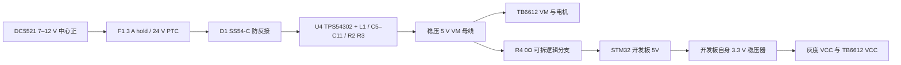

# STM32 巡线载板 A3：PCB 与板载电源

2026-10-16。嘉立创 EDA 专业版工程 `stm32PCB` 已保存三页原理图及双层 PCB。保留固件引脚、上电停止与 PB10 按键策略；没有烧录、通电、操作电机或进行实车测试。

**本目录为设计审阅版，不是已批准直接生产的版本。** 两排 15.00 mm 是用户指定的设计尺寸，尚未用模块实物量测。5 V / 3 A 是全板电源的设计目标，不是已测得的持续输出能力，更不是每路电机可连续使用 3 A。

## 文件与复核

- `stm32PCB-A3-project.zip`：完整文件夹工程，解压后用嘉立创 EDA 打开 `stm32PCB/stm32PCB.eprj3`。
- `PCB-顶层丝印-A3.png`：顶视装配/逐脚丝印；`PCB-双层布线-A3.png`：电源、信号及地平面布线视图。
- `SCH_Schematic1_*.png`：P1 接线说明、P2 模块插座及扩展排针、P3 DC 电源；`schematics-preview.zip` 为原始多页图像导出。
- `stm32PCB-A3.netlist.json`、`stm32PCB-A3.net`：原生与 Protel 网表。
- `schematic-drc.json`、`pcb-drc.json`：保存后的严格检查记录，均为空数组；未通过关闭规则来清零。
- `pcb-state.json`：逐器件焊盘、走线、过孔、地铜区域、丝印、板框及层信息的导出状态。
- `verification.json`、`verify_design.py`：逐脚网表/PCB 对照及 Gerber 板框、钻孔复核；执行 `python3 hardware/stm32PCB-A3/verify_design.py`。
- `stm32PCB-A3-REVIEW-ONLY-Gerber.zip`：审阅用制造数据，包含双层铜、丝印、阻焊、板框和金属化/非金属化钻孔。文件名中的 `REVIEW-ONLY` 不应在完成下述确认前移除。

实时工程：`/Users/zhendong/Documents/LCEDA-Pro/projects/stm32PCB`。本目录快照与 A2 历史快照分开保存。

## 布局与机械尺寸

顶视，车体前方朝上；所有模块从主板顶面插入。

| 接口 | 位置和规格 | 方向 / 用途 |
| --- | --- | --- |
| J10 | 最前方，1×10 排母，2.54 mm 针距 | 从左到右：8、7、6、5、4、3、2、1、GND、VCC；VCC 为 3.3 V |
| J11 / J12 | STM32 前侧，两个 1×10 公排针 | 18 个未用脚、GND 和 3V3，逐针丝印；让开 STM32 两端插头空间 |
| J6 / J7 | 中间横放，两个 1×20 排母 | 排间中心距 15.00 mm；J6-1(VBAT) 对侧为 J7-20(3V3)，两排编号反向 |
| J8 / J9 | 后方，两个 1×8 排母 | 排间中心距 15.00 mm；J8-1(VM) 对侧为 J9-1(PWMA)，两排编号同向 |
| J3 / J4 | 驱动两侧，两个 1×2 公排针 | J3-1/2=AO1/AO2；J4-1/2=BO1/BO2，不能把任意电机端当作 GND |
| J13 | 左边缘向外，DC 电源插座 | 标注 DC5521、7–12 V、中心正；选用 XKB DC-005-5A-2.0 / C381116 |
| SW1 | 右后部 | PB10 启动/停止按键 |

板框 100 × 90 mm，双层；四个 3.2 mm 非金属化安装孔中心为 `(4,4)`、`(96,4)`、`(4,86)`、`(96,86)` mm。坐标以板左后角为原点，前方为正 Y。

模块插座纵向位置：灰度 Y≈82 mm；扩展排针 Y≈69 mm；STM32 两排 Y≈57.5 / 42.5 mm；TB6612 两排 Y≈25 / 10 mm。单排孔距已从 PCB 焊盘坐标检查为 2.54 mm；Gerber 钻孔回读得到 J6/J7 为 1.20 mm，J8/J9/J10/J11/J12 为约 1.10 mm。

**15.00 mm 不等于常见的 15.24 mm。** 若实物测量是 15.24 mm，必须先改 PCB，不能硬插。还需核对实际开发板是否确为两排各 20 针、TB6612 是否为两排各 8 针，以及逐针定义是否相同；“同为 STM32F103C8T6 / TB6612FNG”不证明模块针序相同。排母高度、模块底面元件、USB/下载器插头、DC5521 实际配合和安装孔与车架之间的关系均未实物验证。

## 板载电源

| 器件 | 选型 / 关键连接 |
| --- | --- |
| U4 | TI TPS54302DDCR / C311983，同步降压；1=GND、2=SW、3=受保护输入、4=FB、5=ENA、6=BOOT |
| ENA | 按数据手册允许悬空，使用内部上拉；没有把 7–12 V 直接接到 ENA |
| F1 | SMD2920P300TF/24 / C39831901，3 A 保持电流、24 V；保持/动作电流受温度影响，不是电机每路限流器 |
| D1 | SS54-C / C397626，5 A / 40 V 肖特基，阳极接 DC_FUSED，阴极接 VIN_PROTECTED |
| L1 | Bourns SRP1038A-100M / C780184，10 µH，目录额定电流 7.5 A / 饱和电流 12 A |
| C5 / C6 | 各 22 µF / 25 V / 1206，输入去耦；C7=100 nF 高频去耦 |
| C8 | 100 nF，BOOT 到 SW，不能接成 BOOT 到 GND |
| C9 / C10 | 各 22 µF / 25 V / 1206，输出电容；电容实际容量需考虑 DC 偏压 |
| R2 / R3 / C11 | 100 kΩ / 13.3 kΩ / 75 pF，采用 TI 5 V 参考值；按 0.596 V 典型基准计算约 5.077 V，不是无误差精密 5.000 V |
| R4 | 0 Ω / 1206，从 VM 接 MCU +5V；可拆开隔离 USB 供电 |

原 A2 的 VM 和 +5V 是两路外接输入；**A3 已改为一个板载稳压 5 V 母线及其逻辑分支**，仅通过 R4 相连。J1、J2 现作为 5 V 测试/辅助输出，**禁止向其接入 7–12 V**，也不要从这里并联另一只电源。

**MCU 使用 USB 供电前必须拆下 R4。** 当前没有自动电源择优、USB 防倒灌或对所有模块上电顺序的隔离。首次调试优先使用不向目标板送电的 SWD 接口；其他模块应正常由主板供电，避免灰度输出向未上电 MCU 注入电流。开发板 3.3 V 稳压器同时承担 MCU、八路灰度和驱动逻辑负载，实际容量和温升仍需确认。

功率走线使用约 1.5 mm 的输入/电机 5 V 主干，AO/BO 输出约 1.0 mm；芯片引脚和反馈局部走线按焊盘间距收窄。电源换层处使用并联过孔；两面都有 GND 铜及接地缝合孔。这些几何参数不是载流/温升实测结论。

## 未用脚引出

| 针号 | J11 | J12 |
| --- | --- | --- |
| 1 | PC13 | PB3 |
| 2 | PC14 | PB4 |
| 3 | PC15 | PB6 |
| 4 | PA8 | PB7 |
| 5 | PA9 | PB8 |
| 6 | PA10 | PB9 |
| 7 | PA11 | PB11 |
| 8 | PA12 | NRST |
| 9 | PA15 | VBAT |
| 10 | GND | 3V3 |

VBAT、NRST 不是普通 GPIO。PC13/PC14/PC15、PA11/PA12、PA15/PB3/PB4 还受 MCU 备份域、晶振、USB、调试复用或开发板自带器件影响；“引出”不代表固件已经配置这些外设。PA13/PA14 的 SWD 沿用开发板原接口，不在载板虚构不存在的模块接点。

## 检查结果与修改注意

- 原理图严格 DRC：0 项；PCB 严格 DRC：0 项，包括连接性与间距检查。
- 32 个 PCB/BOM 器件，143 个引脚分配、48 个有效网络；原理图与 PCB 逐针一致。
- 18 个原先 NC 的 MCU 引脚已连接扩展排针，并有逐针丝印。
- 463 段真实走线、62 个过孔、6 块 GND 实心铜区域；不是只画飞线或用图形线代替真实走线。
- 制造文件 ZIP 的 CRC、双层铜/阻焊/板框/钻孔文件、100 × 90 mm 板框、四个安装孔及模块排母逐孔位置/孔径已复核。
- 原理图三页、顶层丝印与双层布线导出图已目视检查。完整模块未提供 3D 模型；STEP 导出接口超时，没有把它算作 3D 装配验证通过。
- 本版地平面以**实心填充区域**保存，不是已重建的自动覆铜对象。后续改变焊盘、走线或过孔位置时，须重新生成/编辑地铜避让并重新严格 DRC，不能假定 EDA 会自动更新这 6 块区域。
- 未改变固件，因此本次未重新运行主机控制逻辑测试或 PlatformIO 构建；此前固件验证不替代本次硬件验证。

## 投产 / 上车前的门槛

1. 用实物确认所有模块针数、针序、2.54 mm 针距、**15.00 mm 排间中心距**、公母配合及排母高度；先用 1:1 纸样或样板试装。
2. 确认 DC5521 插头与所选 2.0 mm 中心针插座的实际配合、中心正极性、插头/电源/线缆载流能力；用带限流的电源先空载检查 5 V、3.3 V，未插模块前确认无短路。
3. 分别在 7 V 和 12 V 输入下做分级负载测试，观察稳压误差、纹波、启动、负载突变、PTC、D1、U4、电感、插座、过孔和铜箔温升；3 A 设计目标不能代替这些实测。
4. 测两个电机各自额定与堵转电流。TB6612FNG 数据手册列有 1.2 A 平均 / 3.2 A 峰值输出指标及其条件；不能把 3.2 A 当成持续能力，也不能因为电源按 3 A 设计就认定现有模块可承受两台电机堵转。
5. 检查电机启动、减速和断使能时的 VM 过冲及再生能量。当前没有专用再生制动吸收器或已实测的钳位方案；若过冲/跌落不合格，须调整电源隔离、吸收及去耦，再重新检查 PCB，不能直接上车。
6. 确认开发板 3.3 V 稳压器能带动灰度和驱动逻辑；再按项目 README 做架空轮向、停止行为、低速实线及虚线/丢线验证。

`hardware_tested=false`，`module_mechanical_fit_verified=false`，`fabrication_release_approved=false`。

## 选型依据

- [TI TPS54302 数据手册](https://www.ti.com/lit/ds/symlink/tps54302.pdf)：输入范围、引脚、0.1 µF 自举、5 V 参考网络、布局与输出电容要求。
- [XKB DC-005-5A-2.0 资料](https://www.lcsc.com/product-detail/C381116.html)：连接器额定参数；[机械图](https://datasheet.lcsc.com/datasheet/pdf/781816078c0f2c3415b95730e83b719f.pdf)定义 1 为中心触点、2 为外壳、3 为切换触点。本设计 3 脚不接。
- [Toshiba TB6612FNG 数据手册](https://toshiba.semicon-storage.com/info/datasheet_en_20141001.pdf?did=10660)：电流指标、真值表与使用条件。具体模块的散热和接线仍以实物为准。
