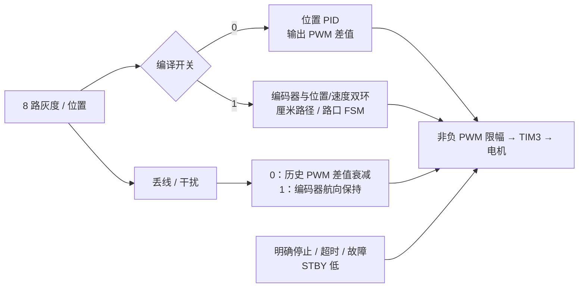
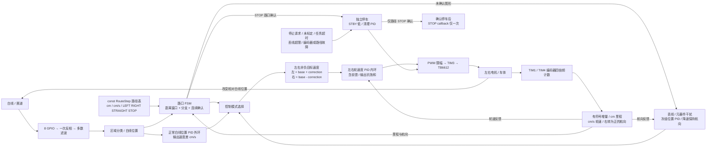
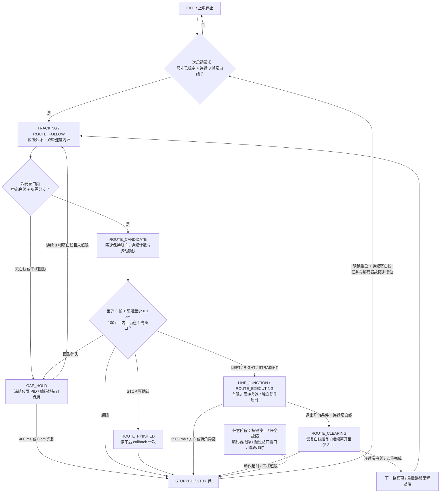

# STM32 八路数字灰度巡线小车

## 当前进度与验证边界

> **2026-10-19 控制模式开关：** `include/motion_config.h` 的 `ENCODER_CONTROL_ENABLED` 默认 **0**：白线位置 PID 直接输出左右 PWM，不初始化/读取编码器，不依赖轮径标定。改为 **1** 后启用编码器、位置/速度双环、厘米路径与路口 STOP；该模式的尺寸参数仍未知，未标定禁止启动。关闭时路径距离和对应 STOP 回调停用，干扰仅做限时历史 PWM 差值保持。两模式均须明确启动，未烧录或验证硬件。详见下方开关说明与 [控制说明](docs/navigation.md)。

> **2026-10-17 下单后终审：** 用户确认订单为 **A10 + SMT**，1×20 排母换料已接受。本次重新核查制造包、原生 PCB 的 32 个器件 / 143 个引脚及 48 个网络，未发现确定性电气接错、断路或异网短路。降压标称约 5.08 V；3.3 V 来自核心板。USB 供电前须拆 R4，电机启动电流、3.3 V 负载余量与降压动态/温升尚未验证。详见 [A10 电气终审](docs/A10-final-electrical-review.md)。

> **2026-10-17 当前硬件修订为 A10：** 按用户截图放宽 C1/C2 去耦区的铜间距。C2 向左下各移 0.20 mm 并同步 VM 支路，清理 5 段旧地线、重新生成局部加大避让的地铜；C2 GND 焊盘到 AIN1 由约 0.154 mm 增至 **0.355 mm**，C1 VM 焊盘到最近地铜由约 0.156 mm 增至 **0.300 mm**，两颗电容的全部焊盘到异网铜均超过 0.25 mm。保存关闭重开 A10 后严格 PCB DRC 为 0，独立铜几何确认 48 个网络连通且无异网短路。模块排距仍为 **15.24 mm**；保留 A9 修正后的 TB6612 上排 J9 控制信号、下排 J8 电源/输出方向。完整工程、配套 Gerber、BOM、坐标及验证记录见 [A10 说明](hardware/stm32PCB-A10/README.md)。U4 原理图既有属性匹配警告仍保留；用户后续已确认 A10 下单并包含 SMT，尚未实物试插或通电验证。下文旧修订为历史记录。

> **2026-10-17 历史硬件修订 A7：** 已在嘉立创 EDA 中将 U4 / TPS54302DDCR 的实际焊盘修正为 TI 推荐的 0.60 × 1.10 mm、两排中心距 2.70 mm；SW1 按用户确认换为基础库 C318884、1.5 mm 高按键，同步改焊盘与连线。核心板 40 个引脚丝印逐一对照实物照片正确，顶视 USB 朝左、SWD 朝右。严格 PCB DRC 为 0，独立铜几何确认 48 个网络连通且无异网短路；原理图仍有一条 U4 的 `ATTRMATCHCODE` 属性匹配警告，未宣称全部通过。完整工程、成套制造文件、基础库替换及验证边界见 [A7 说明](hardware/stm32PCB-A7/README.md)。尚未重新下单或实物验证；下文 A6 / A5 保留为历史记录。

> **2026-10-17 已在嘉立创 EDA 修复 C5 / C6 / L1 贴装碰撞，另存 A6。** L1 向左移动约 4.01 mm，重接相关 SW / VM 铜路并更新地铜避让；与 C5、C6 的名义本体间隙均约 2.55 mm，按厂家最大本体尺寸计算仍约 2.30 mm。A6 严格 PCB DRC 为 0 项，独立铜几何确认 48 个网络连通、无异网短路；保存后重新打开检查通过。工程、审阅 Gerber、BOM、贴片坐标与验证记录见 [A6 说明](hardware/stm32PCB-A6/README.md)。旧版保留，旧订单送厂版本仍未确定，尚未重新下单；工厂贴装工艺及实物验证待完成。下文 A5 为历史记录，不能将其电气 DRC 结果当作装配合格证明。原始问题见 [碰撞核查](docs/C5-C6-L1-assembly-collision.md)。

2026-10-14 用户明确授权进入固件编码阶段，确认 MCU 为 **STM32F103C8T6**、驱动器为 **TB6612FNG**、八路灰度模块为 **GPIO 数字输出**，并授权决定接线。首版 C / STM32Cube HAL 固件已实现，可交叉构建；尚未烧录、接线验证、架空测试或实车调参。

目标是在深蓝底、白线（含虚线）赛道上按预设路径巡线。8 路分别占用 8 个 GPIO。编码器模式下，白线位置外环输出左右目标速度差（cm/s），两轮各自的速度 PID 通过霍尔编码器反馈输出 PWM；默认 PWM 模式由白线位置 PID 直接输出左右 PWM。路径距离使用厘米，编码器提供相对里程和航向估计；打滑会产生累计误差，不能视为绝对定位。倒车与原地旋转仍不在本次实现范围内。

| 项目 | 当前状态 |
| --- | --- |
| GPIO、滤波、位置计算、PID、差速、状态机 | 已实现源码，主机逻辑验证通过 |
| HAL 时钟、GPIO、TIM3 PWM、IWDG、调度 | 已实现源码，交叉构建通过；板上行为待验证 |
| MCU / 电机驱动 / 灰度接口类型 | 用户确认，尚未核对实际板与模块 |
| 引脚选择 | 已落实到固件；实际接线待确认 |
| 双轮霍尔编码器 | 开关为 1 时启用 TIM1/TIM4；默认不初始化或读取 |
| 控制模式 | 默认 0：PWM 开环调速；1：双环/厘米路径，未标定拒绝启动 |
| 模块供电与输出电平、输入上下拉 | 用户确认灰度为 3.3 V 供电；输出电平、输出类型及上下拉仍待实物确认 |
| 深蓝底识别、轮向、停车、电量变化、赛道效果 | 未验证 |
| PID / PWM / 丢线与路口时限 | 未标定初值 |

## 工程配置与参考来源

| 项目 | 当前配置 |
| --- | --- |
| PlatformIO 环境 / board | `genericSTM32F103C8` |
| 平台 / 框架 / 语言 | `ststm32` / `stm32cube` / C |
| 系统时钟 | 内部 HSI 8 MHz / 2 × PLL16 = 名义 64 MHz |
| APB1 / APB2 | 32 MHz / 64 MHz，TIM3 时钟名义 64 MHz |
| TIM3 PWM | PSC=0、ARR=6399，名义 10 kHz，两路 PWM1 |
| TIM1 / TIM4 编码器 | 仅开关为 1：PSC=0、ARR=65535、TI12 四倍频，输入滤波 6 |
| 控制周期 | 5 ms，PID 使用实际控制间隔 `dt` |

晶振未知，因此不依赖外部 HSE。[ST 数据手册](https://www.st.com/resource/en/datasheet/stm32f103c8.pdf)给出 HSI 作为 PLL 输入时最高系统时钟为 64 MHz；RC 时钟存在误差，实际 PWM/周期仍待测量。开发板环境沿用 [PlatformIO 的 genericSTM32F103C8 定义](https://docs.platformio.org/en/latest/boards/ststm32/genericSTM32F103C8.html)，没有改成 `bluepill_f103c8`。

电机底层只读参考 `/Users/zhendong/Documents/RemoteCar_wifi/remote_car` 的 `src/main.c`、`include/main.h`、`platformio.ini`、HAL 配置与中断文件。借鉴双轮接口、单轮方向输出、指令限幅及 PWM 映射；新工程重新处理初始化返回值、零输出、轮向配置和异常停车，没有引入 Wi-Fi、串口遥控协议或 300 ms 遥控超时。

## 控制模式开关

在 `include/motion_config.h` 修改一个宏后重新编译：

```c
#define ENCODER_CONTROL_ENABLED 0  // 0：普通 PWM；1：编码器 + 双环 + 厘米路径
```

| 行为 | 0（当前默认） | 1 |
| --- | --- | --- |
| 电机调速 | 白线位置 PID → 左右 PWM，调节平均电压 | 位置 PID → 目标 cm/s → 双轮速度 PID → PWM |
| 编码器 | 不初始化/读取 TIM1/TIM4，不依赖编码器接线 | 初始化并读取，检查计数/反馈故障 |
| 标定门禁 | 不要求轮径/计数/轮距 | 须填写尺寸、方向并确认标定 |
| 路径与 STOP | `ROUTE_DISABLED`，距离导航及表中 STOP callback 停用 | 保留原距离窗口、路口 FSM 和一次性 STOP callback |
| 干扰/丢线 | 降低 PWM，冻结位置 PID，保留并衰减历史 PWM 差值 | 降速并使用编码器反馈保持估计航向 |
| 停止条件 | PB10/调试停止、丢线 400 ms、任务异常 | 另含里程上限、路径异常及编码器反馈故障 |

普通模式的 `OPEN_LOOP_BASE_PWM=55`、弯道基础值 40、干扰上限 35、位置 PID 初值 8/0/0.08 均集中在同一个配置文件，指令使用 255 标尺且受 PWM 上限 100 约束。它们不是 cm/s，`RouteStep.speed` 不会被挪作 PWM 使用。电机开环调速通过 PWM 占空比改变驱动平均电压，实际速度受负载、电量等影响；没有编码器就不能测量并纠正航向或按厘米定位。



`pio run -e genericSTM32F103C8` 使用代码中的开关；当前默认构建为 PWM 模式。另提供 `pio run -e encoder_closed_loop` 验证环境，使用同一 MCU 配置并以编译参数强制开关为 1，输出到独立目录。不要用这个强制环境判断宏为 0 的默认行为。`g_diagnostics.encoder_control_enabled` 显示实际构建模式；PWM 模式的里程/轮速字段为 0，不代表已测得零速。

## 接线方案

以下分配已由用户授权选择，固件定义见 `include/board_config.h`。它是本项目的接线方案，**不代表线路已连接或验证**。S0→S7 从车体前进方向看由左到右。

| 功能 | STM32 引脚 | 模块 / 说明 |
| --- | --- | --- |
| S0 | PA0 | 最左灰度数字输出 |
| S1 | PA1 | 灰度数字输出 |
| S2 | PA2 | 灰度数字输出 |
| S3 | PA3 | 中心左侧灰度输出 |
| S4 | PA4 | 中心右侧灰度输出 |
| S5 | PA5 | 灰度数字输出 |
| S6 | PB0 | 灰度数字输出 |
| S7 | PB1 | 最右灰度数字输出 |
| 左轮 PWM | PA6 / TIM3_CH1 | TB6612FNG PWMA |
| 右轮 PWM | PA7 / TIM3_CH2 | TB6612FNG PWMB |
| 左轮方向 | PB12、PB13 | AIN1、AIN2；AO1/AO2 接左电机 |
| 右轮方向 | PB14、PB15 | BIN1、BIN2；BO1/BO2 接右电机 |
| 电机使能 | PB5 | STBY，由 MCU 控制，不固定接高 |
| 启动 / 停止按键 | PB10 | 常开按键另一端接 GND，内部上拉 |
| 左轮编码器 A / B | PA8、PA9 | 开关为 1 时使用 TIM1_CH1 / TIM1_CH2 |
| 右轮编码器 A / B | PB6、PB7 | 开关为 1 时使用 TIM4_CH1 / TIM4_CH2 |
| SWD | PA13、PA14 | 保留 SWDIO / SWCLK，另接调试器 GND |
| 原调试串口预留变更 | PA9 已分配给编码器，PA10 仍未使用 | 不再将 PA9/PA10 作为可用的完整 USART1 默认接线对 |

供电规划：TB6612FNG 的逻辑 VCC 接 3.3 V，电机电源不从 MCU GPIO 供电。2026-10-16 用户确认电机为 5 V、DC5521 输入 7–12 V，A5 载板沿用板载同步降压产生 5 V 的 VM 母线，经 R4 给 MCU 的 +5V 分支供电，全板输出电流设计目标为 3 A，尚未负载/温升实测；禁止把 7–12 V 接到 J1/J2。开发板、驱动和灰度模块必须共地。灰度模块确认 3.3 V 供电，模块具体型号、数字输出类型及实际输出电平仍待实物核对，不能由“GPIO 输出”推断未知模块可输出 5 V，也不能未经确认将 5 V 输出直接接入本表引脚。使用 MCU 开发板 USB 供电前须拆下 R4，当前没有自动电源切换或 USB 防倒灌电路。

灰度输入当前配置为上拉，倾向于断开时读背景；须结合模块开漏/推挽输出验证，不能据此宣称断线检测已完成。记录实际传感器安装高度、间距与白线宽度；不等间距安装时调整 `gray_sensor.c` 的集中权重。A2 原理图已加入 STBY 的 10 kΩ 外部下拉；接线前仍需核对模块是否把 STBY 硬接高，MCU 复位时的真实断驱动效果待架空验证。

### 未使用引脚与编码器接线（2026-10-19）

选择编码器之前，应用固件没有分配的常规候选是 **PA8、PA9、PA10、PA11、PA12、PB6、PB7、PB8、PB9、PB11**。PA9/PA10 原先仅是文档中的 UART 预留，未初始化串口。分配编码器后剩余 **PA10、PA11、PA12、PB8、PB9、PB11**；其中 PA11/PA12 如后续启用 USB 则不再可用，且须核对核心板现有 USB 接线。

其他引脚有附带条件：PA15/PB3/PB4 复位后用于 JTAG，需要配置 SWJ 才能作为普通 GPIO，当前不改；PA13/PA14 保留 SWD。PB2 涉及 BOOT1，当前载板 J6.15 为 PB10 按键，并未引出 PB2。PC13/PC14/PC15 涉及核心板 LED / 低速晶振的可能连接，须核对实物；PD0/PD1 留给外部高速晶振，不因固件使用 HSI 就视作可用排针。

选择 PA8/PA9 和 PB6/PB7 是因为两组均对应同一定时器的 CH1/CH2 默认映射，开关为 1 时分别用于正交编码器计数，无需修改现有 TIM3 PWM 或关闭 JTAG/SWD。[ST 数据手册表 5](https://www.st.com/resource/en/datasheet/stm32f103c8.pdf)列出这些引脚及其 FT 属性；TIM1 的互补输出也与 PB13/PB14 等复用，当前编码器初始化不配置这些电机方向引脚或互补输出。

按用户提供图片中的 **霍尔编码器款**，每个电机六线定义如下。图中的编号是连接器针序，不能按未知线色推断，也不能混用右侧 GMR 的线序。

| 霍尔款针号 | 功能 | 左轮连接 | 右轮连接 |
| --- | --- | --- | --- |
| 1 | 电机线 − | TB6612 左轮输出对的一端 | TB6612 右轮输出对的一端 |
| 2 | 编码器电源 | PCB 已预留的编码器电源，先核对额定电压 | 同左 |
| 3 | 编码器 A 相 | PA8；A10 扩展口 J11.4 | PB6；A10 扩展口 J12.3 |
| 4 | 编码器 B 相 | PA9；A10 扩展口 J11.5 | PB7；A10 扩展口 J12.4 |
| 5 | 编码器地 | PCB GND，与 MCU / TB6612 共地 | 同左 |
| 6 | 电机线 + | 同一左轮输出对的另一端 | 同一右轮输出对的另一端 |

TB6612 电机输出为 H 桥两端，不是固定电源正负；电机线极性和车体前进方向需架空确认。A10 接口编号来自本仓库 `PCB design/stm32PCB-A10/stm32PCB-A10.netlist.json`：J11.4/5 与 J7.5/6 同网，J12.3/4 与 J7.14/15 同网；接线按实物丝印找针，不按照片观看方向数针。这是已存设计文件核对，未证明实物连通。

开关为 1 时，初始化入口为 `encoder_init()`，在传感器 GPIO 初始化之后、PWM 初始化之前执行。内部先以 `GPIO_MODE_INPUT` + `GPIO_NOPULL` 配置四个输入，再启动 TIM1 / TIM4 的 TI12 四倍频计数。主循环每 5 ms 顺序读取两个 16 位计数器，计算有符号回绕增量；不用 EXTI 或逐脉冲中断。计数方式依据 [ST HAL 编码器接口](https://github.com/STMicroelectronics/stm32f1xx-hal-driver/blob/master/Src/stm32f1xx_hal_tim.c)与 [RM0008](https://www.st.com/resource/en/reference_manual/cd00171190.pdf)。在编码器模式下，即使标定尚未填写，仍可在停车状态通过 `g_diagnostics.left_encoder/right_encoder` 观察手动转轮计数。

**供电电压与信号高电平分别确认。** 默认关闭内部上下拉，是为了兼容后续核实后的 FT 输入使用条件；[ST 数据手册 §5.3.1 / §5.3.13](https://www.st.com/resource/en/datasheet/stm32f103c8.pdf)要求输入超过 VDD+0.3 V 时禁用内部上下拉。若为开漏且没有已有上拉，输入会浮空，应根据模块规格增加外部上拉，优先采用兼容的 3.3 V 信号方案。若模块自带上拉，先确认其接到哪条电源。不能仅凭“霍尔编码器”认定 A/B 为 3.3 V 或 5 V，也不能仅凭 FT 属性认定电源时序、噪声与整个模块接口已经验证。PCB 电源已预留，本次不改动电源或制造文件。

2026-10-16，嘉立创 EDA `stm32PCB` 已推进到 **A5**：根据 PCB 评审将主要电源承流段加宽至 3.1 mm，修复 VIN 入口单孔未接到底层的问题，两组各 3 个约 0.4 mm 孔径过孔双面并联接入；MCU 5V 分支采用 0.95–1.0 mm 铜路与两个并联过孔，3.3V 分支统一为 0.5 mm。AO1/AO2/BO1/BO2 四路电机输出均改为底层 1.5 mm，无换层过孔；受影响的控制线重布并重新生成双面地铜。板框仍为 100 × 90 mm，STM32 与 TB6612 排距 16.00 mm，单排针距 2.54 mm；保留 A4 按实物照片修正的 STM32 针序，USB 朝左、SWD 朝右。原理图与 PCB 严格 DRC 均为 0 项，32 个器件、143 个引脚分配及 48 个网络已逐脚核对，并独立检查铜几何连通/异网短路及并联过孔双面接入。**仍未进行新 PCB 的实物试插、完整模块 3D 碰撞、电源负载/温升或实车验证。** 完整可编辑 A5 工程、审阅 Gerber、预览及检查入口见 [A5 硬件说明](hardware/stm32PCB-A5/README.md)；[A4](hardware/stm32PCB-A4/README.md)、[A3](hardware/stm32PCB-A3/README.md) 与 [A2](hardware/stm32PCB-A2/README.md) 保留为历史快照。本次 A5 在独立副本中完成，原 A4 实时工程未被替换；旧版 Gerber 不包含本次电源/电机布线修正。

## 采样与位置语义

原始 `raw[i]` 白色为 0、黑色为 1；深蓝底预期为 1，必须用真实材料逐路确认。传感器层执行且仅执行一次 `line[i] = 1 - raw[i]`，之后统一以 1 表示白线。每 5 ms 读取 GPIOA、GPIOB 各一次寄存器快照，八路输入均为独立 GPIO；跨端口并非完全同时采样。

使用 3 帧逐路多数滤波，恢复巡线另需连续 3 次有效分类，存在滤波与确认延迟。等间距初始权重如下：

| 通道 | S0 | S1 | S2 | S3 | S4 | S5 | S6 | S7 |
| --- | --- | --- | --- | --- | --- | --- | --- | --- |
| 权重 | -7 | -5 | -3 | -1 | +1 | +3 | +5 | +7 |

只对选定的有效连续区域使用有符号 `float` 计算：

```text
position = Σ(w[i] × line[i]) / 选定区域白线路数
error = position - 0
# 编码器模式（开关 1）：
left_target_cm_s = base_cm_s + correction_cm_s
right_target_cm_s = base_cm_s - correction_cm_s
# PWM 模式（开关 0）：
left_pwm = base_pwm + correction_pwm
right_pwm = base_pwm - correction_pwm
```

正误差表示白线在右侧；正修正在编码器模式使左轮目标速度较大、右轮较小，在 PWM 模式使左轮 PWM 较大、右轮较小，期望向右转。两轮“正指令均向前”仍需架空确认，可通过 `board_config.h` 的左右轮方向配置修正。

以下字符串按 S0→S7 排列；代码掩码使用 **bit0=S0、bit7=S7**，因此调试器二进制显示从高位到低位时顺序与表中字符串相反。

| `raw` | `line` | 预期处理 |
| --- | --- | --- |
| `11100111` | `00011000` | 中间两路，位置 0；line 掩码 `0x18` |
| `01111111` | `10000000` | 最左白线，位置 -7；line 掩码 `0x01` |
| `11111110` | `00000001` | 最右白线，位置 +7；line 掩码 `0x80` |
| `11111111` | `00000000` | `GRAY_NONE`，不计算除法、不输入正常 PID |
| `00000000` | `11111111` | 全白，`GRAY_AMBIGUOUS`，不能当成居中 |
| `00111100` | `11000011` | 多区域；无可靠连续性时为歧义 |

单个连续区域宽度不超过 4 路时可作为目标；任一区域宽度超过 4 路则为歧义。多个窄区域时，只有最近可靠位置存在、最近区域距离不超过 3 个权重单位，且它比次近区域至少近 1 个单位，才选择该区域。但本次导航层采用更保守的规则：多区域即使在传感器层选出了一个区域，也不进入普通位置 PID；与宽线、无白线一起先交给路径/路口判断，否则按丢线保持航向。这些阈值属于未标定初值。

## 编码器模式总体架构（Mermaid）

以下图示及厘米路径/路口章节仅适用于 `ENCODER_CONTROL_ENABLED=1`；默认 PWM 模式见上方开关说明。



控制周期目标 5 ms，所有 PID 使用实际 `dt`。外环反馈来自白线位置，内环反馈来自左右轮速；干扰保持使用编码器推算的航向。IWDG 仍作为任务卡死后的复位退路，真实停车效果待板上验证。

## 双环、里程与路径表

位置外环初值 `Kp=1.8, Ki=0, Kd=0.025`，输出单位 cm/s；左右轮内环各使用 `Kp=2, Ki=8, Kd=0`，输出为 0…100 的 PWM 指令（255 标尺），加 `3 × 目标速度` 前馈。所有参数均待标定。速度目标上限 25 cm/s、基础速度上升斜率 40 cm/s²，降速与停止立即执行。内环抗饱和按前馈与 PID 相加后的 0…100 实际边界处理；目标速度为零时清空相应 PID 并输出零。

`src/route_table.c` 中只有一条行驶示例与一条停止项，编译进 Flash，不在运行中写 Flash：

```c
typedef enum { LEFT, RIGHT, STRAIGHT, STOP } Action;
typedef struct {
    float distance;   // 到路口的预计路段长度，cm
    float tolerance;  // 允许 ±cm
    Action action;
    int speed;        // 本路段目标速度，cm/s
} RouteStep;

const RouteStep route[] = {
    {30.0f, 5.0f, LEFT, 12},
    {20.0f, 4.0f, STOP, 8},
};
```

第一段从明确启动的位置起算；之后每段从上一动作完成并离开路口消抖区的位置起算，不是全程累计里程。LEFT / RIGHT / STRAIGHT / STOP 均须在自己的距离窗口内确认路口；经过预计距离但没有路口不会触发 STOP callback，而会在越过窗口或路段超时时以路径异常停车。

`main.c` 提供 `route_stop_callback(size_t step_index, void *context)`，默认仅记录 `g_diagnostics.route_stop_events` 与 `route_stopped_step`。主循环先下发停车、再消费一次性回调；回调中不得延时、阻塞输出或重新使能电机。普通按键停车、丢线和故障停车不调用这条路径成功回调。

尺寸配置集中在 `include/motion_config.h`。用户确认参数暂未知，左右轮直径、每输出轮一圈四倍频计数及轮距均保留 0，`ODOMETRY_CALIBRATION_CONFIRMED=0`。编码器模式下未确认前可看原始计数，但启动请求被拒绝并报告 `LINE_STOP_CALIBRATION`。换算公式、标定步骤和各阈值见 [双环与路径说明](docs/navigation.md)。

全车停车沿用 STBY=0、PWM=0、方向引脚=0 的待机路径；不能把软件停车当成已验证机械刹停。左右增益与死区补偿仍是开环静态校正，轮速闭环来自新的编码器反馈。

## 路口、干扰与运行状态（Mermaid）



宽线、全白和多个分离区域只有通过路径窗口、目标分支、连续帧与运动距离联合确认后才是路口候选；其余按丢线/干扰处理。进入干扰时保存当前编码器航向，降低速度至不超过 6 cm/s，通过左右轮目标速度差纠正航向偏移；冻结位置 PID，不按图形位置拐弯，也不进入旧的 SEARCH 寻线。恢复需连续 3 帧单一窄白线，并重建 PID 历史。异常时限从最后稳定白线起算，先检查截止时限再接受恢复，孤立有效帧和异常种类切换不能续时。

左右转使用非负差速，目标转向修正 ±4 cm/s；编码器转角达到至少 1.0 rad 且中心窄白线连续 3 帧后进入离口阶段，超过 2.1 rad、反向超过 0.35 rad 或动作累计 2500 ms 则停车。直行需越过至少 3 cm 再确认中心线。离口再前进至少 3 cm 且连续窄白线后才推进表项，防止同一路口重复消费。

八路一维传感器不能识别元器件的语义。若图形恰好在窗口内产生相同分支和连续观测，仍可能误判；若是持续的单一窄图形，也可能看起来像白线。编码器航向会受轮胎打滑影响。所有尺寸、速度、确认距离与超时均需真实赛道标定。

## 调度、故障与操作入口

`SysTick_Handler()` 只增加 HAL 毫秒时基。主循环按目标 5 ms 单次采样和控制，不阻塞延时、不输出串口日志、不补算多个旧观测；PID 使用本次实际间隔。间隔超过 15 ms、控制计算耗时达到 5 ms、无效位置/时间或初始化错误，进入故障停车。任务故障及编码器反馈故障在本次运行中锁定，按键不能清除，需复位后检查原因。

初始化先把 STBY 拉低，再初始化时钟与 PWM。HAL 初始化、编码器/PWM 配置与启动、看门狗初始化/刷新均检查返回值；停车路径不依赖已成功初始化的定时器句柄。HardFault 等异常进入相同停车路径。

IWDG 分频 64、reload=399，以名义 LSI 40 kHz 估算约 640 ms；LSI 误差和实际复位时限未测量。仅完成控制周期后喂狗，任务卡死或 SysTick 停滞后由独立看门狗复位，复位仍为 `IDLE`。它是软件时序检测之外的退路，不保证 15 ms 内处理卡死。调试器暂停时若看门狗未冻结，会复位；若调试器冻结 IWDG，则这条保护失效，须先停止电机再断点调试。

操作入口：

- PB10 常开按键接 GND，按下消抖 20 ms。待机/普通停止时请求启动，运行时请求停止；上电时已经按住不视为启动，必须松开再按。
- 调试器可读 `g_diagnostics` 查看灰度掩码、位置、左右 PWM、编码器原始计数、厘米里程、航向、轮速/目标轮速、路径项/状态、STOP 事件、停止原因和任务耗时。
- 调试器可写 `g_control_request=1` 请求一次启动，写 `2` 停止。请求用后清零；该变量不是串口协议，也没有命令保活要求。诊断结构为主循环逐字段写入，先停止电机并暂停后检查，不要把运行时跨字段读取当成原子快照。

## 文件与验证入口

| 文件 | 职责 |
| --- | --- |
| `include/board_config.h` | 引脚、轮向、输入上下拉、时钟与 PWM |
| `include/control_config.h` | 周期、PWM、滤波与连续性初值 |
| `include/motion_config.h` | 模式开关、PWM 模式参数、尺寸标定、双环与导航参数 |
| `src/gray_sensor.c` | 一次反相、逐路滤波、区域分类及位置 |
| `src/pid.c` | PID、条件积分抗饱和、微分滤波及复位 |
| `src/motor_command.c` | 可在主机测试的差速限幅与 PWM 映射 |
| `src/motor.c` | HAL TIM3、双轮方向和独立 STBY 停车 |
| `src/encoder.c`、`src/odometry.c` | TIM1/TIM4 四倍频计数、回绕增量、cm 里程与轮速/航向 |
| `src/speed_control.c` | 左右轮速度 PID、前馈、单侧抗饱和、反馈异常停车 |
| `src/route.c`、`src/route_table.c` | 路口 FSM、预设路径表与 STOP 一次性回调事件 |
| `src/line_follow.c` | 位置外环、路径/航向模式选择、运行状态与独立停车 |
| `src/main.c`、`src/stm32f1xx_it.c` | 初始化、调度、按钮、诊断、看门狗与异常入口 |
| `include/stm32f1xx_hal_conf.h` | HAL 模块配置；DMA 是 TIM HAL 类型依赖，不用于灰度采样 |
| `test/test_logic.c`、`test/test_navigation.c`、`test/test_open_loop.c` | 传感器/PID/PWM、双环导航及关闭编码器后的 PWM 控制 |
| `test/test_motor_hal.c`、`test/test_encoder_hal.c`、`test/run_host_tests.sh` | 外设 HAL 模拟及主机验证入口，ASan / UBSan |

```sh
# 在工程目录执行，均无需接板
sh test/run_host_tests.sh
pio run -e genericSTM32F103C8
# 独立验证开启模式（强制宏为 1）
pio run -e encoder_closed_loop
```

输出产物为 `.pio/build/genericSTM32F103C8/firmware.elf` 与 `firmware.bin`。主机测试不执行真实外设中断或电机；HAL 电机输出测试采用模拟接口，不代表电气行为已验证。交叉构建不等于板上运行通过。当前构建使用已有 ststm32 19.7.1 / STM32CubeF1 1.8.6 / GCC Arm 7.2.1，无新增第三方应用依赖。

### VS Code 头文件解析

用 VS Code 打开本工程根目录，并启用 PlatformIO IDE 与 Microsoft C/C++ 扩展。工程内 `.vscode/settings.json` 启用 C/C++ IntelliSense，覆盖用户全局的禁用设置，并关闭本工程的 clangd。解析使用 PlatformIO 生成的 ARM 编译器、CMSIS/HAL 头文件路径和芯片宏，编译数据库指向工程根目录的 `compile_commands.json`。

首次打开、清理生成文件或修改构建配置后，在工程目录执行：

```sh
pio project init --ide vscode -e genericSTM32F103C8
pio run -e genericSTM32F103C8 -t compiledb
```

第一条命令刷新 PlatformIO 自动生成的 `.vscode/c_cpp_properties.json`，第二条生成实际编译数据库；这两个生成文件不提交到 Git。若切换语言服务后诊断未刷新，执行 VS Code 的 `Developer: Reload Window`。不要手动修改自动生成的头文件路径，也不要通过关闭 IntelliSense 消除报错。

## 后续实施顺序

1. **硬件确认与接线**：核对实际模块电平、供电、引脚和 SWD；真实白线/深蓝底逐路记录，确定上下拉与阈值。
2. **底层板上验证**：先确认上电 STBY 低、PWM 频率、按键入口；架空确认轮向、两轮独立指令、单轮零 PWM、整车待机和复位停车。未完成前不落地运行。
3. **编码器标定与速度环**：停车时手动转轮核对计数方向，测量轮径/输出轮计数/轮距；填入标定参数。架空及低速验证左右速度反馈、闭环和故障停车，再调位置外环。
4. **实线低速调参**：先调速度内环，再调位置外环 P / PD，视需要加 I；直线 → 缓弯 → 急弯，记录参数、电量与现象。
5. **路径与干扰**：测量真实路段与路口形状，替换示例表；验证 LEFT / RIGHT / STRAIGHT / STOP、离口去重、干扰航向保持、虚线恢复和超限停车。
6. **整理交付**：更新最终接线、标定参数与板上记录，分别报告逻辑、构建和实车结果。

当前首版软件工作已完成；下一项是硬件确认及架空验证。详细结果与未执行项目见 `docs/validation.md`。
