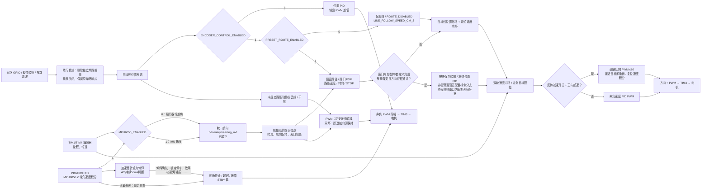
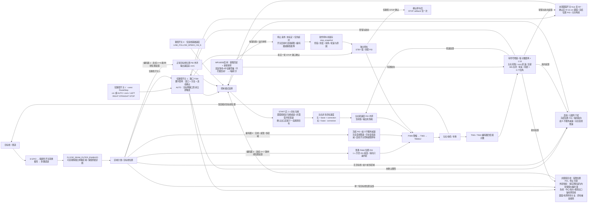
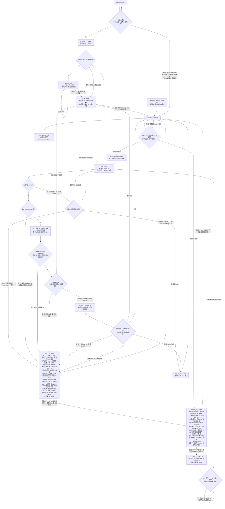
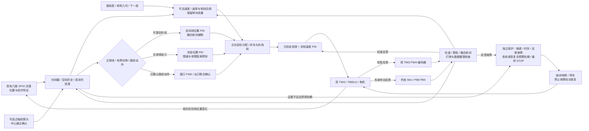

# STM32 八路数字灰度巡线小车

STM32F103C8T6 + TB6612FNG + 八路 GPIO 数字灰度，C / STM32Cube HAL 实现。支持普通 PWM 巡线、编码器双环仅巡线、编码器双环预设路径三种模式，并可选用 MPU6050 I²C 陀螺仪航向；位置误差为正时左轮加速、右轮减速，右转为正航向。路径使用 cm / cm/s，编码器定位为相对估计，不能消除打滑。

**2026-10-27 文档整理：** 本次按现有源码与 A10 设计资料更新当前配置，合并每日优化记录，并新增[下一步优化方案](#next-optimization)。方案以保留现有 PCB 为约束，尚未实现新增算法或传感器；没有修改固件参数、烧录或操作电机。现有参数中的速度是目标值，不是实测性能。

**2026-10-28 新 PCB 设计：** [A14](PCB%20design/stm32PCB-A14/README.md) 基于 A13，将 J10 灰度接口改为朝车头的 1×10 弯排针；A14 的 TB6612 VM 为电池直供、核心板保留 5 V 降压。以下 A10 说明保留为原有实物/固件基线，不能混同两版供电；A14 尚无上电、机械装配或实车验证。

**换料评审：** [A15](PCB%20design/stm32PCB-A15/README.md) 在 A14 基础上将 R3 改为基础库 13 kΩ、D1 改为基础库 SMA 肖特基；5 V 标称约 5.18 V，容差和实测边界见该版说明。

## 当前配置与验证边界

电机方向（2026-10-29）：按用户最新更正，电机极性设为左 `−1`、右 `+1`，对应 `include/board_config.h` 中 `MOTOR_LEFT_FORWARD_IN1_HIGH=0`、`MOTOR_RIGHT_FORWARD_IN1_HIGH=1`；正指令时左侧 IN1 低/IN2 高，右侧 IN1 高/IN2 低。编码器符号现为左 `+1`、右 `−1`，与独立测距工程一致：左侧依据此前启动快照正计数修正，右侧依据本次启动后 0→65535 的回绕负计数修正；两轮物理前进方向和稳定正反馈仍待复测。此修改尚未烧录，需悬空确认两轮均向前且两侧修正后的反馈均为正，主机测试与构建不能替代实车验证。

启动配置修复（2026-10-29）：当前路径表各项已设为 `200 cm/s`，旧轮目标上限 `120 cm/s` 导致 `route_init()` 拒绝整张表，在线上按 START 仍会得到 `LINE_START_REJECTED_ROUTE`。将 `WHEEL_TARGET_MAX_CM_S` 同步为 `200`，保留路径表、稳定目标线和故障门禁。此处修复的是源码中可复现的拒绝条件，尚未读取本次板上快照或烧录；`200 cm/s` 是目标设置，未证明实车能够达到。编码器计数合理性基准仍为 `100 cm/s`，速度反馈保护保持，实际量程须另行标定。

| 项目 | 当前事实与边界 |
| --- | --- |
| 用户最新硬件信息 | 电池 12 V / 1200 mAh；PCB 降压 5 V；电机额定 7.4 V、减速箱 1:20；八路数字灰度。电池化学体系、满充电压、电机额定/堵转电流及全车质量待测 |
| PCB | A10 设计为板载 5 V VM 驱动电机，经 R4 给核心板 +5V；本轮不改板、不改反馈电阻、不切线 |
| 当前编译模式 | `ENCODER_CONTROL_ENABLED=1`、`PRESET_ROUTE_ENABLED=1`、`MPU6050_ENABLED=1`（IMU 偏航角）、`MPU6050_PITCH_STOP_ENABLED=1`（40° 俯仰锁定停车）、`GRAY_INVERT_ENABLED=0`（巡黑线） |
| 当前路径 | `65±5 LEFT → 219±16 LEFT → 75±10 LEFT → 219±16 STOP`，各项 200 cm/s，圆弧开关均 true；无限循环，非最终轮 STOP 按 LEFT 闭合 |
| 速度与阶段参数 | 轮目标上限 200 cm/s；计数合理性基准 100 cm/s；接近上限 20、圆弧轴中点上限40、圆弧捕线6、非圆弧捕线半差上限12、异常保持上限 40 cm/s；这些组合需重新验证 |
| 当前保护配置 | `LOST_LINE_STOP_ENABLED=0`、`ROUTE_AUTO_RESUME_ENABLED=1`、`FLOOR_SEAM_FILTER_ENABLED=0`；反馈/时序/路径保护仍存在，自动恢复仅限合格路径原因 |
| 几何与编码器配置 | 轮径 4.8 cm、轮距 14.5 cm、灰度前置 16 cm、圆弧 R=16 cm；每轮 1560 count/rev，距离比例 1.53，独立转角比例暂定 0.77，方向左 +1 / 右 −1。旧 1:30 来源与最新 1:20 不一致，须复核，当前源码未改 |
| 已有证据 | 仓库保存主机测试、构建、ST-Link 快照/Flash 比对及用户实车反馈；每份记录仅对当时固件与工况有效 |
| 本次启动修复验证 | 真实路径表启动测试：两种颜色 × IMU 开/关通过，保留无线/超限/IMU故障拒绝；`pio run` 成功、`git diff --check` 通过。完整主机套件在既有 `test_heading_scale.c:26` 失败（测试预期距离比例 1.53，当前配置 2.15）；未烧录、未实车验证 |

上电保持 IDLE，连续有效目标线后需明确 START；硬件接线表是设计依据，具体线束、供电瞬态、轮速、制动距离与比赛成功率仍须实测。历史测试通过不能推定当前 200 cm/s 配置已经通过完整赛道。

启动后立即停车最新诊断（2026-10-29）：板上 Flash 前 37,216 B 与读取前本地固件逐字节一致，`START` 已接受，随后因右侧 `SPEED_FAULT_REVERSE` 停车。停车快照左右原始计数 16/65535，反馈 +4.530/−0.594 cm/s，目标 17.2/20.8 cm/s；仍有有效目标线 0x08，IMU 就绪、倾斜未锁定。本次将右编码器符号 +1 改为 −1，对齐用户提供的 `encoder_distance_test_stm32`；`platformio.ini`、电机极性和编码器驱动均一致，无须复制配置或移除保护。生产标定回放验证左正计数、右回绕均产生正反馈并保持运行。本次未烧录，实车效果待验证。[快照、对照与验证记录](docs/evidence/2026-10-29-start-reference/README.md)。此前[左侧修正记录](docs/evidence/2026-10-29-start-latest/README.md)保留为历史证据。

## 历史优化摘要

每日试验过程合并如下；原始快照、回放和检查记录继续保留于 `docs/evidence/`，旧参数不再作为当前配置引用。

| 阶段 | 保留的成果与经验 | 证据入口 |
| --- | --- | --- |
| 10-14～10-22：固件与硬件基线 | GPIO 灰度、PID、PWM、模式/颜色开关、编码器双环；PCB 迭代到 A10。设计连通与 DRC 不能代替实物负载验证 | [A10 电气终审](docs/A10-final-electrical-review.md)、[验证记录](docs/validation.md) |
| 10-23：转弯停车诊断 | 锁存停车前快照；出口捕获、有界出口证据、EXECUTING / CLEARING 独立时限；明确目标升速不等于实际轮速跟随 | [第二次复测快照](docs/evidence/2026-10-23-second-turn-retest-stop.bin)、[控制说明](docs/navigation.md) |
| 10-24：自定义转角与短段 | 保留完整有符号转角、短离口交接、出口证据角度回差、转弯在线退出；细缝过滤因用户反馈识别变差而关闭 | [短段交接](docs/evidence/2026-10-24-short-handoff-fix.md)、[出口修正](docs/evidence/2026-10-24-postturn-stop-fix.md)、[细缝试验](docs/evidence/2026-10-24-floor-seam-filter.md) |
| 10-25：圆弧与几何 | 探头前置旋转位移纳入下一段进度；揭示 R=10、L=16 的完整圆弧与 20 cm 短段冲突 | [短段越窗](docs/evidence/2026-10-25-short-corner-window/README.md) |
| 10-25：电阻图形直行 | 显式 STRAIGHT 按里程通过；圆弧接 STRAIGHT 保持出口航向；后续转弯到标称距离才放行 | [直行复测](docs/evidence/2026-10-25-straight-resistor-retest/README.md)、[入口交接](docs/evidence/2026-10-25-resistor-entry-handoff/README.md)、[延后左转](docs/evidence/2026-10-25-straight-early-left/README.md) |
| 10-25：路径停车续跑 | 合格路径原因停车后连续单线恢复当前项，保留圈数、原里程与恢复前快照；尚需防止反复恢复误走 | [自动恢复记录](docs/evidence/2026-10-25-window-retest-auto-resume/README.md) |

## 工程配置与参考来源

| 项目 | 当前配置 |
| --- | --- |
| PlatformIO 环境 / board | `genericSTM32F103C8` |
| 平台 / 框架 / 语言 | `ststm32` / `stm32cube` / C |
| 系统时钟 | 内部 HSI 8 MHz / 2 × PLL16 = 名义 64 MHz |
| APB1 / APB2 | 32 MHz / 64 MHz，TIM3 时钟名义 64 MHz |
| TIM3 PWM | PSC=0、ARR=6399，名义 10 kHz，两路 PWM1 |
| TIM1 / TIM4 编码器 | 仅开关为 1：PSC=0、ARR=65535、TI12 四倍频，输入滤波 6 |
| 控制周期 | 5 ms，PID 使用实际控制间隔 `dt` |

晶振未知，因此不依赖外部 HSE。[ST 数据手册](https://www.st.com/resource/en/datasheet/stm32f103c8.pdf)给出 HSI 作为 PLL 输入时最高系统时钟为 64 MHz；RC 时钟存在误差，实际 PWM/周期仍待测量。开发板环境沿用 [PlatformIO 的 genericSTM32F103C8 定义](https://docs.platformio.org/en/latest/boards/ststm32/genericSTM32F103C8.html)，没有改成 `bluepill_f103c8`。

电机底层只读参考 `/Users/zhendong/Documents/RemoteCar_wifi/remote_car` 的 `src/main.c`、`include/main.h`、`platformio.ini`、HAL 配置与中断文件。借鉴双轮接口、单轮方向输出、指令限幅及 PWM 映射；新工程重新处理初始化返回值、零输出、轮向配置和异常停车，没有引入 Wi-Fi、串口遥控协议或 300 ms 遥控超时。

## 控制模式开关

在 `include/motion_config.h` 修改两个独立宏后重新编译，不支持行驶中切换：

```c
#define ENCODER_CONTROL_ENABLED 1  // 0：普通 PWM；1：编码器 + 双环
#define PRESET_ROUTE_ENABLED    1  // 0：仅巡线；1：按预设路径行驶（需编码器为 1）
```

| 编码器开关 | 路径开关 | 实际模式 |
| --- | --- | --- |
| 0 | 0 | 普通 PWM 仅巡线，不要求编码器标定 |
| 1 | 0 | 编码器双环仅巡线，用于独立测试巡线稳定性；仍要求标定 |
| 1 | 1 | 当前配置：编码器双环 + `src/route_table.c` 预设路径与路口 STOP |
| 0 | 1 | 无法进行厘米定位，编译报错；两个开关仅允许 0 / 1 |

`PRESET_ROUTE_ENABLED=0` 时，不读取或校验路径表，不使用表内速度、不执行 LEFT / RIGHT / STRAIGHT / STOP、不采用路径距离窗口，路径状态保持 `ROUTE_DISABLED`。编码器仅巡线的基础速度使用 `LINE_FOLLOW_SPEED_CM_S=12.0f`（cm/s），仍随弯道降速；PWM 仅巡线沿用 `OPEN_LOOP_BASE_PWM` 等参数。两者均保留 PB10/调试停止、任务异常等停车；丢线/干扰超时和编码器 8 cm 异常距离停车受 `LOST_LINE_STOP_ENABLED` 控制，当前为 0。编码器反馈故障保护独立保留。PWM 模式连续 1～7 路目标线可启动、巡线和恢复，8 路全目标线或多区域按干扰处理；编码器模式以连续最多 6 路为普通线。仅巡线不保证在分岔路口选择某个分支，建议用连续单线先测试稳定性。

下表比较编码器开关的作用；路径行为由独立路径开关决定：

| 行为 | 0 | 1（当前配置） |
| --- | --- | --- |
| 电机调速 | 白线位置 PID → 左右 PWM，调节平均电压 | 位置 PID → 目标 cm/s → 双轮速度 PID → PWM |
| 编码器 | 不初始化/读取 TIM1/TIM4，不依赖编码器接线 | 初始化并读取，检查计数/反馈故障 |
| 标定门禁 | 不要求轮径/计数/轮距 | 须填写尺寸、方向并确认标定 |
| 路径与 STOP | `ROUTE_DISABLED`，距离导航及表中 STOP callback 停用 | 路径开关为 0 则停用，为 1 则启用距离窗口、路口 FSM 和一次性 STOP callback |
| 干扰/丢线 | 歧义沿用正常 PWM 基准，完全丢线限速；冻结位置 PID，衰减历史差值 | 歧义不额外降速，完全丢线限速；编码器反馈保持估计航向 |
| 停止条件 | PB10/调试停止、丢线 400 ms（开关启用时）、任务异常 | 另含异常里程上限、编码器反馈故障；开启路径时另检查路径异常 |

普通模式的 `OPEN_LOOP_BASE_PWM=255`、转向半差上限 `OPEN_LOOP_CORRECTION_MAX_PWM=127.5`、完全丢线上限 35、位置 PID 初值 8/0/0.08 均集中在同一个配置文件，指令使用 255 标尺且受 PWM 上限 255 约束。正常巡线用 1 s 从零升至满占空比，正常巡线不再随位置偏差降低基础 PWM；转向时外轮保持该基准，内轮降低两倍 PID 半差（最低零），居中时两轮均为 255；弯道及丢线阶段不强制两轮同时满输出。它们不是 cm/s，`RouteStep.speed` 不会被挪作 PWM 使用。电机开环调速通过 PWM 占空比改变驱动平均电压，实际速度受负载、电量等影响；没有编码器就不能测量并纠正航向或按厘米定位。

初次架空检查电机时，未完成编码器标定可将两个开关均设为 0 并构建 `genericSTM32F103C8` 固件。编码器模式下，只要标定未确认、任一每圈计数或轮距仍为 0，按 START 也会被 `LINE_STOP_CALIBRATION` 拒绝。当前已按用户要求启用标定确认，参数及验证边界见下方标定说明；软件确认标志不代表完成实物测量。普通 PWM 模式仍需先稳定识别有效目标线，再按一次 START，不会上电自动转动；它向左右两路输出巡线指令，并非专用单电机测试模式。单侧电机能否正常起转及其实际轮向仍需架空验证。



2026-10-23 按用户要求只保留 `genericSTM32F103C8` 一个编译环境，移除原有两个通过 `-D` 强制模式的环境。`pio run` 和 PlatformIO 一键上传均按头文件编译：模式以 `include/motion_config.h` 为准，颜色以 `include/control_config.h` 为准。当前为编码器 1、路径 1、巡黑线 0、标定确认 1。上传协议及调试器明确为 ST-Link；`-g` 为同一份固件保留 ELF 变量调试信息，不改变 release 优化等级。`g_diagnostics.encoder_control_enabled`、`preset_route_enabled` 显示实际模式；PWM 模式的里程/轮速字段为 0，不代表已测得零速。

## 接线方案

以下分配已由用户授权选择，固件定义见 `include/board_config.h`。它是本项目的接线方案，**不代表线路已连接或验证**。S0→S7 从车体前进方向看由左到右。

| 功能 | STM32 引脚 | 模块 / 说明 |
| --- | --- | --- |
| S0 | PA0 | 最左灰度数字输出 |
| S1 | PA1 | 灰度数字输出 |
| S2 | PA2 | 灰度数字输出 |
| S3 | PA3 | 中心左侧灰度输出 |
| S4 | PA4 | 中心右侧灰度输出 |
| S5 | PA5 | 灰度数字输出 |
| S6 | PB0 | 灰度数字输出 |
| S7 | PB1 | 最右灰度数字输出 |
| 左轮 PWM | PA6 / TIM3_CH1 | TB6612FNG PWMA |
| 右轮 PWM | PA7 / TIM3_CH2 | TB6612FNG PWMB |
| 左轮方向 | PB12、PB13 | AIN1、AIN2；AO1/AO2 接左电机 |
| 右轮方向 | PB14、PB15 | BIN1、BIN2；BO1/BO2 接右电机 |
| 电机使能 | PB5 | STBY，由 MCU 控制，不固定接高 |
| 启动 / 停止按键 | PB10 | 常开按键另一端接 GND，内部上拉 |
| 左轮编码器 A / B | PA8、PA9 | 开关为 1 时使用 TIM1_CH1 / TIM1_CH2 |
| 右轮编码器 A / B | PB6、PB7 | 开关为 1 时使用 TIM4_CH1 / TIM4_CH2 |
| MPU6050 SCL | PB8 / I²C1 重映射 SCL | A10 J12.5，SCL 上拉至 3.3 V |
| MPU6050 SDA | PB9 / I²C1 重映射 SDA | A10 J12.6，SDA 上拉至 3.3 V |
| MPU6050 VCC | +3V3 | A10 J12.10，模块必须兼容 3.3 V 电源 |
| MPU6050 GND | GND | A10 J11.10，与 STM32 共地 |
| MPU6050 AD0（有时误读成 ADC） | GND | I²C 7 位地址 0x68；接 3.3 V 为 0x69，需修改配置 |
| MPU6050 XDA / XCL / INT | 不连接 | 辅助 I²C、数据中断；代码轮询主 I²C |
| SWD | PA13、PA14 | 保留 SWDIO / SWCLK，另接调试器 GND |
| 原调试串口预留变更 | PA9 已分配给编码器，PA10 仍未使用 | 不再将 PA9/PA10 作为可用的完整 USART1 默认接线对 |

### MPU6050 接线和航向开关（2026-10-29）

在 `include/motion_config.h` 中设置 `MPU6050_ENABLED`：当前为 **1**，从 MPU6050 陀螺仪得到全部航向；设为 **0** 则恢复原有编码器轮差估角，必须同时开启 `ENCODER_CONTROL_ENABLED=1`，修改后重新 `pio run` 编译。连接 PB8/PB9 时 I²C1 启用 remap（PB6/PB7 已用于编码器，不改变）；I²C 时钟 400 kHz。SCL/SDA 均须上拉到 **3.3 V**，如模块板上已经有连接 3.3 V 的电阻无需重复并联；否则各加约 4.7 kΩ。切勿把两根线通过上拉拉到 5 V。模块上标着 `ADC` 的排针如不确定是否为 `AD0`，先查实物丝印或模块电路，不要猜测其功能。

模块初始化时先读 `WHO_AM_I=0x68`，设定陀螺仪 ±2000°/s、约 42 Hz 低通和 1 kHz 输出速率。**上电保持小车静止**，驱动待机状态下读取 128 次 Z 轴采样估计零偏；控制循环每 5 ms 检查数据就绪，启用俯仰保护时一次读 14 字节获取加速度计 XYZ、温度及陀螺仪 XYZ，关闭保护时只读取 Z 轴角速度。扣除零偏后按实际间隔积分为连续相对航向（rad）。启用后所有共用 `odometry.heading_rad` 的角度计算，包括路口转角/出口、圆弧规划反馈、异常航向保持、二维轮轴与灰度探头位姿及离口位移投影，都改用 IMU。**轮程、轮速、路径厘米位置及双轮速度 PID 仍使用编码器**。陀螺仪不能直接给出位移。

用户确认 MPU6050 **倒置安装**（芯片 Z 正轴朝下，板面仍基本水平），因此 `MPU6050_YAW_SIGN=+1`，水平面导航仅积分 Z 轴偏航角；新增俯仰角只参与拿起停机保护，不参与航向计算或位置 PID。先手持缓慢右转并观察 `g_diagnostics.heading_rad` 是否增加，若实际模块轴向与假定不同再调整正负号。**歪斜安装时单纯 Z 轴读数只是车身真实转动在该轴的投影**，当前没有安装矩阵补偿，应把板子倒扣并水平固定。上电标定时不可移动或让电机震动，否则会产生角度偏差。

**俯仰拿起保护（2026-10-29，默认启用）：** `include/motion_config.h` 中 `MPU6050_PITCH_STOP_ENABLED=1`；设置为 `0` 时禁用该判定（保留 MPU6050 偏航角），重新构建生效。该功能只在 `MPU6050_ENABLED=1` 时采样/生效；若关闭 IMU，旧编码器角度模式保持可用，不会请求加速度计。传感器 **X 轴须与车体前后轴平行**，倒置水平安装使 Z 轴朝下；`tilt_guard.c` 用加速度计读数计算 `abs(atan2(ax, sqrt(ay²+az²)))` 的角度（单位度），所以抬头与低头、倒置极性都触发同一个绝对值阈值。**俯仰绝对值大于 40°、连续 50 ms**，触发 `LINE_STOP_TILT` 锁定停车，STBY 拉低；姿态恢复水平后保持停止；角度持续更新，下一次明确按启动键时，用本帧有效重力及原40°门槛检查姿态，放平后解除俯仰锁定，再按连续有效线规则启动，无须复位。仍倾斜/数据不可信则保持停止；不能清除IMU通信、编码器或任务锁定故障。`MPU6050_PITCH_FILTER_TAU_S=0.040f` 进行低通；加速度模长明显偏离 1g（低于 0.70g 或高于 1.30g）的采样不累计确认时间，以减轻强烈加减速造成的假俯仰。可读 `g_diagnostics.pitch_stop_enabled`、`pitch_deg`、`pitch_over_threshold_ms` 与 `pitch_stop_latched`；这次停车的 `stop_reason`/`stop_snapshot.reason` 为 `LINE_STOP_TILT`。已有电机/看门狗故障保护独立生效。

注意这是**车体前后俯仰超限停机**，并不直接检测人手接触。把小车基本水平地抬起来，或者只向左右滚转而没有明显俯仰，都不一定触发。激烈运动时加速度也可能影响倾角估计，滤波与近 1g 判定是暂定保护，不是实车验证的安全认证。模块若绕 Z 轴旋转了 90°，X 轴便不能表示小车前后俯仰；必须确认实际芯片轴向并调整安装后再测试。

启用 IMU 后，初始化/I²C/数据就绪/非有限航向失败均触发停车：启动失败进入错误处理，运行中触发锁定 `LINE_STOP_IMU`，要求复位并重新标定，不会在动作中悄悄改用编码器角度。可在 `g_diagnostics` 观察 `imu_enabled`、`imu_ready`、`imu_gyro_z_raw`、`imu_gyro_z_bias_lsb` 及已切换的 `heading_rad`。I²C 事务设置有限超时，仍需实测高负载下 5 ms 任务预算。MPU6050 只有角速度积分偏航，温漂和零偏会积累；这里完成用户要求的严格来源切换，没有实现磁航向、姿态融合或编码器与 IMU 交叉验证。

**2026-10-29 启动故障排查：** ST-Link 只读检查确认当时 MCU PC 停在 `Error_Handler`，`control_count=0`，程序尚未进入巡线控制循环。当前资料不能确定具体失败的是 I²C 初始化、模块地址、配置写入还是零偏校准；从启动顺序看 MPU6050 初始化是重点排查对象。新固件在上电时检测 MPU6050 的 0x68/0x69 两种地址，校验 `WHO_AM_I=0x68` 后才继续配置，失败依旧禁止驱动。发生初始化失败时保留 `g_diagnostics.imu_init_failure_stage`：1=STM32 I²C 初始化失败、2=两个地址均无法读取匹配的 WHO_AM_I、3=MPU6050 配置写入失败、4=静止零偏采样失败；`imu_address_7bit` 记录最后探测地址。成功为 0。此诊断需将新固件**另行烧录后**才能读取，不应把当前板上旧固件的 RAM 按新结构解释。地址探测不能替代 SCL/SDA 到 PB8/PB9、共地、3.3V 供电及正确上拉的实物检查；尚未进行实机修复验证。

供电以用户 2026-10-27 信息为准：电池 12 V / 1200 mAh，电机额定 **7.4 V、减速箱 1:20**，现由 PCB 降压后的约 5 V VM 驱动。A10 设计路径为 `J13 → F1 → D1 → TPS54302/L1 → VM → TB6612`；`VM → R4（0 Ω）→ 核心板 +5V`，核心板再提供 +3V3。TB6612 逻辑 VCC 与灰度使用 3.3 V，各模块共地。设计标称 VM 约 5.077 V，实际值及电机负载下的压降待测；“3 A 降压芯片”不等于整板或双电机可持续输出 3 A。

**禁止直接把板载 VM 调到 7.4 V**，否则 R4 会将该电压带到核心板 +5V。J1/J2 是低压输出接口，不能接入电池；USB 供电须遵循原设计的 R4 隔离要求。本次不改变这些连接。电池“12 V”尚不能证明满充也不超过 12 V；若实际是 3 串锂离子电池，须按其标签核对满充电压与整板输入边界，不能只用 TPS54302 芯片最大额定值判断。电源及接口依据见 [A10 电气终审](docs/A10-final-electrical-review.md)。

灰度模块具体型号、数字输出类型与实际电平仍需核对，不能将未知 5 V 信号直接接入灰度引脚。

灰度输入当前配置为上拉，断开时倾向于读高电平；巡白线时可能表现为背景，当前巡黑线时可能表现为目标线；须结合模块开漏/推挽输出验证，不能据此宣称断线检测已完成。记录实际传感器安装高度、间距与白线宽度；不等间距安装时调整 `gray_sensor.c` 的集中权重。A2 原理图已加入 STBY 的 10 kΩ 外部下拉；接线前仍需核对模块是否把 STBY 硬接高，MCU 复位时的真实断驱动效果待架空验证。

### 未使用引脚与编码器接线（2026-10-19）

选择编码器之前，应用固件没有分配的常规候选是 **PA8、PA9、PA10、PA11、PA12、PB6、PB7、PB8、PB9、PB11**。PA9/PA10 原先仅是文档中的 UART 预留，未初始化串口。分配编码器后剩余 **PA10、PA11、PA12、PB8、PB9、PB11**；其中 PA11/PA12 如后续启用 USB 则不再可用，且须核对核心板现有 USB 接线。

其他引脚有附带条件：PA15/PB3/PB4 复位后用于 JTAG，需要配置 SWJ 才能作为普通 GPIO，当前不改；PA13/PA14 保留 SWD。PB2 涉及 BOOT1，当前载板 J6.15 为 PB10 按键，并未引出 PB2。PC13/PC14/PC15 涉及核心板 LED / 低速晶振的可能连接，须核对实物；PD0/PD1 留给外部高速晶振，不因固件使用 HSI 就视作可用排针。

选择 PA8/PA9 和 PB6/PB7 是因为两组均对应同一定时器的 CH1/CH2 默认映射，开关为 1 时分别用于正交编码器计数，无需修改现有 TIM3 PWM 或关闭 JTAG/SWD。[ST 数据手册表 5](https://www.st.com/resource/en/datasheet/stm32f103c8.pdf)列出这些引脚及其 FT 属性；TIM1 的互补输出也与 PB13/PB14 等复用，当前编码器初始化不配置这些电机方向引脚或互补输出。

按用户提供图片中的 **霍尔编码器款**，每个电机六线定义如下。图中的编号是连接器针序，不能按未知线色推断，也不能混用右侧 GMR 的线序。

| 霍尔款针号 | 功能 | 左轮连接 | 右轮连接 |
| --- | --- | --- | --- |
| 1 | 电机线 − | TB6612 左轮输出对的一端 | TB6612 右轮输出对的一端 |
| 2 | 编码器电源 | PCB 已预留的编码器电源，先核对额定电压 | 同左 |
| 3 | 编码器 A 相 | PA8；A10 扩展口 J11.4 | PB6；A10 扩展口 J12.3 |
| 4 | 编码器 B 相 | PA9；A10 扩展口 J11.5 | PB7；A10 扩展口 J12.4 |
| 5 | 编码器地 | PCB GND，与 MCU / TB6612 共地 | 同左 |
| 6 | 电机线 + | 同一左轮输出对的另一端 | 同一右轮输出对的另一端 |

TB6612 电机输出为 H 桥两端，不是固定电源正负；电机线极性和车体前进方向需架空确认。A10 接口编号来自本仓库 `PCB design/stm32PCB-A10/stm32PCB-A10.netlist.json`：J11.4/5 与 J7.5/6 同网，J12.3/4 与 J7.14/15 同网；接线按实物丝印找针，不按照片观看方向数针。这是已存设计文件核对，未证明实物连通。

开关为 1 时，初始化入口为 `encoder_init()`，在传感器 GPIO 初始化之后、PWM 初始化之前执行。内部先以 `GPIO_MODE_INPUT` + `GPIO_NOPULL` 配置四个输入，再启动 TIM1 / TIM4 的 TI12 四倍频计数。主循环每 5 ms 顺序读取两个 16 位计数器，计算有符号回绕增量；不用 EXTI 或逐脉冲中断。计数方式依据 [ST HAL 编码器接口](https://github.com/STMicroelectronics/stm32f1xx-hal-driver/blob/master/Src/stm32f1xx_hal_tim.c)与 [RM0008](https://www.st.com/resource/en/reference_manual/cd00171190.pdf)。在编码器模式下，即使标定尚未填写，仍可在停车状态通过 `g_diagnostics.left_encoder/right_encoder` 观察手动转轮计数。

**供电电压与信号高电平分别确认。** 默认关闭内部上下拉，是为了兼容后续核实后的 FT 输入使用条件；[ST 数据手册 §5.3.1 / §5.3.13](https://www.st.com/resource/en/datasheet/stm32f103c8.pdf)要求输入超过 VDD+0.3 V 时禁用内部上下拉。若为开漏且没有已有上拉，输入会浮空，应根据模块规格增加外部上拉，优先采用兼容的 3.3 V 信号方案。若模块自带上拉，先确认其接到哪条电源。不能仅凭“霍尔编码器”认定 A/B 为 3.3 V 或 5 V，也不能仅凭 FT 属性认定电源时序、噪声与整个模块接口已经验证。PCB 电源已预留，本次不改动电源或制造文件。

PCB 历史版本保留在 `hardware/` 与 `PCB design/`。当前采用 A10 资料，两组模块双排中心距为 **15.24 mm**；旧 A5 的 16 mm 描述不适用于 A10。详见 [A10 电气终审](docs/A10-final-electrical-review.md)。

## 采样与位置语义

在 `include/control_config.h` 选择巡线颜色，当前为巡黑线：

```c
#define GRAY_INVERT_ENABLED 0  // 1：巡白线，反相；0：巡黑线，不反相
```

| 配置 | GPIO 到目标线的转换 | 目标线电平 | 背景电平 |
| --- | --- | --- | --- |
| `GRAY_INVERT_ENABLED=1`（巡白线） | `line[i] = 1 - raw[i]` | 白色 0 | 黑色 1 |
| `GRAY_INVERT_ENABLED=0`（巡黑线） | `line[i] = raw[i]` | 黑色 1 | 白色 0 |

这是编译开关，修改后须重新编译，其他数值会编译报错。生产固件仅使用 `genericSTM32F103C8` 一个环境并遵循头文件；主机测试独立覆盖不同组合。它独立于编码器、路径开关。原始 `raw[i]` 白色为 0、黑色为 1，深蓝底预期为 1；这些电平仍必须用真实材料逐路确认。极性只在传感器层转换，随后统一以 1 表示**目标线**；滤波、位置符号、启动确认、路口判断与丢线保护沿用同一逻辑。为兼容现有接口保留 `white_count` 字段名，其含义改为目标线路数。下文控制说明中沿用的“白线/全白”在巡黑线模式分别指目标黑线/全部通道检测到黑线。

灰度输入仍使用原有上拉；巡黑线时断开的通道可能读为目标线，开关不提供断线检测。每 5 ms 读取 GPIOA、GPIOB 各一次寄存器快照，八路输入均为独立 GPIO；跨端口并非完全同时采样。

当前已关闭地板细缝过滤，恢复原始单路目标线响应：

```c
#define FLOOR_SEAM_FILTER_ENABLED 0  // 当前：关闭，保留单路目标区域
// 修改后执行 pio run，并上传对应固件。
```

仅在将该过滤开关设为 1 时，例如 `0x98`（中心两路 + 右侧孤立一路）变为 `0x18`，`0x99`（中心两路 + 两侧孤立点）也变为 `0x18`；`0x03`、`0xc0` 等真实两路边缘区域完整保留，`0xff` 仍为歧义。多个两路区域不会被拼成单一区域。`0x80` 等仅一路信号在练习模式变为无可靠线，按原丢线保持/停车开关处理，不能用来启动。该宽度规则不识别物体语义，不能把它作为比赛线宽的已标定参数；真实线窄到只有一路时，应关闭模式或先核对安装高度/传感器阈值。

使用 3 帧逐路多数滤波；开启地板练习模式时再剔除独立单路区域。关闭该模式恢复原始空间分辨率。恢复巡线另需连续 3 次有效分类，存在滤波与确认延迟。等间距初始权重如下：

| 通道 | S0 | S1 | S2 | S3 | S4 | S5 | S6 | S7 |
| --- | --- | --- | --- | --- | --- | --- | --- | --- |
| 权重 | -7 | -5 | -3 | -1 | +1 | +3 | +5 | +7 |

只对选定的有效连续区域使用有符号 `float` 计算：

```text
position = Σ(w[i] × line[i]) / 选定区域目标线路数
error = position - 0
# 编码器模式（开关 1）：
left_target_cm_s = base_cm_s + correction_cm_s
right_target_cm_s = base_cm_s - correction_cm_s
# PWM 模式（开关 0）：
left_pwm = base_pwm + correction_pwm
right_pwm = base_pwm - correction_pwm
```

正误差表示目标线在右侧；正修正在编码器模式使左轮目标速度较大、右轮较小，在 PWM 模式使左轮 PWM 较大、右轮较小，期望向右转。两轮“正指令均向前”仍需架空确认，可通过 `board_config.h` 的左右轮方向配置修正。

下表为巡白线（`GRAY_INVERT_ENABLED=1`）示例。巡黑线时，同一 `line` 图案的 `raw` 与 `line` 相同。以下字符串按 S0→S7 排列；代码掩码使用 **bit0=S0、bit7=S7**，因此调试器二进制显示从高位到低位时顺序与表中字符串相反。

| `raw` | `line` | 预期处理 |
| --- | --- | --- |
| `11100111` | `00011000` | 中间两路，位置 0；line 掩码 `0x18` |
| `01111111` | `10000000` | 最左白线，位置 -7；line 掩码 `0x01` |
| `11111110` | `00000001` | 最右白线，位置 +7；line 掩码 `0x80` |
| `11111111` | `00000000` | `GRAY_NONE`，不计算除法、不输入正常 PID |
| `00000000` | `11111111` | 全白，`GRAY_AMBIGUOUS`，不能当成居中 |
| `00111100` | `11000011` | 多区域；无可靠连续性时为歧义 |

单个连续区域宽度在 PWM 模式不超过 7 路、编码器模式不超过 6 路时可作为目标；任一区域超过对应模式宽度上限则为歧义。多个窄区域时，只有最近可靠位置存在、最近区域距离不超过 3 个权重单位，且它比次近区域至少近 1 个单位，才选择该区域。但本次导航层采用更保守的规则：多区域即使在传感器层选出了一个区域，也不进入普通位置 PID；与宽线、无白线一起先交给路径/路口判断，否则按丢线保持航向。这些阈值属于未标定初值。

2026-10-29 最新启动复测已通过IMU初始化，板上37,076 B二进制与读取前本地一致；控制循环8477次，零偏−5 LSB、校准跨度2 LSB。真正拒绝原因为`LINE_STOP_TILT`：首次启动前IDLE时触发，5次按键均`LINE_START_REJECTED_FAULT`，最近按键时目标线掩码0x30是有效窄线。旧俯仰代码触发后连角度也停止更新，所以诊断56.29°是锁存旧值，不能判断当前姿态。现保留倾斜停车，锁存后继续跟踪姿态；放平后明确按键可以解除该锁定并按正常在线规则启动，无须复位，不自动启动、不增加数值门槛。仍抬起、重力数据不可信或有其他锁定故障不得解除。已覆盖IDLE拿起后0x30线上重启和重复拿起停车，详见[本次证据](docs/evidence/2026-10-29-start-final-retest/README.md)。本轮新改动未烧录，实车重启效果待验证。

2026-10-29 启动流程按用户要求简化：**取消IMU校准均值10°/s、波动3°/s的启动拦截，取消5窗口校准重试**。上电100 ms等待与有界双地址探测保留；模块配置后固定等待500 ms，采128帧（约640 ms），用中位数估计Z轴零偏并进入待启动状态。正常总过程约1.3秒，零偏和跨度仅用于诊断，阶段5不再产生。真实通信/配置/新数据读取失败仍停止；不会因零偏大小或波动大永久停在初始化。中位数抑制少数孤立异常，持续移动车体仍会影响零偏准确性，上电校准时须放稳。启动仍需一次按键和连续有效目标线，保留IMU运行故障、倾斜、编码器、任务时序和按键停车。

2026-10-30 再次启动失败为IMU阶段2超时（control_count=0），补读时SCL/SDA均高且BUSY=0。启动地址探测失败后现在先DeInit、复位I2C1外设并重新Init，再进入下一轮，最多4次恢复/5轮双地址探测；全部失败仍停机。初始化通信超时参数改为25 ms，运行期仍2 ms，运行期不重试/复位、不放宽时序或IMU故障保护。`imu.init_recovery_attempts`记录恢复次数；这不能修复线路被持续拉低，也不保证解决所有BUSY异常。新增暂态恢复/重初始化失败/持续无响应及运行超时参数测试通过，未烧录，[本轮证据](docs/evidence/2026-10-30-start-still/README.md)。

2026-10-30 启动失败只读复查：`control_count=0`，IMU阶段2、I²C超时0x20；两次读到PB8/SCL高、PB9/SDA低、BUSY=1，程序在主循环前进入Error_Handler。需先排查SDA线路、模块供电/共地和3.3 V上拉，再将MCU与IMU一起重新上电；仅按PB10不会重跑初始化。初始化尚未完成时诊断模式标志为默认0，不能据此推断固件关闭了编码器或IMU。[原始证据与检查边界](docs/evidence/2026-10-30-start-failure-retest/README.md)。

上一轮启动拒绝为 `LINE_START_REJECTED_ROUTE` / `ROUTE_FAILURE_INVALID`：第三项65 cm误填容差112 cm，违反数字项 `0≤tolerance<distance`；已将112修为12，保留第二段200 cm、第三段65 cm。生产路径START专项在旧表复现校验失败，修正后通过；固件构建通过，未烧录。此次主循环已运行且IMU初始化成功，后续另有倾斜锁存，不能与此前初始化I²C超时混为一谈。[本轮证据](docs/evidence/2026-10-30-start-after-turn/README.md)。

这轮板上读取前二进制37,132 B与Flash一致，程序在初始化阶段5，均值194.695 LSB、跨度2348 LSB、末帧−811 LSB，控制循环为0；证实仍由新增校准门槛拦住，无法仅从摘要判定物理波动原因。专项测试覆盖大/负零偏、宽波动均可完成初始化，孤立980 LSB尖峰被中位数抑制，暂态探测失败恢复和真实总线故障，以及实际驱动→连续中心线→按键启动接受的完整软件链路；正常静止和90°积分继续通过。构建成功，完整导航套件仍有此前相同短S弯基线失败，不能称全套通过；新修改未烧录，实车启动效果待验证。[本轮证据](docs/evidence/2026-10-29-start-simplify/README.md)。此前[偶发转弯](docs/evidence/2026-10-29-intermittent-turn/README.md)、[通信启动失败](docs/evidence/2026-10-29-start-refusal/README.md)和[校准窗口重试](docs/evidence/2026-10-29-start-retest/README.md)记录仅作历史证据，其校准门槛与重试策略已被本段替代。

## 编码器模式总体架构（Mermaid）

以下图示适用于 `ENCODER_CONTROL_ENABLED=1`；图中的路径表、路口 FSM 和路径 STOP 仅在 `PRESET_ROUTE_ENABLED=1` 时启用。仅巡线仍使用白线位置双环及独立干扰/停车路径，PWM 模式见上方开关说明。



控制周期目标 5 ms，所有 PID 使用实际 `dt`。外环反馈来自白线位置，内环反馈来自左右轮速；干扰保持使用当前航向源：MPU6050 开启时为 Z 轴积分，否则为编码器轮差估角。IWDG 仍作为任务卡死后的复位退路，真实停车效果待板上验证。

## 直角圆弧几何与距离语义（2026-10-25）

每个 `RouteStep` 第六列 `corner_arc_enabled` 独立控制本路口：`true` 且有效动作是 90° 左右转（含 `CUSTOM_TURN ±90°`）时使用圆弧；`false` 使用原转弯控制。省略字段按 C 初始化规则为 `false`，建议所有表项显式填写。STRAIGHT、最终轮 STOP 和非 ±90° 自定义转角不使用圆弧；非最终轮 STOP 映射为闭合左右转时，按该 STOP 项的开关选择。当前启用赛道2的各项均为 `true`；非最终轮 STOP 映射 LEFT 时也走圆弧。入口识别与距离窗口保持，圆弧出口要求真实中心线确认。

```c
{104.0f, 16.0f, LEFT,        60,  0.0f, true},  // 圆弧左转
{131.0f, 16.0f, LEFT,        60,  0.0f, false}, // 原方式左转
{55.0f,  12.0f, CUSTOM_TURN, 50, 90.0f, true},  // 圆弧右转 90°
{60.0f,  16.0f, STOP,        60,  0.0f, false}, // 循环闭合用原方式，最终轮停车
```

尺寸集中在 `include/motion_config.h`：`WHEEL_TRACK_CM=14.5`、`GRAY_FORWARD_OFFSET_CM=16`、`CORNER_RADIUS_CM=10`。半径必须大于轮距一半且不大于探头前置距离，当前模型禁止内轮倒转；实际标定轮距若使半径不合法，控制链停车。

设轴中点速度为 v、轮距为 B、规划半径为 R，理想内轮速度 `v×(1-B/(2R))`，外轮速度 `v×(1+B/(2R))`。当前 v=30 时为 8.25/51.75 cm/s（旧 v=18 示例为 4.95/31.05）。先直行 `L-R=6 cm`，圆弧目标航向为 `clamp((轴中点行程-6)/R, 0, π/2)`；轮速差同时含曲率前馈与编码器航向误差修正。速度受路径表、启动/加速包络和轮目标上限约束；修正、跟随误差及既有提前退出均会使实际半径偏离 10 cm。

完整 90° 圆弧部分（不含入弯 6 cm 和离口）：

| 运动参考点 | 轨迹半径 | 路程 |
| --- | --- | --- |
| 内轮 | 2.75 cm | 4.320 cm |
| 外轮 | 17.25 cm | 27.096 cm |
| 轮轴中点 | 10 cm | 15.708 cm |
| 灰度排中心 | √(10²+16²)=18.868 cm | 29.638 cm |

`Odometry.distance_cm` 继续表示有符号轴中点弧长；`left_distance_cm/right_distance_cm` 为有符号累计轮程；`sensor_distance_cm` 为非负累计探头轨迹长度。坐标以初始前向为 x、右向为 y，轴中点采用恒曲率精确积分，探头坐标为 `轴中点坐标 + 16×[cos(heading),sin(heading)]`。这些值可在调试器的 `LineFollow.odometry`（主对象为 `src/main.c` 的 `follow`，读取 `follow.odometry`）读取，未改变既有 `g_diagnostics` 字段语义。

下一段路口距离使用探头沿出口轴的**净位移**，每周期更新为：

```text
Δoutgoing = ds × sinc(dheading/2) × cos(中点航向 - 出口航向)
          + 16 × [cos(当前航向 - 出口航向) - cos(上次航向 - 出口航向)]
```

原始轮程与轴中点弧长不作人为扣减，`ODOMETRY_DISTANCE_SCALE=1.53` 只在 cm/count 换算应用一次。里程修正不等于消除打滑误差，也不将探头弧长加到路径表中。

理想几何中，入口探头恰在路口中心时，R=L=16 cm 可从识别处开始圆弧，90° 后探头在出口方向约 32 cm；轮距 14.5 cm 时理想内/外轮目标之比约 0.376。该模型不包含轮速响应、滑移和触发点偏差。出口附近短于约 32 cm 的路段存在越过下一路口的风险，须按实际赛道确认。

短段方向基准：下一段标称距离小于 `CORNER_RADIUS_CM + GRAY_FORWARD_OFFSET_CM + JUNCTION_SHORT_CLEAR_CM`（当前 26.5 cm）时，切段保存上一项的规划出口航向。下一动作以该轴计算目标航向、几何进度与出口投影，不以未对齐的车头方向重新旋转整整 90°。`action_start_heading` 保存实际动作起始航向，反向保护仍按真实动作增量判断；`turn_rad` 是相对规划入口轴的进度，停车快照 `actual_turn_rad` 才是本次实际转动量。长段保留原来以实际入弯航向建立基准的行为，START 清理继承轴。

历史主机验证覆盖左右镜像、当时参数下的轮速比例、入弯直行、三种路程与位姿、传感器安装前置 16 cm 的二维 L 形线重新捕获，以及既有出口/离口/停车回归。二维模型假设轮速理想跟随，不能代表摩擦、惯性或赛道实测。

## 双环、里程与路径表

位置外环初值 `Kp=1.8, Ki=0, Kd=0.025`，输出 cm/s 半差；左右速度内环各为 `Kp=2, Ki=8, Kd=0`，输出 0…255 PWM，并加 `3 × 目标速度` 前馈。当前轮目标上限 **120 cm/s**，仍待实测标定。START 使用 1 s 目标包络，恢复和切段上升斜率为 160 cm/s²；目标下降/停止立即执行，不代表机械速度瞬间下降。内环按最终输出抗饱和，单轮零目标复位该轮 PID。

正常编码器巡线同样保留位置PID：输出分配改为外轮维持当帧基准、内轮降低两倍位置修正，零修正时两轮同速。现有 `POSITION_CURVE_SLOWDOWN=0.35` 曲率减速仍生效；这里修复的是返回中心时基准恢复满速、微分阻尼却被旧混合器零余量钳掉的情况，不将当前配置的所有纠偏问题归因于满速。`base`诊断记录实际左右均值，转向时可小于外轮基准。位置PID在见线捕获、离口和普通巡线连续工作，左右速度PID内环始终负责目标轮速；无线/歧义冻结位置PID，显式STRAIGHT及特殊电阻图形保护仍按原航向策略。

外轮饱和时保留实际转向能力：若需要非零纠偏、外轮实测≥5 cm/s且低于外轮目标，则按“外轮实测×请求的内外轮比”进一步限制内轮目标，外轮基准不变，零修正时两轮仍同目标。位置PID的12 cm/s捕获半差上限是请求值；经过饱和分配后，诊断中的左右目标差可能大于24 cm/s，这用于避免120/96两个目标都超过实测约90、两轮一起饱和而实际不纠偏。几何回线以前一次真实中心线点和规划出口轴为参考，前视8 cm、航向偏置限±0.35 rad，内轮保持正向；只在无线时使用，有效线仍由位置PID控制。原始轮程、规划出口投影和0.77暂定角度比例未改。[本轮诊断与验证](docs/evidence/2026-10-29-exit-line-recapture.md)。

转角比例独立于直线距离：当前 `ODOMETRY_DISTANCE_SCALE=1.53` 保持用户确认的直线换算，新增 `ODOMETRY_HEADING_SCALE=0.77` 暂定值。航向增量为 `Δθ=(Δ左轮程-Δ右轮程)/14.5 × 0.77`；轮程、中心累计路程及轮速不再乘此转角系数，轴中点/灰度探头位姿和出口投影则使用修正后的航向。依据是本轮板上估计约97.59°、用户更正目测约75°，`75/97.59≈0.7685` 后取0.77；这是一组目测数据得到的初值，尚非精确标定，左右一致性及不同速度/地面的打滑影响仍未验证。普通非圆弧现以可靠出口线优先，取消见线后强凑90°的扫转，外轮表速保留；相同编码器数据下估计航向降低，使控制器继续完成转向，不能据此宣称实际角度已校准。[本轮证据与验证](docs/evidence/2026-10-29-heading-scale.md)。

2026-10-30 首项 65 cm LEFT 未转弯的[只读快照、数字圆弧入口修正与验证](docs/evidence/2026-10-30-left65/README.md)：首次为70.07 cm越窗，未提交转弯；修正数字圆弧形状命中后仍等待候选的问题，未烧录，未证实覆盖本次全部漏识别原因。

当前 `src/route_table.c` 启用赛道2，其余赛道处于注释中。路径编译进 Flash，关闭路径开关时不读取或校验它：

```c
typedef enum { LEFT, RIGHT, STRAIGHT, STOP, CUSTOM_TURN } Action;
typedef struct {
    float distance;   // 从起点 / 上一个路口参考点至本路口，cm
    float tolerance;  // 允许 ±cm 的检测窗口
    Action action;
    int speed;        // 本路段目标 cm/s，不是 PWM
    float angle_deg;  // CUSTOM_TURN：正顺时针、负逆时针
    bool corner_arc_enabled;
} RouteStep;

const RouteStep route[] = {
    {65.0f,  12.0f, LEFT, 200, 0.0f, false},
    {190.0f, 16.0f, LEFT, 200, 0.0f, false},
    {65.0f,  12.0f, LEFT, 200, 0.0f, false},
    {219.0f, 16.0f, STOP, 200, 0.0f, false},
};
```

路径表距离列支持 `AUTO`（2026-10-30），[实现与验证记录](docs/evidence/2026-10-30-route-auto/README.md)。在 `src/route_table.c` 中将所需项的第一列改为 `AUTO` 即可，支持与数字距离混用，例如：

```c
{AUTO, 0.0f, LEFT, 60, 0.0f, false},        // 持续巡线，检测到左侧路口后减速左转
{75.0f, 10.0f, RIGHT, 60, 0.0f, true},      // 保留数字距离窗口
{AUTO, 0.0f, CUSTOM_TURN, 60, -60.0f, false}, // 下一个左侧路口执行 -60°
{AUTO, 0.0f, STOP, 60, 0.0f, false},        // 下一个匹配路口：最终轮停车，否则按闭合动作
```

`AUTO` 完全忽略该项第二列 `tolerance`，建议填 `0.0f`。它不设置路口距离上下界，不因行驶超过某个预期距离而报越窗，也不使用标称点前的距离减速包络；检测前按该项表速巡线，正常位置 PID、曲率减速、启动包络与故障保护照常工作。编码器、速度双环和标定门禁仍需要。

AUTO 入口沿用目标方向的路口形状：LEFT/负自定义角要求左分支，RIGHT/正自定义角要求右分支；中心与目标分支至少 4 路，或左右转的至少 3 路中心加目标分支、近期稳定中心线后至少 2 路目标侧窄边缘分支。当前帧符合形状即进入动作，不再等待普通数字转弯的候选帧数/0.1 cm；普通窄线、孤立噪点、反方向分支和单纯丢线骤变不会触发 AUTO 转弯。形状规则仍可能把相似干扰当成路口，须实车验证。

AUTO 转弯检测当周期采用 `min(表速, JUNCTION_APPROACH_SPEED_CM_S)`（当前 20 cm/s）的动作规划上限：普通转弯限制外轮目标，圆弧限制轴中点目标并按几何分配轮速；即使 `TURN_APPROACH_SLOWDOWN_ENABLED=0` 也会执行该减速。实际制动响应和转弯轨迹未由主机测试证明。`AUTO + STRAIGHT` 在路口前使用位置 PID 巡线，检测到任一侧的中心加分支路口后保持入口航向直行，通过点以检测位置起算；数字 STRAIGHT 仍按已知里程点通过。最终轮 `AUTO + STOP` 检测后停车并产生一次回调事件，非最终轮仍按闭合动作执行。

出弯仍保留出口线确认、正常离口去重和动作/离口时限；下一项为 AUTO 时不运行下一段距离越窗、短段提前交接或短距离航向锁定。AUTO 后接数字距离时，数字项仍从上一个检测路口参考点累计出口方向位移；数字项后接 AUTO 时，完成正常离口后继续巡线等待新路口。当前启用赛道2的距离保持原数字值，可逐项改为 AUTO，修改后执行 `pio run` 重编译。

自定义转角在路径项第五列填写，前四列顺序不变；例如（替换所需路径项，末项仍须为 STOP）：

```c
{75.0f, 10.0f, CUSTOM_TURN, 60, 45.0f, false},   // 顺时针 45°
{75.0f, 10.0f, CUSTOM_TURN, 60, -135.0f, false}, // 逆时针 135°
{75.0f, 10.0f, CUSTOM_TURN, 60, 180.0f, false},  // 顺时针掉头
{75.0f, 10.0f, CUSTOM_TURN, 60, -360.0f, false}, // 逆时针一整圈
```

`angle_deg` 支持小数，有效范围为 `[-360, 0)` 或 `(0, 360]`；0° 请用 STRAIGHT。非有限数和越界角度使路径校验失败，禁止启动。LEFT/RIGHT 仍使用原有直角参数，其第五列填 `0.0f`；STRAIGHT/STOP 同样填零。当前实际路径动作与速度保持用户配置，没有替换成上述示例。

CUSTOM_TURN 按符号复用左右转入口规则，编码器累计角度不取模，+270° 不会改成 -90°。目标角度用于航向捕获、几何出口确认和下一段投影；正常/有界几何出口仍要求线证据。当前还存在“满 1 s 连续单线”与“超时当前帧在线”的替代出口，因此不能承诺每次都完整达到表内几何角度，具体例外见运行状态章节。转弯时限为 `3000 ms × max(1, |angle_deg|/90)` 向上取整，最大 12 s；显式 STRAIGHT 为 4500 ms，离口独立 1500 ms。反向及最大转角保护保留，角度估计与实际效果仍待验证。

循环次数在 [include/motion_config.h](include/motion_config.h) 设置，修改后重新构建：

```c
#define ROUTE_REPEAT_COUNT 0U  // 0 无限循环；1 一轮；2 两轮；N 共执行 N 轮
```

当前默认无限循环。每轮仍执行整张表，末项 STOP 也必须在距离窗口内确认路口，确认时 `route_completed_laps` 加一。还有下一轮时，将该 STOP 标记按 `ROUTE_REPEAT_ACTION=LEFT` 左转通过：确认转角和出口并完成离口去重后，索引回到 0、重新建立首段里程基准；不停车、不重新启动、不重置 1 s 启动包络，也不调用成功回调。有限轮数的最后一个 STOP 确认后才停车并回调一次。按键、丢线和其他故障仍可随时停车；再次明确 START 从第 0 项、第 1 轮开始。

用户确认当前末项需左转回首段，闭合动作配置为 `ROUTE_REPEAT_ACTION=LEFT`（可选 LEFT / RIGHT / STRAIGHT）。下一轮首项距离仍从末项动作参考点沿出口方向计程，保留转弯与离口位移；闭合效果待实车复测。

第一段从明确启动的位置起算；后续按用户测量的路口中心间距离配置。入口灰度触发点近似路口中心，转弯及离口期间累计灰度中心沿目标出口轴的净位移（包含前置 16 cm 的旋转位移）；切段保留此位移，不在离口后清零。触发点与真实几何中心的偏差、打滑仍需实测校准。数字距离项的 LEFT / RIGHT / STOP 须在自己的距离窗口内确认路口，数字 STRAIGHT 按已知里程通过；经过预计距离但没有路口不会触发 STOP callback，而会在越过距离窗口上界时以路径异常停车。

整段行驶不设时间限制，也不根据长度、目标速度生成超时预算。只要没有越过距离窗口且其他运行条件正常，经过 15 秒、原计算预算或更长时间都不会因路段计时而停车。`route_elapsed_ms` 仅供诊断。距离窗口上界、候选确认、动作与离口、丢线和反馈保护独立生效。每次重新按 START 仍从第 0 项重新建立路径，不能把途中重新启动当作从原索引续跑。

`main.c` 提供 `route_stop_callback(size_t step_index, void *context)`，默认仅记录 `g_diagnostics.route_stop_events` 与 `route_stopped_step`。主循环先下发停车、再消费一次性回调；回调中不得延时、阻塞输出或重新使能电机。普通按键停车、丢线和故障停车不调用这条路径成功回调。

尺寸配置见 `include/motion_config.h`：轮径 4.8 cm、轮距 14.5 cm、每轮 1560 四倍频计数、左/右符号 +1/−1、标定确认 1。1560 来自历史 `13 × 30 × 4`；用户最新提供减速比 **1:20**，需重新测量输出轮整圈计数与有效滚动周长，不能把旧注释当作当前电机事实。

当前统一换算为 `π × 4.8 / 1560 × 1.53 ≈ 0.01478965 cm/count`；1.53 来源于独立工程 1 m 指令实走 1.53 m、补偿后用户确认距离正确。它用于里程和轮速，轮差推算航向再单独乘 `ODOMETRY_HEADING_SCALE`，位姿与出口投影共用此航向。若现电机仍为单相 13 周期、减速比确为 20，则理论计数为 1040，旧 1560/1040=1.5 与旧补偿 1.53 接近，**只能作为核查线索**。如改为实测正确计数，必须重新拟合剩余比例，不能同时沿用 1.53 导致重复补偿；直线距离、左右轮差与转角应分别验证。此次保留源码原值。

全车停车沿用 STBY=0、PWM=0、方向引脚=0 的待机路径；不能把软件停车当成已验证机械刹停。左右增益与死区补偿仍是开环静态校正，轮速闭环来自新的编码器反馈。

**转弯速度与反转减速开关（2026-10-30）：** 以下位于 `include/motion_config.h`，默认全部为 1；修改后执行 `pio run`，一键上传仍直接使用头文件，不增加环境覆盖。本次未烧录。 验证记录见[转弯速度开关与未通过回归](docs/evidence/2026-10-30-turn-speed-switches/README.md)。

| 开关 / 参数 | 当前值 | 行为 |
| --- | --- | --- |
| `TURN_APPROACH_SLOWDOWN_ENABLED` | `1` | 数字距离普通转弯、自定义角度及圆弧按速度平方和规划减速度提前减速，在最早允许动作点前降到入弯目标；普通转弯动作外轮不超过 `min(表速,20)`，圆弧轴中点不超过此值，外轮仍按几何比例分配；显式 STRAIGHT 保持表速。设 0 取消数字距离项的该包络及新增动作限速；AUTO 检测后减速与恢复窗口限速仍保留。 |
| `TURN_EXIT_ACCEL_ENABLED` | `1` | 确认出口进入 CLEARING 即预看下一段速度，以快速斜率提升；跨路径索引切换延续，达到当时规划目标或再次进入动作后结束。设 0 不预看下一段、使用本段表速和普通 160 cm/s² 斜率，切段后才采用下一段表速。 |
| `TURN_EXIT_ACCEL_CM_S2` | `400.0f` | 原普通斜率 160 的 2.5 倍。20→120 的目标变化约需 0.25 s；实际受纠偏、下一路口减速包络及轮速上限影响，不能当作实测加速时间。START 仍保留 1 s 包络。 |
| `MOTOR_REVERSE_BRAKE_ENABLED` | `1` | 编码器模式允许受限反向 PWM 制动；设 0 全链恢复非负 PWM。普通 PWM 模式始终拒绝反向指令。独立于路径开关，编码器仅巡线也可按轮速反馈减速。 |
| `REVERSE_BRAKE_MARGIN_CM_S` / `REVERSE_BRAKE_KP` / `REVERSE_BRAKE_MAX_PWM` | `3` / `4` / `60` | 实测轮速高于正目标超过 3 cm/s 时，反向 PWM=`-min(60,4×(实测-目标-3))`；退回阈值内立即撤销，制动时复位速度 PID，防止积分滞留。 |

双轮**速度目标始终非负**。反向 PWM 只用来对抗正向超速，不生成倒车轮速目标；零目标仍输出零，双轮零、禁用和故障仍进入 STBY 低的独立停车路径，不通过反转驻停。反向反馈故障与堵转保护保留。HAL 将 PWM 清零再改方向，反向不加死区补偿，幅值有界；无阻塞等待。该策略依赖编码器速度滤波及现有反馈尺度，真实反转制动电流、VM 瞬态、温升、响应延迟与短暂反向风险尚未实测，不能声称硬件制动效果已验证。

`TURN_APPROACH_SLOWDOWN_ENABLED=1` 时，数字距离的非 STRAIGHT 项按最早允许入口规划减速（2026-10-30 修正）。普通转弯的入口点为 `distance-tolerance`；STOP 仍受标称位置前5 cm门禁，入口点为 `distance-min(tolerance,5)`。令 `slow=min(表速,20)`、`remaining=入口点-progress`，减速长度 `D=max(5,(表速²-slow²)/(2×160))`；剩余0…D时基础上限为 `sqrt(slow²+(表速²-slow²)×remaining/D)`，进入入口区或候选时不超过slow。160 cm/s²为 `JUNCTION_APPROACH_DECEL_CM_S2` 规划初值，未标定机械制动能力；启动包络、位置偏差和其他保护仍可进一步降低目标。AUTO和显式STRAIGHT不使用距离减速；关闭该开关仍保留AUTO检测后减速和恢复区限速。

首项 `{65,12,LEFT,200,0,true}` 的入口点为53 cm，200→20的规划长度为123.75 cm，首段起步即受限；20/40/52/53 cm处基础上限约104.69/67.53/26.83/20 cm/s。这是目标上限，不代表实测轮速。首项容差从5改12依据本轮入口记录：55.35 cm已出现左分支（mask=0x1f，实测左右92.61/93.48 cm/s），57.53 cm全丢线，旧窗口60 cm才开放、减速也从60 cm才开始，导致错过入口后越窗。保留65 cm标称距离与表速200，不据此重新标定里程。[入口原始数据、回放和验证](docs/evidence/2026-10-30-approach-debug/README.md)。

## 路径停车后的在线自动恢复（2026-10-25）

用户明确授权：路径原因停车后，重新检测到连续有效目标线自动恢复当前段。`include/motion_config.h` 的 `ROUTE_AUTO_RESUME_ENABLED=1` 开启；设 0 恢复为停车后必须明确 START。它独立于 `LOST_LINE_STOP_ENABLED` 和各项 `corner_arc_enabled`。

仅 STOPPED / LINE_STOP_ROUTE 可尝试恢复，必须在停车之后重新取得连续 3 帧单一有效目标区域（编码器 1～6 路）；无线、超宽、多区域或相邻采样超过 15 ms 清空连续计数。上电 IDLE 不自动启动；按键停车、最终 STOP、丢线停车、非法路径、过转、反向及编码器/控制故障不自动重启。

| 原路径停车阶段/原因 | 自动恢复行为 |
| --- | --- |
| FOLLOW/CANDIDATE 越窗或候选确认超时 | 当前项回到 FOLLOW；保留 index、completed_laps、原 origin_cm 和规划方向 |
| EXECUTING/CLEARING 动作或离口超时 | 稳定在线后进入 CLEARING；重建离口计时/距离，仍须完成去重才推进下一项 |

FOLLOW 恢复时以当时编码器里程单独建立检测区间，长度 `max(2×当前项tolerance, GRAY_FORWARD_OFFSET_CM)`。例如 tolerance=10 时，恢复后区间为向前 20 cm。原路段进度可能继续大于原窗口上界，这是保留的真实估计，不会被清零；检测当前路口改用恢复区间。恢复巡线目标上限 20 cm/s，从零按原 1 s 包络渐升。没有路口并耗尽恢复区间仍停车，连续在线可再次满足条件恢复；只有路口形状/原骤变规则确认后才执行当前动作。未重新标定物理距离，不声称恢复已经解决原始定位或识别误差。

自动恢复前的停车快照移至 `g_diagnostics.auto_resume_snapshot`，清空当前 `stop_snapshot` 供下一次停车锁存。`auto_resume_count`、`auto_resume_last_ms` 记录恢复次数与时间；`route_recovery_window_active/progress_cm/limit_cm` 显示恢复区间。`start_result=7` 表示自动恢复。人工 START 仍清零路径到第 0 项、圈数和恢复诊断；自动恢复不调用 route_start、不增加按键或启动请求计数。

普通 PWM 模式中，歧义及恢复确认期间沿用 `OPEN_LOOP_BASE_PWM` 与原启动斜坡，外轮保持该基准、内轮按衰减的历史差值降低；完全丢线才应用 `OPEN_LOOP_HOLD_PWM`。这仍是开环 PWM 保持，不代表实测轮速不变。歧义期间位置 PID 冻结，恢复连续帧与现有停车保护继续生效。本次行为修改未烧录、未做实车验证。

## 路口、干扰与运行状态（Mermaid）



预设路径开启时，数字距离 LEFT/RIGHT 的骤变入口仍先受当前距离窗口约束，但生产配置 `JUNCTION_REQUIRE_DIRECTION_EVIDENCE=1` 增加目标方向证据门禁（2026-10-30 用户确认目标前有同侧支路）：非零骤变必须当前帧符合目标侧路口形状；纯丢线不能单独提交转弯，必须在本窗口内连续至少 `JUNCTION_LOSS_BRANCH_SAMPLES=2` 帧匹配目标侧分支，且最后分支距当前不超过100 ms、前进不超过1.5 cm。窗口外分支不建证据；离开窗口、采样间隔超过15 ms、倒退、过期/超距或反方向分支会清除证据，正常切段/START与自动恢复也不继承旧入口证据。仍需前一帧属于连续3帧有效窄线，且满足原整排骤变阈值；普通候选、AUTO和圆弧形状入口保持各自原确认规则。

这样，第二项仍为 `190±16 cm`：162 cm支路在窗口外被忽略，182.79 cm处没有合法分支历史的纯丢线不再误触发；到目标附近出现匹配形状才确认转向。历史“丢线或反侧骤变都按表强转”的几何回归显式使用门禁0保留对照，生产PlatformIO遵循头文件1，新策略由实测事件回放与负例测试覆盖。此门禁不提供语义识别：若相同方向、相同形状的两个路口都落在合法窗口内，仍需更准确的距离或额外标记区分。[用户澄清、修正与验证](docs/evidence/2026-10-30-second-fix/README.md)。

显式 STRAIGHT 是已知直行里程点：全段冻结位置 PID、按本项表速保持路段轴航向，在距离窗口起点进入动作，越过标称点后按距离离口，净前进 `min(3 cm, 下一项distance-tolerance)` 后交接。它不等待电阻图形内部可能不存在的中心线；STOP 及闭合映射为 STRAIGHT 的 STOP 仍须路口证据。当前启用赛道2无显式STRAIGHT项。

90° 圆弧后紧接 STRAIGHT 时，转弯末段与离口也冻结位置 PID，须与目标出口轴相差不超过 0.05 rad 且连续 3 帧才离口，单线提前退出不能绕过该对齐。紧跟 STRAIGHT 的转弯必须走满该项标称距离才接受候选/骤变；此前保持出口轴，不让侧边线产生位置转向。两项策略分别防止电阻入口侧线拉偏和出口后提前转弯，仍依赖正确的路线尺寸与编码器航向。

`g_diagnostics.straight_entry_aligned` / `straight_entry_handoff` 锁存人工 START 后首次此类交接的灰度、路径阶段、目标/实际航向、目标轮速与 PID 状态；停车和自动恢复不覆盖，下一次人工 START 清空。复测背景见历史摘要中的三个链接。

未满足上述强制条件时，宽线、全目标线和多个分离区域仍通过距离窗口、目标分支、连续帧与运动距离联合确认。LEFT/RIGHT 另支持 L 弯：同帧中心与目标侧分支覆盖至少 3 路，或先连续 3 帧中心窄线、随后出现至少 2 路的单一目标侧边缘分支；后者中心历史须在 250 ms 内且前进不超过 1.5 cm。数字距离的普通转弯仍需连续至少 3 帧分支、前进 0.1 cm 并在 100 ms 内确认；启用 90° 圆弧的转弯在窗口内命中上述形状即当帧执行，不等待候选计数和前进距离。普通候选中，没有中心历史的两路侧边线、单个边缘噪点、反方向分支不能确认；STOP 及其非最终轮直行闭合仍要求同帧中心+侧边分支至少 4 路，显式 STRAIGHT 表项按上述里程通过。未提交动作的其余异常按丢线/干扰处理。强制入口仍受当前距离窗口限制，不会绕过已到期的丢线/故障停车；圆弧出口采用下述 90° 和连续中心线条件，其他动作仍使用各自出口门禁。`g_diagnostics.route_turn_forced` 标记本项是否由骤变触发，保持到下一路段或 START。进入歧义或丢线时保存当前编码器航向。歧义（全目标线、超宽线、多区域）及连续恢复确认期间沿用正常基础速度，不施加干扰保持上限；完全无目标线时才将基础速度限制到 `HOLD_SPEED_CM_S=40 cm/s`。路径接近、候选及已确认动作的速度规划仍独立生效。编码器模式通过左右轮目标速度差纠正航向偏移；冻结位置 PID，不按图形位置拐弯，也不进入旧的 SEARCH 寻线。恢复需连续 3 帧单一窄白线，并重建 PID 历史。异常时限从最后稳定白线起算，先检查截止时限再接受恢复，孤立有效帧和异常种类切换不能续时。

转弯执行阶段（`ROUTE_EXECUTING`）的最新规则：**没有可靠出口线就继续本项指定方向转向**。完全无线、全目标宽线、普通多区域歧义都不算可靠出口；保留原有有界中心加分支识别。LEFT向左、RIGHT向右、CUSTOM_TURN按角度符号续转，估计达到目标角不再自动改成直行/航向回正。圆弧按原轨迹到目标角，之后无线时继续正向曲率；圆弧接STRAIGHT也必须实际检测到连续中心出口线，不能只凭航向对齐离口。在原有合理捕获角度门禁后看到可靠线，非圆弧立即取消大差速扫转，使用半差上限12 cm/s的位置PID，不再叠加目标航向、强制补角或高速倍增。已见线后30 ms内短暂失线先保持左右等速，证据中断会重建连续确认；超过宽限后，若已有真实中心线点，则反馈传感器相对规划出口轴的横向偏移来回线，若尚无中心线点才恢复指定方向扫转。非圆弧已确认出口的CLEARING继续位置PID沿线离口，无有效线时才冻结PID。动作时限、最大转角、反向、编码器及控制任务保护保留，触发时停车，不作无限转圈。[实现与验证](docs/evidence/2026-10-29-continue-turn-without-line.md)。

非圆弧转弯的外轮速度由上方新开关决定：默认恢复入弯减速与动作外轮 20 cm/s 上限，关闭减速开关则沿用外轮表速。出弯确认后默认按 400 cm/s² 加速到下一段规划速度。转向仍通过内轮减速实现；外轮保持当前规划速度，`base` 记录左右目标均值，内轮减速时均值降低不代表外轮被限速。位置/航向半差按速度同比换算，防止高速下沿用低速半差导致大半径。转弯执行中没有可靠出口线时，继续本项指定方向转向；即使达到或超过目标角，也不锁定该航向直走或反向回正。检测到可靠线后立即转为受限位置PID，普通直角以成熟实际出口线证据优先，不再为估计角度追加旋转。圆弧参数与显式 STRAIGHT 策略保持原实现；恢复停车后的窗口低速与所有故障保护仍保留。

普通非圆弧直角（LEFT/RIGHT，以及循环 STOP 映射的左右转）以实际出口线优先：保留入口干扰的捕获角度门禁（当前0.70 rad，约40°）；达到估计目标角后仍需中心线连续3帧，未到估计90°但已连续单一区域窄线50 ms且净前进0.25 cm、最终中心线连续3帧，也可确认出口。见线立即取消扫转，不必等待这段确认才恢复内轮。孤立线、无线/宽线/多区域中断不能直接成功。确认后继续位置PID走完离口去重，交接还须连续中心线50 ms并前进至少2 cm，不再用偶尔三帧居中结束离口。已见中心线后失线采用出口轴横向反馈；捕获/离口超出20 cm仍未稳定回线，以新故障8停车且不自动恢复。若下一窗口已经越过，直接停车，禁止把超窗进度交接给下一项。`g_diagnostics.turn_exit[0/1]` 新增首个有效捕线帧的角度/灰度/左右目标，仍保存离口与交接记录，便于区分软件仍给扫转指令和真实轮速尚未跟上。此规则取代本日早期的强制90°与离口冻结位置PID策略；圆弧、自定义角度及有界附带分支仍保留各自出口门禁。详见[见线取消扫转与PID恢复](docs/evidence/2026-10-29-line-capture-pid.md)。高速短段与实车效果仍待验证。

圆弧项的接近速度规划同样由 `TURN_APPROACH_SLOWDOWN_ENABLED` 控制；动作入口保持距离窗口与原有路口形状规则；窗口内匹配形状即当帧执行，不再等待普通候选的 3 帧/0.1 cm（2026-10-30 修正）。确认路口后 R=L=16 cm，立即按圆弧规划两轮正向目标，轴中点目标原上限 40 cm/s，开启新减速开关时再受 20 cm/s 限制，航向修正限幅。实际轮速可能因响应或饱和暂时达不到目标；该几何不保证传感器全程在线。达到估计 90° 后仍须原始观测为居中单一区域窄线连续至少 50 ms、前进 0.25 cm 且至少 3 帧，才转入 CLEARING；接 STRAIGHT 还须满足航向对齐。无线、偏离或歧义会清空出口候选；动作超时、反向和过转保护保留。离口后仍按下一段目标规划，实际回线和跟踪需实车验证。非圆弧与自定义角度仍采用各自的原有规则。

八路一维传感器不能识别元器件的语义。若图形恰好在窗口内产生相同分支和连续观测，仍可能误判；若是持续的单一窄图形，也可能看起来像白线。编码器航向会受轮胎打滑影响。所有尺寸、速度、确认距离与超时均需真实赛道标定。

## 调度、故障与操作入口

`SysTick_Handler()` 只增加 HAL 毫秒时基。主循环按目标 5 ms 单次采样和控制，不阻塞延时、不输出串口日志、不补算多个旧观测；PID 使用本次实际间隔。间隔超过 15 ms、控制计算耗时达到 5 ms、无效位置/时间或初始化错误，进入故障停车。任务故障及编码器反馈故障在本次运行中锁定，按键不能清除，需复位后检查原因。

初始化先把 STBY 拉低，再初始化时钟与 PWM。HAL 初始化、编码器/PWM 配置与启动、看门狗初始化/刷新均检查返回值；停车路径不依赖已成功初始化的定时器句柄。HardFault 等异常进入相同停车路径。

IWDG 分频 64、reload=399，以名义 LSI 40 kHz 估算约 640 ms；LSI 误差和实际复位时限未测量。仅完成控制周期后喂狗，任务卡死或 SysTick 停滞后由独立看门狗复位，复位仍为 `IDLE`。它是软件时序检测之外的退路，不保证 15 ms 内处理卡死。调试器暂停时若看门狗未冻结，会复位；若调试器冻结 IWDG，则这条保护失效，须先停止电机再断点调试。

操作入口：

- PB10 常开按键接 GND，按下消抖 20 ms。待机/普通停止时请求启动，运行时请求停止；上电时已经按住不视为启动，必须松开再按。
- 调试器可读 `g_diagnostics` 查看灰度掩码、位置、左右 PWM、编码器原始计数、厘米里程、航向、轮速/目标轮速、路径项/状态、STOP 事件、停止原因和任务耗时。
- 调试器可写 `g_control_request=1` 请求一次启动，写 `2` 停止。请求用后清零；该变量不是串口协议，也没有命令保活要求。诊断结构为主循环逐字段写入，先停止电机并暂停后检查，不要把运行时跨字段读取当成原子快照。

“按 START 两轮完全不动”时，查看 `g_diagnostics`：

| 字段 | 用途 |
| --- | --- |
| `control_count` | 是否已进入采样控制循环；为 0 时先检查初始化/故障入口 |
| `button_press_count` | 消抖后的按下次数，启动/停止均计数；调试器命令不增加此值 |
| `start_request_count` | 已交给控制器的一次性启动请求数；运行中的按键用于停止 |
| `encoder_control_enabled` / `preset_route_enabled` | 固件实际编译模式；PlatformIO 一键上传本身不足以证明使用了哪个环境 |
| `start_result` | 最近一次启动请求的结果，后续无请求的采样与普通停车不会清除此记录 |
| `start_raw_mask` / `start_line_mask` | 最近一次启动请求所在采样的原始掩码 / 滤波白线掩码；后续采样不覆盖 |
| `raw_mask` / `line_mask` / `valid_line_samples` | 当前原始输入 / 滤波白线 / 连续有效单线样本数（PWM 最多 7 路，编码器最多 6 路；启动需至少 3 帧） |
| `state` / `stop_reason` / `left_command` / `right_command` | 当前是否运行、是否已发生停车、软件下发的 PWM 指令；不代表已测到引脚波形 |
| `route_state` / `route_index` / `route_failure` | 当前路径阶段、0 起始索引及具体路径失败原因（8为回线超距），失败原因保持至人工 START 或自动恢复，恢复前另存快照 |

| `route_repeat_count` / `route_completed_laps` | 配置总轮数（0 无限）与本次 START 后末项标记确认次数；无限计数饱和不回绕 |
| `stop_snapshot.actual_turn_rad` | 实际动作起始航向以来的转角，反向保护使用此基准；相对规划轴的进度仍为 `turn_rad` |
| `route_candidate_samples` / `route_turn_capturing` / `route_turn_rad` | 候选连续帧数、是否在捕获窄出口线、相对规划入口轴的有符号角度进度（rad，左负右正；短段可能有初始偏移） |
| `route_progress_cm` / `route_elapsed_ms` | 当前段里程及从本段起点至当前采样的时间；计时只供诊断，不触发停车，停车后仍随采样增加 |
| `auto_resume_count` / `auto_resume_last_ms` / `auto_resume_snapshot` | 自动恢复次数、时刻和恢复前停车快照，人工 START 清零 |
| `route_recovery_window_active` / `route_recovery_window_progress_cm` / `route_recovery_window_limit_cm` | 是否使用恢复检测区间、恢复后前进量和区间上限（cm） |
| `stop_snapshot` | 当前停车前锁存记录；接受 START 或自动恢复后清空，自动恢复前另存 auto_resume_snapshot |

2026-10-30 再次复测仍在首项70.08 cm越窗，说明上一轮入口等待修正未解决首次漏触发；详见[复测证据](docs/evidence/2026-10-30-left65-retest/README.md)。新增 `follow.entry_trace`：FOLLOW/CANDIDATE 每个5 ms控制周期记录路径进度、灰度/滤波前/细缝掩码、输入前窄线计数、更新前后路径阶段及左右实测轮速；本轮另记录上一周期基础/左右目标/PWM，以便配对检查实际制动响应，循环保存最近128帧（正常周期下640 ms）。本路口提交转弯动作或路径失败后冻结；正常完成离口切到下一段时重新记录，自动恢复不覆盖，接受人工START清空。`next` 指向下一写入位置；满环后从 `next` 开始按环形顺序读取。只读诊断，不改变入口、距离窗口或电机控制策略；复位/断电丢失。

2026-10-30 低速复测确认首次越窗前目标和实测均约20 cm/s，但未提交转弯；丢线1340 ms超过逐帧环的640 ms覆盖，入口变化已丢失。新增 `follow.entry_trace.events` 独立保存最近64次掩码、类型、路径阶段或窗口区间变化，长时间相同无线帧不占新事件；`event_next/event_count` 为环形索引与数量，冻结/人工START清空规则与逐帧环相同。事件含 `window_band`（0窗口前、1窗口内、2越窗、3 AUTO，仅表示距离区间，STOP额外门禁及STRAIGHT后保护仍独立生效）。[本轮记录与验证](docs/evidence/2026-10-30-slow-no-turn/README.md)。

第二次转弯复测：索引1已进入EXECUTING，左/右目标0/20 cm/s、实测约0/21.61 cm/s，但3000 ms时IMU仅累计左转约16.35°，以ACTION_TIMEOUT停车；末段轮差与IMU变化也不一致，不能把轮转动当作车身已转向。用户确认两轮都转且车基本直行，停车后才拿起；隔离手转左轮后左计数+309、右+4，左路在静态下可独立响应，运行中是否漏采及路口处触发是否偏晚仍待确认。入口历史原来被第一个弯一直冻结，本轮已修正正常切段后重新记录下一路口，失败自动恢复仍保留证据；控制参数、190 cm第二段及用户当前全false转弯方式保持。[原始证据与验证](docs/evidence/2026-10-30-second-turn/README.md)。

转弯过程另存于 `follow.turn_trace`：EXECUTING / CLEARING 阶段每 20 ms 记录一次里程、转角、灰度类型/位置、左右目标及实测速度，循环保留最近 48 帧；`next` 指向下一写入位置，`count` 为有效帧数。停车后可通过 ST-Link 读取，接受人工 START 清空；复位或断电丢失。采样用于诊断，不能代替实车测量，也不改变回线及停车保护。

针对“转弯后沿出口低速直走一段再停”，先正常运行，停车后保持供电、不要按复位或再按 START，然后展开 `g_diagnostics.stop_snapshot`；若已自动恢复则读 `auto_resume_snapshot` 和恢复次数。调试连接须保留当前 RAM，使用不复位/不重新下载的连接方式；若调试器重新复位/烧录，记录会丢失。快照由主循环复制，停车后应等待至少一个正常控制周期再读取；运行时跨字段读取不是原子快照。`Error_Handler` 的硬故障/初始化失败与看门狗复位不保证有此快照。

| 快照字段 | 怎么读 |
| --- | --- |
| `valid` / `reason` | valid=1 才有效；reason：2 丢线、3 任务/数值、4 编码器/速度反馈、6 路径失败、7 路径完成 |
| `route_state_before_update` | 停车采样进入路径处理前的阶段：0 FOLLOW、1 CANDIDATE、2 EXECUTING、3 CLEARING、4 FINISHED、5 FAILED、6 DISABLED |
| `route_failure` / `route_phase_age_ms` | 失败 5 表示阶段超时；结合原阶段与动作区分：90° 转弯 3000 ms、自定义大角度按比例、STRAIGHT 4500 ms、离口 1500 ms |
| `observation.line_mask` / `observation.kind` / `turn_rad` | 停车时滤波线形、分类（0 有效、1 无线、2 歧义）及有符号转角；90° 几何出口为 1.35 rad 正常条件或 1.30 rad 有界证据加连续中心线；另有在线替代出口及圆弧接 STRAIGHT 专用规则，见状态章节 |
| `base` / `left_target_cm_s` / `right_target_cm_s` | 清零前的基础值与左右目标；base 编码器模式单位 cm/s，PWM 模式为 PWM 指令 |
| `left_speed_cm_s` / `right_speed_cm_s` | 停车采样的编码器滤波轮速 |
| `speed_fault` / `speed_fault_wheel` | 速度故障：0 无、1 dt、2 输入、3 反向反馈、4 堵转、5 PID 数值；轮侧 0 公共/无、1 左、2 右。reason=4 且 speed_fault=0 需先检查里程计计数/时序 |
| `turn_exit_branch` / `exit_line_mask` | 本帧是否使用受限附带边缘分支的出口处理，以及路径采用的出口区域；原始 observation/line_mask 仍保留 |
| `observation.prefilter_mask` / `observation.seam_mask` | 停车时地板过滤前的掩码，以及被剔除的单路区域；实时同名字段也在 g_diagnostics 中 |
| `handoff_early` / `segment_start_progress_cm` | 当前段是否通过短离口提前交接，以及切段时已继承的出口方向位移（cm）；首次 START 为 false / 0 |
| `exit_anchor_valid` / `exit_recovery_active` / `exit_lateral_error_cm` | 实时回线参考点是否有效、最近控制周期是否采用几何回线及估计横向误差；停车快照保留后两项，不是独立测得的真实横向距离 |
| `reliable_age_ms` / `clear_progress_cm` | 距最后可靠线的时间，以及进入离口后的里程；后者仅在离口阶段有意义 |
| `sample_ms` / `counts` / `dt_s` | 停车采样时刻、原始两路计数与实际控制间隔 |

例如快照 reason=6、route_failure=5、route_state_before_update=2，表示程序仍停留在转弯执行中直到超时；即使车看起来沿线前进，也可能尚未达到转角或连续中心线退出条件。若 reason=2 则按丢线/歧义超限定位；若 reason=4，使用速度故障子码区分轮侧堵转、反向反馈与里程计输入异常。只凭“停前很慢”无法区分这些原因。

直线途中停车时，先看 `stop_reason`：2 为丢线/干扰超限，3 为任务/数值故障，4 为编码器/堵转，6 为路径失败，7 为预设 STOP 完成。只有路径失败时再看 `route_failure`：0 无失败、1 表/输入非法、2 越过距离窗口、3 已停用（旧路段超时）、4 路口候选确认超时、5 动作与离口超时、6 过转、7 反向转弯、8 捕获/离口超距仍未稳定回线（不自动恢复）。任务和编码器故障仍锁定至复位；按 START 能再次运行本身不能证明是哪一种非锁定停车。用户已确认中途停止问题解决；对“直角边缘不转弯就停车”的反馈，本次修正 L 弯候选和出口捕获。实车根因与本次效果仍需诊断及复测确认。

`start_result` 数值为：0 `LINE_START_NONE`（未收到请求）；1 `LINE_START_ACCEPTED`；2 `LINE_START_REJECTED_LINE`（未连续确认有效单一窄白线）；3 `LINE_START_REJECTED_CALIBRATION`；4 `LINE_START_REJECTED_ROUTE`；5 `LINE_START_REJECTED_FAULT`；6 `LINE_START_ALREADY_RUNNING`（运行中收到调试器启动请求）；7 `LINE_START_AUTO_RESUMED`（停车后在线自动恢复当前项）。启动成功后也可能因任务或反馈异常停车，须结合当前 `stop_reason` 检查。

以下为巡白线（`GRAY_INVERT_ENABLED=1`）的诊断示例。以 S3/S4 看到白线为例，预期原始掩码为 `0xE7`、滤波后白线为 `0x18`。原始 `0xFF` 表示所有通道高、按示例巡白线极性无白线；`0x00` 表示全低、会成为全白歧义；`0xE6` 反相后是分离多区域，同样拒绝启动。这些是软件输入语义示例，须实测灰度输出确认，不能用“传感器已摆在白线上”替代 MCU 读数。巡黑线时 S3/S4 居中的原始掩码为 `0x18`，滤波后仍为 `0x18`；原始 `0x00` 为无目标线，`0xFF` 为全目标线歧义，`0x19` 为分离多区域。拒绝的启动请求不会排队：修正条件后需重新按 START。保留此门禁，避免未检测到可靠白线时盲行。

## 文件与验证入口

| 文件 | 职责 |
| --- | --- |
| `include/board_config.h` | 引脚、轮向、输入上下拉、时钟与 PWM |
| `include/control_config.h` | 巡白线/巡黑线开关、周期、PWM、滤波与连续性初值 |
| `include/motion_config.h` | 模式开关、PWM 模式参数、尺寸标定、双环与导航参数 |
| `src/gray_sensor.c` | 按开关转换极性、逐路滤波、区域分类及目标线位置 |
| `src/pid.c` | PID、条件积分抗饱和、微分滤波及复位 |
| `src/motor_command.c` | 可在主机测试的差速限幅与 PWM 映射 |
| `src/motor.c` | HAL TIM3、双轮方向和独立 STBY 停车 |
| `src/encoder.c`、`src/odometry.c` | TIM1/TIM4 四倍频计数、回绕增量、cm 里程与轮速/航向 |
| `src/speed_control.c` | 左右轮速度 PID、前馈、抗饱和、可选反向 PWM 超速制动、反馈异常停车 |
| `src/route.c`、`src/route_table.c` | 路口 FSM、预设路径表与 STOP 一次性回调事件 |
| `src/line_follow.c` | 位置外环、路径/航向模式选择、运行状态与独立停车 |
| `src/main.c`、`src/stm32f1xx_it.c` | 初始化、调度、按钮、诊断、看门狗与异常入口 |
| `include/stm32f1xx_hal_conf.h` | HAL 模块配置；DMA 是 TIM HAL 类型依赖，不用于灰度采样 |
| `test/test_logic.c`、`test/test_navigation.c`、`test/test_open_loop.c` | 传感器/PID/PWM、双环导航及关闭编码器后的 PWM 控制 |
| `test/test_line_only.c` | 编码器仅巡线、长时间运行不受路径限制、干扰及停车回归 |
| `test/test_motor_hal.c`、`test/test_encoder_hal.c`、`test/run_host_tests.sh` | 外设 HAL 模拟及主机验证入口，ASan / UBSan |

```sh
# 在工程目录执行，均无需接板
sh test/run_host_tests.sh
pio run
# 模式或颜色直接修改头文件；上传使用 PlatformIO 的同一个 Upload 按钮。
```

输出产物为 `.pio/build/genericSTM32F103C8/firmware.elf` 与 `firmware.bin`。主机测试自动分别以 `GRAY_INVERT_ENABLED=1` 和 `0` 执行全部套件，覆盖两种极性的 256 种输入、滤波、启动、恢复与停车。主机测试不执行真实外设中断或电机；HAL 电机输出测试采用模拟接口，不代表电气行为已验证。交叉构建不等于板上运行通过。当前构建使用已有 ststm32 19.7.1 / STM32CubeF1 1.8.6 / GCC Arm 7.2.1，无新增第三方应用依赖。

### VS Code 头文件解析

用 VS Code 打开本工程根目录，并启用 PlatformIO IDE 与 Microsoft C/C++ 扩展。工程内 `.vscode/settings.json` 启用 C/C++ IntelliSense，覆盖用户全局的禁用设置，并关闭本工程的 clangd。解析使用 PlatformIO 生成的 ARM 编译器、CMSIS/HAL 头文件路径和芯片宏，编译数据库指向工程根目录的 `compile_commands.json`。

首次打开、清理生成文件或修改构建配置后，在工程目录执行：

```sh
pio project init --ide vscode -e genericSTM32F103C8
pio run -e genericSTM32F103C8 -t compiledb
```

第一条命令刷新 PlatformIO 自动生成的 `.vscode/c_cpp_properties.json`，第二条生成实际编译数据库；这两个生成文件不提交到 Git。若切换语言服务后诊断未刷新，执行 VS Code 的 `Developer: Reload Window`。不要手动修改自动生成的头文件路径，也不要通过关闭 IntelliSense 消除报错。

<a id="next-optimization"></a>

## 下一步优化方案（2026-10-27，待实施）

### 目标与优先级

目标是在**不修改现有 PCB**的前提下，提高有效平均速度、按正确路线完赛的概率与可恢复能力，再用实测能耗决定减重。不能承诺“绝不出错”；将目标转成可测量指标：正确完赛率、整场用时、错误路口数、丢线/恢复次数、最坏轮速误差、供电压降和质量。下面是设计提案，不代表当前固件已经实现。

推荐顺序是 **P0 参数与执行能力核实 → P1 速度规划和容错 → P2 外挂 IMU 与近轴确认 → P3 能耗驱动减重**。主方案保持 5 V VM 与现有 TB6612、电机、灰度模块；没有必要先买摄像头或更换主控。

| 优先级 | 改进 | 主要收益 | 成本、重量与实施边界 |
| --- | --- | --- | --- |
| P0 | 编码器比例、轮速上限、前馈与供电能力统一标定 | 避免虚假速度/距离、反馈误停及长期饱和 | 无新增器件；需测量工时 |
| P1 | 保留转向余量的速度分配 + 实测制动包络 | 直线尽量快，弯前来得及减速，满速仍能纠偏 | 软件为主，基本不增重 |
| P1 | 空间线索与置信度降级、有总预算的自动恢复 | 降低误转、误认出口和重复续跑 | 软件为主，需历史回放数据 |
| P2 首选 | 一块 3.3 V I²C 六轴 IMU 小板 | 独立观测车身转动，辅助航向及打滑识别 | 模块与线束有少量增重；型号、价格、质量采购前核对 |
| P2 按需 | 近轴双探头确认 + 保留原前置八路 | 解决前方发现、车身是否真正到线的可观测性差异 | 两个数字探头与轻支架；不改原八路接口 |
| P2 测试工具 | 可拆电压/电流采集模块 | 定量定位掉压、记录比赛耗电，给减重提供依据 | 测试后可拆；增加串联采样电阻需核算压降 |
| P3 | 电池容量、重心与线束优化 | 降低质量与偏航惯量，减少接触不良 | 根据质量清单与实测电流选择，暂不指定购买型号 |

### P0：先消除当前速度配置的矛盾

1. **重新建立物理尺度。** 左右输出轮分别手动转 10 圈取平均计数，再带载直行实测距离，最后做左右转角测量。将轮周长、count/rev 与残余比例分开记录。1:20 与旧 1:30、1.53 的关系见前文；不要只改减速比而留下重复补偿。轮距 14.5 cm 是几何值，左右转角误差也可能来自滑移，不能一律靠改轮距吸收。
2. **统一目标与反馈量程。** 目前目标 120、反馈基准 100 cm/s。`odometry_update()` 实际允许量为 `100×dt + 4×cm_per_count`，以当前比例和 5 ms 算，对应约 **111.8 cm/s**，并非简单在 100 截断；若实际轮速接近 120，可能触发计数异常。未来应按“最高可达轮速 + 瞬态/量化余量”设置合理性界限，并对所有允许 dt 回归，不能仅为不停车而无限放宽。
3. **测量 5 V 下的真实驱动余量。** 同时记录左右目标、轮速、PWM、VM 与电池电压，分别测空载、落地直行、弯道和低电量。现前馈 `3v` 在 85 cm/s 已达到 255，120 对应 360；PID 仍可能负向修正，因此这不等于“硬件最高只能 85”，但证明旧前馈不能直接用于高目标。拟合左右独立的 `u_ff = kS + kV·v + kA·a` 或小型分段表，零目标保持零输出，保留抗饱和与非负限制。
4. **建立可达速度上限。** 若 PWM 长期接近上限且实际速度持续落后，降低规划速度/加速度并记录饱和原因；当前“低于 0.5 cm/s 持续 350 ms”的堵转保护不足以识别例如目标 120、实际 60 的正常转动但严重失跟。新增失跟判断须考虑启动时间、测量延迟与负载，不能误当堵转直接频繁停车。

7.4 V 电机在 5 V 下属于低于额定电压运行，满占空比也不能产生持续 7.4 V。`5/7.4≈0.676` 仅是电压比，不能直接推导实际速度或力矩比例；1:20 也不能独立确定最高轮速，还缺电机转速常数、负载电流与机械阻力。只有上述测量才能判断当前瓶颈在供电、驱动、电机还是控制。

### P1：把速度与转向、制动能力共同规划

**创新点一：给转向预留可用轮速，再决定直线速度。** 当前普通双环的半差限幅是 `min(base, 120-base)`；base 到 120 时可用半差为零。位置偏差使 base 降低后可恢复部分余量，但居中附近的航向扰动、微分需求仍可能受限；STRAIGHT 已有单独处理，普通巡线尚未统一。

建议外环先计算希望的半差 `c`，再求 `base ≤ Vwheel_max - |c|`，必要时同步降低两轮公共速度，或按比例缩放左右目标以保留曲率；最后仍保持 `0 ≤ vL,vR ≤ Vwheel_max`，并将实际限幅反馈给 PID。该修改需要同时调整位置 PID 自身的输出边界，不能只改最终混合函数。短直线保持余量，长直线在误差/变化率较小且线索可信时才提高速度。

**创新点二：用实测制动距离替代固定 5 cm。** 2026-10-30 已采用规划减速度160 cm/s²的入口包络，实测减速度、延迟和余量仍待标定。此前若从 120 降到 20 cm/s，5 cm 对应理想减速度 `(120²-20²)/(2×5)=1400 cm/s²`，约 14 m/s²；这只是由目标包络反推的要求，没有实车证据支持。建议用在当前 PWM/停车策略、地面与电量下测得的保守减速度 `a_brake`，规划：

```text
d_need = max(0, (v_measured² - v_entry²) / (2*a_brake))
       + v_measured*T_delay + d_margin
v_plan = min(表内目标, 实测可达速度, 转向余量上限,
             sqrt(v_entry² + 2*a_brake*max(0, d_available-v_measured*T_delay-d_margin)),
             曲率限速, 观测可信度限速)
```

单位统一为 cm、s；`T_delay` 包括采样/多数滤波、确认、轮速滤波、控制与执行延迟，不可只取 5 ms。仅作估算：若 `a_brake=200 cm/s²`，120→20 已需 **35 cm**，尚未含延迟与余量；数值须测量，不能直接作为新参数。减速应对准最早允许执行的转弯点及路线几何：若仍允许在窗口下界立即强制转弯，就必须保证到窗口下界已有足够低的速度，不能只按窗口中心规划。

圆弧加入 `v_curve ≤ sqrt(a_lat_max / |κ|)`，其中 κ=1/R，`a_lat_max` 由车轮抓地试验选取；同时外轮约束要求 `v ≤ Vwheel_max/(1+B/(2R))`。R=10、B=14.5 时，当前 v=30 的内/外轮为 8.25/51.75 cm/s，不能把“转弯 30”理解为两轮都不超过 30。加速采用有界斜率，必要时限制斜率变化，减少启动和离口时的打滑。

现全车 `motor_stop()` 是 STBY 低的待机，单轮 PWM 零与整车停止的电气行为不同。若后续试验主动短刹，须单独定义减速/驻停状态并验证制动电流、VM 瞬态和温升，不能把短刹或反转悄悄混入零指令；2026-10-30 已按新需求加入可关闭的反向 PWM 超速制动，零目标停车语义保留，尚需硬件实测。TB6612 的模式与额定边界见[东芝原厂数据手册](https://toshiba.semicon-storage.com/info/datasheet_en_20141001.pdf?did=10660)。

### P1：按空间线索决定“快走、慢走或停止”

**创新点三：把短时灰度历史变成沿行程排列的特征序列。** 保留原始 8 bit、滤波掩码、区域数、位置、左右轮程和航向，每前进固定小距离采样/重采样，比较“窄线 → 分支/横线 → 出口窄线”的顺序与间隔。取样间距由最窄合法图形和最大速度决定；在当前 5 ms、120 cm/s 下每周期前进 0.6 cm，离散掩码丢失的信息无法靠提高 PID 增益恢复。

保留时间上限，并将部分确认改为“时间稳定性 + 空间长度 + 方向一致性”的联合条件，避免只用固定 3 帧使不同速度下的判定长度悬殊。先记录真实虚线、L 角、电阻侧线与瓷砖缝回放；不要重新启用已经降低识别准确度的单点剔除模式，也不要把每一种多区域都送入普通位置 PID。

用简单、可解释的条件分数表示**观测可信度**，输入包括区域连续性、最近可靠线位置、预测位置残差、路径窗口、转向证据及传感器健康；分数不是经统计校准的概率。高可信且曲率小才允许高速；可信度下降先限速并冻结无效位置 PID；仅在已知虚线/STRAIGHT 区域允许有限距离预测通过；证据继续恶化则停车。不能用“表中说该有路口”作为已观察到路口的证明。

**创新点四：为自动恢复增加整个事件的总预算。** 当前单次恢复区间有上限，但在线后可再次恢复，整次错误可能没有有限的累计行程。建议保留用户要求的“恢复当前项”，同时增加：

- 每一项允许的恢复次数、累计恢复距离及时间上限，先以每项最多 1 次做保守测试；重复同因失败后锁定等待人工 START。
- 重新上线同时检查规划方向、进度合理性及连续线证据；恢复后低速确认，不能仅因 3 帧单线就认定车已回到正确支路。
- 执行动作超时后的恢复不能自动把未完成转角当作成功；先判断车身方向和出口证据，再决定重新捕线、进入离口或停止。
- 按键、最终 STOP、反向/过转、编码器/任务故障继续禁止自动恢复。比赛圈数按规则设置为有限值，当前无限循环只适合调试。

当前 `LOST_LINE_STOP_ENABLED=0`；歧义不额外减速，40 cm/s 保持上限仅用于完全丢线，在线替代出口仍保留。后续用“合法间隙有限通过 + 未知丢线降速/截止”替代全局无限保持，并重新评估满 1 s / 超时单帧在线出口：高容错应增加证据与受控恢复，而不是把所有退出门禁一律放宽。

### P2：外挂 IMU，补充独立的车身转动信息

优先选择有原厂资料、3.3 V 逻辑的六轴小板，例如 **LSM6DSOX 模块**；这是器件候选，实际模块供电、上拉、排针、质量和价格另行核对。它支持 I²C/SPI，裸芯片供电范围覆盖 3.3 V，见 [ST 数据手册](https://www.st.com/resource/en/datasheet/lsm6dsox.pdf)。本项目只需陀螺仪 Z 轴及辅助加速度，不依赖机器学习功能；电机附近不优先用磁力计作航向基准。

A10 已有可用扩展点，无需改 PCB。以下依据已保存的 A10 网表与[STM32F103 引脚/复用表](https://www.st.com/resource/en/datasheet/stm32f103c8.pdf)，接线前仍需确认实物针号和模块朝向：

| 用途 | A10 接口 / MCU | 实施约束 |
| --- | --- | --- |
| IMU SCL | J12.5 / PB8，重映射 I²C1_SCL | 显式启用 I²C1 remap；不能用已被右编码器占用的 PB6 |
| IMU SDA | J12.6 / PB9，重映射 I²C1_SDA | 上拉至 3.3 V，核算多个小板并联上拉后的阻值 |
| 模块 VCC / GND | J12.10 / +3V3；J11.10 / GND | +3V3 来自核心板，先核对稳压余量；J12.9 为 VBAT_EXT，不能当成 3.3 V |
| 原始灰度与编码器 | PA0…PA5、PB0/PB1；PA8/PA9、PB6/PB7 | 保持现有八路 GPIO 与 TIM1/TIM4；TIM3 PWM、PB10 按键、PA13/PA14 SWD 保留 |

IMU 固定在接近轮轴中点的刚性轻支架，标定安装轴向和右转正号。静止时估计零偏，运动中以 `ωgyro-bias` 积分短时转角，与 `ωenc=(vL-vR)/B` 交叉检查；在可靠直线段用线观测约束漂移。轮速低通延迟与 IMU 时间戳需要对齐，否则正常快速转弯也会表现为两者不一致。

先实现互补滤波或简单加权估计：两者一致时使用编码器长期约束；残差持续增大时降低编码器航向权重并降低速度，不在打滑时强行把陀螺仪拉回轮程。转弯出口联合实际转角、角速度收敛与线证据确认，可减少“轮子转了、车身没转够”的误判。六轴 IMU 没有绝对偏航基准，不能长期替代灰度/路线；左右轮同时直线空转也可能不产生航向残差，不能宣称它能检测所有打滑，更不对加速度双积分当作可靠厘米定位。

IMU 在固定周期异步采集并缓存最新带时间戳数据；根据运行速度配置量程/采样率，先测试 200 Hz 控制下使用至少同量级的传感器输出。I²C 超时、数据陈旧或总线卡死必须有有限处理时限；不能在 5 ms 控制链中进行长时间阻塞重试。无 IMU 时降级到经过验证的编码器低速模式；若当前动作无法可靠完成则停车。

### P2：前排预瞄 + 近轴确认，解决短段与出口误认

现前排距轮轴 16 cm，适合预先发现路口，但转弯时探头扫过的线未必是车身真正进入的出口。R=10 的完整 90° 圆弧结束时，前排已深入出口约 26 cm；对于 20 cm 短段，这是几何问题，增加 PID 或放宽窗口不能令探头回到已经越过的位置。

两种可选方式均不改主 PCB：

| 方式 | 设计与收益 | 约束 |
| --- | --- | --- |
| 零新增电子器件 | 用可调轻支架缩短原灰度前置，重新测量 L 并修改几何模型 | 当前模型要求 B/2 < R ≤ L；例如 L=8、R=8 在数学上可行，出口前排约 16 cm，但内轮速度很低且预瞄缩短，仍需留出确认余量并重新调参，不能直接宣称优于现配置 |
| 推荐的扩展试验 | 保留原八路作预瞄，在轴前约 4～6 cm 加两个左右对称数字反射探头，形成近轴中心确认 | 两点只能粗略确认中心覆盖/偏移，不能恢复八路同等位置分辨率；高度、左右间距、阈值按真实线宽标定 |

双探头可分别接 **J11.6 / PA10、J12.7 / PB11**，供电/地使用经过核对的 +3V3/GND；要求输出兼容 3.3 V，安装时固定线束与标记左右。两脚在当前源码未分配，使用后同步更新 `board_config.h` 和接线表。原八路仍逐一使用原 GPIO，不接扩展器；不占用编码器、按键或 SWD。若双点证据仍不足，再考虑独立串行输出的完整第二排模块，需另做接口资源与时延评审。

在近直线、偏航较小时，前排和近轴排的纵向间隔 ΔL 对应同一特征的延迟约 `ΔL/v`；用编码器位移队列关联这两次观测，做“前排发现候选、近排确认车身通过”。转弯必须按两排各自安装坐标和融合位姿投影，不能机械套用直线延迟。近排可支持出口/离口确认，前排继续提供预瞄和原始位置反馈。

**短段还必须配套处理未消费的路口事件。** 若前排在上一弯尚未完成时扫到下一路口，应缓存带位置/方向的候选，在交接后结合近排证据验证，不能简单丢弃，也不能排队后无条件执行。若前排根本没扫到下一线、两排证据矛盾或轨迹已错过路口，应低速重定位或停止；仅增加近排不会自动解决所有 20 cm 连续弯。按路径尺寸选择小半径/原捕线/圆弧，不承诺统一 R=10 可适合所有赛道。

### 电源、轻量化与不改板的边界

**主方案继续 5 V VM。** 先测负载 VM、两轮加速电流、TPS54302/TB6612 温升与线路压降；整理松动接头、缩短无用线束并固定传感器线，保持电源线所需线径。TPS54302 是额定 3 A 的降压器件，但整板负载能力还受 PCB、散热、电感及驱动限制，见 [TI 官方资料](https://www.ti.com/product/TPS54302)。TB6612 的 1.2 A 平均/3.2 A 脉冲属于规定条件下的额定限制，不能当成每轮可持续 3.2 A 的购买依据，见[东芝手册](https://toshiba.semicon-storage.com/info/datasheet_en_20141001.pdf?did=10660)。

如果测得 5 V 供电已经无法达到所需速度，才评估**可拔插驱动转接座 + 独立 7.4 V 稳压电机电源**：前提是现 TB6612 模块可拔插，且转接座可明确隔离板上 J8.1 的 VM 与模块 VM，保留逻辑信号、公共地及电机输出；外部 7.4 V 只到模块 VM，不能回接板上 VM/J2/R4。若无法确认隔离，不采用此路线。外部电源还须处理启动电流、回生和瞬态，驱动通道电流能力不会因为电压提高而增加；该方案增加重量与故障点，列为后备研究，不是当前推荐改装或接线授权。

需要记录电压/电流时，可用 **INA226 类 I²C 模块**串入电池线束做总功率测量，与 IMU 共用 PB8/PB9 总线并选择不冲突地址，逻辑供电使用 3.3 V；另测 VM 才能区分电池掉压与降压掉压。其母线量程覆盖 12 V，见 [TI 官方资料](https://www.ti.com/product/INA226)。电流量程由模块分流电阻、连接器和功耗决定：例如 0.1 Ω 在 3 A 时压降 0.3 V、损耗 0.9 W，会干扰被测系统；不能只看芯片名称买模块。当前常规 ADC 引脚已被灰度占用，不把电池直接接到空闲 GPIO；临时外部仪表同样可以完成能耗测试，无需永久增重。

电池是否过大应按真实比赛消耗确定：在电池端测得平均电流 `Iavg`、包含等待/重跑的时间 `t` 后，`Q_required ≥ Iavg × t / 可用容量比例`（t 用小时）。例如 **假设**平均 2 A、总需求 5 分钟、仅使用标称容量的 70%，所需约 0.238 Ah；这不等于已经适合换 250 mAh 电池，还须满足瞬时电流、低电量压降、温升、循环老化和实际质量比较。12 V×1.2 Ah 的名义能量约 14.4 Wh，只有在 12 V 为能量计算所用标称电压时才成立；不能把电池 1200 mAh 直接当作 5 V 端的 1200 mAh。

优先称量电池、车架/支架、线束、轮胎/轮毂各部分，按“可减少的克数 / 引入的故障风险”排序。保留 PCB、主要受力件、电源线径和连接器锁紧；电池向轮轴附近且低处布置，先减重复支撑板、过长紧固件和线缆。10% 减重时，在**相同牵引力**下理论加速度约增 11%，但若已受轮胎摩擦限制，该比例不成立；不能据此预估圈速。更小/更轻车轮可能降低转动惯量，也会改变速度、离地间隙、轮径与里程标定，不作为第一步。

不优先将现电池直接换成 2S 来追求轻量：满充、低电量和线束压降下均须满足整板输入范围与 5 V 稳压余量；电机仍由 5 V VM 供电，不会因换成“7.4 V 电池”就得到 7.4 V。电池化学体系、充电器、保护与满充电压按实际标签核对后再选型。

### 拟议架构与分阶段验收

下图是**待实施架构**；上文模式、总体架构及状态图描述当前固件。新增传感器必须通过健康与数据时效检查，普通位置 PID 反馈仍来自目标线。



分阶段只改变一类因素，并记录固件版本/配置、线宽与地面、轮胎、电池负载电压、质量和每次失败原因。重现旧故障时先比对 Flash 与 ELF、读取停车快照，再改控制策略。

| 阶段 | 交付物 | 放行条件（建议试验门槛，待按赛事确定） |
| --- | --- | --- |
| A：基线测量 | 每轮 count/rev、距离/转角误差、PWM—轮速表、VM 波形、质量清单 | 物理尺度一致；可靠速度低于实测可达上限；不发生正常计数被误判 |
| B：软件速度与容错 | 速度规划、转向余量、有限恢复，真实历史回放 | 主机覆盖饱和/量程、短段、假出口、重复恢复、有限圈终点；构建通过；低速实车再逐级提高速度 |
| C：外挂感知 | IMU 健康/融合、可选近轴确认、断线降级 | 断开 IMU、陈旧数据、灰度异常不会卡住 5 ms 控制链；所有任务耗时仍低于现有故障阈值；转角与出口误认指标改善 |
| D：减重与定版 | 实测能耗报告、称重对比、固定比赛配置 | 低电量最坏负载仍有供电/轮速余量；改装后重复距离和制动验证；没有新增松动或温升问题 |

速度每次提高约 10% 作为试验步幅，同时重新验证制动距离与转向；“降低圈时”必须以正确完赛为前提。建议最终配置覆盖满电/中电量/接近允许低电量、不同光照与典型初始横向偏差，至少完成 **30 次完整比赛流程零错路/零非预期停车**，同时单独做受控丢线、编码器异常和传感器断线测试。记录每组成功数与失败数，不能只保留最快一圈；30 次零失败仍不保证正式比赛不失败。

增加轻量环形事件记录以定位罕见错误：例如 128 条×48 B 约 6 KiB，按 50 Hz 可保留约 2.56 s 的概况，关键转向/恢复事件另记；5 ms 原始灰度历史可用更紧凑格式单独保存。STM32F103C8 只有 20 KiB SRAM，须看链接 map 与最坏栈占用，容量不足则缩小记录，不动态分配。运行中不阻塞输出、不频繁写 Flash；停车后通过现有调试入口导出。记录与回放用于验证算法，不替代供电、轮胎抓地和比赛实测。

后续真正实施固件时，按改动范围运行 `sh test/run_host_tests.sh`、`pio run` 与 `git diff --check`，同步当前架构/状态图和接线表；分别记录主机逻辑、交叉构建、实际烧录版本与实车结果。本次仅完成方案与文档整理。
