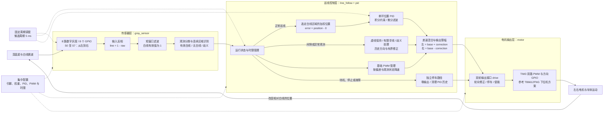
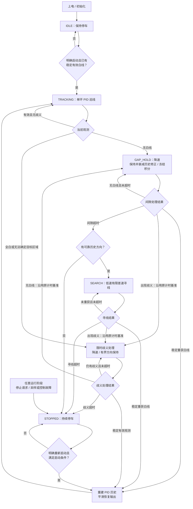

# STM32 八路灰度巡线小车计划

## 当前阶段与目标

本项目计划实现 STM32 差速巡线小车，在**深蓝色底、白色线（含虚线）**的赛道上自主巡线。本次仅制定方案并维护文档，尚未实现固件或验证实车效果。

- 使用 8 路数字灰度传感器，8 个 GPIO 分别采集一路数字输出；不使用 ADC 或串行扩展器代替这 8 路输入。
- 使用一个横向位置 PID，将白线位置误差转换为左右轮 PWM 差值。
- 当前阶段不使用编码器，不实现轮速反馈、速度 PID、位置/速度双环或串级控制。
- PWM 指令表示电机驱动强度，不表示已测得的轮速；两轮同 PWM 不保证实际轮速相同。
- 优先完成低速直线、弯道与虚线通过，暂不定义路口选路、比赛终点识别等扩展功能。

## 已确认的项目基础与参考来源

当前 `platformio.ini` 配置为：

| 项目 | 当前配置 |
| --- | --- |
| PlatformIO 环境 | `genericSTM32F103C8` |
| 平台 | `ststm32` |
| 开发板定义 | `genericSTM32F103C8` |
| 框架 | `stm32cube` |
| 应用源码 | 当前 `src/` 为空 |

参考用户所指的 `remote_car_wifi` STM32 下位机，实际本地路径为 `/Users/zhendong/Documents/RemoteCar_wifi/remote_car`。已阅读该工程的 `README.md`、`platformio.ini`、`include/main.h`、`src/main.c` 和 `src/stm32f1xx_it.c`。

可参考的现有结构：

- TB6612FNG 双电机驱动；PA6/TIM3_CH1 对应左轮 PWM，PA7/TIM3_CH2 对应右轮 PWM。
- PB12/PB13 控制左轮方向，PB14/PB15 控制右轮方向，PB5 控制 STBY。
- `drive(left, right, brake)` 分别输出两轮有符号指令，范围为 `-255…255`。
- `set_wheel()` 执行单轮方向与 PWM 输出，`speed_to_ccr()` 完成指令到比较寄存器数值的映射。
- 参考工程在其 72 MHz 定时器时钟配置下，以 PSC=71、ARR=99 配置名义 10 kHz PWM。新项目须先核实本板时钟，不能仅复制寄存器参数。

沿用其电机控制接口思路，由本机巡线控制器产生左右轮指令。参考工程的 Wi-Fi/树莓派链路、串口遥控协议以及 300 ms 无遥控命令超时逻辑不作为本项目巡线运行的前提。本项目以采样、控制任务健康状态和持续丢线时间判断是否停车。

参考代码对刹车/滑行的命名不等于实车行为已经核实；实施时须结合所用驱动器真值表、PWM 电平、STBY 状态和架空车轮试验明确停车方式。

## 硬件与 GPIO 规划

以下为**建议分配，尚未确认实际接线**。若继续使用参考工程的 TB6612FNG 接法，可保留电机接口并安排灰度输入如下。8 个 GPIO 指的是灰度传感器输入，电机控制另占用输出引脚。

| 功能 | 建议 STM32 引脚 | 说明 |
| --- | --- | --- |
| S0 灰度输入 | PA0 | 从车体前进方向看，最左侧传感器 |
| S1 灰度输入 | PA1 | 左侧 |
| S2 灰度输入 | PA2 | 左侧 |
| S3 灰度输入 | PA3 | 中心左侧 |
| S4 灰度输入 | PA4 | 中心右侧 |
| S5 灰度输入 | PA5 | 右侧 |
| S6 灰度输入 | PB0 | 右侧 |
| S7 灰度输入 | PB1 | 最右侧传感器 |
| 左轮 PWM | PA6 / TIM3_CH1 | 参考接口 PWMA |
| 右轮 PWM | PA7 / TIM3_CH2 | 参考接口 PWMB |
| 左轮方向 | PB12、PB13 | 参考接口 AIN1、AIN2 |
| 右轮方向 | PB14、PB15 | 参考接口 BIN1、BIN2 |
| 电机使能 | PB5 | 参考接口 STBY |
| 可选调试串口 | PA9、PA10 | USART1，候选 115200 8N1 |
| 下载/调试保留 | PA13、PA14 | 保留 SWD |

实施前确认：实际 MCU 与板型、晶振、电机驱动型号、左右轮接法、传感器输出电压与输出类型、GPIO 输入上下拉要求、供电与共地。输入电平须与所选 MCU 引脚兼容；不能未经核实直接接入传感器输出。

传感器横排安装，S0→S7 的顺序固定为左→右。记录安装高度、通道间距与白线宽度。若传感器间距不一致，实施时按实际横向位置调整权重。逐路用实际白线和深蓝底验证阈值：传感器对黑色输出 1，并不能直接证明对深蓝色也稳定输出 1。

## 采样、反相与位置误差

### 输入语义

原始输入 `raw[i]`：白色为 0，黑色为 1。实际深蓝底的预期值为 1，须在赛道材料上确认。因此进入位置计算前统一反相：

```text
line[i] = 1 - raw[i]
line[i] = 1 表示该路检测到白线
line[i] = 0 表示该路检测到背景
```

反相只在传感器层执行一次。滤波、有效路数统计、权重计算和状态判断均使用 `line[]`，避免把背景当成目标或重复反相。可对连续采样使用短窗口多数滤波；窗口长度通过实车调试确定，避免过度滤波造成弯道延迟。

### 权重与符号约定

等间距安装时，计划采用关于车体中心对称的权重：

| 通道 | S0 | S1 | S2 | S3 | S4 | S5 | S6 | S7 |
| --- | --- | --- | --- | --- | --- | --- | --- | --- |
| 权重 `w[i]` | -7 | -5 | -3 | -1 | +1 | +3 | +5 | +7 |

```text
N = Σ line[i]
position = Σ(w[i] × line[i]) / N       仅在有效、无歧义的白线观测下计算
error = position - 0                 目标：白线位于传感器阵列中心
```

使用有符号浮点数或有明确比例的定点数保留误差精度，避免整数除法丢失细小偏差。正误差表示白线在车体右侧，需要向右修正；负误差表示白线在左侧，需要向左修正。

按 S0→S7 顺序，计划验证的原始输入示例：

| `raw` | 反相后的 `line` | 预期处理 |
| --- | --- | --- |
| `11100111` | `00011000` | 中间两路白线，误差为 0 |
| `01111111` | `10000000` | 最左侧白线，误差为 -7 |
| `11111110` | `00000001` | 最右侧白线，误差为 +7 |
| `11111111` | `00000000` | 无白线；进入间隙/丢线策略，禁止除以 0 |
| `00000000` | `11111111` | 全白或宽线观测；不能据此认定正常居中 |
| `00111100` | `11000011` | 多个分离白线区域；不能直接用全局平均冒充居中 |

检测到多个不相连的有效区时，优先按上一有效位置选择连续性最好的白线区域；无法可靠选择时，进入有时限的歧义处理并降速，超时停车。全白或异常宽线先短时保持方向并降速，持续异常则停车。本阶段不凭此判断路口方向或终点。

## 总体架构（Mermaid）

下图表示计划中的模块与数据流。闭环反馈来自灰度传感器观察到的白线位置；电机端只接收 PWM 指令，本阶段没有编码器或轮速控制环。固定周期调度负责触发采样和控制更新。



状态管理决定正常 PID、历史方向策略或停车路径中的哪一条拥有输出权。间隙及无效观测不会作为零误差输入 PID；独立停车路径优先于差速混合和死区补偿。

## 单环 PID 与差速混合

数据路径：`8 路 GPIO → 反相/滤波 → 白线位置与观测状态 → 单环 PID → 差速混合/限幅 → 电机 PWM`。

计划使用固定周期的位置式 PID，初始控制周期候选为 5 ms（200 Hz），最终以 GPIO 采样稳定性、任务耗时和实车表现确定。

```text
I = 限幅(I + error × dt)
D = 低通滤波((error - previous_error) / dt)
correction = Kp × error + Ki × I + Kd × D
left_command  = base_pwm + correction
right_command = base_pwm - correction
```

这里主动定义 `error = position - target`，配合以上混合公式，使正误差产生左轮快、右轮慢的向右修正。参数符号与公式必须成套保持一致。架空测试确认“正指令使两轮均向前”和转向符号后才能落地调参。

控制约束：

- 先用低基础 PWM、`Ki=0`、`Kd=0` 调比例项，再加入微分阻尼；仅在确有持续偏差时加入小积分。最终结构保留 PID，PD 是调参步骤。
- 设置积分上限，并根据输出饱和方向抑制进一步积分；启动、停车、丢线和重获白线时清理或冻结积分。
- 微分项使用实际 `dt`，对二值观测跳变做适当低通；首次有效观测与重获白线时重置误差历史，避免微分冲击。
- 正常巡线先限制左右轮指令为 `0…PWM_LIMIT`，其中 `PWM_LIMIT ≤ 255`；同时限制修正量，避免默认倒车或原地旋转。
- 基础 PWM 随偏差幅度、转向需求或观测不确定性降低；设置变化率限制，避免输出突跳。
- 必要时增加左右轮静态 PWM 修正和起转死区补偿；这些均是开环校准，不构成轮速闭环。
- 独立设计停车命令，不能让死区补偿或最小运行 PWM 把零输出变成继续行驶。

## 虚线、丢线与运行状态

8 路均未检测到白线时，仅凭这一帧无法区分正常虚线间隙和偏离赛道。采用有时限的状态策略，不把无白线解释为误差为 0。

| 状态 | 触发/行为 | 退出条件 |
| --- | --- | --- |
| `IDLE` | 上电保持电机停止，初始化采样与控制参数 | 明确启动且已有稳定有效白线观测后进入 `TRACKING` |
| `TRACKING` | 有效白线观测驱动 PID 差速巡线 | 无白线进入 `GAP_HOLD`；歧义观测进入限时降速处理 |
| `GAP_HOLD` | 记住最后有效方向，降低基础 PWM，保持有限修正并逐步衰减；冻结积分、不用无效误差更新微分 | 连续有效观测后恢复 `TRACKING`；达到间隙容忍时间进入 `SEARCH` |
| `SEARCH` | 按最近可靠误差方向低速、有限差速寻线；若没有可靠方向则停车 | 稳定重获白线后恢复；寻线超时或故障进入 `STOPPED` |
| `STOPPED` | 持续输出停车状态，清除控制历史 | 明确重新启动且满足启动条件；不自动恢复行驶 |

以下流程图展开运行状态与分支。每次控制周期重新评估观测和时限；全白、多区域等歧义观测使用单独的限时处理分支，不当作正常居中。



`GAP_HOLD`、`SEARCH` 期间若出现歧义观测，也转入图中的限时歧义分支，并沿用本次异常的计时基准。无白线与歧义之间切换不能延长总容忍时间；只有稳定有效白线才能结束本次异常处理。

补充规则：

- `GAP_HOLD` 和 `SEARCH` 的时限以最后一次稳定有效观测为基准，孤立噪声不能反复刷新计时器。
- 重新获得白线需连续有效观测，恢复时重建 PID 历史并平滑增加输出。
- 初始寻线保持前进式差速并限制 PWM；反转或原地旋转只有在后续确有需求、经实车验证后才考虑。
- 启动前若没有有效白线，不盲目进入虚线保持状态。
- 异常宽线/多区域观测复用短时方向保持与降速策略，但记录独立原因和超时；不无限保持最后输出。
- GPIO/控制任务故障、控制周期持续超时等情况直接停车；是否增加独立看门狗在固件实施时确定。

间隙容忍时间、寻线时限、恢复确认次数和降速比例都集中配置，暂不宣称已选出可用实车数值。先记录最长虚线间隙、最低/最高运行 PWM、不同电量下的通过耗时，再选取时限。没有编码器时不能从 PWM 精确推算行驶距离；时限要兼顾虚线通过和偏离后及时停车。

## 未来固件分层

以下仅为后续文件职责规划，本次不创建源码文件：

| 候选文件 | 职责 |
| --- | --- |
| `include/board_config.h` | 实际 GPIO、时钟/PWM 配置、传感器顺序及轮向修正 |
| `include/control_config.h` | 权重、控制周期、PID、PWM 边界及状态超时参数 |
| `src/gray_sensor.c` / `include/gray_sensor.h` | 八路采样、一次反相、滤波、连续区域识别与有效位置 |
| `src/pid.c` / `include/pid.h` | 单环 PID、积分约束、微分滤波及复位 |
| `src/motor.c` / `include/motor.h` | 参考下位机的双轮 PWM、轮向、限幅与停车接口 |
| `src/line_follow.c` / `include/line_follow.h` | 巡线状态机、差速混合、虚线/歧义/丢线处理 |
| `src/main.c`、`src/stm32f1xx_it.c` | HAL 初始化、周期调度、必要中断与可选调试输出 |

周期触发可先评估 HAL 时基调度，需要更稳定周期再使用独立定时器；PWM 使用 TIM3 时避免与控制周期定时器冲突。控制链不插入阻塞式延时，调试日志降低频率并避免拖慢采样；具体调度与日志实现留待编码阶段。

## 后续实施顺序与验收计划

1. **硬件确认**：核对 MCU、驱动器、8 路顺序、接线与电平；用真实深蓝底/白线记录逐路输入。输出最终接线表，消除建议引脚的不确定性。
2. **底层驱动**：再创建 HAL 初始化、GPIO 读取和电机输出。架空验证左右轮独立输出、正反方向、限幅、零输出、使能和实际停车行为。
3. **位置计算**：验证上面的六类输入，以及抖动、非对称白线、左右镜像。无白线和歧义观测必须有明确状态，不出现除零或伪装成正常居中。
4. **单环控制**：验证右侧白线产生右转修正、左侧白线产生左转修正；检查 PID 复位、积分约束、微分滤波、输出限幅和任务时序。
5. **实线低速调参**：先直线后缓弯，再急弯。记录基础 PWM、PID 参数、传感器阈值、控制周期、电量和现象，确认降低振荡且能持续跟线。
6. **虚线与丢线**：分别测试居中虚线、弯道虚线、短噪声、持续无白线、重新捕获、全白和多区域观测。正常间隙能通过，持续丢线/歧义须在设定总时限内停车。
7. **整理验证结果**：补充最终引脚与参数、编译结果和实车记录。通过编译、逻辑用例与实际赛道测试分别报告，不能互相代替。

编码阶段再执行 PlatformIO 构建与必要的逻辑验证；本次只写文档，不构建、烧录或驱动电机。

## 待确认事项

- 实际开发板、晶振与下载方式；是否沿用 TB6612FNG 及参考电机接线。
- 8 路灰度模块型号、输出电平/类型、左右排列和实际安装间距。
- 深蓝底与白线的逐路阈值稳定性、白线宽度、最大虚线间隙、弯道形状。
- 轮向、起转 PWM、左右轮静态差异、供电变化对通过间隙时间的影响。
- 启动/停止入口（按键或调试指令），以及停车采用的具体电气模式。

以上信息在实施前补齐。当前文档中的候选参数、引脚和模块划分均为计划，不代表已经配置、接线或验证成功。
