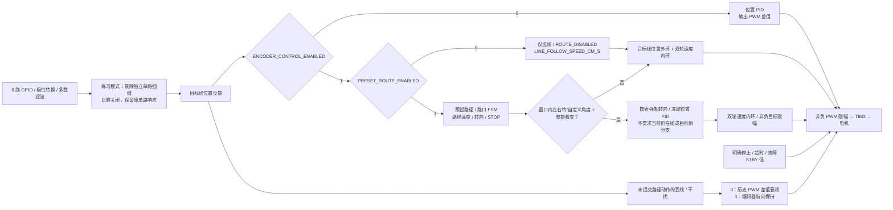
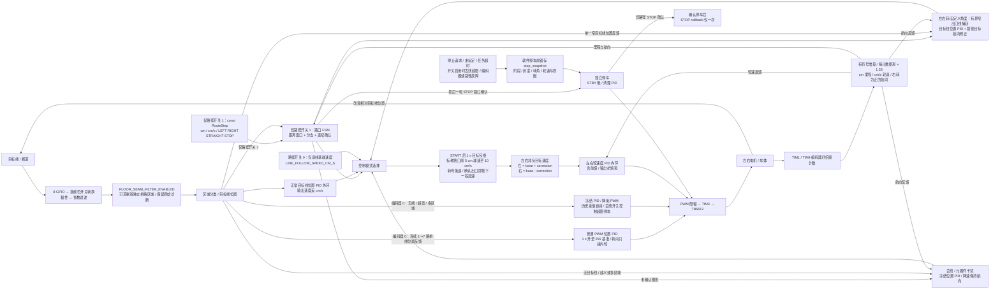
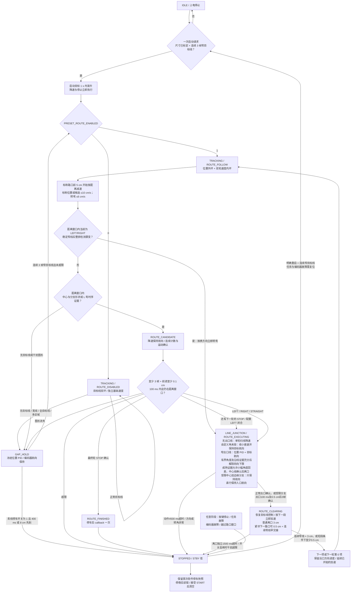

# STM32 八路数字灰度巡线小车

> **2026-10-24 第二项 -120° 过转修正：** 板上全部24752 B与读取前最新固件一致，第1项左转在2560 ms时转到-150.43°，触发TURN_LIMIT；灰度全丢线0x00，左右目标0/6 cm/s。自定义转角无出口线的末段控制由固定单轮扫线改为按目标航向误差收小差速：进入原慢速角后，以低速基础目标和限幅航向修正逼近表内角度，目标角时等速，超调时反向差速纠偏但不倒车。仍在EXECUTING，出口线/连续中心确认才能离口，无线持续则动作超时停车。LEFT/RIGHT及已有出口捕获策略保持。详见[本次记录](docs/evidence/2026-10-24-left120-fix.md)，新固件未烧录，实车待验证。


> **2026-10-24 修正版转弯后仍停车：** 本次 Flash 全部 24648 B 与上一轮修正版一致。第 0 项 +120° 在 EXECUTING 达到 6000 ms 动作超时，转角 2.037906 rad（116.76°），单一区域窄线 0x0C、position=-2 已居中，但低于约 117.14° 的有界角度下限，出口候选清零，目标恢复为 6.8/5.2 cm/s。新增成熟出口证据的角度回差：先按原角度要求、连续窄线 50 ms / 前进 0.25 cm 建立证据，随后回线允许额外 min(0.02 rad,目标角绝对值5%) 的角度回落。120° 动作保持证据下限约 115.99°；没有成熟证据仍须原约 117.14°，最终仍须中心窄线连续3帧。无线/歧义/低于回差下限立即清空，受限多区域分支不使用回差；时限、过转/错向与反馈保护保留。详见 [本次证据](docs/evidence/2026-10-24-postturn-stop-fix.md)。本次新修正未烧录，实车待复测。


> **2026-10-24 再次复测版本核对：** 板上 Flash 与上一轮修改前旧固件一致，尚未包含有界出口证据充分后解除同向差速下限的修正。本次停因为首项 +120° 转到约 150.43° 触发过转保护，灰度 0xFF；它不是修正版的实车验证。已保存[版本与快照证据](docs/evidence/2026-10-24-120deg-retest-version.md)，当前修正版未烧录。

> **2026-10-24 右转 120° 后低速停车修正：** ST-Link 停车快照确认首项 CUSTOM_TURN +120° 在 EXECUTING 达到 6000 ms 动作时限；转角 2.079726 rad（119.16°），单一窄线 line_mask=0x04、position=-3，出口候选已连续 3740 ms / 前进 20.3509 cm，但中心确认 0 帧。左右目标 6.8/5.2 cm/s，实测约 5.566/5.540 cm/s，速度故障 NONE。旧逻辑在未到精确目标角时持续施加最小同向半差，压住位置 PID 向左回线。现在，仅单一区域窄线已满足原有界出口角度、连续 50 ms 和前进 0.25 cm 后，解除该半差下限，让位置 PID 与目标航向共同回线；无线/歧义或角度不足会清空证据并恢复下限。最终仍须 |position|≤2 连续 3 帧才离口，保留动作/离口时限、转角与反馈保护。路径表及参数不变。读取前固件全部 24560 B 与板上 Flash 一致，短暂停核读取后已恢复，未复位/烧录。修正已通过源码回归与构建，实车效果待复测；详见 [本次证据](docs/evidence/2026-10-24-120deg-stop-fix.md)。


> **2026-10-24 地板细缝练习模式（IMG_1011）：** 新增 `include/control_config.h` 的 `FLOOR_SEAM_FILTER_ENABLED`，当前已按用户反馈关闭为 0（开启后识别准确度下降）。以下为开启时行为：极性转换与逐路三帧多数滤波之后，剔除没有相邻目标通道的单路区域；连续两路及以上的区域保持。仅剩被剔除单路信号时按无可靠线处理，禁止据此启动或更新普通位置 PID，也禁止把这种过滤后的空掩码当成真实整排丢线来触发强制转向。实际全零输入的原路径入口规则保留。新增 prefilter_mask / seam_mask 保留过滤前及被剔除位，raw_mask 仍是原始 GPIO。正式比赛设为 0 并重编译，恢复单路目标边缘线响应。该模式要求真实胶带在需要识别的位置能覆盖至少两路；真线只剩一路同样会被抑制。连续两路的细缝、与胶带连通的缝或横向整排暗缝不能由此可靠区分。路径、速度、转角与既有保护保持用户当前配置；未烧录、未实车验证。

> **2026-10-24 第二次停车复测修正：** 板上已包含短段早交接代码。本次停在第二项 `-90°` 的 EXECUTING，原因为 `TURN_LIMIT`，估计转角 -2.101149 rad，原始 line_mask=0x98（中心 S3/S4 加独立右边缘 S7），不是第三项越窗。新增有界附带分支出口处理：仅已确认转弯、接近目标角（最多提前 0.05 rad，且不超过目标 +0.35 rad）、下一路口处于标称位置前 5 cm 至窗口上界时，允许同时覆盖 S3/S4 的单一窄中心区域附带转弯反侧最外两路内的一个独立区域。中心区域必须满足原窄线宽度和中心位置限制，连续证据至少 100 ms / 0.5 cm，再经 3 帧确认才进入离口；中断清零。原始多区域观测及诊断不修改，普通位置 PID 不接收该观测；动作捕获和短离口只用编码器出口航向控制。完整窄线返回后恢复原捕获逻辑。错侧、非中心、宽区域、三块及以上区域、过早/过大转角、远下一段均不使用此处理；过转、反向、窗口和阶段时限保护保留。该形状可能来自入口残支，也可能来自相似图形；快照不能还原此前完整灰度历史，本次修正仍待实车复测，未烧录。

> **2026-10-24 短路段交接修正（IMG_1010）：** ST-Link 快照确认第三项 `10±5 cm / -60°` 因 `ROUTE_FAILURE_WINDOW` 停车；上一弯完成固定离口后，切段已继承 14.236 cm，50 ms 后达到 15.013 cm。新增短段早交接：上一转弯已满足原转角和连续中心出口线确认，且下一路口已进入标称位置前 5 cm 的范围、尚未越过下一窗口上界时，离口至少前进 `JUNCTION_SHORT_CLEAR_CM=0.5 cm` 并连续 3 帧单一区域窄线即可切段。出口线可在探头内横移；直行动作和远路口仍按 3 cm 离口。已确认的窄线历史转交给下一项，中心分支记忆仅在当前确实居中时建立。窗口和真实投影进度保持，未扩大容差或归零里程；无路口证据仍不能转弯，越窗及动作/离口时限继续生效。当前九项路径、第三项 10 cm、各角度/速度及丢线开关保留用户设置。本次源码修正不等于实车验证，尚未烧录。

> **2026-10-24 自定义路径转角：** 新增 `CUSTOM_TURN`，路径项第五列 `angle_deg` 使用角度制，正数顺时针、负数逆时针，支持小数与 ±360°。例如 `{75.0f, 10.0f, CUSTOM_TURN, 60, -135.0f}` 表示该路口逆时针转 135°。目标角度用于编码器航向捕获、出口确认和下一段距离投影；仍需可靠出口线及离口去重，详见下方路径表说明。原有方向可继续使用，第五列填零；当前路径动作未替换。

> **2026-10-24 提高转弯外轮目标：** `include/motion_config.h` 的 `JUNCTION_TURN_SPEED_CM_S` 从 6 调为 8 cm/s。LEFT/RIGHT 未捕获出口线且未进入慢速扫线时，半差等于基础目标，左转为左/右 0/16、右转为 16/0 cm/s（仍受表内速度、启动包络与轮目标限幅）。`JUNCTION_TURN_SLOW_CM_S=3` 保留，转过 1.25 rad 且无可靠出口线时外轮目标仍为 6 cm/s；`JUNCTION_CAPTURE_SPEED_CM_S=6` 保留，捕获出口后由位置 PID 与航向项共同控制两轮。该参数也用于 STRAIGHT 动作的基础速度上限，当前实际路径表没有 STRAIGHT 项。这是目标速度调整，实测轮速、打滑与出口效果待复测，未烧录。


> **2026-10-24 黑线赛道不启动检查：** 当前巡黑线 `GRAY_INVERT_ENABLED=0`，编码器/路径均为 1。发现实际路径表四段速度均为 60 cm/s，而轮目标上限为 50 cm/s，导致 `route_init()` 校验失败；在线且按下 START 时会得到 `LINE_START_REJECTED_ROUTE`（4）与 `ROUTE_FAILURE_INVALID`。保留表内 60，将 `WHEEL_TARGET_MAX_CM_S` 同步到 60，并新增实际路径表经原始灰度输入启动及超量程仍拒绝的回归。编码器连续有效区域上限保留当前 5 路；普通 PWM 全 8 路目标恢复为歧义，避免把无位置依据的整排输入当作居中。上电仍须放在线上后按 PB10，拒绝请求不排队。新增启动回归在黑/白两种极性下均通过，`pio run` 与 `git diff --check` 通过；完整主机回归在旧 `test_routes` 的 1.20 rad 不退出断言处失败，与当前退出门槛 1.20 rad 不一致，不能报告全套通过。源码配置冲突已定位；板上固件版本、实际灰度电平、轮速及实车效果未验证，未烧录。


## 当前进度与验证边界

> **2026-10-23 转弯后停车定位：** 用户补充上次仅一次成功恢复速度，其余沿出口线低速直行后停车。快速提速修改继续保留，同时新增 `g_diagnostics.stop_snapshot`：软件第一次停车时，在清零目标/PID 前锁存路径阶段、具体失败、灰度、转角、左右目标/实测速度与时间。无需运行中暂停，停车后保持供电、不要复位或重新 START，再读取快照。已在合成输入中复现“有中心出口线且持续前进，但估计转角不足，低速捕获直到 4500 ms 动作超时”的可能过程；这不是已确认的实车根因。本次没有扩大转角/丢线/反馈保护门限。

> **2026-10-23 转弯后快速恢复：** 用户反馈减速转弯后不提速。现改为转角与连续中心出口线确认完成、进入 `ROUTE_CLEARING` 时，即按下一段目标速度开始加速；不再等 3 cm 离口去重完成，也不继续采用旧路口的低速窗口。`TARGET_RISE_CM_S2=160`，居中直线从 6 升到 40 cm/s 的目标规划约 0.213 s。离口阶段仍保留 3 cm 去重和后续切段基准，预看下一段低速目标与短段减速包络；丢线/歧义仍降速保持并受超限停车保护。初次 START 仍使用 1 s 包络。尚未烧录或实车复测。

> **2026-10-23 实测距离比例同步：** 独立 `encoder_distance_test_stm32` 工程最初目标 1 m、用户实测停稳 1.53 m；加入公共距离系数 `ODOMETRY_DISTANCE_SCALE=1.53` 后，用户复测确认“这次距离对了”。本工程已采用同一系数，左右每计数距离统一乘 1.53，同时用于厘米里程、轮速反馈和航向估计；原轮径 4.8 cm、每圈计数 1560 与轮距 14.5 cm 保留。原路径表、40 cm/s 目标及巡线/丢线/路口策略继续按当前配置运行。用户确认的是独立工程的直线测距结果，当前完整路径、速度及转角效果仍待实车复测。

> **2026-10-23 当前循环与直角转弯修正：** 用户已确认中途停止解决；针对“到直角边缘不转弯就停车”，LEFT/RIGHT 新增中心线到侧边分支的 L 弯时序确认，转弯末段新增窄出口线位置反馈捕获。`ROUTE_REPEAT_COUNT=0U` 默认无限循环，1 为单轮、N 为共 N 轮；末项 STOP 仅在最终轮停车，其余轮按 `ROUTE_REPEAT_ACTION=LEFT` 左转离口后重建首段。保留用户路径目标 40 cm/s，并同步轮目标上限。主机模拟不能替代实际赛道复测，循环还要求末项标记后实际闭合回首段。
>
> **2026-10-23 当前启动、路径和直角转弯配置：** 路径巡航目标为 **50 cm/s**（保留用户当前路径表并同步轮目标上限）；START 接受后用实际 `dt` 在 **1 s 内**将居中直线目标升到该值。在表内路口标称位置前 5 cm 开始按剩余距离减速，到标称位置基础目标降到不超过 10 cm/s，转弯确认完成进入离口时就按下一段目标快速提速。PWM 模式同样用 1 s 升至 255。按用户最新要求，**直接取消整段行驶时间限制**，不再因 15 秒或按长度计算的路段预算耗尽而停车；距离窗口、路口确认 100 ms、动作 4500 ms、离口独立 1500 ms、丢线及反馈保护继续生效。左右转内轮目标 0、外轮目标 12 cm/s，转过 1.25 rad 后外轮降至 6 cm/s 找线；至少 1.30 rad 且连续 3 帧中心线，或至少 1.25 rad 加连续窄线 50 ms / 0.25 cm 后再连续 3 帧中心线才退出。未烧录、未实车验证，下方旧日期记录为历史快照。

> **2026-10-23 当前编译入口：** 只保留 `genericSTM32F103C8` 一个环境，编译和一键上传均直接遵循头文件。当前编码器 1、预设路径 1、巡黑线 0、标定确认 1；轮径 4.8 cm、每圈计数 1560、轮距 14.5 cm、编码器方向 -1/+1。用户提供的调试截图已确认 START 被接受，随后触发编码器反馈停车；左计数 65527、右计数 2 提示左轮负向回绕，已修正左侧符号，修正后实车效果待复测；以下日期较早的记录保留当时的模式和结果。

> **2026-10-22 满速巡线配置：** 用户反馈当前巡线正常，现将普通 PWM 模式的居中目标由 `55/255` 提高为 `255/255`，公共输出上限由 `100` 提高为 `255`。居中并完成加速后，两轮达到名义 100% 占空比（TIM3 ARR=6399、CCR=6400）；基础 PWM 仍以每秒 200 上升，从零约 1.275 s 达到 255。位置偏差增大时仍降速并差速转向，最大偏差基础值 40、丢线/干扰上限 35、400 ms 丢线停车及 PB10/故障停车均保留。当前颜色开关保持用户已有的 `GRAY_INVERT_ENABLED=0`，编码器/路径均为 0。公共 PWM 上限也适用于编码器模式，但其 cm/s 目标与标定门禁未改。本次满速配置未烧录，满速赛道表现尚未验证；PWM 占空比不代表实测轮速。

> **2026-10-22 巡线颜色开关：** `include/control_config.h` 新增 `GRAY_INVERT_ENABLED`，**1：反相、巡白线**；**0：不反相、巡黑线**，当前配置为 **0**。转换后 `line_mask` 的 1 始终表示目标线，适用于 PWM、编码器仅巡线及编码器路径三种模式；修改后重新编译。

> **2026-10-22 历史实物排查（用户后续已反馈巡线正常）：** 用户报告独立的 `motor_test_stm32` 最小项目可通过 PB10 控制电机，巡线项目在灰度已接好并对准白线时按 START 两侧仍完全不动。源码对照确认两项目电机引脚、64 MHz 时钟、TIM3 10 kHz PWM 与按键消抖配置一致；最小项目当前配置固定 20% 占空比，当时本项目居中稳态为 55/255，约 21.6%。这将排查重点转向实际烧录模式、启动白线门禁与任务故障；尚未读取板上诊断，不能确认具体根因。已新增保留的启动请求结果、消抖按键计数与启动时灰度掩码，见下方操作入口。本次改动未烧录，巡线与灰度板上行为仍待验证。

> **2026-10-22 独立路径开关：** `include/motion_config.h` 新增 `PRESET_ROUTE_ENABLED`，默认 **0（仅巡线）**；改为 **1** 时按预设路径表执行距离、路口转向与 STOP，且要求 `ENCODER_CONTROL_ENABLED=1`。编码器开关仍默认 0，控制 PWM / 双环的选择；现在也可开启编码器双环、关闭路径，单独测试巡线稳定性。仅巡线停用路径距离、路段超时及路径 STOP callback，保留启动门禁、丢线/干扰与故障停车。编码器模式仍须尺寸标定。未烧录或验证硬件，详见下方开关说明与 [控制说明](docs/navigation.md)。

> **2026-10-17 下单后终审：** 用户确认订单为 **A10 + SMT**，1×20 排母换料已接受。本次重新核查制造包、原生 PCB 的 32 个器件 / 143 个引脚及 48 个网络，未发现确定性电气接错、断路或异网短路。降压标称约 5.08 V；3.3 V 来自核心板。USB 供电前须拆 R4，电机启动电流、3.3 V 负载余量与降压动态/温升尚未验证。详见 [A10 电气终审](docs/A10-final-electrical-review.md)。

> **2026-10-17 当前硬件修订为 A10：** 按用户截图放宽 C1/C2 去耦区的铜间距。C2 向左下各移 0.20 mm 并同步 VM 支路，清理 5 段旧地线、重新生成局部加大避让的地铜；C2 GND 焊盘到 AIN1 由约 0.154 mm 增至 **0.355 mm**，C1 VM 焊盘到最近地铜由约 0.156 mm 增至 **0.300 mm**，两颗电容的全部焊盘到异网铜均超过 0.25 mm。保存关闭重开 A10 后严格 PCB DRC 为 0，独立铜几何确认 48 个网络连通且无异网短路。模块排距仍为 **15.24 mm**；保留 A9 修正后的 TB6612 上排 J9 控制信号、下排 J8 电源/输出方向。完整工程、配套 Gerber、BOM、坐标及验证记录见 [A10 说明](hardware/stm32PCB-A10/README.md)。U4 原理图既有属性匹配警告仍保留；用户后续已确认 A10 下单并包含 SMT，尚未实物试插或通电验证。下文旧修订为历史记录。

> **2026-10-17 历史硬件修订 A7：** 已在嘉立创 EDA 中将 U4 / TPS54302DDCR 的实际焊盘修正为 TI 推荐的 0.60 × 1.10 mm、两排中心距 2.70 mm；SW1 按用户确认换为基础库 C318884、1.5 mm 高按键，同步改焊盘与连线。核心板 40 个引脚丝印逐一对照实物照片正确，顶视 USB 朝左、SWD 朝右。严格 PCB DRC 为 0，独立铜几何确认 48 个网络连通且无异网短路；原理图仍有一条 U4 的 `ATTRMATCHCODE` 属性匹配警告，未宣称全部通过。完整工程、成套制造文件、基础库替换及验证边界见 [A7 说明](hardware/stm32PCB-A7/README.md)。尚未重新下单或实物验证；下文 A6 / A5 保留为历史记录。

> **2026-10-17 已在嘉立创 EDA 修复 C5 / C6 / L1 贴装碰撞，另存 A6。** L1 向左移动约 4.01 mm，重接相关 SW / VM 铜路并更新地铜避让；与 C5、C6 的名义本体间隙均约 2.55 mm，按厂家最大本体尺寸计算仍约 2.30 mm。A6 严格 PCB DRC 为 0 项，独立铜几何确认 48 个网络连通、无异网短路；保存后重新打开检查通过。工程、审阅 Gerber、BOM、贴片坐标与验证记录见 [A6 说明](hardware/stm32PCB-A6/README.md)。旧版保留，旧订单送厂版本仍未确定，尚未重新下单；工厂贴装工艺及实物验证待完成。下文 A5 为历史记录，不能将其电气 DRC 结果当作装配合格证明。原始问题见 [碰撞核查](docs/C5-C6-L1-assembly-collision.md)。

2026-10-14 用户明确授权进入固件编码阶段，确认 MCU 为 **STM32F103C8T6**、驱动器为 **TB6612FNG**、八路灰度模块为 **GPIO 数字输出**，并授权决定接线。首版 C / STM32Cube HAL 固件已实现，可交叉构建；尚未烧录、接线验证、架空测试或实车调参。

目标是在深蓝底、白线（含虚线）赛道上按预设路径巡线。8 路分别占用 8 个 GPIO。编码器模式下，白线位置外环输出左右目标速度差（cm/s），两轮各自的速度 PID 通过霍尔编码器反馈输出 PWM；默认 PWM 模式由白线位置 PID 直接输出左右 PWM。路径距离使用厘米，编码器提供相对里程和航向估计；打滑会产生累计误差，不能视为绝对定位。倒车与原地旋转仍不在本次实现范围内。

| 项目 | 当前状态 |
| --- | --- |
| GPIO、滤波、位置计算、PID、差速、状态机 | 已实现源码，主机逻辑验证通过 |
| HAL 时钟、GPIO、TIM3 PWM、IWDG、调度 | 已实现源码，交叉构建通过；板上行为待验证 |
| MCU / 电机驱动 / 灰度接口类型 | 用户确认，尚未核对实际板与模块 |
| 引脚选择 | 已落实到固件；实际接线待确认 |
| 双轮霍尔编码器 | 当前开关为 1，启用 TIM1/TIM4；实际反馈待验证 |
| 控制模式 | 当前编码器为 1：双环，标定确认已按用户要求启用 |
| 预设路径 | 当前为 1：编码器厘米路径与路口 STOP |
| 模块供电与输出电平、输入上下拉 | 用户确认灰度为 3.3 V 供电；输出电平、输出类型及上下拉仍待实物确认 |
| 实车巡线 | 用户反馈原配置巡线正常；本次满速及各项停车、电量变化未专项验证 |
| PID / PWM / 丢线与路口时限 | 未标定初值 |

## 工程配置与参考来源

| 项目 | 当前配置 |
| --- | --- |
| PlatformIO 环境 / board | `genericSTM32F103C8` |
| 平台 / 框架 / 语言 | `ststm32` / `stm32cube` / C |
| 系统时钟 | 内部 HSI 8 MHz / 2 × PLL16 = 名义 64 MHz |
| APB1 / APB2 | 32 MHz / 64 MHz，TIM3 时钟名义 64 MHz |
| TIM3 PWM | PSC=0、ARR=6399，名义 10 kHz，两路 PWM1 |
| TIM1 / TIM4 编码器 | 仅开关为 1：PSC=0、ARR=65535、TI12 四倍频，输入滤波 6 |
| 控制周期 | 5 ms，PID 使用实际控制间隔 `dt` |

晶振未知，因此不依赖外部 HSE。[ST 数据手册](https://www.st.com/resource/en/datasheet/stm32f103c8.pdf)给出 HSI 作为 PLL 输入时最高系统时钟为 64 MHz；RC 时钟存在误差，实际 PWM/周期仍待测量。开发板环境沿用 [PlatformIO 的 genericSTM32F103C8 定义](https://docs.platformio.org/en/latest/boards/ststm32/genericSTM32F103C8.html)，没有改成 `bluepill_f103c8`。

电机底层只读参考 `/Users/zhendong/Documents/RemoteCar_wifi/remote_car` 的 `src/main.c`、`include/main.h`、`platformio.ini`、HAL 配置与中断文件。借鉴双轮接口、单轮方向输出、指令限幅及 PWM 映射；新工程重新处理初始化返回值、零输出、轮向配置和异常停车，没有引入 Wi-Fi、串口遥控协议或 300 ms 遥控超时。

## 控制模式开关

在 `include/motion_config.h` 修改两个独立宏后重新编译，不支持行驶中切换：

```c
#define ENCODER_CONTROL_ENABLED 1  // 0：普通 PWM；1：编码器 + 双环
#define PRESET_ROUTE_ENABLED    1  // 0：仅巡线；1：按预设路径行驶（需编码器为 1）
```

| 编码器开关 | 路径开关 | 实际模式 |
| --- | --- | --- |
| 0 | 0 | 普通 PWM 仅巡线，不要求编码器标定 |
| 1 | 0 | 编码器双环仅巡线，用于独立测试巡线稳定性；仍要求标定 |
| 1 | 1 | 当前配置：编码器双环 + `src/route_table.c` 预设路径与路口 STOP |
| 0 | 1 | 无法进行厘米定位，编译报错；两个开关仅允许 0 / 1 |

`PRESET_ROUTE_ENABLED=0` 时，不读取或校验路径表，不使用表内速度、不执行 LEFT / RIGHT / STRAIGHT / STOP、不采用路径距离窗口，路径状态保持 `ROUTE_DISABLED`。编码器仅巡线的基础速度使用 `LINE_FOLLOW_SPEED_CM_S=12.0f`（cm/s），仍随弯道降速；PWM 仅巡线沿用 `OPEN_LOOP_BASE_PWM` 等参数。两者均保留 PB10/调试停止、丢线/干扰超限、任务异常等停车，编码器模式另保留反馈故障和 8 cm 异常距离上限。PWM 模式连续 1～7 路目标线可启动、巡线和恢复，8 路全目标线或多区域按干扰处理；编码器模式仍以连续最多 4 路为普通线。仅巡线不保证在分岔路口选择某个分支，建议用连续单线先测试稳定性。

下表比较编码器开关的作用；路径行为由独立路径开关决定：

| 行为 | 0 | 1（当前配置） |
| --- | --- | --- |
| 电机调速 | 白线位置 PID → 左右 PWM，调节平均电压 | 位置 PID → 目标 cm/s → 双轮速度 PID → PWM |
| 编码器 | 不初始化/读取 TIM1/TIM4，不依赖编码器接线 | 初始化并读取，检查计数/反馈故障 |
| 标定门禁 | 不要求轮径/计数/轮距 | 须填写尺寸、方向并确认标定 |
| 路径与 STOP | `ROUTE_DISABLED`，距离导航及表中 STOP callback 停用 | 路径开关为 0 则停用，为 1 则启用距离窗口、路口 FSM 和一次性 STOP callback |
| 干扰/丢线 | 降低 PWM，冻结位置 PID，保留并衰减历史 PWM 差值 | 降速并使用编码器反馈保持估计航向 |
| 停止条件 | PB10/调试停止、丢线 400 ms（开关启用时）、任务异常 | 另含异常里程上限、编码器反馈故障；开启路径时另检查路径异常 |

普通模式的 `OPEN_LOOP_BASE_PWM=255`、转向半差上限 `OPEN_LOOP_CORRECTION_MAX_PWM=127.5`、干扰上限 35、位置 PID 初值 8/0/0.08 均集中在同一个配置文件，指令使用 255 标尺且受 PWM 上限 255 约束。正常巡线用 1 s 从零升至满占空比，正常巡线不再随位置偏差降低基础 PWM；转向时外轮保持该基准，内轮降低两倍 PID 半差（最低零），居中时两轮均为 255；弯道及丢线阶段不强制两轮同时满输出。它们不是 cm/s，`RouteStep.speed` 不会被挪作 PWM 使用。电机开环调速通过 PWM 占空比改变驱动平均电压，实际速度受负载、电量等影响；没有编码器就不能测量并纠正航向或按厘米定位。

初次架空检查电机时，未完成编码器标定可将两个开关均设为 0 并构建 `genericSTM32F103C8` 固件。编码器模式下，只要标定未确认、任一每圈计数或轮距仍为 0，按 START 也会被 `LINE_STOP_CALIBRATION` 拒绝。当前已按用户要求启用标定确认，参数及验证边界见下方标定说明；软件确认标志不代表完成实物测量。普通 PWM 模式仍需先稳定识别有效目标线，再按一次 START，不会上电自动转动；它向左右两路输出巡线指令，并非专用单电机测试模式。单侧电机能否正常起转及其实际轮向仍需架空验证。



2026-10-23 按用户要求只保留 `genericSTM32F103C8` 一个编译环境，移除原有两个通过 `-D` 强制模式的环境。`pio run` 和 PlatformIO 一键上传均按头文件编译：模式以 `include/motion_config.h` 为准，颜色以 `include/control_config.h` 为准。当前为编码器 1、路径 1、巡黑线 0、标定确认 1。上传协议及调试器明确为 ST-Link；`-g` 为同一份固件保留 ELF 变量调试信息，不改变 release 优化等级。`g_diagnostics.encoder_control_enabled`、`preset_route_enabled` 显示实际模式；PWM 模式的里程/轮速字段为 0，不代表已测得零速。

## 接线方案

以下分配已由用户授权选择，固件定义见 `include/board_config.h`。它是本项目的接线方案，**不代表线路已连接或验证**。S0→S7 从车体前进方向看由左到右。

| 功能 | STM32 引脚 | 模块 / 说明 |
| --- | --- | --- |
| S0 | PA0 | 最左灰度数字输出 |
| S1 | PA1 | 灰度数字输出 |
| S2 | PA2 | 灰度数字输出 |
| S3 | PA3 | 中心左侧灰度输出 |
| S4 | PA4 | 中心右侧灰度输出 |
| S5 | PA5 | 灰度数字输出 |
| S6 | PB0 | 灰度数字输出 |
| S7 | PB1 | 最右灰度数字输出 |
| 左轮 PWM | PA6 / TIM3_CH1 | TB6612FNG PWMA |
| 右轮 PWM | PA7 / TIM3_CH2 | TB6612FNG PWMB |
| 左轮方向 | PB12、PB13 | AIN1、AIN2；AO1/AO2 接左电机 |
| 右轮方向 | PB14、PB15 | BIN1、BIN2；BO1/BO2 接右电机 |
| 电机使能 | PB5 | STBY，由 MCU 控制，不固定接高 |
| 启动 / 停止按键 | PB10 | 常开按键另一端接 GND，内部上拉 |
| 左轮编码器 A / B | PA8、PA9 | 开关为 1 时使用 TIM1_CH1 / TIM1_CH2 |
| 右轮编码器 A / B | PB6、PB7 | 开关为 1 时使用 TIM4_CH1 / TIM4_CH2 |
| SWD | PA13、PA14 | 保留 SWDIO / SWCLK，另接调试器 GND |
| 原调试串口预留变更 | PA9 已分配给编码器，PA10 仍未使用 | 不再将 PA9/PA10 作为可用的完整 USART1 默认接线对 |

供电规划：TB6612FNG 的逻辑 VCC 接 3.3 V，电机电源不从 MCU GPIO 供电。2026-10-16 用户确认电机为 5 V、DC5521 输入 7–12 V，A5 载板沿用板载同步降压产生 5 V 的 VM 母线，经 R4 给 MCU 的 +5V 分支供电，全板输出电流设计目标为 3 A，尚未负载/温升实测；禁止把 7–12 V 接到 J1/J2。开发板、驱动和灰度模块必须共地。灰度模块确认 3.3 V 供电，模块具体型号、数字输出类型及实际输出电平仍待实物核对，不能由“GPIO 输出”推断未知模块可输出 5 V，也不能未经确认将 5 V 输出直接接入本表引脚。使用 MCU 开发板 USB 供电前须拆下 R4，当前没有自动电源切换或 USB 防倒灌电路。

灰度输入当前配置为上拉，倾向于断开时读背景；须结合模块开漏/推挽输出验证，不能据此宣称断线检测已完成。记录实际传感器安装高度、间距与白线宽度；不等间距安装时调整 `gray_sensor.c` 的集中权重。A2 原理图已加入 STBY 的 10 kΩ 外部下拉；接线前仍需核对模块是否把 STBY 硬接高，MCU 复位时的真实断驱动效果待架空验证。

### 未使用引脚与编码器接线（2026-10-19）

选择编码器之前，应用固件没有分配的常规候选是 **PA8、PA9、PA10、PA11、PA12、PB6、PB7、PB8、PB9、PB11**。PA9/PA10 原先仅是文档中的 UART 预留，未初始化串口。分配编码器后剩余 **PA10、PA11、PA12、PB8、PB9、PB11**；其中 PA11/PA12 如后续启用 USB 则不再可用，且须核对核心板现有 USB 接线。

其他引脚有附带条件：PA15/PB3/PB4 复位后用于 JTAG，需要配置 SWJ 才能作为普通 GPIO，当前不改；PA13/PA14 保留 SWD。PB2 涉及 BOOT1，当前载板 J6.15 为 PB10 按键，并未引出 PB2。PC13/PC14/PC15 涉及核心板 LED / 低速晶振的可能连接，须核对实物；PD0/PD1 留给外部高速晶振，不因固件使用 HSI 就视作可用排针。

选择 PA8/PA9 和 PB6/PB7 是因为两组均对应同一定时器的 CH1/CH2 默认映射，开关为 1 时分别用于正交编码器计数，无需修改现有 TIM3 PWM 或关闭 JTAG/SWD。[ST 数据手册表 5](https://www.st.com/resource/en/datasheet/stm32f103c8.pdf)列出这些引脚及其 FT 属性；TIM1 的互补输出也与 PB13/PB14 等复用，当前编码器初始化不配置这些电机方向引脚或互补输出。

按用户提供图片中的 **霍尔编码器款**，每个电机六线定义如下。图中的编号是连接器针序，不能按未知线色推断，也不能混用右侧 GMR 的线序。

| 霍尔款针号 | 功能 | 左轮连接 | 右轮连接 |
| --- | --- | --- | --- |
| 1 | 电机线 − | TB6612 左轮输出对的一端 | TB6612 右轮输出对的一端 |
| 2 | 编码器电源 | PCB 已预留的编码器电源，先核对额定电压 | 同左 |
| 3 | 编码器 A 相 | PA8；A10 扩展口 J11.4 | PB6；A10 扩展口 J12.3 |
| 4 | 编码器 B 相 | PA9；A10 扩展口 J11.5 | PB7；A10 扩展口 J12.4 |
| 5 | 编码器地 | PCB GND，与 MCU / TB6612 共地 | 同左 |
| 6 | 电机线 + | 同一左轮输出对的另一端 | 同一右轮输出对的另一端 |

TB6612 电机输出为 H 桥两端，不是固定电源正负；电机线极性和车体前进方向需架空确认。A10 接口编号来自本仓库 `PCB design/stm32PCB-A10/stm32PCB-A10.netlist.json`：J11.4/5 与 J7.5/6 同网，J12.3/4 与 J7.14/15 同网；接线按实物丝印找针，不按照片观看方向数针。这是已存设计文件核对，未证明实物连通。

开关为 1 时，初始化入口为 `encoder_init()`，在传感器 GPIO 初始化之后、PWM 初始化之前执行。内部先以 `GPIO_MODE_INPUT` + `GPIO_NOPULL` 配置四个输入，再启动 TIM1 / TIM4 的 TI12 四倍频计数。主循环每 5 ms 顺序读取两个 16 位计数器，计算有符号回绕增量；不用 EXTI 或逐脉冲中断。计数方式依据 [ST HAL 编码器接口](https://github.com/STMicroelectronics/stm32f1xx-hal-driver/blob/master/Src/stm32f1xx_hal_tim.c)与 [RM0008](https://www.st.com/resource/en/reference_manual/cd00171190.pdf)。在编码器模式下，即使标定尚未填写，仍可在停车状态通过 `g_diagnostics.left_encoder/right_encoder` 观察手动转轮计数。

**供电电压与信号高电平分别确认。** 默认关闭内部上下拉，是为了兼容后续核实后的 FT 输入使用条件；[ST 数据手册 §5.3.1 / §5.3.13](https://www.st.com/resource/en/datasheet/stm32f103c8.pdf)要求输入超过 VDD+0.3 V 时禁用内部上下拉。若为开漏且没有已有上拉，输入会浮空，应根据模块规格增加外部上拉，优先采用兼容的 3.3 V 信号方案。若模块自带上拉，先确认其接到哪条电源。不能仅凭“霍尔编码器”认定 A/B 为 3.3 V 或 5 V，也不能仅凭 FT 属性认定电源时序、噪声与整个模块接口已经验证。PCB 电源已预留，本次不改动电源或制造文件。

2026-10-16，嘉立创 EDA `stm32PCB` 已推进到 **A5**：根据 PCB 评审将主要电源承流段加宽至 3.1 mm，修复 VIN 入口单孔未接到底层的问题，两组各 3 个约 0.4 mm 孔径过孔双面并联接入；MCU 5V 分支采用 0.95–1.0 mm 铜路与两个并联过孔，3.3V 分支统一为 0.5 mm。AO1/AO2/BO1/BO2 四路电机输出均改为底层 1.5 mm，无换层过孔；受影响的控制线重布并重新生成双面地铜。板框仍为 100 × 90 mm，STM32 与 TB6612 排距 16.00 mm，单排针距 2.54 mm；保留 A4 按实物照片修正的 STM32 针序，USB 朝左、SWD 朝右。原理图与 PCB 严格 DRC 均为 0 项，32 个器件、143 个引脚分配及 48 个网络已逐脚核对，并独立检查铜几何连通/异网短路及并联过孔双面接入。**仍未进行新 PCB 的实物试插、完整模块 3D 碰撞、电源负载/温升或实车验证。** 完整可编辑 A5 工程、审阅 Gerber、预览及检查入口见 [A5 硬件说明](hardware/stm32PCB-A5/README.md)；[A4](hardware/stm32PCB-A4/README.md)、[A3](hardware/stm32PCB-A3/README.md) 与 [A2](hardware/stm32PCB-A2/README.md) 保留为历史快照。本次 A5 在独立副本中完成，原 A4 实时工程未被替换；旧版 Gerber 不包含本次电源/电机布线修正。

## 采样与位置语义

在 `include/control_config.h` 选择巡线颜色，默认保留巡白线：

```c
#define GRAY_INVERT_ENABLED 1  // 1：巡白线，反相；0：巡黑线，不反相
```

| 配置 | GPIO 到目标线的转换 | 目标线电平 | 背景电平 |
| --- | --- | --- | --- |
| `GRAY_INVERT_ENABLED=1`（默认巡白线） | `line[i] = 1 - raw[i]` | 白色 0 | 黑色 1 |
| `GRAY_INVERT_ENABLED=0`（巡黑线） | `line[i] = raw[i]` | 黑色 1 | 白色 0 |

这是编译开关，修改后须重新编译；也支持 `-DGRAY_INVERT_ENABLED=0/1` 覆盖，其他数值会编译报错。它独立于编码器、路径开关，三个 PlatformIO 环境均采用此选择。原始 `raw[i]` 白色为 0、黑色为 1，深蓝底预期为 1；这些电平仍必须用真实材料逐路确认。极性只在传感器层转换，随后统一以 1 表示**目标线**；滤波、位置符号、启动确认、路口判断与丢线保护沿用同一逻辑。为兼容现有接口保留 `white_count` 字段名，其含义改为目标线路数。下文控制说明中沿用的“白线/全白”在巡黑线模式分别指目标黑线/全部通道检测到黑线。

灰度输入仍使用原有上拉；巡黑线时断开的通道可能读为目标线，开关不提供断线检测。每 5 ms 读取 GPIOA、GPIOB 各一次寄存器快照，八路输入均为独立 GPIO；跨端口并非完全同时采样。

当前已关闭地板细缝过滤，恢复原始单路目标线响应：

```c
#define FLOOR_SEAM_FILTER_ENABLED 0  // 当前：关闭，保留单路目标区域
// 修改后执行 pio run，并上传对应固件。
```

例如 `0x98`（中心两路 + 右侧孤立一路）变为 `0x18`，`0x99`（中心两路 + 两侧孤立点）也变为 `0x18`；`0x03`、`0xc0` 等真实两路边缘区域完整保留，`0xff` 仍为歧义。多个两路区域不会被拼成单一区域。`0x80` 等仅一路信号在练习模式变为无可靠线，按原丢线保持/停车开关处理，不能用来启动。该宽度规则不识别物体语义，不能把它作为比赛线宽的已标定参数；真实线窄到只有一路时，应关闭模式或先核对安装高度/传感器阈值。

使用 3 帧逐路多数滤波；开启地板练习模式时再剔除独立单路区域。关闭该模式恢复原始空间分辨率。恢复巡线另需连续 3 次有效分类，存在滤波与确认延迟。等间距初始权重如下：

| 通道 | S0 | S1 | S2 | S3 | S4 | S5 | S6 | S7 |
| --- | --- | --- | --- | --- | --- | --- | --- | --- |
| 权重 | -7 | -5 | -3 | -1 | +1 | +3 | +5 | +7 |

只对选定的有效连续区域使用有符号 `float` 计算：

```text
position = Σ(w[i] × line[i]) / 选定区域目标线路数
error = position - 0
# 编码器模式（开关 1）：
left_target_cm_s = base_cm_s + correction_cm_s
right_target_cm_s = base_cm_s - correction_cm_s
# PWM 模式（开关 0）：
left_pwm = base_pwm + correction_pwm
right_pwm = base_pwm - correction_pwm
```

正误差表示目标线在右侧；正修正在编码器模式使左轮目标速度较大、右轮较小，在 PWM 模式使左轮 PWM 较大、右轮较小，期望向右转。两轮“正指令均向前”仍需架空确认，可通过 `board_config.h` 的左右轮方向配置修正。

下表为默认巡白线（`GRAY_INVERT_ENABLED=1`）示例。巡黑线时，同一 `line` 图案的 `raw` 与 `line` 相同。以下字符串按 S0→S7 排列；代码掩码使用 **bit0=S0、bit7=S7**，因此调试器二进制显示从高位到低位时顺序与表中字符串相反。

| `raw` | `line` | 预期处理 |
| --- | --- | --- |
| `11100111` | `00011000` | 中间两路，位置 0；line 掩码 `0x18` |
| `01111111` | `10000000` | 最左白线，位置 -7；line 掩码 `0x01` |
| `11111110` | `00000001` | 最右白线，位置 +7；line 掩码 `0x80` |
| `11111111` | `00000000` | `GRAY_NONE`，不计算除法、不输入正常 PID |
| `00000000` | `11111111` | 全白，`GRAY_AMBIGUOUS`，不能当成居中 |
| `00111100` | `11000011` | 多区域；无可靠连续性时为歧义 |

单个连续区域宽度在 PWM 模式不超过 7 路、编码器模式不超过 4 路时可作为目标；任一区域超过对应模式宽度上限则为歧义。多个窄区域时，只有最近可靠位置存在、最近区域距离不超过 3 个权重单位，且它比次近区域至少近 1 个单位，才选择该区域。但本次导航层采用更保守的规则：多区域即使在传感器层选出了一个区域，也不进入普通位置 PID；与宽线、无白线一起先交给路径/路口判断，否则按丢线保持航向。这些阈值属于未标定初值。

## 编码器模式总体架构（Mermaid）

以下图示适用于 `ENCODER_CONTROL_ENABLED=1`；图中的路径表、路口 FSM 和路径 STOP 仅在 `PRESET_ROUTE_ENABLED=1` 时启用。仅巡线仍使用白线位置双环及独立干扰/停车路径，默认 PWM 模式见上方开关说明。



控制周期目标 5 ms，所有 PID 使用实际 `dt`。外环反馈来自白线位置，内环反馈来自左右轮速；干扰保持使用编码器推算的航向。IWDG 仍作为任务卡死后的复位退路，真实停车效果待板上验证。

## 双环、里程与路径表

位置外环初值 `Kp=1.8, Ki=0, Kd=0.025`，输出单位 cm/s；左右轮内环各使用 `Kp=2, Ki=8, Kd=0`，输出为 0…255 的 PWM 指令（255 标尺），加 `3 × 目标速度` 前馈。所有参数均待标定。每轮速度目标上限 40 cm/s；每次明确 START 后用 1 s 启动包络升至表中目标，恢复和路段切换受 160 cm/s² 上升斜率限制，降速与停止立即执行。这里的 1 s 指目标规划，不能证明实测轮速能在 1 s 内达到 40 cm/s。内环抗饱和按前馈与 PID 相加后的 0…255 实际边界处理；目标速度为零时清空相应 PID 并输出零。

`PRESET_ROUTE_ENABLED=1` 时使用 `src/route_table.c`，当前为四次左转后 STOP，距离和容差保留现有表，保留用户设置的巡航目标 40 cm/s，同步轮速目标上限至 40 cm/s。编译进 Flash，不在运行中写 Flash。关闭路径时不使用或校验该表：

```c
typedef enum { LEFT, RIGHT, STRAIGHT, STOP, CUSTOM_TURN } Action;
typedef struct {
    float distance;   // 到路口的预计路段长度，cm
    float tolerance;  // 允许 ±cm
    Action action;
    int speed;        // 本路段目标速度，cm/s
    float angle_deg;  // CUSTOM_TURN：正数顺时针，负数逆时针，单位 °
} RouteStep;

const RouteStep route[] = {
    {104.0f, 8.0f, LEFT, 40, 0.0f},
    {131.0f, 8.0f, LEFT, 40, 0.0f},
    {60.0f, 5.0f, LEFT, 40, 0.0f},
    {39.0f, 5.0f, LEFT, 40, 0.0f},
    {70.0f, 5.0f, STOP, 40, 0.0f},
};
```

自定义转角在路径项第五列填写，前四列顺序不变；例如（替换所需路径项，末项仍须为 STOP）：

```c
{75.0f, 10.0f, CUSTOM_TURN, 60, 45.0f},   // 顺时针 45°
{75.0f, 10.0f, CUSTOM_TURN, 60, -135.0f}, // 逆时针 135°
{75.0f, 10.0f, CUSTOM_TURN, 60, 180.0f},  // 顺时针掉头
{75.0f, 10.0f, CUSTOM_TURN, 60, -360.0f}, // 逆时针一整圈
```

`angle_deg` 支持小数，有效范围为 `[-360, 0)` 或 `(0, 360]`；0° 请用 STRAIGHT。非有限数和越界角度使路径校验失败，禁止启动。LEFT/RIGHT 仍使用原有直角参数，其第五列填 `0.0f`；STRAIGHT/STOP 同样填零。当前实际路径动作与速度保持用户配置，没有替换成上述示例。

CUSTOM_TURN 按符号复用左右转的距离窗口、分支/整排骤变入口与非负轮速控制，编码器累计角度不取模，因此 +270° 不会改成 -90°。捕获航向与下一段出口位移投影使用自定义目标；正常退出要求达到目标角度且连续 3 帧中心窄线，有界退出最多提前 `min(0.05 rad, 目标角绝对值的 10%)`，仍须连续窄线 50 ms / 前进 0.25 cm，并最终连续 3 帧中心线。捕获与慢扫门槛沿用直角参数的角度余量，小角度时按比例压缩；最大允许转角为目标绝对值加原直角过转余量，反向保护保持原值。自定义角度的动作时限为 `4500 ms × max(1, |angle_deg|/90)`（向上取整），最大 18 s，离口仍独立限时 1500 ms；LEFT/RIGHT/STRAIGHT 原时限保持。角度到达但没有可靠出口线仍不会完成动作，最终可能超时停车。转角来自编码器估计，目标值不代表真实车体角度精度；小角度、掉头和整圈出口效果均须实车验证。本次仅源码、主机回归及构建，不烧录。

循环次数在 [include/motion_config.h](include/motion_config.h) 设置，修改后重新构建：

```c
#define ROUTE_REPEAT_COUNT 0U  // 0 无限循环；1 一轮；2 两轮；N 共执行 N 轮
```

当前默认无限循环。每轮仍执行整张表，末项 STOP 也必须在距离窗口内确认路口，确认时 `route_completed_laps` 加一。还有下一轮时，将该 STOP 标记按 `ROUTE_REPEAT_ACTION=LEFT` 左转通过：确认转角和出口并完成离口去重后，索引回到 0、重新建立首段里程基准；不停车、不重新启动、不重置 1 s 启动包络，也不调用成功回调。有限轮数的最后一个 STOP 确认后才停车并回调一次。按键、丢线和其他故障仍可随时停车；再次明确 START 从第 0 项、第 1 轮开始。

用户确认当前末项需左转回首段，闭合动作配置为 `ROUTE_REPEAT_ACTION=LEFT`（可选 LEFT / RIGHT / STRAIGHT）。下一轮首项距离仍从末项动作参考点沿出口方向计程，保留转弯与离口位移；闭合效果待实车复测。

第一段从明确启动的位置起算；后续按用户测量的路口中心间距离配置。动作触发点近似路口参考点，转弯及离口期间用车轴中心行程与航向增量积分出口方向位移；切段保留此位移，不在离口后清零。传感器到轮轴偏移及打滑仍需实测校准，触发点不保证精确位于几何中心。LEFT / RIGHT / STRAIGHT / STOP 均须在自己的距离窗口内确认路口；经过预计距离但没有路口不会触发 STOP callback，而会在越过距离窗口上界时以路径异常停车。

整段行驶不设时间限制，也不根据长度、目标速度生成超时预算。只要没有越过距离窗口且其他运行条件正常，经过 15 秒、原计算预算或更长时间都不会因路段计时而停车。`route_elapsed_ms` 仅供诊断。距离窗口上界、候选确认、动作与离口、丢线和反馈保护独立生效。每次重新按 START 仍从第 0 项重新建立路径，不能把途中重新启动当作从原索引续跑。

`main.c` 提供 `route_stop_callback(size_t step_index, void *context)`，默认仅记录 `g_diagnostics.route_stop_events` 与 `route_stopped_step`。主循环先下发停车、再消费一次性回调；回调中不得延时、阻塞输出或重新使能电机。普通按键停车、丢线和故障停车不调用这条路径成功回调。

尺寸配置集中在 `include/motion_config.h`。当前左右轮直径配置均为 4.8 cm；2026-10-23 按用户提供的 L150PRO 参数（电机轴单相 13 周期/圈、减速比 30、四倍频），将左右每输出轮一圈计数均填写为 `13 × 30 × 4 = 1560`。参数来源为用户摘录的[钉钉文档图 3-3](https://alidocs.dingtalk.com/i/nodes/Gl6Pm2Db8D6PkYv6h9PQXOmdVxLq0Ee4)，本次未能独立读取原文。同日按用户实测将左右轮中心间距填写为 14.5 cm，并按用户“直接完成标定”的要求设置 `ODOMETRY_CALIBRATION_CONFIRMED=1`，随后根据启动后调试截图（`LINE_START_ACCEPTED`、`LINE_STOP_ENCODER`、原始左 65527 / 右 2），将左计数方向由 `+1` 改为 `-1`，右侧保留 `+1`。从计数初始值 0 解读，65527 是 -9 的 16 位回绕；左轮反馈取反后才符合前进为正的约定，修正后需实车复测。当前参数可通过软件标定有效性检查，START 仍要求连续有效目标线。轮径、实际每圈计数及正向符号未在本次实物验证；配置启用不代表实车标定完成。换算公式、标定步骤和各阈值见 [双环与路径说明](docs/navigation.md)。

上述轮径与每圈计数保留为基础配置；当前换算额外乘 `ODOMETRY_DISTANCE_SCALE=1.53`，来源为独立 1 m 测试先实走 1.53 m、修正后用户确认距离正确。实际每计数约 `π × 4.8 / 1560 × 1.53 = 0.01478965 cm`，100 cm 约需两轮各 6761.5 个计数。系数已在里程层统一应用，路径距离、轮速反馈、编码器航向及相关保护使用同一厘米尺度，不要再把路径表距离除以 1.53 或同时修改轮径重复补偿。一次直线测距确认不等于左右每圈计数、滑行、最高速度或转角已单独标定。

全车停车沿用 STBY=0、PWM=0、方向引脚=0 的待机路径；不能把软件停车当成已验证机械刹停。左右增益与死区补偿仍是开环静态校正，轮速闭环来自新的编码器反馈。

提前减速包络只在路径模式使用：令 `remaining = distance - 当前路段里程`、`slow = min(表中速度, 10)`；剩余 0…5 cm 时，基础上限为 `sqrt(slow² + (表中速度² - slow²) × remaining / 5)`，更远时使用表中速度，到达标称位置或进入普通候选时使用 slow，转弯动作另用原速度。**距离容差只用于路口检测窗口，不再提前整个减速区间。** 以当前首段 `{75, 10, LEFT, 50}` 为例，**70 cm 开始减速，75 cm 达到 10 cm/s 基础目标**，路口允许确认范围仍为 65…85 cm；若在 75 cm 之前已确认路口，仍立即进入低速动作。末项 `{219, 16, STOP, 50}` 虽有 203…235 cm 容差窗口，但最早到 **214 cm** 才允许候选/骤变确认，正常窄线下 214 cm 开始减速、219 cm 到 10 cm/s。非最终轮使用闭合动作的入口/转向/出口规则，最终轮仍需 STOP 图形确认。其余表项与下一轮按各自路段基准计算。位置偏差和干扰仍可进一步降速，表中速度低于 10 时不会被抬高。5 cm 为待实车验证的目标规划提前量，不代表真实制动距离；距离到达本身不能触发转弯或 STOP。

## 路口、干扰与运行状态（Mermaid）



预设路径开启时，**窗口内当前 LEFT/RIGHT 优先按表强制转向**：前一帧属于连续 3 帧有效单一窄目标线，且与当前帧相隔不超过 15 ms；当前滤波后整排目标线突然全丢，或在至少 2 路目标时满足“四路及以上翻转、目标线路数增加至少两路、至少两路翻转后变为宽线/多区域、窄线位置一次跳变至少 4 权重”任一条件，即在本周期进入 `ROUTE_EXECUTING`。不再等待中心线、指定侧分支、候选 3 帧或前进 0.1 cm；即使当前观测仍为有效窄线，或分支在反侧，也按当前表项转向。触发来自极性转换及三帧多数滤波后的 `line_mask`，不是原始 GPIO 单帧；单个边缘目标点不触发。`JUNCTION_ABRUPT_*` 参数集中在 `motion_config.h`。逐帧平滑横移 2 权重不会触发该强制分支；原有形状候选规则仍独立生效。一维阵列无法可靠识别“非曲线”，这些是待实车标定的形状判据，窗口内虚线突然消失或干扰骤变也可能触发按表转弯。

未满足上述强制条件时，宽线、全目标线和多个分离区域仍通过距离窗口、目标分支、连续帧与运动距离联合确认。LEFT/RIGHT 另支持 L 弯：同帧中心与目标侧分支覆盖至少 3 路，或先连续 3 帧中心窄线、随后出现至少 2 路的单一目标侧边缘分支；后者中心历史须在 250 ms 内且前进不超过 1.5 cm。两者仍需连续至少 3 帧分支、前进 0.1 cm 并在 100 ms 内确认。普通候选中，没有中心历史的两路侧边线、单个边缘噪点、反方向分支不能确认；STOP/STRAIGHT 仍要求同帧中心+侧边分支至少 4 路。未提交动作的其余异常按丢线/干扰处理。强制入口仍受当前距离窗口限制，不会绕过已到期的丢线/故障停车；已进入转弯后使用动作时限与转角保护，0.70 rad 前不使用当前线位置捕获，退出使用当前 1.30 rad 正常条件或 1.25 rad 有界出口条件，最终均需连续中心窄线。`g_diagnostics.route_turn_forced` 标记本项是否由骤变触发，保持到下一路段或 START。进入干扰时保存当前编码器航向，降低速度至不超过 6 cm/s，通过左右轮目标速度差纠正航向偏移；冻结位置 PID，不按图形位置拐弯，也不进入旧的 SEARCH 寻线。恢复需连续 3 帧单一窄白线，并重建 PID 历史。异常时限从最后稳定白线起算，先检查截止时限再接受恢复，孤立有效帧和异常种类切换不能续时。

在标称路口位置前 `JUNCTION_APPROACH_DISTANCE_CM=5 cm` 开始按剩余距离降低基础目标，到标称位置降至不超过 10 cm/s，候选及转弯期间保持低速。左右转以非负目标做单轮支点转弯：内轮目标 0、外轮目标 12 cm/s，转过 1.25 rad（约 72°）后外轮降至 6 cm/s 找线。转过 0.70 rad（约 40°）后，只要出现单一窄出口线，就以不超过 6 cm/s 的基础速度进入位置 PID 与入口 ±90° 航向共同修正的捕获过程，不再等到中心线才接管。出口线消失或出现歧义时清理位置 PID 并继续有界扫线；此过程仍属于已确认路口动作，受路口角度和时间保护约束。至少转过 1.30 rad（约 74.5°），或至少 1.25 rad（约 71.6°）且单一区域窄线连续 50 ms、前进 0.25 cm，再经中心窄目标线连续 3 帧后进入离口，超过 2.1 rad、反向超过 0.35 rad 或动作超过 4500 ms 或离口超过独立 1500 ms 则停车。直行需越过至少 3 cm 再确认中心线。转弯满足正常或有界出口条件并连续中心出口线确认完成时进入离口，立即按下一路径项的目标速度与 `TARGET_RISE_CM_S2=160 cm/s²` 提速，从 6 升至当前 50 cm/s 的居中直线目标规划约需 0.275 s。离口预看下一段速度，下一段本身较短时仍受该段起点的减速包络约束，下一段低速目标也不会被抬高。再前进通常至少 3 cm 且连续窄白线后推进表项；紧邻下一路口且未越窗时，已确认转弯可用 0.5 cm + 连续 3 帧窄线提前交接，重建下一段里程基准，防止同一路口重复消费；切段延续当前速度与 START 包络。内轮目标为零不代表已经实测锁住内轮；转向半径、惯性、传感器到轮轴距离和打滑仍需实车验证。

八路一维传感器不能识别元器件的语义。若图形恰好在窗口内产生相同分支和连续观测，仍可能误判；若是持续的单一窄图形，也可能看起来像白线。编码器航向会受轮胎打滑影响。所有尺寸、速度、确认距离与超时均需真实赛道标定。

## 调度、故障与操作入口

`SysTick_Handler()` 只增加 HAL 毫秒时基。主循环按目标 5 ms 单次采样和控制，不阻塞延时、不输出串口日志、不补算多个旧观测；PID 使用本次实际间隔。间隔超过 15 ms、控制计算耗时达到 5 ms、无效位置/时间或初始化错误，进入故障停车。任务故障及编码器反馈故障在本次运行中锁定，按键不能清除，需复位后检查原因。

初始化先把 STBY 拉低，再初始化时钟与 PWM。HAL 初始化、编码器/PWM 配置与启动、看门狗初始化/刷新均检查返回值；停车路径不依赖已成功初始化的定时器句柄。HardFault 等异常进入相同停车路径。

IWDG 分频 64、reload=399，以名义 LSI 40 kHz 估算约 640 ms；LSI 误差和实际复位时限未测量。仅完成控制周期后喂狗，任务卡死或 SysTick 停滞后由独立看门狗复位，复位仍为 `IDLE`。它是软件时序检测之外的退路，不保证 15 ms 内处理卡死。调试器暂停时若看门狗未冻结，会复位；若调试器冻结 IWDG，则这条保护失效，须先停止电机再断点调试。

操作入口：

- PB10 常开按键接 GND，按下消抖 20 ms。待机/普通停止时请求启动，运行时请求停止；上电时已经按住不视为启动，必须松开再按。
- 调试器可读 `g_diagnostics` 查看灰度掩码、位置、左右 PWM、编码器原始计数、厘米里程、航向、轮速/目标轮速、路径项/状态、STOP 事件、停止原因和任务耗时。
- 调试器可写 `g_control_request=1` 请求一次启动，写 `2` 停止。请求用后清零；该变量不是串口协议，也没有命令保活要求。诊断结构为主循环逐字段写入，先停止电机并暂停后检查，不要把运行时跨字段读取当成原子快照。

“按 START 两轮完全不动”时，查看 `g_diagnostics`：

| 字段 | 用途 |
| --- | --- |
| `control_count` | 是否已进入采样控制循环；为 0 时先检查初始化/故障入口 |
| `button_press_count` | 消抖后的按下次数，启动/停止均计数；调试器命令不增加此值 |
| `start_request_count` | 已交给控制器的一次性启动请求数；运行中的按键用于停止 |
| `encoder_control_enabled` / `preset_route_enabled` | 固件实际编译模式；PlatformIO 一键上传本身不足以证明使用了哪个环境 |
| `start_result` | 最近一次启动请求的结果，后续无请求的采样与普通停车不会清除此记录 |
| `start_raw_mask` / `start_line_mask` | 最近一次启动请求所在采样的原始掩码 / 滤波白线掩码；后续采样不覆盖 |
| `raw_mask` / `line_mask` / `valid_line_samples` | 当前原始输入 / 滤波白线 / 连续有效单线样本数（PWM 最多 7 路，编码器最多 4 路；启动需至少 3 帧） |
| `state` / `stop_reason` / `left_command` / `right_command` | 当前是否运行、是否已发生停车、软件下发的 PWM 指令；不代表已测到引脚波形 |
| `route_state` / `route_index` / `route_failure` | 当前路径阶段、0 起始索引及具体路径失败原因，失败原因锁存到下次 START |
| `route_repeat_count` / `route_completed_laps` | 配置总轮数（0 无限）与本次 START 后末项标记确认次数；无限计数饱和不回绕 |
| `route_candidate_samples` / `route_turn_capturing` / `route_turn_rad` | 候选连续帧数、是否在捕获窄出口线、从动作入口起的有符号转角（rad，左负右正） |
| `route_progress_cm` / `route_elapsed_ms` | 当前段里程及从本段起点至当前采样的时间；计时只供诊断，不触发停车，停车后仍随采样增加 |
| `stop_snapshot` | 第一次软件停车前的锁存记录，后续采样不覆盖；接受 START 后清空，复位/断电丢失 |

针对“转弯后沿出口低速直走一段再停”，先正常运行，停车后保持供电、不要按复位或再按 START，然后展开 `g_diagnostics.stop_snapshot`。调试连接须保留当前 RAM，使用不复位/不重新下载的连接方式；若调试器重新复位/烧录，记录会丢失。快照由主循环复制，停车后应等待至少一个正常控制周期再读取；运行时跨字段读取不是原子快照。`Error_Handler` 的硬故障/初始化失败与看门狗复位不保证有此快照。

| 快照字段 | 怎么读 |
| --- | --- |
| `valid` / `reason` | valid=1 才有效；reason：2 丢线、3 任务/数值、4 编码器/速度反馈、6 路径失败、7 路径完成 |
| `route_state_before_update` | 停车采样进入路径处理前的阶段：0 FOLLOW、1 CANDIDATE、2 EXECUTING、3 CLEARING、4 FINISHED、5 FAILED、6 DISABLED |
| `route_failure` / `route_phase_age_ms` | 失败 5 且阶段时间达到 4500 ms 表示动作/离口超时；结合上一阶段区分还在转弯还是离口 |
| `observation.line_mask` / `observation.kind` / `turn_rad` | 停车时滤波线形、分类（0 有效、1 无线、2 歧义）及有符号转角；左右转退出须符合当前 1.30 rad 正常条件或 1.25 rad 有界出口条件，并连续中心线 |
| `base` / `left_target_cm_s` / `right_target_cm_s` | 清零前的基础值与左右目标；base 编码器模式单位 cm/s，PWM 模式为 PWM 指令 |
| `left_speed_cm_s` / `right_speed_cm_s` | 停车采样的编码器滤波轮速 |
| `speed_fault` / `speed_fault_wheel` | 速度故障：0 无、1 dt、2 输入、3 反向反馈、4 堵转、5 PID 数值；轮侧 0 公共/无、1 左、2 右。reason=4 且 speed_fault=0 需先检查里程计计数/时序 |
| `turn_exit_branch` / `exit_line_mask` | 本帧是否使用受限附带边缘分支的出口处理，以及路径采用的出口区域；原始 observation/line_mask 仍保留 |
| `observation.prefilter_mask` / `observation.seam_mask` | 停车时地板过滤前的掩码，以及被剔除的单路区域；实时同名字段也在 g_diagnostics 中 |
| `handoff_early` / `segment_start_progress_cm` | 当前段是否通过短离口提前交接，以及切段时已继承的出口方向位移（cm）；首次 START 为 false / 0 |
| `reliable_age_ms` / `clear_progress_cm` | 距最后可靠线的时间，以及进入离口后的里程；后者仅在离口阶段有意义 |
| `sample_ms` / `counts` / `dt_s` | 停车采样时刻、原始两路计数与实际控制间隔 |

例如快照 reason=6、route_failure=5、route_state_before_update=2，表示程序仍停留在转弯执行中直到超时；即使车看起来沿线前进，也可能尚未达到转角或连续中心线退出条件。若 reason=2 则按丢线/歧义超限定位；若 reason=4，使用速度故障子码区分轮侧堵转、反向反馈与里程计输入异常。只凭“停前很慢”无法区分这些原因。

直线途中停车时，先看 `stop_reason`：2 为丢线/干扰超限，3 为任务/数值故障，4 为编码器/堵转，6 为路径失败，7 为预设 STOP 完成。只有路径失败时再看 `route_failure`：0 无失败、1 表/输入非法、2 越过距离窗口、3 已停用（旧路段超时）、4 路口候选确认超时、5 动作与离口超时、6 过转、7 反向转弯。任务和编码器故障仍锁定至复位；按 START 能再次运行本身不能证明是哪一种非锁定停车。用户已确认中途停止问题解决；对“直角边缘不转弯就停车”的反馈，本次修正 L 弯候选和出口捕获。实车根因与本次效果仍需诊断及复测确认。

`start_result` 数值为：0 `LINE_START_NONE`（未收到请求）；1 `LINE_START_ACCEPTED`；2 `LINE_START_REJECTED_LINE`（未连续确认有效单一窄白线）；3 `LINE_START_REJECTED_CALIBRATION`；4 `LINE_START_REJECTED_ROUTE`；5 `LINE_START_REJECTED_FAULT`；6 `LINE_START_ALREADY_RUNNING`（运行中收到调试器启动请求）。启动成功后也可能因任务或反馈异常停车，须结合当前 `stop_reason` 检查。

以下为默认巡白线（`GRAY_INVERT_ENABLED=1`）的诊断示例。以 S3/S4 看到白线为例，预期原始掩码为 `0xE7`、滤波后白线为 `0x18`。原始 `0xFF` 表示所有通道高、按当前极性无白线；`0x00` 表示全低、会成为全白歧义；`0xE6` 反相后是分离多区域，同样拒绝启动。这些是软件输入语义示例，须实测灰度输出确认，不能用“传感器已摆在白线上”替代 MCU 读数。巡黑线时 S3/S4 居中的原始掩码为 `0x18`，滤波后仍为 `0x18`；原始 `0x00` 为无目标线，`0xFF` 为全目标线歧义，`0x19` 为分离多区域。拒绝的启动请求不会排队：修正条件后需重新按 START。保留此门禁，避免未检测到可靠白线时盲行。

## 文件与验证入口

| 文件 | 职责 |
| --- | --- |
| `include/board_config.h` | 引脚、轮向、输入上下拉、时钟与 PWM |
| `include/control_config.h` | 巡白线/巡黑线开关、周期、PWM、滤波与连续性初值 |
| `include/motion_config.h` | 模式开关、PWM 模式参数、尺寸标定、双环与导航参数 |
| `src/gray_sensor.c` | 按开关转换极性、逐路滤波、区域分类及目标线位置 |
| `src/pid.c` | PID、条件积分抗饱和、微分滤波及复位 |
| `src/motor_command.c` | 可在主机测试的差速限幅与 PWM 映射 |
| `src/motor.c` | HAL TIM3、双轮方向和独立 STBY 停车 |
| `src/encoder.c`、`src/odometry.c` | TIM1/TIM4 四倍频计数、回绕增量、cm 里程与轮速/航向 |
| `src/speed_control.c` | 左右轮速度 PID、前馈、单侧抗饱和、反馈异常停车 |
| `src/route.c`、`src/route_table.c` | 路口 FSM、预设路径表与 STOP 一次性回调事件 |
| `src/line_follow.c` | 位置外环、路径/航向模式选择、运行状态与独立停车 |
| `src/main.c`、`src/stm32f1xx_it.c` | 初始化、调度、按钮、诊断、看门狗与异常入口 |
| `include/stm32f1xx_hal_conf.h` | HAL 模块配置；DMA 是 TIM HAL 类型依赖，不用于灰度采样 |
| `test/test_logic.c`、`test/test_navigation.c`、`test/test_open_loop.c` | 传感器/PID/PWM、双环导航及关闭编码器后的 PWM 控制 |
| `test/test_line_only.c` | 编码器仅巡线、长时间运行不受路径限制、干扰及停车回归 |
| `test/test_motor_hal.c`、`test/test_encoder_hal.c`、`test/run_host_tests.sh` | 外设 HAL 模拟及主机验证入口，ASan / UBSan |

```sh
# 在工程目录执行，均无需接板
sh test/run_host_tests.sh
pio run
# 模式或颜色直接修改头文件；上传使用 PlatformIO 的同一个 Upload 按钮。
```

输出产物为 `.pio/build/genericSTM32F103C8/firmware.elf` 与 `firmware.bin`。主机测试自动分别以 `GRAY_INVERT_ENABLED=1` 和 `0` 执行全部套件，覆盖两种极性的 256 种输入、滤波、启动、恢复与停车。主机测试不执行真实外设中断或电机；HAL 电机输出测试采用模拟接口，不代表电气行为已验证。交叉构建不等于板上运行通过。当前构建使用已有 ststm32 19.7.1 / STM32CubeF1 1.8.6 / GCC Arm 7.2.1，无新增第三方应用依赖。

### VS Code 头文件解析

用 VS Code 打开本工程根目录，并启用 PlatformIO IDE 与 Microsoft C/C++ 扩展。工程内 `.vscode/settings.json` 启用 C/C++ IntelliSense，覆盖用户全局的禁用设置，并关闭本工程的 clangd。解析使用 PlatformIO 生成的 ARM 编译器、CMSIS/HAL 头文件路径和芯片宏，编译数据库指向工程根目录的 `compile_commands.json`。

首次打开、清理生成文件或修改构建配置后，在工程目录执行：

```sh
pio project init --ide vscode -e genericSTM32F103C8
pio run -e genericSTM32F103C8 -t compiledb
```

第一条命令刷新 PlatformIO 自动生成的 `.vscode/c_cpp_properties.json`，第二条生成实际编译数据库；这两个生成文件不提交到 Git。若切换语言服务后诊断未刷新，执行 VS Code 的 `Developer: Reload Window`。不要手动修改自动生成的头文件路径，也不要通过关闭 IntelliSense 消除报错。

## 后续实施顺序

1. **硬件确认与接线**：核对实际模块电平、供电、引脚和 SWD；真实白线/深蓝底逐路记录，确定上下拉与阈值。
2. **底层板上验证**：先确认上电 STBY 低、PWM 频率、按键入口；架空确认轮向、两轮独立指令、单轮零 PWM、整车待机和复位停车。未完成前不落地运行。
3. **编码器标定与速度环**：停车时手动转轮核对计数方向，测量轮径/输出轮计数/轮距；填入标定参数。架空及低速验证左右速度反馈、闭环和故障停车，再调位置外环。
4. **实线低速调参**：先调速度内环，再调位置外环 P / PD，视需要加 I；直线 → 缓弯 → 急弯，记录参数、电量与现象。
5. **路径与干扰**：测量真实路段与路口形状，替换示例表；验证 LEFT / RIGHT / STRAIGHT / STOP、离口去重、干扰航向保持、虚线恢复和超限停车。
6. **整理交付**：更新最终接线、标定参数与板上记录，分别报告逻辑、构建和实车结果。

当前首版软件工作已完成；下一项是硬件确认及架空验证。详细结果与未执行项目见 `docs/validation.md`。


2026-10-23 路口间距离修正：用户确认表内后续距离为两个路口中心间距离。动作触发点暂作路口参考点，转弯与离口用 `ds × sinc(dheading/2) × cos(中点航向 - 出口航向)` 积分出口方向位移（LEFT/RIGHT 为入口方向 ±90°，STRAIGHT 为入口方向）；离口中预看下一段实际进度，切段基准为当前累计里程减出口位移。离口去重仍至少 3 cm，但不再丢弃这段进度。轮轴中点圆弧已在原始里程内，不应再重复加整段弧长。该模型不补偿触发点与几何中心的偏移或打滑，第二次失败的实车根因待快照/复测确认。入弯前减速区间为 5 cm、基础低速上限 10 cm/s，转弯动作仍保留原速度。


2026-10-23 实车停车快照与捕获修正：第二次 LEFT（索引 1）停车原因为 `LINE_STOP_ROUTE` / `ROUTE_FAILURE_ACTION_TIMEOUT`，4500 ms 时仍在 EXECUTING，估计左转 1.346519 rad，小于最小退出 1.35 rad；出口单线 position=+1，左右目标约 5.9976/6.0024 cm/s。位置 PID 与航向项抵消是源码可复现的停滞机制。捕获阶段未到最小退出角时，增加期望方向半差下限 `JUNCTION_CAPTURE_MIN_TURN_CM_S=0.8`，并受当前基础目标限制；仍须达到 1.35 rad 且连续中心线才进入离口，保留反转角/最大角/动作超时与速度反馈保护。实车修正效果待复测。

`include/control_config.h` 新增 `LOST_LINE_STOP_ENABLED`（默认 1）：1 保留丢线/歧义保持的 400 ms 或编码器 8 cm 超限停车；0 继续低速保持至连续有效线恢复，位置 PID 保持冻结，PWM 历史差值衰减到零后钳位，避免长时间保持后反向增长。开关不允许无线启动，不自动重启 STOPPED，不关闭路径窗口/路口动作时限/编码器与控制时序故障/按键停车；关闭时车辆可能持续离开赛道，需要人工停车条件。修改头文件后重编译，不增加 PlatformIO 环境入口。


2026-10-23 第二次实车停车复测：索引 1，ACTION_TIMEOUT，动作 4500 ms；转角 -1.347363 rad，出口 line_mask=0x30、position=2、单区域；左右目标 5.2/6.8 cm/s，实测 5.958171/6.087713 cm/s。上次最小差速已体现在目标里，但实际轮差不足，仍可能停滞在严格 1.35 rad 门槛之前，不能把理想目标跟随回归当成实车修复证据。

新增有界出口退出条件：原来的转角至少 1.35 rad 且连续 3 帧中心线仍可直接退出；另外允许转角至少 `1.35-0.05=1.30 rad`（约 74.5°），且单一区域窄中心出口线连续至少 100 ms、期间前进至少 0.5 cm，然后再经原连续帧确认退出。角度不足、静止、宽线/多区域、证据中断均不能使用该条件；任何一次中断清空出口候选，动作 4500 ms、反向和最大角度保护保留。进入离口后仍立即预看下一段目标加速。前进距离来自车轴中心编码器里程，不代表已验证真实出口几何。仍需实车验证侧滑/偏航与出口捕获。

丢线开关保持用户当前 `LOST_LINE_STOP_ENABLED=0`，不自动改回 1；本次停车为路径动作超时，该开关不控制它。


2026-10-23 第三次相同现象：短暂停核读取并恢复，路口代码 Flash 0x08003900 起 2048 B 与当时本地固件完全匹配，确认包含上一轮有界退出逻辑。第二次 LEFT 仍 ACTION_TIMEOUT，动作 4500 ms，角度 -1.346344 rad，line_mask=0x30，position=2，左右目标 5.2/6.8，实测 6.822185/5.900695 cm/s。RoutePlanner 中出口候选 pending=1，起点时刻 23900 ms，快照采样时刻 23910 ms，候选仅 10 ms、累计前进约 0.06656 cm；无法满足 100 ms/0.5 cm。快照未保存整段传感器历史，不能断言此前每次清零的具体原因。

源码修正：近角度出口候选累计使用单一区域窄线（不再要求每帧中心位置），角度下限仍为 1.30 rad，持续 100 ms、前进 0.5 cm；最终退出仍要求原连续 3 帧中心线（|position|≤2）。因此中心附近位置 2/3 横移不会反复清空“已捕获出口”证据。无线、宽线、多区域或角度低于下限仍清空证据；超时/转角保护保留。不再以增大差速或延长超时替代退出确认。快照新增 exit_candidate_pending、exit_candidate_age_ms、exit_candidate_progress_cm、exit_confirm_samples，供后续明确哪个门禁未满足。当前丢线开关 0、第四项 RIGHT 保留。


2026-10-23 第四次停车快照：板上路口代码与读取前本地最新版本对应区域匹配。第二次转弯已从 EXECUTING 成功进入 CLEARING，软件停车前状态 TRACKING，基础目标已升至 14 cm/s（不是实测车速）；左右目标 17.600002/10.400002，实测 7.516083/4.566621 cm/s。出口候选累计 900 ms、5.539398 cm、确认 3 帧；进入离口后仅 0.288437 cm，却耗尽动作和离口共享 4500 ms，触发 ACTION_TIMEOUT。此前出口修正确已生效，但共享预算导致晚完成转弯后无法离口。

最新阶段时限：EXECUTING 保留 JUNCTION_ACTION_TIMEOUT_MS=4500 ms；确认出口转入 CLEARING 时 phase_ms 重新建立一次，并使用 JUNCTION_CLEAR_TIMEOUT_MS=1500 ms。离口更新不会反复刷新计时，仍需至少 3 cm + 连续窄线才推进表项。两个阶段合计最多约 6000 ms；故障号 ACTION_TIMEOUT 保留，通过停车前路径阶段区分转弯/离口超时。route_phase_age_ms 为当前阶段年龄。入口/出口、里程、速度配置和当前 LOST_LINE_STOP_ENABLED=0/第四项 RIGHT 均保持。

新增晚完成转弯（4400 ms）后跨过旧总时限仍可离口的回归，同时验证离口独立超时仍停车。实测轮速在快照时低于目标，不能把目标升速当成实测跟随已达成；本次未标定速度 PID 或验证实车效果。


2026-10-23 图片复测后的优化：用户反馈已连续成功转过数弯，在 IMG_0996 所示横向胶带靠左端停下；未取得本次停车快照，不能确定是窗口、动作/离口时限还是反馈故障。本次将减速参考点从窗口下界改为表内路口位置（首段 83→99 cm 开始减速）；正常退出角 1.35→1.30 rad，有界出口下限 1.30→1.25 rad、窄线证据 100→50 ms、净前进 0.5→0.25 cm，最终中心误差仍 ≤2 且连续 3 帧。进入离口仍立即预看下一段并按 160 cm/s² 升速，保留 3 cm 去重与动作 4500 ms / 离口 1500 ms 独立时限。保留用户表内 50 cm/s 并同步轮目标上限到 50，否则路径校验会拒绝当前表。当前 LOST_LINE_STOP_ENABLED=0 保留。形状与转角门槛放宽后的真实出口精度、5 cm 内的实际减速能力及此次停车原因仍待验证；未烧录。

2026-10-23 PWM 全速宽线调整：当前头文件为编码器 0、预设路线 0、巡白线 1。普通巡线采用满 PWM 基准，保留 1 s 启动斜坡，转向只降低内轮；连续 1～7 路目标线可经连续 3 帧启动及恢复，8 路全目标线、多区域与无线仍进入干扰处理。LOST_LINE_STOP_ENABLED 保持当前 0。PWM 不代表实测车速；未烧录，宽线和满速转弯效果待实车验证。
