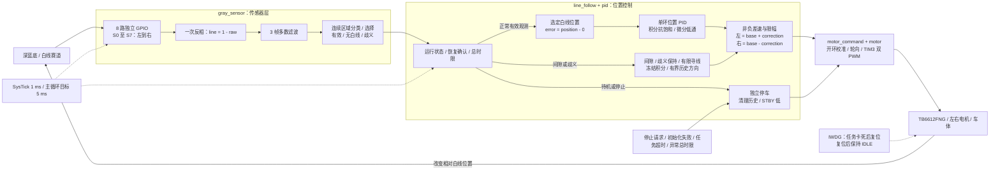
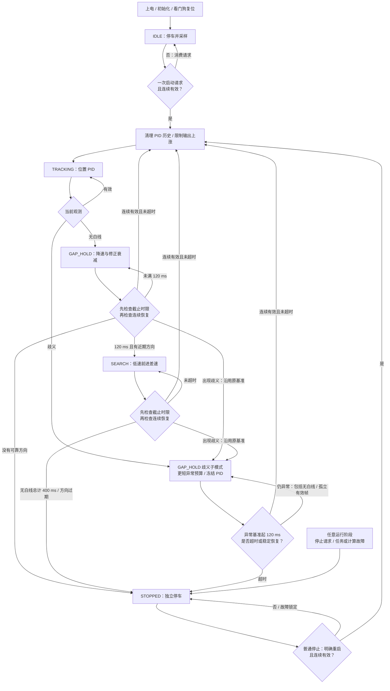

# STM32 八路数字灰度巡线小车

## 当前进度与验证边界

2026-10-14 用户明确授权进入固件编码阶段，确认 MCU 为 **STM32F103C8T6**、驱动器为 **TB6612FNG**、八路灰度模块为 **GPIO 数字输出**，并授权决定接线。首版 C / STM32Cube HAL 固件已实现，可交叉构建；尚未烧录、接线验证、架空测试或实车调参。

目标是在深蓝底、白线（含虚线）赛道上巡线。8 路分别占用 8 个 GPIO；一个白线横向位置 PID 输出左右轮 PWM 差值。当前无编码器、轮速反馈、速度 PID、双环或串级控制。PWM 是驱动强度，不能代表已知速度或精确距离。路口选路、终点识别、倒车与原地旋转不在首版范围内。

| 项目 | 当前状态 |
| --- | --- |
| GPIO、滤波、位置计算、PID、差速、状态机 | 已实现源码，主机逻辑验证通过 |
| HAL 时钟、GPIO、TIM3 PWM、IWDG、调度 | 已实现源码，交叉构建通过；板上行为待验证 |
| MCU / 电机驱动 / 灰度接口类型 | 用户确认，尚未核对实际板与模块 |
| 引脚选择 | 已落实到固件；实际接线待确认 |
| 模块供电与输出电平、输入上下拉 | 待硬件确认 |
| 深蓝底识别、轮向、停车、电量变化、赛道效果 | 未验证 |
| PID / PWM / 虚线时限 | 未标定初值 |

## 工程配置与参考来源

| 项目 | 当前配置 |
| --- | --- |
| PlatformIO 环境 / board | `genericSTM32F103C8` |
| 平台 / 框架 / 语言 | `ststm32` / `stm32cube` / C |
| 系统时钟 | 内部 HSI 8 MHz / 2 × PLL16 = 名义 64 MHz |
| APB1 / APB2 | 32 MHz / 64 MHz，TIM3 时钟名义 64 MHz |
| TIM3 PWM | PSC=0、ARR=6399，名义 10 kHz，两路 PWM1 |
| 控制周期 | 5 ms，PID 使用实际控制间隔 `dt` |

晶振未知，因此不依赖外部 HSE。[ST 数据手册](https://www.st.com/resource/en/datasheet/stm32f103c8.pdf)给出 HSI 作为 PLL 输入时最高系统时钟为 64 MHz；RC 时钟存在误差，实际 PWM/周期仍待测量。开发板环境沿用 [PlatformIO 的 genericSTM32F103C8 定义](https://docs.platformio.org/en/latest/boards/ststm32/genericSTM32F103C8.html)，没有改成 `bluepill_f103c8`。

电机底层只读参考 `/Users/zhendong/Documents/RemoteCar_wifi/remote_car` 的 `src/main.c`、`include/main.h`、`platformio.ini`、HAL 配置与中断文件。借鉴双轮接口、单轮方向输出、指令限幅及 PWM 映射；新工程重新处理初始化返回值、零输出、轮向配置和异常停车，没有引入 Wi-Fi、串口遥控协议或 300 ms 遥控超时。

## 接线方案

以下分配已由用户授权选择，固件定义见 `include/board_config.h`。它是本项目的接线方案，**不代表线路已连接或验证**。S0→S7 从车体前进方向看由左到右。

| 功能 | STM32 引脚 | 模块 / 说明 |
| --- | --- | --- |
| S0 | PA0 | 最左灰度数字输出 |
| S1 | PA1 | 灰度数字输出 |
| S2 | PA2 | 灰度数字输出 |
| S3 | PA3 | 中心左侧灰度输出 |
| S4 | PA4 | 中心右侧灰度输出 |
| S5 | PA5 | 灰度数字输出 |
| S6 | PB0 | 灰度数字输出 |
| S7 | PB1 | 最右灰度数字输出 |
| 左轮 PWM | PA6 / TIM3_CH1 | TB6612FNG PWMA |
| 右轮 PWM | PA7 / TIM3_CH2 | TB6612FNG PWMB |
| 左轮方向 | PB12、PB13 | AIN1、AIN2；AO1/AO2 接左电机 |
| 右轮方向 | PB14、PB15 | BIN1、BIN2；BO1/BO2 接右电机 |
| 电机使能 | PB5 | STBY，由 MCU 控制，不固定接高 |
| 启动 / 停止按键 | PB10 | 常开按键另一端接 GND，内部上拉 |
| SWD | PA13、PA14 | 保留 SWDIO / SWCLK，另接调试器 GND |
| 调试串口预留 | PA9、PA10 | 当前未启用 UART，可用于后续调试 |

供电规划：TB6612FNG 的逻辑 VCC 拟接 3.3 V；VM 按实际电机额定电压与驱动器允许范围供电，不从 MCU GPIO 供电。开发板、驱动和灰度模块必须共地。灰度模块型号、允许供电电压和输出类型尚未知，不能由“GPIO 输出”推断其高电平为 3.3 V，也不能未经确认将 5 V 输出直接接入本表引脚。若模块要求其他电源，先核对其输出并确定电平匹配方案。

输入当前配置为上拉，倾向于断开时读背景；须结合模块开漏/推挽输出验证，不能据此宣称断线检测已完成。记录实际传感器安装高度、间距与白线宽度；不等间距安装时调整 `gray_sensor.c` 的集中权重。接线前核对 STBY 是否被模块硬接高，建议使用外部下拉确保 MCU 复位/未运行时禁用驱动，具体模块接法待确认。

## 采样与位置语义

原始 `raw[i]` 白色为 0、黑色为 1；深蓝底预期为 1，必须用真实材料逐路确认。传感器层执行且仅执行一次 `line[i] = 1 - raw[i]`，之后统一以 1 表示白线。每 5 ms 读取 GPIOA、GPIOB 各一次寄存器快照，八路输入均为独立 GPIO；跨端口并非完全同时采样。

使用 3 帧逐路多数滤波，恢复巡线另需连续 3 次有效分类，存在滤波与确认延迟。等间距初始权重如下：

| 通道 | S0 | S1 | S2 | S3 | S4 | S5 | S6 | S7 |
| --- | --- | --- | --- | --- | --- | --- | --- | --- |
| 权重 | -7 | -5 | -3 | -1 | +1 | +3 | +5 | +7 |

只对选定的有效连续区域使用有符号 `float` 计算：

```text
position = Σ(w[i] × line[i]) / 选定区域白线路数
error = position - 0
left = base + correction
right = base - correction
```

正误差表示白线在右侧；正修正使左轮 PWM 较大、右轮较小，期望向右转。两轮“正指令均向前”仍需架空确认，可通过 `board_config.h` 的左右轮方向配置修正。

以下字符串按 S0→S7 排列；代码掩码使用 **bit0=S0、bit7=S7**，因此调试器二进制显示从高位到低位时顺序与表中字符串相反。

| `raw` | `line` | 预期处理 |
| --- | --- | --- |
| `11100111` | `00011000` | 中间两路，位置 0；line 掩码 `0x18` |
| `01111111` | `10000000` | 最左白线，位置 -7；line 掩码 `0x01` |
| `11111110` | `00000001` | 最右白线，位置 +7；line 掩码 `0x80` |
| `11111111` | `00000000` | `GRAY_NONE`，不计算除法、不输入正常 PID |
| `00000000` | `11111111` | 全白，`GRAY_AMBIGUOUS`，不能当成居中 |
| `00111100` | `11000011` | 多区域；无可靠连续性时为歧义 |

单个连续区域宽度不超过 4 路时可作为目标；任一区域宽度超过 4 路则为歧义。多个窄区域时，只有最近可靠位置存在、最近区域距离不超过 3 个权重单位，且它比次近区域至少近 1 个单位，才选择该区域。否则限时降速，超时停车。这些阈值属于未标定初值，不用于判断路口或终点。

## 总体架构（Mermaid）



反馈来自白线位置，电机端没有轮速反馈。IWDG 路径依赖复位及 STBY 电气状态，实际断驱动效果待硬件验证；图中该虚线不代表独立硬件刹车。

## PID、输出与停车

PID 初值为 `Kp=8`、`Ki=0`、`Kd=0.08`，积分限幅 20，微分低通时间常数 20 ms。调参先把 `Ki/Kd` 置 0 调 P，再加 D，确有持续偏差再加小 I；实现始终保留 PID 结构。

积分采用限幅与条件积分抗饱和，修正量按当前基础 PWM 的可用空间限制。首帧及重获白线后重置微分历史，避免突跳。丢线/歧义期间不调用正常 PID，冻结积分；稳定恢复、停止和重启时重建历史。

指令沿用 `0…255` 标尺，当前运行上限 100。基础 PWM 从中心 55 随偏差降低至 40；间隙/歧义 35，寻线 30，寻线修正 18。输出上涨斜率限制为每秒 200 指令单位，降速与停车立即执行。`motor_mix()` 同时限制修正和两轮输出，不默认倒车。

左右轮增益初值均为 1，死区补偿为 0，集中放在 `control_config.h`；后续校准仍属于开环修正。零指令先于补偿处理，不能被补偿变为转动。PWM 映射按 `CCR = calibrated_command × (ARR+1) / 255` 取整，使用实际 TIM3 周期，避免沿用参考工程 ARR=99。

**全车停车使用 STBY=0、PWM=0、方向引脚=0，选择待机高阻输出。** [TB6612FNG 真值表](https://toshiba.semicon-storage.com/info/datasheet_en_20141001.pdf?did=10660)中 STBY 低为待机；STBY 高、单轮 PWM 低则为短刹。因此运行中单轮零指令和整车停车的电气模式不同。停车命令不会保证车体立即静止，实际滑行距离与待机行为须架空及低速验证。

## 运行状态、虚线与歧义

| 状态 | 行为 | 转移 |
| --- | --- | --- |
| `IDLE` | 上电停车，持续采样 | 明确启动且连续 3 次有效观测 → `TRACKING` |
| `TRACKING` | 有效位置 PID，按偏差降速 | 无白线或歧义 → `GAP_HOLD` 的对应子模式 |
| `GAP_HOLD` | 降速，衰减最后修正，冻结 PID | 稳定恢复 → `TRACKING`；无白线满 120 ms 且有可靠方向 → `SEARCH` |
| `SEARCH` | 最近可靠方向的低速前进差速 | 稳定恢复 → `TRACKING`；总时限、无方向或故障 → `STOPPED` |
| `STOPPED` | 持续停车、清除历史 | 普通停止需明确重启且观测稳定；任务故障需复位 |



时限均使用 `uint32_t` 时间差，从最后一次连续稳定的有效观测计算，兼容时基回绕。无白线先保持 120 ms，再寻线最多 280 ms，累计 400 ms。出现歧义后，本次异常从同一基准使用 120 ms 更短预算，之后即使变成无白线也不恢复较长预算。若寻线中才出现歧义且该基准已超过 120 ms，立即停车。

只有连续 3 次有效观测可结束异常；孤立有效帧不刷新基准、不更新正常 PID。截止时限优先于同周期恢复确认，不能在超时点用恢复帧延长输出。寻线方向来自最近非中心稳定误差，方向历史超过 500 ms 不再使用；没有可靠方向时停车。未检测到稳定白线不启动盲行，启动被拒绝后不会排队等待白线自行起步。

这些时间值还未在真实虚线、弯道、运行 PWM 与电量变化下标定。过短可能在正常间隙停车，过长可能偏离后继续运动；必须记录实际通过耗时后调整，不能从 PWM 直接换算间隙距离。

## 调度、故障与操作入口

`SysTick_Handler()` 只增加 HAL 毫秒时基。主循环按目标 5 ms 单次采样和控制，不阻塞延时、不输出串口日志、不补算多个旧观测；PID 使用本次实际间隔。间隔超过 15 ms、控制计算耗时达到 5 ms、无效位置/时间或初始化错误，进入故障停车。任务故障在本次运行中锁定，按键不能清除，需复位后检查原因。

初始化先把 STBY 拉低，再初始化时钟与 PWM。HAL 初始化、PWM 配置/启动、看门狗初始化/刷新均检查返回值；停车路径不依赖已成功初始化的定时器句柄。HardFault 等异常进入相同停车路径。

IWDG 分频 64、reload=399，以名义 LSI 40 kHz 估算约 640 ms；LSI 误差和实际复位时限未测量。仅完成控制周期后喂狗，任务卡死或 SysTick 停滞后由独立看门狗复位，复位仍为 `IDLE`。它是软件时序检测之外的退路，不保证 15 ms 内处理卡死。调试器暂停时若看门狗未冻结，会复位；若调试器冻结 IWDG，则这条保护失效，须先停止电机再断点调试。

操作入口：

- PB10 常开按键接 GND，按下消抖 20 ms。待机/普通停止时请求启动，运行时请求停止；上电时已经按住不视为启动，必须松开再按。
- 调试器可读 `g_diagnostics` 查看原始/滤波掩码、选中区域、观测状态、位置、左右指令、停止原因、控制间隔和计算耗时。
- 调试器可写 `g_control_request=1` 请求一次启动，写 `2` 停止。请求用后清零；该变量不是串口协议，也没有命令保活要求。诊断结构为主循环逐字段写入，先停止电机并暂停后检查，不要把运行时跨字段读取当成原子快照。

## 文件与验证入口

| 文件 | 职责 |
| --- | --- |
| `include/board_config.h` | 引脚、轮向、输入上下拉、时钟与 PWM |
| `include/control_config.h` | 周期、PID、PWM、滤波、连续性与超时初值 |
| `src/gray_sensor.c` | 一次反相、逐路滤波、区域分类及位置 |
| `src/pid.c` | PID、条件积分抗饱和、微分滤波及复位 |
| `src/motor_command.c` | 可在主机测试的差速限幅与 PWM 映射 |
| `src/motor.c` | HAL TIM3、双轮方向和独立 STBY 停车 |
| `src/line_follow.c` | 状态机、间隙/歧义/寻线、恢复与截止时限 |
| `src/main.c`、`src/stm32f1xx_it.c` | 初始化、调度、按钮、诊断、看门狗与异常入口 |
| `include/stm32f1xx_hal_conf.h` | HAL 模块配置；DMA 是 TIM HAL 类型依赖，不用于灰度采样 |
| `test/test_logic.c`、`test/test_motor_hal.c`、`test/run_host_tests.sh` | 主机逻辑与 HAL 模拟用例，开启地址和未定义行为检查 |

```sh
# 在工程目录执行，均无需接板
sh test/run_host_tests.sh
pio run -e genericSTM32F103C8
```

输出产物为 `.pio/build/genericSTM32F103C8/firmware.elf` 与 `firmware.bin`。主机测试不执行真实外设中断或电机；HAL 电机输出测试采用模拟接口，不代表电气行为已验证。交叉构建不等于板上运行通过。当前构建使用已有 ststm32 19.7.1 / STM32CubeF1 1.8.6 / GCC Arm 7.2.1，无新增第三方应用依赖。

### VS Code 头文件解析

用 VS Code 打开本工程根目录，并启用 PlatformIO IDE 与 Microsoft C/C++ 扩展。工程内 `.vscode/settings.json` 启用 C/C++ IntelliSense，覆盖用户全局的禁用设置，并关闭本工程的 clangd。解析使用 PlatformIO 生成的 ARM 编译器、CMSIS/HAL 头文件路径和芯片宏，编译数据库指向工程根目录的 `compile_commands.json`。

首次打开、清理生成文件或修改构建配置后，在工程目录执行：

```sh
pio project init --ide vscode -e genericSTM32F103C8
pio run -e genericSTM32F103C8 -t compiledb
```

第一条命令刷新 PlatformIO 自动生成的 `.vscode/c_cpp_properties.json`，第二条生成实际编译数据库；这两个生成文件不提交到 Git。若切换语言服务后诊断未刷新，执行 VS Code 的 `Developer: Reload Window`。不要手动修改自动生成的头文件路径，也不要通过关闭 IntelliSense 消除报错。

## 后续实施顺序

1. **硬件确认与接线**：核对实际模块电平、供电、引脚和 SWD；真实白线/深蓝底逐路记录，确定上下拉与阈值。
2. **底层板上验证**：先确认上电 STBY 低、PWM 频率、按键入口；架空确认轮向、两轮独立指令、单轮零 PWM、整车待机和复位停车。未完成前不落地运行。
3. **位置与控制板上核对**：对照六类输入与诊断，确认左右符号、周期/耗时、故障停车与看门狗效果。
4. **实线低速调参**：先 P 再 PD，视需要加 I；直线 → 缓弯 → 急弯，记录参数、阈值、电量与现象。
5. **虚线与异常**：居中/弯道虚线、短噪声、重获、持续无白线、全白与多区域交替；标定间隙/总时限并测量停车时间。
6. **整理交付**：更新最终接线、标定参数与板上记录，分别报告逻辑、构建和实车结果。

当前首版软件工作已完成；下一项是硬件确认及架空验证。详细结果与未执行项目见 `docs/validation.md`。
