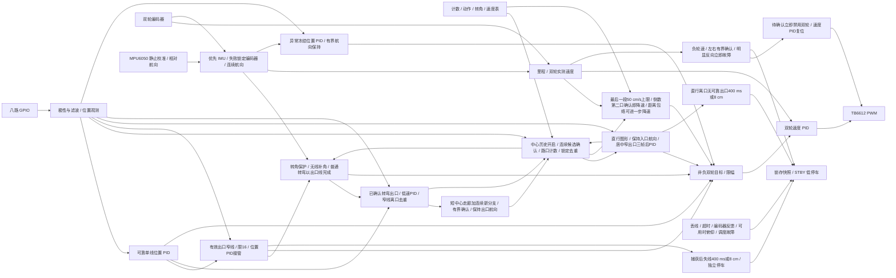
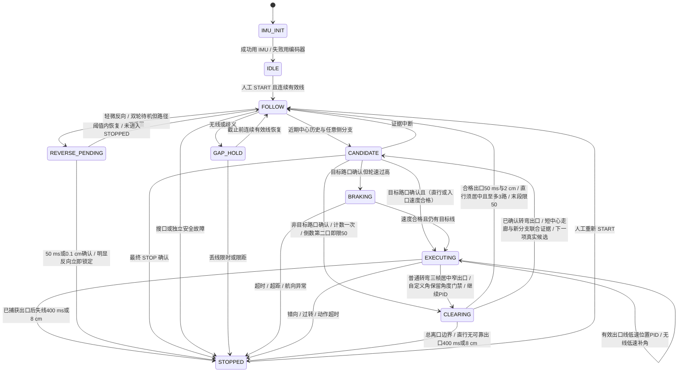
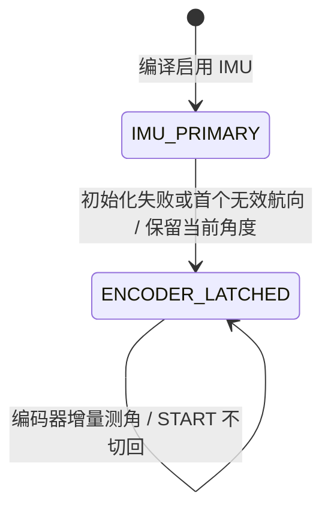

# STM32 八路数字灰度巡线小车

STM32F103C8T6 + TB6612FNG + 八路 GPIO 数字灰度。固件使用 C / STM32Cube HAL，系统时钟 HSI/2 × 16 = 64 MHz。当前 `new` 分支按[校赛计划](https://app.notion.com/p/3f8c2c8fcde6800783fee3745c60f292)重构为路口计数导航；本文中的当前规则取代历史证据文件内的距离窗口方案。

## 当前状态与边界

先更新 `AGENTS.md`，再修改路径、转向和测试。路口计数决定动作，MPU6050 相对航向决定转角，灰度确认出口，编码器提供速度反馈和短期里程。预估距离只影响速度，不能触发动作、跳过路口或宣告终点。

| 项目 | 当前状态 |
|---|---|
| 构建环境 | 唯一 `genericSTM32F103C8`，`pio run` |
| 编码器 / 路径 / IMU | `motion_config.h` 默认均为 1 |
| 目标线极性 | `control_config.h` 当前 `GRAY_INVERT_ENABLED=0` 巡黑线 |
| 路径表 | 当前本地表依次 LEFT、LEFT、LEFT、STOP；计数 1/4/2/3，巡航目标 200 cm/s、入口/转弯上限 50 cm/s，各项圆弧关闭；路过路口上限初值 60 cm/s |
| 最后一段长度 | 当前本地表 65/70/50/70 cm；必须按离口确认点到目标灰度触发点核实，不能直接使用旧中心间距离 |
| 安全减速度 | 当前本地配置 `BRAKING_CALIBRATION_CONFIRMED=1`、`BRAKING_SAFE_DECEL_CM_S2=120`；标志置 1 不代表本次已实测，200→50 按此模型需 156.25 cm（不含余量），短段可能无法及时降速 |
| 反向制动 | 默认关闭；现有实验代码仅保留显式编译测试，未补齐限流和双轮一致性硬件保护，不可据此上车 |
| 短路制动 | 独立 `motor_short_brake()` 接口和 HAL 模拟测试；导航不自动调用，效果/电流/温升待测 |
| 停车 / 重启 | 上电 IDLE，显式 START 且连续有效线才启动；停车后保持，人工 START 重置路径计数；自动续跑已停用 |
| 丢线保护 | 路径模式始终执行 400 ms / 8 cm 保护；仅巡线实验才服从 `LOST_LINE_STOP_ENABLED` |
| 机会式巡线 | `OPPORTUNISTIC_FALLBACK_ENABLED=0`，仅记录后续边界，尚未实现 |

200 cm/s 是未验证的目标值。2026-10-30 用户信息小车最高可能达到 5 m/s：`WHEEL_TARGET_MAX_CM_S`、`ODOMETRY_MAX_SPEED_CM_S`（650）与速度前馈已按 500 cm/s 满量程修正，但 5 m/s 本身未经实测，前馈/增益仍需台架重标。当前未获得新规则下的赛道计数、最后一段测距或减速度标定，不能把构建或主机回归当成高速上车许可。未烧录、未运行电机、未进行新方案实车验证。

## 控制模式

头文件决定固件模式，不增加 PlatformIO 环境覆盖入口。`ENCODER_CONTROL_ENABLED=0` + `PRESET_ROUTE_ENABLED=0` 为普通非负 PWM 巡线，无编码器初始化与路径动作。编码器为 1、路径为 0 时只有灰度位置外环与双轮速度内环，使用 `LINE_FOLLOW_SPEED_CM_S`。路径为 1 必须同时开启编码器；当前 IMU 为 1，航向取陀螺仪积分，左右轮差不替代 IMU 输入。仅巡线不读取或校验路径表。

灰度 S0→S7 为车体左→右，统一目标线为 1，权重 `[-7,-5,-3,-1,+1,+3,+5,+7]`。`error=position-0`，正误差使左轮目标大于右轮，向右修正。正常只对可靠单一区域更新位置 PID，全目标、多区域和无线不能当成居中。PID 保留 dt、微分滤波、积分限幅、抗饱和与历史复位。

## 工程配置与参考来源

| 项目 | 当前配置 |
| --- | --- |
| PlatformIO 环境 / board | `genericSTM32F103C8` |
| 平台 / 框架 / 语言 | `ststm32` / `stm32cube` / C |
| 系统时钟 | 内部 HSI 8 MHz / 2 × PLL16 = 名义 64 MHz |
| APB1 / APB2 | 32 MHz / 64 MHz，TIM3 时钟名义 64 MHz |
| TIM3 PWM | PSC=0、ARR=6399，名义 10 kHz，两路 PWM1 |
| TIM1 / TIM4 编码器 | 仅开关为 1：PSC=0、ARR=65535、TI12 四倍频，输入滤波 6 |
| 控制周期 | 5 ms，PID 使用实际控制间隔 `dt` |

晶振未知，因此不依赖外部 HSE。[ST 数据手册](https://www.st.com/resource/en/datasheet/stm32f103c8.pdf)给出 HSI 作为 PLL 输入时最高系统时钟为 64 MHz；RC 时钟存在误差，实际 PWM/周期仍待测量。开发板环境沿用 [PlatformIO 的 genericSTM32F103C8 定义](https://docs.platformio.org/en/latest/boards/ststm32/genericSTM32F103C8.html)，没有改成 `bluepill_f103c8`。

电机底层只读参考 `/Users/zhendong/Documents/RemoteCar_wifi/remote_car` 的 `src/main.c`、`include/main.h`、`platformio.ini`、HAL 配置与中断文件。借鉴双轮接口、单轮方向输出、指令限幅及 PWM 映射；新工程重新处理初始化返回值、零输出、轮向配置和异常停车，没有引入 Wi-Fi、串口遥控协议或 300 ms 遥控超时。

## 接线方案

以下分配已由用户授权选择，固件定义见 `include/board_config.h`。它是本项目的接线方案，**不代表线路已连接或验证**。S0→S7 从车体前进方向看由左到右。

| 功能 | STM32 引脚 | 模块 / 说明 |
| --- | --- | --- |
| S0 | PA0 | 最左灰度数字输出 |
| S1 | PA1 | 灰度数字输出 |
| S2 | PA2 | 灰度数字输出 |
| S3 | PA3 | 中心左侧灰度输出 |
| S4 | PA4 | 中心右侧灰度输出 |
| S5 | PA5 | 灰度数字输出 |
| S6 | PB0 | 灰度数字输出 |
| S7 | PB1 | 最右灰度数字输出 |
| 左轮 PWM | PA6 / TIM3_CH1 | TB6612FNG PWMA |
| 右轮 PWM | PA7 / TIM3_CH2 | TB6612FNG PWMB |
| 左轮方向 | PB12、PB13 | AIN1、AIN2；AO1/AO2 接左电机 |
| 右轮方向 | PB14、PB15 | BIN1、BIN2；BO1/BO2 接右电机 |
| 电机使能 | PB5 | STBY，由 MCU 控制，不固定接高 |
| 启动 / 停止按键 | PB10 | 常开按键另一端接 GND，内部上拉 |
| 左轮编码器 A / B | PA8、PA9 | 开关为 1 时使用 TIM1_CH1 / TIM1_CH2 |
| 右轮编码器 A / B | PB6、PB7 | 开关为 1 时使用 TIM4_CH1 / TIM4_CH2 |
| MPU6050 SCL | PB8 / I²C1 重映射 SCL | A10 J12.5，SCL 上拉至 3.3 V |
| MPU6050 SDA | PB9 / I²C1 重映射 SDA | A10 J12.6，SDA 上拉至 3.3 V |
| MPU6050 VCC | +3V3 | A10 J12.10，模块必须兼容 3.3 V 电源 |
| MPU6050 GND | GND | A10 J11.10，与 STM32 共地 |
| MPU6050 AD0（有时误读成 ADC） | GND | I²C 7 位地址 0x68；接 3.3 V 为 0x69，需修改配置 |
| MPU6050 XDA / XCL / INT | 不连接 | 辅助 I²C、数据中断；代码轮询主 I²C |
| SWD | PA13、PA14 | 保留 SWDIO / SWCLK，另接调试器 GND |
| 原调试串口预留变更 | PA9 已分配给编码器，PA10 仍未使用 | 不再将 PA9/PA10 作为可用的完整 USART1 默认接线对 |

### MPU6050 接线和航向开关（2026-10-29）

在 `include/motion_config.h` 中设置 `MPU6050_ENABLED`：当前为 **1**，优先从 MPU6050 得到航向，初始化失败或运行数据失效后锁定降级到编码器轮差；设为 **0** 则始终使用编码器轮差估角，必须同时开启 `ENCODER_CONTROL_ENABLED=1`，修改后重新 `pio run` 编译。连接 PB8/PB9 时 I²C1 启用 remap（PB6/PB7 已用于编码器，不改变）；I²C 时钟 400 kHz。SCL/SDA 均须上拉到 **3.3 V**，如模块板上已经有连接 3.3 V 的电阻无需重复并联；否则各加约 4.7 kΩ。切勿把两根线通过上拉拉到 5 V。模块上标着 `ADC` 的排针如不确定是否为 `AD0`，先查实物丝印或模块电路，不要猜测其功能。

模块初始化时先读 `WHO_AM_I=0x68`，设定陀螺仪 ±2000°/s、约 42 Hz 低通和 1 kHz 输出速率。**上电保持小车静止**，驱动待机状态下每窗读取 32 次 Z 轴采样估计零偏；控制循环每 5 ms 检查数据就绪，启用俯仰保护时一次读 14 字节获取加速度计 XYZ、温度及陀螺仪 XYZ，关闭保护时只读取 Z 轴角速度。扣除零偏后按实际间隔积分为连续相对航向（rad）。启用后所有共用 `odometry.heading_rad` 的角度计算，包括路口转角/出口、圆弧规划反馈、异常航向保持、二维轮轴与灰度探头位姿及短期位移估计，都改用 IMU。**轮程、轮速、路径厘米位置及双轮速度 PID 仍使用编码器**。陀螺仪不能直接给出位移。

用户确认 MPU6050 **倒置安装**（芯片 Z 正轴朝下，板面仍基本水平），因此 `MPU6050_YAW_SIGN=+1`，水平面导航仅积分 Z 轴偏航角；新增俯仰角只参与拿起停机保护，不参与航向计算或位置 PID。先手持缓慢右转并观察 `g_diagnostics.heading_rad` 是否增加，若实际模块轴向与假定不同再调整正负号。**歪斜安装时单纯 Z 轴读数只是车身真实转动在该轴的投影**，当前没有安装矩阵补偿，应把板子倒扣并水平固定。上电标定时不可移动或让电机震动，否则会产生角度偏差。

**俯仰拿起保护（2026-10-29，默认启用）：** `include/motion_config.h` 中 `MPU6050_PITCH_STOP_ENABLED=1`；设置为 `0` 时禁用该判定（保留 MPU6050 偏航角），重新构建生效。该功能只在 `MPU6050_ENABLED=1` 时采样/生效；若关闭 IMU，旧编码器角度模式保持可用，不会请求加速度计。传感器 **X 轴须与车体前后轴平行**，倒置水平安装使 Z 轴朝下；`tilt_guard.c` 用加速度计读数计算 `abs(atan2(ax, sqrt(ay²+az²)))` 的角度（单位度），所以抬头与低头、倒置极性都触发同一个绝对值阈值。**俯仰绝对值大于 40°、连续 50 ms**，触发 `LINE_STOP_TILT` 锁定停车，STBY 拉低；姿态恢复水平后保持停止；角度持续更新，下一次明确按启动键时，用本帧有效重力及原40°门槛检查姿态，放平后解除俯仰锁定，再按连续有效线规则启动，无须复位。仍倾斜/数据不可信则保持停止；不能清除IMU通信、编码器或任务锁定故障。`MPU6050_PITCH_FILTER_TAU_S=0.040f` 进行低通；加速度模长明显偏离 1g（低于 0.70g 或高于 1.30g）的采样不累计确认时间，以减轻强烈加减速造成的假俯仰。可读 `g_diagnostics.pitch_stop_enabled`、`pitch_deg`、`pitch_over_threshold_ms` 与 `pitch_stop_latched`；这次停车的 `stop_reason`/`stop_snapshot.reason` 为 `LINE_STOP_TILT`。已有电机/看门狗故障保护独立生效。

注意这是**车体前后俯仰超限停机**，并不直接检测人手接触。把小车基本水平地抬起来，或者只向左右滚转而没有明显俯仰，都不一定触发。激烈运动时加速度也可能影响倾角估计，滤波与近 1g 判定是暂定保护，不是实车验证的安全认证。模块若绕 Z 轴旋转了 90°，X 轴便不能表示小车前后俯仰；必须确认实际芯片轴向并调整安装后再测试。

**2026-10-30 最新用户授权：IMU 失败降级而非阻塞启动。** 上电执行一次有界初始化序列（含内部有限重试），失败后继续进入 IDLE，在线按 START 可用编码器航向启动，不再有“按键只重试校准”的等待循环。运行中首个 I²C/数据就绪/量程/非有限航向失败，当帧从当前累计航向加编码器轮差，不清零里程、路口计数、入口参考或 PID 状态；本次上电锁定编码器，不自动跳回可能已过期的 IMU 航向。START 不清除此降级；复位后重新尝试 IMU。不在行驶中做阻塞初始化，降级后也不重复读失效 IMU。有效线、路径合法、编码器标定和所有非 IMU 故障门禁保留，不保证无线或硬件故障时强行启动。上电初始化完成前的短按不排队，按住上电仍不启动。

诊断 `heading_source`：0 编码器、1 IMU；`heading_fallback_reason`：0 无降级、1 首帧即不可用、2 运行数据失效；`heading_fallback_ms` 为首个降级周期时刻。`imu_init_failure_stage` 保留初始化失败证据，`imu_ready` 表示本帧可用，`pitch_monitor_available` 表示俯仰检测实际可用；停车快照也保存来源/原因/时刻。降级编码器使用现有 `ODOMETRY_HEADING_SCALE=0.77`，受轮距、距离尺度、打滑及地面影响，不等同 IMU 精度。**IMU 不可用时无法继续提供可靠俯仰拿起检测**，但之前已锁存的俯仰停车不因降级自动解除。IMU 健康时原俯仰检测和明确 START 复位条件不变。此功能未实车验证，须架空轮向确认后低速测试。

**历史启动故障排查：** ST-Link 曾读到 `Error_Handler`、`control_count=0`。地址探测和配置/校准质量检查仍保留；现已用上文授权的编码器降级取代 IMU 失败锁定。`imu_init_failure_stage`：0 成功、1 STM32 I²C 初始化、2 身份/地址探测、3 写配置、4 新鲜样本采集、6 配置回读、7 校准质量、8 释放 I²C 失败、9 总线恢复时 SCL/SDA 电平异常。探测不能替代接线/供电检查，未修复或确证真实噪声来源。

**校准时间：** 每窗 32 样本、间隔 5 ms，最多 5 窗；零偏绝对值 ≤328 LSB、去除两端各约 5% 后跨度 ≤64 LSB。首窗合格名义约 0.76 s，五窗不合格约 1.4 s，均不含 I²C 事务及通信重试。短窗口可能遗漏慢扰动，待实车验证。失败数值不用于 IMU 航向，而进入编码器模式；最近阶段 7、中位数 -2006、中央跨度 2305 LSB 的真实噪声来源仍未知。初始化期间电机待机、IWDG 尚未启用。

**初始化通信重试：** 通信/配置失败时在待机下间隔 100 ms 完整重试，最多 3 次，仍执行双地址、身份、配置及静止检查；校准质量阶段 7 不完整重试（内部已有 5 窗）。`imu_init_attempts` 记录次数。全部失败后不继续阻塞按键，使用编码器；这不是修复 I²C 硬件故障，需烧录后实测。

参考 `dev` 分支恢复初始化 I²C 事务 25 ms 超时（运行期保持 2 ms），以及每轮双地址探测失败后的 I²C 反初始化、外设复位与重新初始化。完整初始化重试仍保留；模块始终须通过身份、配置与静止质量检查。这是排查阶段 2 的软件改进，尚不能证明就是实车根因或修复持续总线故障。

**启动总线恢复（本次修复）：** 旧流程只重置 I²C 外设，未处理 [ST ES096 §2.8.7](https://www.st.com/resource/en/errata_sheet/es096-stm32f101x8b-stm32f102x8b-and-stm32f103x8b-mediumdensity-device-limitations-stmicroelectronics.pdf) 中的模拟滤波器 BUSY 锁死。现在在每次初始化及双地址探测失败后的重试中，禁用 I²C、将 PB8/PB9 配为开漏并释放为高；必要时最多输出 9 个 SCL 脉冲释放中断的从机事务，随后产生 SDA 低→SCL 低→SCL 高→SDA 高的转换并逐项检查实际电平，恢复复用开漏后重置/初始化外设。电平等待有界，持续拉低记阶段 9；只在上电待机时执行，不在 START 或运动中恢复总线。正常每次恢复新增约 5 ms，脉冲和等待可能增加启动耗时；质量校准门限不放宽。阶段 2 只说明身份/地址探测失败，尚无板上 BUSY/线电平证据，不能声称此次实车已确诊该勘误。

新增诊断 `imu_bus_recovery_count`、`imu_last_i2c_status`、`imu_last_i2c_error`、`imu_last_who_am_i`、`imu_bus_line_mask`（bit0=SCL 高、bit1=SDA 高），由初始化结果发布，可区分无应答、HAL 错误、身份不符和总线电平恢复失败。原有失败降级编码器、运行期 2 ms 通信超时与 5 ms 控制预算保护保留。主机假 HAL 可验证恢复流程和界限，不能验证实际引脚波形、供电、上拉或从机硬件状态。


供电以用户 2026-10-27 信息为准：电池 12 V / 1200 mAh，电机额定 **7.4 V、减速箱 1:20**，现由 PCB 降压后的约 5 V VM 驱动。A10 设计路径为 `J13 → F1 → D1 → TPS54302/L1 → VM → TB6612`；`VM → R4（0 Ω）→ 核心板 +5V`，核心板再提供 +3V3。TB6612 逻辑 VCC 与灰度使用 3.3 V，各模块共地。设计标称 VM 约 5.077 V，实际值及电机负载下的压降待测；“3 A 降压芯片”不等于整板或双电机可持续输出 3 A。

**禁止直接把板载 VM 调到 7.4 V**，否则 R4 会将该电压带到核心板 +5V。J1/J2 是低压输出接口，不能接入电池；USB 供电须遵循原设计的 R4 隔离要求。本次不改变这些连接。电池“12 V”尚不能证明满充也不超过 12 V；若实际是 3 串锂离子电池，须按其标签核对满充电压与整板输入边界，不能只用 TPS54302 芯片最大额定值判断。电源及接口依据见 [A10 电气终审](docs/A10-final-electrical-review.md)。

灰度模块具体型号、数字输出类型与实际电平仍需核对，不能将未知 5 V 信号直接接入灰度引脚。

灰度输入当前配置为上拉，断开时倾向于读高电平；巡白线时可能表现为背景，当前巡黑线时可能表现为目标线；须结合模块开漏/推挽输出验证，不能据此宣称断线检测已完成。记录实际传感器安装高度、间距与白线宽度；不等间距安装时调整 `gray_sensor.c` 的集中权重。A2 原理图已加入 STBY 的 10 kΩ 外部下拉；接线前仍需核对模块是否把 STBY 硬接高，MCU 复位时的真实断驱动效果待架空验证。

### 未使用引脚与编码器接线（2026-10-19）

选择编码器之前，应用固件没有分配的常规候选是 **PA8、PA9、PA10、PA11、PA12、PB6、PB7、PB8、PB9、PB11**。PA9/PA10 原先仅是文档中的 UART 预留，未初始化串口。分配编码器后剩余 **PA10、PA11、PA12、PB8、PB9、PB11**；其中 PA11/PA12 如后续启用 USB 则不再可用，且须核对核心板现有 USB 接线。

其他引脚有附带条件：PA15/PB3/PB4 复位后用于 JTAG，需要配置 SWJ 才能作为普通 GPIO，当前不改；PA13/PA14 保留 SWD。PB2 涉及 BOOT1，当前载板 J6.15 为 PB10 按键，并未引出 PB2。PC13/PC14/PC15 涉及核心板 LED / 低速晶振的可能连接，须核对实物；PD0/PD1 留给外部高速晶振，不因固件使用 HSI 就视作可用排针。

选择 PA8/PA9 和 PB6/PB7 是因为两组均对应同一定时器的 CH1/CH2 默认映射，开关为 1 时分别用于正交编码器计数，无需修改现有 TIM3 PWM 或关闭 JTAG/SWD。[ST 数据手册表 5](https://www.st.com/resource/en/datasheet/stm32f103c8.pdf)列出这些引脚及其 FT 属性；TIM1 的互补输出也与 PB13/PB14 等复用，当前编码器初始化不配置这些电机方向引脚或互补输出。

按用户提供图片中的 **霍尔编码器款**，每个电机六线定义如下。图中的编号是连接器针序，不能按未知线色推断，也不能混用右侧 GMR 的线序。

| 霍尔款针号 | 功能 | 左轮连接 | 右轮连接 |
| --- | --- | --- | --- |
| 1 | 电机线 − | TB6612 左轮输出对的一端 | TB6612 右轮输出对的一端 |
| 2 | 编码器电源 | PCB 已预留的编码器电源，先核对额定电压 | 同左 |
| 3 | 编码器 A 相 | PA8；A10 扩展口 J11.4 | PB6；A10 扩展口 J12.3 |
| 4 | 编码器 B 相 | PA9；A10 扩展口 J11.5 | PB7；A10 扩展口 J12.4 |
| 5 | 编码器地 | PCB GND，与 MCU / TB6612 共地 | 同左 |
| 6 | 电机线 + | 同一左轮输出对的另一端 | 同一右轮输出对的另一端 |

TB6612 电机输出为 H 桥两端，不是固定电源正负；电机线极性和车体前进方向需架空确认。A10 接口编号来自本仓库 `PCB design/stm32PCB-A10/stm32PCB-A10.netlist.json`：J11.4/5 与 J7.5/6 同网，J12.3/4 与 J7.14/15 同网；接线按实物丝印找针，不按照片观看方向数针。这是已存设计文件核对，未证明实物连通。

**2026-10-30 实车故障教训：** 曾出现“启动后只转一下就停”，快照显示两轮编码器计数全程为 0、目标 37 cm/s 而实测 0，最终由用户查明是**编码器 3.3 V 电源线（2 脚）脱落**。该插头同时承载电机线与编码器线，电机能动不代表编码器供电已接通；断电后编码器无脉冲，速度环判堵转并在 350 ms 停车，属保护正确动作。**插拔电机/编码器插头后必须先架空手转轮子，确认 `g_diagnostics.left_encoder/right_encoder` 随转动变化，再上电试跑。** 与之叠加的另一个软件问题（速度斜坡被位置曲线钳死）已单独修复，两者互不替代。

开关为 1 时，初始化入口为 `encoder_init()`，在传感器 GPIO 初始化之后、PWM 初始化之前执行。内部先以 `GPIO_MODE_INPUT` + `GPIO_NOPULL` 配置四个输入，再启动 TIM1 / TIM4 的 TI12 四倍频计数。主循环每 5 ms 顺序读取两个 16 位计数器，计算有符号回绕增量；不用 EXTI 或逐脉冲中断。计数方式依据 [ST HAL 编码器接口](https://github.com/STMicroelectronics/stm32f1xx-hal-driver/blob/master/Src/stm32f1xx_hal_tim.c)与 [RM0008](https://www.st.com/resource/en/reference_manual/cd00171190.pdf)。在编码器模式下，即使标定尚未填写，仍可在停车状态通过 `g_diagnostics.left_encoder/right_encoder` 观察手动转轮计数。

**供电电压与信号高电平分别确认。** 默认关闭内部上下拉，是为了兼容后续核实后的 FT 输入使用条件；[ST 数据手册 §5.3.1 / §5.3.13](https://www.st.com/resource/en/datasheet/stm32f103c8.pdf)要求输入超过 VDD+0.3 V 时禁用内部上下拉。若为开漏且没有已有上拉，输入会浮空，应根据模块规格增加外部上拉，优先采用兼容的 3.3 V 信号方案。若模块自带上拉，先确认其接到哪条电源。不能仅凭“霍尔编码器”认定 A/B 为 3.3 V 或 5 V，也不能仅凭 FT 属性认定电源时序、噪声与整个模块接口已经验证。PCB 电源已预留，本次不改动电源或制造文件。

PCB 历史版本保留在 `hardware/` 与 `PCB design/`。当前采用 A10 资料，两组模块双排中心距为 **15.24 mm**；旧 A5 的 16 mm 描述不适用于 A10。详见 [A10 电气终审](docs/A10-final-electrical-review.md)。

## 采样与位置语义

在 `include/control_config.h` 选择巡线颜色，当前为巡黑线：

```c
#define GRAY_INVERT_ENABLED 0  // 1：巡白线，反相；0：巡黑线，不反相
```

| 配置 | GPIO 到目标线的转换 | 目标线电平 | 背景电平 |
| --- | --- | --- | --- |
| `GRAY_INVERT_ENABLED=1`（巡白线） | `line[i] = 1 - raw[i]` | 白色 0 | 黑色 1 |
| `GRAY_INVERT_ENABLED=0`（巡黑线） | `line[i] = raw[i]` | 黑色 1 | 白色 0 |

这是编译开关，修改后须重新编译，其他数值会编译报错。生产固件仅使用 `genericSTM32F103C8` 一个环境并遵循头文件；主机测试独立覆盖不同组合。它独立于编码器、路径开关。原始 `raw[i]` 白色为 0、黑色为 1，深蓝底预期为 1；这些电平仍必须用真实材料逐路确认。极性只在传感器层转换，随后统一以 1 表示**目标线**；滤波、位置符号、启动确认、路口判断与丢线保护沿用同一逻辑。为兼容现有接口保留 `white_count` 字段名，其含义改为目标线路数。下文控制说明中沿用的“白线/全白”在巡黑线模式分别指目标黑线/全部通道检测到黑线。

灰度输入仍使用原有上拉；巡黑线时断开的通道可能读为目标线，开关不提供断线检测。每 5 ms 读取 GPIOA、GPIOB 各一次寄存器快照，八路输入均为独立 GPIO；跨端口并非完全同时采样。

当前已关闭地板细缝过滤，恢复原始单路目标线响应：

```c
#define FLOOR_SEAM_FILTER_ENABLED 0  // 当前：关闭，保留单路目标区域
// 修改后执行 pio run，并上传对应固件。
```

仅在将该过滤开关设为 1 时，例如 `0x98`（中心两路 + 右侧孤立一路）变为 `0x18`，`0x99`（中心两路 + 两侧孤立点）也变为 `0x18`；`0x03`、`0xc0` 等真实两路边缘区域完整保留，`0xff` 仍为歧义。多个两路区域不会被拼成单一区域。`0x80` 等仅一路信号在练习模式变为无可靠线，按原丢线保持/停车开关处理，不能用来启动。该宽度规则不识别物体语义，不能把它作为比赛线宽的已标定参数；真实线窄到只有一路时，应关闭模式或先核对安装高度/传感器阈值。

使用 3 帧逐路多数滤波；开启地板练习模式时再剔除独立单路区域。关闭该模式恢复原始空间分辨率。恢复巡线另需连续 3 次有效分类，存在滤波与确认延迟。等间距初始权重如下：

| 通道 | S0 | S1 | S2 | S3 | S4 | S5 | S6 | S7 |
| --- | --- | --- | --- | --- | --- | --- | --- | --- |
| 权重 | -7 | -5 | -3 | -1 | +1 | +3 | +5 | +7 |

只对选定的有效连续区域使用有符号 `float` 计算：

```text
position = Σ(w[i] × line[i]) / 选定区域目标线路数
error = position - 0
# 编码器模式（开关 1）：
left_target_cm_s = base_cm_s + correction_cm_s
right_target_cm_s = base_cm_s - correction_cm_s
# PWM 模式（开关 0）：
left_pwm = base_pwm + correction_pwm
right_pwm = base_pwm - correction_pwm
```

正误差表示目标线在右侧；正修正在编码器模式使左轮目标速度较大、右轮较小，在 PWM 模式使左轮 PWM 较大、右轮较小，期望向右转。两轮“正指令均向前”仍需架空确认，可通过 `board_config.h` 的左右轮方向配置修正。

下表为巡白线（`GRAY_INVERT_ENABLED=1`）示例。巡黑线时，同一 `line` 图案的 `raw` 与 `line` 相同。以下字符串按 S0→S7 排列；代码掩码使用 **bit0=S0、bit7=S7**，因此调试器二进制显示从高位到低位时顺序与表中字符串相反。

| `raw` | `line` | 预期处理 |
| --- | --- | --- |
| `11100111` | `00011000` | 中间两路，位置 0；line 掩码 `0x18` |
| `01111111` | `10000000` | 最左白线，位置 -7；line 掩码 `0x01` |
| `11111110` | `00000001` | 最右白线，位置 +7；line 掩码 `0x80` |
| `11111111` | `00000000` | `GRAY_NONE`，不计算除法、不输入正常 PID |
| `00000000` | `11111111` | 全白，`GRAY_AMBIGUOUS`，不能当成居中 |
| `00111100` | `11000011` | 多区域；无可靠连续性时为歧义 |

单个连续区域宽度在 PWM 模式不超过 7 路、编码器模式不超过 6 路时可作为目标；任一区域超过对应模式宽度上限则为歧义。多个窄区域时，只有最近可靠位置存在、最近区域距离不超过 3 个权重单位，且它比次近区域至少近 1 个单位，才选择该区域。但本次导航层采用更保守的规则：多区域即使在传感器层选出了一个区域，也不进入普通位置 PID；与宽线、无白线一起先交给路径/路口判断，否则按丢线保持航向。这些阈值属于未标定初值。

## 路口计数、转向与离口

`RouteStep` 字段顺序为：

```c
{junction_count, turn_speed, action, cruise_speed,
 angle_deg, corner_arc_enabled, final_segment_length_cm}
// 示例：上个动作离口后第 2 个路口左转；最后一段未测量故为 0。
{2, 12.0f, LEFT, 40, 0.0f, false, 0.0f}
```

`junction_count` 至少为 1，`turn_speed` 单位 cm/s，限制动作入口的双轮实测速度和动作轮目标。`cruise_speed` 是巡航目标。CUSTOM_TURN 的 `angle_deg` 顺时针正、逆时针负，范围 [-360,0) 或 (0,360]。最后一项必须 STOP，中途不得 STOP；表速、转向速度、角度和可选长度均须通过校验。表内计数是待实车确认的配置，并非从旧距离推算的事实。

通用检测与动作方向解耦：最近连续中心窄线之后，任意一侧至少两路分支构成候选；中心扩宽或近期中心线后的单一边缘窄线可参与确认。需要连续至少 3 帧且前进至少 0.1 cm，候选最长 100 ms。全丢线、单个边缘噪点、孤立骤变不计数；采样间隔超出 15 ms 中断候选。全目标宽线只有配合入口历史和持续位移才可能被认作路口。这是形状启发式，不能保证区分具有相同形状的元件图形、接缝和物理路口。

确认即累计一次并锁定，直到合格离口线连续至少 50 ms、至少 2 cm 且至少 3 帧才重新允许计数。**转弯后的 CLEARING** 已经确认出口，继续允许单区域窄线横向移动，不要求每帧居中；转角和连续中心出口门禁不因此豁免。**直行过口的 CLEARING**（非目标路口、STRAIGHT 及直行闭合）尚未确认出口，要求单一区域、`|position|≤2`、至多 `JUNCTION_STRAIGHT_EXIT_MAX_WIDTH=3` 路，侧边线与中心宽图形不能作为离口线。直行阶段先保持入口航向，连续 3 帧合格居中出口线后才启用位置 PID；任一不合格观测或采样中断清空去重证据。过路速度受 cruise、过路速度参数及末段 50 cm/s 限速共同约束，使用外轮上限混合，航向/位置修正不会令外轮超过限速。

直行离口从进入 CLEARING 或最近连续合格出口线起，400 ms / 8 cm 任一达到即 `ROUTE_FAILURE_CLEAR_LINE_LOST=12` 停车；先检查期限再接受恢复，孤立线不能续时。

**转弯出口紧接下一图形（2026-10-30 补充）：** 新实车快照停在第1项（索引1）LEFT的 CLEARING，原400 ms歧义停车，灰度0x1a、两区域；该弯已确认出口，但约0.6 cm单一区域出口后即进入二极管，未能积满普通2 cm去重。现在仅在已确认角度和出口的转弯离口中，允许“连续中心出口至少3帧、20 ms、0.30 cm”加上“新的两区域中心组+外侧分支，连续3帧、前进0.1 cm、100 ms内”联合完成交接。记录的真实新分支样本交给下一表项作一次正常路口确认；仍执行下一项计数、入口轮速门禁、STOP及循环规则，不以距离补计、不豁免转角。仅有单帧、无中心走廊、无位移、采样/形状中断或三块孤立区域不能交接。

这段至多100 ms的新分支确认期间保持已确认出口航向，位置PID冻结、目标不高于16 cm/s；不进入普通歧义计时，也不刷新旧离口总时限。确认后新图形按下一项正常处理，非目标口仍须居中窄出口50 ms/2 cm去重，末段50 cm/s及400 ms/8 cm保护继续生效。普通离口条件保留。0.30 cm短走廊是未实测通用性的初值，形状相同的路口尾缘仍可能误判，须实车复测；不宣称语义识别。证据与回归见 `docs/evidence/2026-10-30-diode-stop-retest/`。
原 1500 ms / 20 cm 总离口边界仍保留。非目标路口离口前不推进表项；目标路口执行表内动作。STRAIGHT 和 STOP 同样必须确认真实路口，距离不会消费表项。短连续弯间距不足解锁条件时仍可能漏计，须低速实测。

**2026-10-30 二极管视频与快照修正：** 用户视频 `IMG_1052.MOV` 显示转弯后通过二极管、随后在下一处直角冲出。沿用只读授权、不检查固件一致性取得的 SRAM 按本地 ELF 解码：index=2、junctions_seen=1、passing_junction=true，二极管已计数；停车前在 CLEARING 575 ms / 20.1285 cm 超距，命中 ACTION_TIMEOUT。23636 ms 为 `0x0f`、position=-4，旧代码把该单一侧边区域交给位置 PID，左右目标约 36.83/56.46 cm/s；23656 ms 起保存的 trace 全部无线，仍维持约 50 cm/s 前进，未解锁下一路口。此次修正区分“已确认转弯出口”和“尚在图形中的直行离口”，不补计、不跳段、不降低已有转弯出口保护。侧边图形引起转向偏离是可复现的软件机制，未取得逐帧实车全部输入，实际效果待复测。证据见 `docs/evidence/2026-10-30-diode-junction/`。

2026-10-30 首弯后在线停车读取：锁存快照为索引 0、CLEARING，离口 480 ms / 20.0658 cm，`LINE_STOP_ROUTE / ACTION_TIMEOUT` 实际由 20 cm 超距触发；停车时仍为单一区域窄线 `0x04`、position=-3，无速度故障、IMU 未降级。首弯已经确认出口，但旧规则要求持续居中，横向回线反复清空离口证据，尚未推进到第二项。此次仅修正离口去重的中心限制，保留所有限界及路径表；未检查固件一致性、未烧录，实车效果待复测。证据见 `docs/evidence/2026-10-30-post-left-clearance/README.md`。

目标路口确认时若任一轮实测速度大于 `turn_speed`，先进入 BRAKING：双轮目标为零，撤去驱动输出。1200 ms、继续前进 10 cm 或航向变化超限任一触发则停车（2026-10-30 由 500 ms / 2 cm 放宽，适配百 cm/s 级入口）。只有速度降至入口上限且当前仍有目标线才开始动作，不重新计数。STRAIGHT 动作无强转风险，不设该入口门禁。这里使用降低正向输出，实际制动能力尚未测量；无法及时降速会停车。

LEFT/RIGHT 目标 ±90°；CUSTOM_TURN 使用指定有符号角度。默认 MPU6050 航向正向为右转，不对 ±180°取模。非圆弧先同向差速，达到捕线角度且出现有效窄线后，立即由低速位置 PID 接管纠偏；不再把剩余航向误差叠加到非零位置纠偏上。圆弧按 `CORNER_RADIUS_CM`、前置灰度距离和轴中点行程规划相对航向并反馈当前航向源；只对 ±90°且该项开关开启时使用。双轮目标始终非负且限幅。

**普通转弯以出口线完成动作（用户最新要求）：** LEFT/RIGHT（含循环末项的普通闭合转弯）达到最小捕线角0.70 rad后，连续3帧有效居中单一区域窄线（|position|≤2、至多3路）即进入CLEARING并继续位置PID巡线，不再等待估计90°，不附加200 ms/2 cm或100 ms/0.5 cm的等待。此前即使位置PID已沿线行驶，也会因编码器估计转角不足卡在EXECUTING并在3000 ms停车；本次实车快照为有效0x08、position=-1、估计转角0.736 rad，已在主机复现并修复。诊断 `turn_exit[i].line_confirmed_exit` 标识未满目标角时凭出口线结束普通转弯。单帧、失线、多区域、侧边或过宽线不满足此快速完成条件，三帧被中断须重新累计；到角时的原出口确认路径仍保留。

CUSTOM_TURN保留原角度门禁：满目标角且连续3帧居中出口线，或目标角95%加100 ms/0.5 cm和连续帧。动作超时仍先检查，不能到期后将在线当作成功；错向/过转、编码器和调度保护保留。确认出口即继续低速位置巡线，普通50 ms/2 cm离口去重只管理何时重新计数，不阻止巡线接管；相邻图形的联合证据交接规则仍有效。动作时限3000 ms，大自定义角按比例延长。双轮非负、转弯外轮不超turn_speed。

这条普通转弯规则对健康IMU和编码器航向一致，不修改编码器尺度，也不宣称凭线确认已精确转过90°。它以持续有效出口线作为完成依据；形状相同的线或图形仍可能被误捕，须实车复测。证据见 `docs/evidence/2026-10-30-first-turn-online-retest/`。

### 转弯末段收敛与低速离口（2026-10-30）

用户反馈有时成功、有时过转，本次没有新实车快照。源码回归证明旧逻辑在到角但无线时仍恢复固定强转；另有确认出口即按下一段快速加速的策略。它们是可复现的软件薄弱点，不等于本次实车全部根因已确认。

- 普通/圆弧/自定义转弯接近目标时，收敛区间为 `min(0.60 rad, 目标角绝对值×0.4)`。外轮上限从表内 `turn_speed` 随剩余角度线性降至 `min(turn_speed,16 cm/s)`；圆弧末段也交给角度/灰度捕获，不继续追几何轨迹。
- **出口线接管（本次修复）：** 达到捕线角度且出现有效单区域窄线后，当帧将外轮目标上限收紧到 `min(turn_speed,16 cm/s)`，普通、圆弧、自定义角共用位置 PID 纠偏，允许立即反向修正。有效非零位置纠偏不再叠加剩余角度项，也不强制保持原转向；仅在线位置为零且 PID 输出接近零、角度尚未完成时，施加至多 1.2 cm/s 的补角半差，避免居中早于到角时停滞。之后仍减去实际角速度×2.5，保留角速度阻尼。角速度来自当前航向源增量/实际 dt，30 ms 低通；IMU 有效时使用 IMU，降级后使用连续编码器航向。无线时复位位置 PID、低速控制剩余角度，不恢复固定强转；双轮目标仍非负。
- 已到角但从未见出口时低速保持目标航向，不宣告成功、不补计，仍按原动作期限停车。**曾捕获出口后再次失线/宽线/多区域**，从最后一次合格捕获起独立检查 400 ms / 8 cm，任一达到即 `ROUTE_FAILURE_EXIT_LOST=11` 停车；先检查期限再接收恢复，失效后须连续三帧合格捕获才刷新预算，孤立窄线不能续时，不会继续无线前进至整段 3000 ms 超时。普通转弯按上文连续出口线完成，自定义角仍须满足原角度/出口证据。
- 转弯确认出口后，CLEARING 位置巡线目标先受 `min(当前turn_speed,16 cm/s,所选巡航速度)` 上限约束。完成原离口门禁后，才按下一段规划恢复加速；取代历史立即高速加速。非目标路口直行与 STRAIGHT 通过策略不变。

以上数值是未实测初值；目标减速与角速度阻尼不是物理短刹，不保证轮速即时跟随。路径表、极性、制动开关和全部故障/角度/出口门禁保持。主机合成模型不能替代电池、抓地、惯性、传感器扫线与真实角度验证。

`ROUTE_REPEAT_COUNT=0` 无限循环、1 单轮、N 共 N 轮。非末轮 STOP 确认后累计圈数，执行 `ROUTE_REPEAT_ACTION` 并离口后回首项；最终 STOP 确认后先停车，再由主任务分派一次回调。要求真实赛道闭合，不能据此保证每轮计数正确。

## 最后一段动态速度规划

**二极管后未降速的补充修复（2026-10-30）：** 200 cm/s 时每个 5 ms 周期约前进 1 cm，原检测器在每帧候选上重新要求距最后中心线不超过 1.5 cm，导致连续三帧尚未确认就丢弃候选。现在中心历史仅用于开启候选，后续连续合格分支帧保持该证据，仍须满足三帧、最小位移和 100 ms 时限；无线、形状或采样中断立即清除候选，不补计路口。倒数第二个路口确认进入 CLEARING 时便开始 50 cm/s 上限，离口去重期间不再等待 `final_segment_active` 才降速；最后一段的距离起点仍在离口确认点。新增端到端回归使用 `{2,50,LEFT,200,0,false,50}`，验证首口计数、去重期限速、末段限速和下一口左转，同时验证中断不能保留候选。主机复现说明软件存在此漏计机制，不代表已经取得本次实车状态证据；未烧录、未实车复测。

**最后一段全程低速检测（2026-10-30 修复）：** `TURN_APPROACH_SLOWDOWN_ENABLED=1` 时，`final_segment_active` 的 FOLLOW/CANDIDATE 速度上限为 `min(cruise_speed, JUNCTION_APPROACH_SPEED_CM_S)`，当前检测上限按用户实测设为 **50 cm/s**。`junction_count=1` 从 START 或上一动作离口切段开始生效；count>1 从倒数第二个路口离口确认后生效。长度为 0 也限速，非零长度的距离规划可进一步降低速度。此前仅启用距离曲线，长度为 0 不限速，非零长度也允许大部分末段高速行驶，未保证整段低速检测。限速下降当帧作用于目标，不等待候选确认或目标上升斜坡；实际轮速仍需物理减速，入口过速保护继续生效。不改变路口计数或用距离触发转弯；关闭原有减速开关则关闭这项末段限速。此次源码修复未烧录，实车效果待复测。

`braking_planner.c/.h` 为纯速度规划模块，不产生任何路口或动作事件。长度 L 必须测量自上一个路口的离口确认点到目标路口灰度触发点；首项 count=1 从 START 起点量。count>1 时，仅在第 count-1 个路口确认并离口后，才开始最终一段里程 d。中间路段不依赖长度。

每个周期计算 `s=max(0,L-d-margin)`，`v_allowed=min(cruise,sqrt(v_turn²+2*a_safe*s))`；所需减速度 `max(0,(v²-v_turn²)/(2*s))`，s=0 且仍超速返回无穷诊断值。输入非法或未标定时拒绝规划。当前安全余量初值 2 cm，必须覆盖检测误差、控制延迟、电压与抓地变化，不能当作已验证安全距离。

规划目标上升使用加速度和 jerk 初值限制，再交给原双环。速度安全包络下降时直接钳低，不为平滑延迟必要减速；这不意味着物理轮速能瞬间下降。原启动 1 s 包络和出口加速限制仍存在。

**斜坡状态只跟踪速度包络（2026-10-30 修正）：** 早期实现把 `braking_slew.speed` 每周期钳到实际轮目标，而实际目标又含位置曲线降速 `(1-0.35·|pos|/7)`，两者相扣形成衰减反馈，速度收敛到 `上升率/(曲线损失)`：`pos=1` 仅约 15 cm/s、`pos=2` 约 8、`pos=3` 约 5，车辆无法加速、PWM 太低甚至触发堵转保护。现已删除该钳位：包络下降仍即时生效，CANDIDATE/搜口/离口限速仍走独立 `fminf`，上升仍受 `rise*dt` 限制不会跳变。该机制由现场快照（START 后 1195 ms 堵转停车、斜坡 15.07 与理论值吻合）与回归 `test_final_leg_ramp` 证实；未烧录实车复测。

L 走完而没有路口时继续按入口低速搜口；独立 2000 ms 或 12 cm 上限任一触发停车，绝不补计或自动转弯。目标路口提前出现时仍执行实测入口速度门禁。当前本地表包含非零 L，标定确认配置已为 1，校验允许启动，但本次未获得真实减速度标定证据；必须核实实际减速能力，不能把配置标志当成实测证明。所需减速度目前仅返回计算结果，调用处未用它处理制动距离不足。形状确认、入口门禁、丢线和动作保护仍独立生效。

制动实施顺序为降低正向输出→测量可用减速度→必要时验证短路制动→全程测试。`motor_stop()` 为 STBY 低待机；`motor_short_brake()` 为 STBY 高、双轮方向端高、PWM 低的独立接口。导航当前不自动调用短刹，不能把 HAL 模拟的引脚状态当成实际制动力证明。反向制动默认禁用，启用前仍须另行完成限流、超时、零交叉及双轮一致性保护。

## 总体架构与运行状态

### 启动单计数反向反馈（2026-10-30）

**按住START的后续同步验证（优先于下述松开态推测）：** 用户已断电拔开双电机插头，控制板供电并按住START。PB10实读低、软件消抖确认按下，按键/START各1次；START结果为 `REJECTED_LINE`，请求时灰度0x23包含S0/S1与S5两个区域。当前恢复为0x01单线、position=-7、连续3帧，但拒绝请求不排队，继续按住不会补启动。应先松开、对准单条线中央，稳定后另一次明确请求；保持电机物理隔离，不带电重新插接。这次不是按键不能识别或初始化太早，IMU降级也未阻塞启动。未核对Flash，解码以本地布局适用为前提；不放宽无线/歧义启动门禁。证据在 `docs/evidence/2026-10-30-start-unable-recheck/held-start/`。

**再次无法启动的不同现场：** 本地ELF布局可一致解释同步SRAM（未核对Flash），上电192687ms仍IDLE、START_NONE，按键/START均0，无停车快照。PB10同步读为输入上拉且当前高电平，消抖candidate/stable均松开、最后变化仍1537ms；不是已记录的START拒绝。raw/line全0，当前巡黑线无目标线，即使收到请求也不允许无线启动。IMU阶段2探测失败已降级编码器，未卡住控制循环。需确认按的是接PB10到GND的START键而不是NRST，且在初始化后松开重按；不能由最终电平直接断言开关损坏或接线错误。此次不改门禁，证据见 `docs/evidence/2026-10-30-start-unable-recheck/README.md`。

**后续START不稳定现场检查：** 用户授权只读保存现场，未复位/烧录/发送控制请求。本地最新ELF直接解码出现非法字段，作废；按缺少最新角速度4B字段的旧布局候选解析，控制器和诊断快照吻合，但未读Flash核对版本。该候选显示按键/START各1次，START于950ms接受，6310ms在首弯EXECUTING因过转停车（-2.103665rad、无线、目标0/50cm/s），速度故障NONE；并非启动门禁拒绝，也没有记录其他失败尝试。因此暂不放宽START或反馈保护，不能据此认定其他间歇失败已解决。详见 `docs/evidence/2026-10-30-start-instability/README.md`；结论以旧布局候选适用为前提。

再次只读诊断中，IMU 正常，START 于1705 ms接受，1715 ms右轮反向故障锁定；
当时右轮目标0、滤波反馈-0.593797 cm/s；读取时累计6次START请求，当前结果为故障锁定拒绝。
生产几何/尺度下，一个反向计数在5 ms内经30 ms低通，足以产生约-0.594 cm/s，
越过旧-0.5立即故障门槛。这证明软件对单计数敏感，不证明该次实车计数来自噪声。

现在反向确认与堵转阈值分离：任一轮低于-0.5 cm/s即立即禁用双轮输出、复位速度PID；
连续50 ms或累计该段负反馈距离0.1 cm即锁存 `SPEED_FAULT_REVERSE`，达到-5 cm/s则立即锁存。
按实际dt分别累计左右证据；反馈回到阈值内清除该轮候选，零目标也检测。
瞬态待确认期间 `follow.speed.reverse_pending=true`，返回值可成功但 `command.enabled=false`；
确认前恢复后可继续本次巡线，不重置路径、不触发START或重新规划跳段。
下图 `REVERSE_PENDING` 是输出门禁的逻辑示意，不是新增的 `LineState`；其他巡线/路口状态同样受此门禁约束。
确认故障进入STOPPED后仍不自动恢复、START不可清除编码器锁定。
参数为未实测初值，确认期间 STBY 低待机不是短路制动，不保证真实反转立即止动。
轮向/编码器极性未改；路径、丢线、计数跳变和调度保护保留。
未烧录，真实负反馈来源及修正效果仍待确认。







## IMU、异常处理与调度

MPU6050 启动时待机校准；不合格窗口不用于积分。运行缺 DATA_RDY、I²C 失败、非有限航向、量程饱和或角速度超过 12 rad/s 时拒绝样本并锁定降级编码器，详见上文。编码器降级不解除其他故障，不能修复打滑或保证角度精度；俯仰保护仅 IMU 健康时可用，已经锁存的俯仰停车仍需可信放平确认。不得在无俯仰检测时宣称提车一定停机。

普通巡线可靠线反馈位置 PID，异常冻结位置 PID，编码器模式用最近航向保持并持续尝试回线。路径模式从最后可靠线起 400 ms 或异常进入后 8 cm 任一到期停车；孤立帧不能续时。转向与确认路口的有界穿越使用独立动作/离口期限，绝不无期限保持。PWM 模式的历史差值衰减仅是开环策略。

5 ms 固定调度，PID 使用实际 dt；单次间隔大于 15 ms 或控制计算耗时达到 5 ms 锁定停车。IWDG 为卡死后的复位退路，硬件超时与复位停车效果未验证。上电默认 IDLE，PB10 接地按键请求启动/停止，调试入口 `g_control_request=1/2` 为一次启动/停止请求。

停车前快照 `g_diagnostics.stop_snapshot` 保存原因、路径阶段、传感器、计数、角度和清零前速度；RAM 复位即丢失。`route_junctions_seen`、`route_index`、`route_final_segment_active`、`route_final_segment_progress_cm` 供计数/规划诊断。历史恢复窗口字段保留调试字段兼容但为零，不参与控制。路径故障号 1 非法、4 候选超时、5 动作/离口超时、6 过转、7 错向、9 搜口超限、10 入口制动超限、11 已捕获出口再次失线超时/超距、12 直行离口未恢复可靠线；2/3/8 为旧编号，不在新路径逻辑中产生。

## 验证入口与实车待办

```sh
sh test/run_host_tests.sh
pio run
```

主机套件使用 C11、警告作为错误、ASan/UBSan，覆盖两种目标线极性、三种控制模式、速度开关矩阵、HAL 电机/编码器、真实 IMU 驱动与故障注入。新版导航覆盖方向无关计数、失线不计数、去重、短连续路口、STRAIGHT/STOP、循环、±60°到±360°、入口速度门禁、超时/过转/错向、动态速度公式、未标定门禁和最终段搜口上限。测试中的已标定减速度仅为合成输入，不写回生产配置。

实车顺序：架空确认轮向与待机→低速验证十字/T/L/短连续弯计数→元件/接缝/噪声排除→IMU 转角与回线→测量最终一段 L 与可重复 a_safe→逐级速度制动→整圈压力测试。需记录误计/漏计、入口实测轮速、制动距离、电池电压与停车快照。当前 2 cm 去重、16 cm/s 动作速度、60 cm/s 过路速度、1200 ms/10 cm 入口制动界限、5% 出口角度余量与速度前馈 0.51 PWM/(cm/s) 均是待测初值。没有新方案硬件运行证据。

机会式巡线按计划留到主方案通过实测后实施。它与本次航向来源降级无关；当前开关固定 0，不能宣称已有自动探索功能。已确认提车、持续失线、速度和任务故障仍停车，IMU 数据失效按上文用户授权切到编码器。

历史硬件和实测记录保存在 `docs/evidence/`，其数值/状态机不代表本次固件。主要实现为 `route.c`、`braking_planner.c`、`line_follow.c`、`speed_control.c`、`mpu6050.c`，配置集中于 `motion_config.h`、`control_config.h` 与 `board_config.h`。
