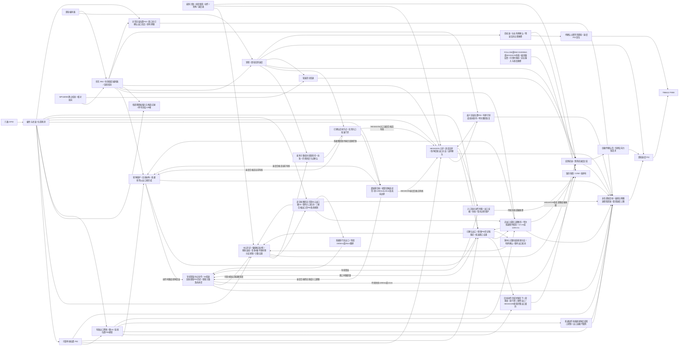
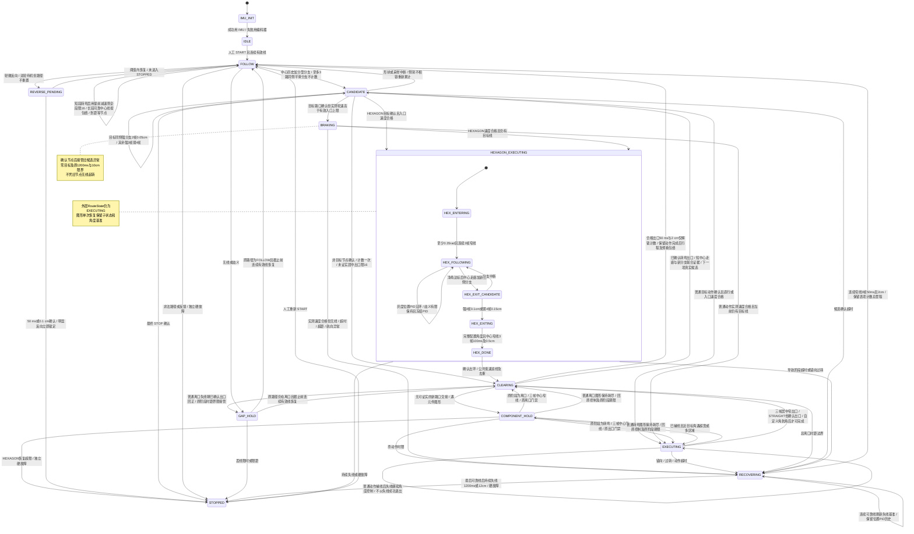
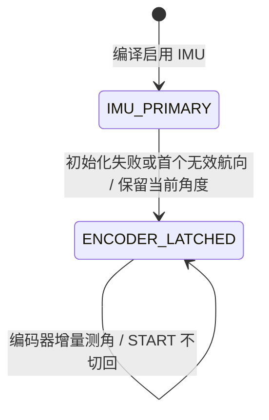

# STM32 八路数字灰度巡线小车

STM32F103C8T6 + TB6612FNG + 八路 GPIO 数字灰度。固件使用 C / STM32Cube HAL，系统时钟 HSI/2 × 16 = 64 MHz。当前 `main` 使用编码器总段距离 + 最多路口数导航。2026-11-06 最新用户规则：**计数或距离任一满足后，在下一个确认的灰度节点执行动作**；`junction_count` 为“含本路口前经过的最多路口数”，电阻等印刷图形参与计数，表内总段距离统一由`test/new_track_routes.json` 的几何长度自动减 5 cm 生成。全程路线仍在仿真调试中，未完成、未上实车。

## 当前状态与边界

> **全程仿真重标定进行中（2026-11-06，优先于历史记录）：** 用户授权两个工程及路径微调。仿真器现保留有限驱动/滑行/短刹响应与加减速度界限，停止指令后继续积分实际运动；C/TS普通90°动作新增轮轴接近阶段（24−14/2=17 cm），捕线不再等于约40°即完成，需接近目标角。已删除前一轮“段末漏计回退”，右下角通过真实4次计数完成。当前名义仿真前8个动作无恢复，30 cm连续转弯与环岛仍失败，全程及完整C回归尚未通过；C/TS减速距离语义正在对齐。当前证据和后续任务见 [全程重标定进度](docs/evidence/2026-11-06-full-course/README.md)。未烧录或操作电机。

计数（包含当前节点）达到表内上限，或累计总段距离达到表值，任一满足即可在灰度确认节点执行动作；距离本身不盲转、不补计、不宣告终点。此规则取代下方 2026-11-05 的“计数唯一授权”历史记录。MPU6050（失效锁定降级编码器）提供航向，灰度确认出口，编码器负责速度闭环与总段里程。入口冲出后的预算交接与有界恢复修正见 [2026-11-05证据](docs/evidence/2026-11-05-entry-loss/README.md)，此前独立审查和精确停车清单见 [2026-11-04证据](docs/evidence/2026-11-04-navigation-review/README.md)，以下带旧日期的现场记录保留历史背景，以本节及当前状态图为准。

> **2026-11-05 路口计数修正（当前优先）：** ST-Link 只读 SRAM 与少量关键 Flash（未做整片比对）显示索引0、`junctions_seen=4`、三次导航恢复均为 `ACTION_TIMEOUT`。首项 `CUSTOM_TURN -90` 在约63°捕获出口线后由位置 PID 拉平，迟迟到不了90°，动作超时回到 FOLLOW 时索引仍为0、计数1已满足，于是下一个路口又被立即当成目标。修正两点：①±90° CUSTOM_TURN 与 LEFT/RIGHT 几何相同，捕到居中出口线后立即停止强转、交回位置 PID 并进入 CLEARING，不能继续转到丢线；非90°自定义角仍要求到角；②`junction_count>0` 是动作唯一授权，`segment_length_cm` 只用于速度/减速包络和距离耗尽后的低速搜口，不再因距离先到而提前转向；计数0的旧表项仍允许仅按长度。现场只读、未烧录；主机回归和构建结果见文末验证记录。

| 项目 | 当前状态 |
|---|---|
| 构建环境 | 唯一 `genericSTM32F103C8`，`pio run` |
| 编码器 / 路径 / IMU | `motion_config.h` 默认均为 1 |
| 机械尺寸 | 双轮直径均 6.5 cm（65 mm），轮中心距 14 cm，轮轴中心到灰度传感器中心 24 cm；圆弧规划半径同步为 24 cm |
| 编码器换算 | 1560 计数/圈，公共距离系数 2.15、航向修正 0.77 沿用旧配置；新轮径下里程、轮速和编码器降级转角须实车重标 |
| 目标线极性 | `control_config.h` 当前 `GRAY_INVERT_ENABLED=0` 巡黑线 |
| 路径表 | `src/route_table.c` 由 `test/new_track_routes.json` 和 `test/sync_new_track_routes.py` 生成：0 保留四步调试路线（固件默认）；1 参考图走虚线路线30步（GUI默认）；2 不走虚线28步；3 外框测试圈。所有行几何长度减5 cm，正式路线 turn_speed=12、巡航30 cm/s，仍在回放校准，尚未全程通过 |
| 总段长度 | `segment_length_cm` 从 START / 上次动作完成点起测；中间节点不重建基准。0 表示未知，计数也为0则拒绝启动 |
| 安全减速度 | 当前本地配置 `BRAKING_CALIBRATION_CONFIRMED=1`、`BRAKING_SAFE_DECEL_CM_S2=120`；标志置 1 不代表本次已实测，200→16 按此模型需 165.6 cm（不含余量），短段可能无法及时降速 |
| 反向减速 | 末段实时评估所需减速度；有界反向力矩与双轮速度 PID 已接入，但 `BRAKING_REVERSE_HARDWARE_CONFIRMED=0`、`MOTOR_REVERSE_BRAKE_ENABLED=0`，当前固件不输出反向 PWM；需确认电流、供电、轮向与实测制动力后开启 |
| 短路制动 | 独立 `motor_short_brake()` 接口和 HAL 模拟测试；导航不自动调用，效果/电流/温升待测 |
| 导航退路 / 重启 | 动作超时、错向/过转、入口降速超限等转低速有界 RECOVERING，不推进项；稳定回线后保持当前总进度重新等新节点。实际 STOPPED 不自动恢复，显式 START 重置路径 |
| 丢线保护 | 普通FOLLOW/未确认候选400 ms / 8 cm；普通EXECUTING/CLEARING由阶段时距限界转RECOVERING，恢复持续失线1200 ms / 12 cm仍停车；HEXAGON保持独立失线保护 |
| 机会式巡线 | `OPPORTUNISTIC_FALLBACK_ENABLED=0`，仅记录后续边界，尚未实现 |

200 cm/s 是未验证的目标值。2026-10-30 用户信息小车最高可能达到 5 m/s：`WHEEL_TARGET_MAX_CM_S`、`ODOMETRY_MAX_SPEED_CM_S`（650）与速度前馈已按 500 cm/s 满量程修正，但 5 m/s 本身未经实测，前馈/增益仍需台架重标。当前未获得新规则下的赛道计数、最后一段测距或减速度标定，不能把构建或主机回归当成高速上车许可。未烧录、未运行电机、未进行新方案实车验证。

## 2026-11-05 普通路口动作不因失线立即停车（当前规则优先）

用户确认：LEFT/RIGHT/STRAIGHT/CUSTOM_TURN的EXECUTING及随后CLEARING（含普通非目标节点直行离口）不因灰度全丢线、宽线或多区域直接产生LINE_STOP_LOST、EXIT_LOST、CLEAR_LINE_LOST。转弯捕过出口后再次失线也继续原角度控制；当前航向源为健康IMU，失效仍按原规则锁定降级编码器。到角无线不自动成功，位置PID不接收无效观测；转弯仍须原出口线证据及自定义角门禁。STRAIGHT目标也须连续3帧居中窄出口才从EXECUTING进入CLEARING，并在该完成点建立下一段原点；离口去重仍需连续窄线3帧/50 ms/2 cm，不据失线推进索引。

始终找不到出口或无法离口时，由现有阶段界限中止进入RECOVERING。当前普通转弯配置为3000 ms，自定义角按比例延长（135°为4500 ms），STRAIGHT保留独立时限；CLEARING仍1500 ms/20 cm，未放宽。RECOVERING仍在最后连续可靠线之后持续失线1200 ms/12 cm停车。普通动作内的一次图形航向保持耗尽1200 ms/12 cm时，只退出该保持、回原转角/离口控制，不再以故障8直接停车，也不重新开启机会或重置阶段期限。

普通失线截止改在route FSM更新后判定：只有真实节点证据在同帧确认并交给普通BRAKING/EXECUTING/CLEARING时才允许预算交接；未确认CANDIDATE/FOLLOW的400 ms/8 cm和孤立线不续时规则保留。阶段离开当帧也不会被残留abnormal抢先停车。BRAKING仍须实测入口轮速合格且当前有线才开始动作；零目标、1200 ms/10 cm/航向界限及速度合格无线转RECOVERING均保留。

HEXAGON不在本轮范围：其ENTERING的1200 ms/12 cm、沿环/出口的400 ms/8 cm及一次图形恢复超限8仍可停车，公共离口也沿原规则。非路径模式及LOST_LINE_STOP_ENABLED=0行为保持。编码器/IMU降级/堵转/反向/速度反馈/俯仰/任务硬保护、非负轮目标、全部表值和刹车门禁保持。以下带旧日期的出口失效11/12/8立即停车说明，凡涉及普通EXECUTING/CLEARING均由本节取代；详见[本轮证据](docs/evidence/2026-11-05-maneuver-loss/README.md)。未访问硬件、未烧录，实车效果待验证。

## 2026-11-05 LEFT 入口与非目标过口限速（当前规则优先）

本次现场第二项索引1，已计数2、段内约190 cm，均未达到用户当前配置4个节点或219 cm，因此按非目标节点直行通过。轨迹显示无线期间轮目标约77 cm/s，离口累计20 cm后进入RECOVERING；恢复短窄线回FOLLOW，随后持续失线400 ms停车。这证实了软件的高速无出口通过路径，不能由此认定实际路口计数错误或赛道物理拓扑。第一LEFT“短停后直行再停”没有本次快照；BRAKING零目标后无线中止动作的源码路径与现象相符，但不能认定为该次真实根因。现场与验证见[本轮证据](docs/evidence/2026-11-05-left-fail/README.md)。

`TURN_APPROACH_SLOWDOWN_ENABLED=1`时，总段长度≤100 cm（含未知0）的LEFT/RIGHT/CUSTOM_TURN/HEXAGON，从START或上次动作完成点即将基础及最终外轮目标限制到`min(turn_speed,16 cm/s)`；STOP/STRAIGHT保留原速度策略。长段有可靠居中线时继续原距离包络。非目标CANDIDATE在非单一区域窄线或不居中时、非目标CLEARING尚未连续3帧取得合格居中出口时，以及其图形恢复期间，基础及最终轮目标均不超16 cm/s；合格出口恢复后再按原规划及上升斜率提速。混合后按同一比例缩放两轮目标，保留差速方向和比例，避免航向保持的外轮突破上限。

BRAKING速度合格但无线不转、RECOVERING保留索引/计数/总段起点、动作/离口/恢复全部时距界限与反馈保护不变；不改用户路径表、标定或刹车门禁。总段定义为START/上次动作完成点至灰度触发点，不再因传感器前置24 cm重复扣减。低目标不能保证低实测轮速，本轮为源码机制修复和首弯预防，未烧录、未实车验证。下文带旧日期的“短段统一60”及“非目标无条件保速”描述以本节为准。

## 控制模式

头文件决定固件模式，不增加 PlatformIO 环境覆盖入口。`ENCODER_CONTROL_ENABLED=0` + `PRESET_ROUTE_ENABLED=0` 为普通非负 PWM 巡线，无编码器初始化与路径动作。编码器为 1、路径为 0 时只有灰度位置外环与双轮速度内环，使用 `LINE_FOLLOW_SPEED_CM_S`。路径为 1 必须同时开启编码器；当前 IMU 为 1，航向取陀螺仪积分，左右轮差不替代 IMU 输入。仅巡线不读取或校验路径表。

灰度 S0→S7 为车体左→右，统一目标线为 1，权重 `[-7,-5,-3,-1,+1,+3,+5,+7]`。`error=position-0`，正误差使左轮目标大于右轮，向右修正。正常只对可靠单一区域更新位置 PID，全目标、多区域和无线不能当成居中。PID 保留 dt、微分滤波、积分限幅、抗饱和与历史复位。

## 工程配置与参考来源

| 项目 | 当前配置 |
| --- | --- |
| PlatformIO 环境 / board | `genericSTM32F103C8` |
| 平台 / 框架 / 语言 | `ststm32` / `stm32cube` / C |
| 系统时钟 | 内部 HSI 8 MHz / 2 × PLL16 = 名义 64 MHz |
| APB1 / APB2 | 32 MHz / 64 MHz，TIM3 时钟名义 64 MHz |
| TIM3 PWM | PSC=0、ARR=6399，名义 10 kHz，两路 PWM1 |
| TIM1 / TIM4 编码器 | 仅开关为 1：PSC=0、ARR=65535、TI12 四倍频，输入滤波 6 |
| 控制周期 | 5 ms，PID 使用实际控制间隔 `dt` |

晶振未知，因此不依赖外部 HSE。[ST 数据手册](https://www.st.com/resource/en/datasheet/stm32f103c8.pdf)给出 HSI 作为 PLL 输入时最高系统时钟为 64 MHz；RC 时钟存在误差，实际 PWM/周期仍待测量。开发板环境沿用 [PlatformIO 的 genericSTM32F103C8 定义](https://docs.platformio.org/en/latest/boards/ststm32/genericSTM32F103C8.html)，没有改成 `bluepill_f103c8`。

电机底层只读参考 `/Users/zhendong/Documents/RemoteCar_wifi/remote_car` 的 `src/main.c`、`include/main.h`、`platformio.ini`、HAL 配置与中断文件。借鉴双轮接口、单轮方向输出、指令限幅及 PWM 映射；新工程重新处理初始化返回值、零输出、轮向配置和异常停车，没有引入 Wi-Fi、串口遥控协议或 300 ms 遥控超时。

## 接线方案

以下分配已由用户授权选择，固件定义见 `include/board_config.h`。它是本项目的接线方案，**不代表线路已连接或验证**。S0→S7 从车体前进方向看由左到右。

| 功能 | STM32 引脚 | 模块 / 说明 |
| --- | --- | --- |
| S0 | PA0 | 最左灰度数字输出 |
| S1 | PA1 | 灰度数字输出 |
| S2 | PA2 | 灰度数字输出 |
| S3 | PA3 | 中心左侧灰度输出 |
| S4 | PA4 | 中心右侧灰度输出 |
| S5 | PA5 | 灰度数字输出 |
| S6 | PB0 | 灰度数字输出 |
| S7 | PB1 | 最右灰度数字输出 |
| 左轮 PWM | PA6 / TIM3_CH1 | TB6612FNG PWMA |
| 右轮 PWM | PA7 / TIM3_CH2 | TB6612FNG PWMB |
| 左轮方向 | PB12、PB13 | AIN1、AIN2；AO1/AO2 接左电机 |
| 右轮方向 | PB14、PB15 | BIN1、BIN2；BO1/BO2 接右电机 |
| 电机使能 | PB5 | STBY，由 MCU 控制，不固定接高 |
| 启动 / 停止按键 | PB10 | 常开按键另一端接 GND，内部上拉 |
| 左轮编码器 A / B | PA8、PA9 | 开关为 1 时使用 TIM1_CH1 / TIM1_CH2 |
| 右轮编码器 A / B | PB6、PB7 | 开关为 1 时使用 TIM4_CH1 / TIM4_CH2 |
| MPU6050 SCL | PB8 / I²C1 重映射 SCL | A10 J12.5，SCL 上拉至 3.3 V |
| MPU6050 SDA | PB9 / I²C1 重映射 SDA | A10 J12.6，SDA 上拉至 3.3 V |
| MPU6050 VCC | +3V3 | A10 J12.10，模块必须兼容 3.3 V 电源 |
| MPU6050 GND | GND | A10 J11.10，与 STM32 共地 |
| MPU6050 AD0（有时误读成 ADC） | GND | I²C 7 位地址 0x68；接 3.3 V 为 0x69，需修改配置 |
| MPU6050 XDA / XCL / INT | 不连接 | 辅助 I²C、数据中断；代码轮询主 I²C |
| SWD | PA13、PA14 | 保留 SWDIO / SWCLK，另接调试器 GND |
| 原调试串口预留变更 | PA9 已分配给编码器，PA10 仍未使用 | 不再将 PA9/PA10 作为可用的完整 USART1 默认接线对 |

### MPU6050 接线和航向开关（2026-10-29）

在 `include/motion_config.h` 中设置 `MPU6050_ENABLED`：当前为 **1**，优先从 MPU6050 得到航向，初始化失败或运行数据失效后锁定降级到编码器轮差；设为 **0** 则始终使用编码器轮差估角，必须同时开启 `ENCODER_CONTROL_ENABLED=1`，修改后重新 `pio run` 编译。连接 PB8/PB9 时 I²C1 启用 remap（PB6/PB7 已用于编码器，不改变）；I²C 时钟 400 kHz。SCL/SDA 均须上拉到 **3.3 V**，如模块板上已经有连接 3.3 V 的电阻无需重复并联；否则各加约 4.7 kΩ。切勿把两根线通过上拉拉到 5 V。模块上标着 `ADC` 的排针如不确定是否为 `AD0`，先查实物丝印或模块电路，不要猜测其功能。

模块初始化时先读 `WHO_AM_I=0x68`，设定陀螺仪 ±2000°/s、约 42 Hz 低通和 1 kHz 输出速率。**上电保持小车静止**，驱动待机状态下每窗读取 32 次 Z 轴采样估计零偏；控制循环每 5 ms 检查数据就绪，启用俯仰保护时一次读 14 字节获取加速度计 XYZ、温度及陀螺仪 XYZ，关闭保护时只读取 Z 轴角速度。扣除零偏后按实际间隔积分为连续相对航向（rad）。启用后所有共用 `odometry.heading_rad` 的角度计算，包括路口转角/出口、圆弧规划反馈、异常航向保持、二维轮轴与灰度探头位姿及短期位移估计，都改用 IMU。**轮程、轮速、路径厘米位置及双轮速度 PID 仍使用编码器**。陀螺仪不能直接给出位移。

用户确认 MPU6050 **倒置安装**（芯片 Z 正轴朝下，板面仍基本水平），因此 `MPU6050_YAW_SIGN=+1`，水平面导航仅积分 Z 轴偏航角；新增俯仰角只参与拿起停机保护，不参与航向计算或位置 PID。先手持缓慢右转并观察 `g_diagnostics.heading_rad` 是否增加，若实际模块轴向与假定不同再调整正负号。**歪斜安装时单纯 Z 轴读数只是车身真实转动在该轴的投影**，当前没有安装矩阵补偿，应把板子倒扣并水平固定。上电标定时不可移动或让电机震动，否则会产生角度偏差。

**俯仰拿起保护（2026-10-29，默认启用）：** `include/motion_config.h` 中 `MPU6050_PITCH_STOP_ENABLED=1`；设置为 `0` 时禁用该判定（保留 MPU6050 偏航角），重新构建生效。该功能只在 `MPU6050_ENABLED=1` 时采样/生效；若关闭 IMU，旧编码器角度模式保持可用，不会请求加速度计。传感器 **X 轴须与车体前后轴平行**，倒置水平安装使 Z 轴朝下；`tilt_guard.c` 用加速度计读数计算 `abs(atan2(ax, sqrt(ay²+az²)))` 的角度（单位度），所以抬头与低头、倒置极性都触发同一个绝对值阈值。**俯仰绝对值大于 40°、连续 50 ms**，触发 `LINE_STOP_TILT` 锁定停车，STBY 拉低；姿态恢复水平后保持停止；角度持续更新，下一次明确按启动键时，用本帧有效重力及原40°门槛检查姿态，放平后解除俯仰锁定，再按连续有效线规则启动，无须复位。仍倾斜/数据不可信则保持停止；不能清除IMU通信、编码器或任务锁定故障。`MPU6050_PITCH_FILTER_TAU_S=0.040f` 进行低通；加速度模长明显偏离 1g（低于 0.70g 或高于 1.30g）的采样不累计确认时间，以减轻强烈加减速造成的假俯仰。可读 `g_diagnostics.pitch_stop_enabled`、`pitch_deg`、`pitch_over_threshold_ms` 与 `pitch_stop_latched`；这次停车的 `stop_reason`/`stop_snapshot.reason` 为 `LINE_STOP_TILT`。已有电机/看门狗故障保护独立生效。

注意这是**车体前后俯仰超限停机**，并不直接检测人手接触。把小车基本水平地抬起来，或者只向左右滚转而没有明显俯仰，都不一定触发。激烈运动时加速度也可能影响倾角估计，滤波与近 1g 判定是暂定保护，不是实车验证的安全认证。模块若绕 Z 轴旋转了 90°，X 轴便不能表示小车前后俯仰；必须确认实际芯片轴向并调整安装后再测试。

**2026-10-30 最新用户授权：IMU 失败降级而非阻塞启动。** 上电执行一次有界初始化序列（含内部有限重试），失败后继续进入 IDLE，在线按 START 可用编码器航向启动，不再有“按键只重试校准”的等待循环。运行中首个 I²C/数据就绪/量程/非有限航向失败，当帧从当前累计航向加编码器轮差，不清零里程、路口计数、入口参考或 PID 状态；本次上电锁定编码器，不自动跳回可能已过期的 IMU 航向。START 不清除此降级；复位后重新尝试 IMU。不在行驶中做阻塞初始化，降级后也不重复读失效 IMU。有效线、路径合法、编码器标定和所有非 IMU 故障门禁保留，不保证无线或硬件故障时强行启动。上电初始化完成前的短按不排队，按住上电仍不启动。

诊断 `heading_source`：0 编码器、1 IMU；`heading_fallback_reason`：0 无降级、1 首帧即不可用、2 运行数据失效；`heading_fallback_ms` 为首个降级周期时刻。`imu_init_failure_stage` 保留初始化失败证据，`imu_ready` 表示本帧可用，`pitch_monitor_available` 表示俯仰检测实际可用；停车快照也保存来源/原因/时刻。降级编码器使用现有 `ODOMETRY_HEADING_SCALE=0.77`，受轮距、距离尺度、打滑及地面影响，不等同 IMU 精度。**IMU 不可用时无法继续提供可靠俯仰拿起检测**，但之前已锁存的俯仰停车不因降级自动解除。IMU 健康时原俯仰检测和明确 START 复位条件不变。此功能未实车验证，须架空轮向确认后低速测试。

**历史启动故障排查：** ST-Link 曾读到 `Error_Handler`、`control_count=0`。地址探测和配置/校准质量检查仍保留；现已用上文授权的编码器降级取代 IMU 失败锁定。`imu_init_failure_stage`：0 成功、1 STM32 I²C 初始化、2 身份/地址探测、3 写配置、4 新鲜样本采集、6 配置回读、7 校准质量、8 释放 I²C 失败、9 总线恢复时 SCL/SDA 电平异常。探测不能替代接线/供电检查，未修复或确证真实噪声来源。

**校准时间：** 每窗 32 样本、间隔 5 ms，最多 5 窗；零偏绝对值 ≤328 LSB、去除两端各约 5% 后跨度 ≤64 LSB。首窗合格名义约 0.76 s，五窗不合格约 1.4 s，均不含 I²C 事务及通信重试。短窗口可能遗漏慢扰动，待实车验证。失败数值不用于 IMU 航向，而进入编码器模式；最近阶段 7、中位数 -2006、中央跨度 2305 LSB 的真实噪声来源仍未知。初始化期间电机待机、IWDG 尚未启用。

**初始化通信重试：** 通信/配置失败时在待机下间隔 100 ms 完整重试，最多 3 次，仍执行双地址、身份、配置及静止检查；校准质量阶段 7 不完整重试（内部已有 5 窗）。`imu_init_attempts` 记录次数。全部失败后不继续阻塞按键，使用编码器；这不是修复 I²C 硬件故障，需烧录后实测。

参考 `dev` 分支恢复初始化 I²C 事务 25 ms 超时（运行期保持 2 ms），以及每轮双地址探测失败后的 I²C 反初始化、外设复位与重新初始化。完整初始化重试仍保留；模块始终须通过身份、配置与静止质量检查。这是排查阶段 2 的软件改进，尚不能证明就是实车根因或修复持续总线故障。

**启动总线恢复（本次修复）：** 旧流程只重置 I²C 外设，未处理 [ST ES096 §2.8.7](https://www.st.com/resource/en/errata_sheet/es096-stm32f101x8b-stm32f102x8b-and-stm32f103x8b-mediumdensity-device-limitations-stmicroelectronics.pdf) 中的模拟滤波器 BUSY 锁死。现在在每次初始化及双地址探测失败后的重试中，禁用 I²C、将 PB8/PB9 配为开漏并释放为高；必要时最多输出 9 个 SCL 脉冲释放中断的从机事务，随后产生 SDA 低→SCL 低→SCL 高→SDA 高的转换并逐项检查实际电平，恢复复用开漏后重置/初始化外设。电平等待有界，持续拉低记阶段 9；只在上电待机时执行，不在 START 或运动中恢复总线。正常每次恢复新增约 5 ms，脉冲和等待可能增加启动耗时；质量校准门限不放宽。阶段 2 只说明身份/地址探测失败，尚无板上 BUSY/线电平证据，不能声称此次实车已确诊该勘误。

新增诊断 `imu_bus_recovery_count`、`imu_last_i2c_status`、`imu_last_i2c_error`、`imu_last_who_am_i`、`imu_bus_line_mask`（bit0=SCL 高、bit1=SDA 高），由初始化结果发布，可区分无应答、HAL 错误、身份不符和总线电平恢复失败。原有失败降级编码器、运行期 2 ms 通信超时与 5 ms 控制预算保护保留。主机假 HAL 可验证恢复流程和界限，不能验证实际引脚波形、供电、上拉或从机硬件状态。


供电以用户 2026-10-27 信息为准：电池 12 V / 1200 mAh，电机额定 **7.4 V、减速箱 1:20**，现由 PCB 降压后的约 5 V VM 驱动。A10 设计路径为 `J13 → F1 → D1 → TPS54302/L1 → VM → TB6612`；`VM → R4（0 Ω）→ 核心板 +5V`，核心板再提供 +3V3。TB6612 逻辑 VCC 与灰度使用 3.3 V，各模块共地。设计标称 VM 约 5.077 V，实际值及电机负载下的压降待测；“3 A 降压芯片”不等于整板或双电机可持续输出 3 A。

**禁止直接把板载 VM 调到 7.4 V**，否则 R4 会将该电压带到核心板 +5V。J1/J2 是低压输出接口，不能接入电池；USB 供电须遵循原设计的 R4 隔离要求。本次不改变这些连接。电池“12 V”尚不能证明满充也不超过 12 V；若实际是 3 串锂离子电池，须按其标签核对满充电压与整板输入边界，不能只用 TPS54302 芯片最大额定值判断。电源及接口依据见 [A10 电气终审](docs/A10-final-electrical-review.md)。

灰度模块具体型号、数字输出类型与实际电平仍需核对，不能将未知 5 V 信号直接接入灰度引脚。

灰度输入当前配置为上拉，断开时倾向于读高电平；巡白线时可能表现为背景，当前巡黑线时可能表现为目标线；须结合模块开漏/推挽输出验证，不能据此宣称断线检测已完成。记录实际传感器安装高度、间距与白线宽度；不等间距安装时调整 `gray_sensor.c` 的集中权重。A2 原理图已加入 STBY 的 10 kΩ 外部下拉；接线前仍需核对模块是否把 STBY 硬接高，MCU 复位时的真实断驱动效果待架空验证。

### 未使用引脚与编码器接线（2026-10-19）

选择编码器之前，应用固件没有分配的常规候选是 **PA8、PA9、PA10、PA11、PA12、PB6、PB7、PB8、PB9、PB11**。PA9/PA10 原先仅是文档中的 UART 预留，未初始化串口。分配编码器后剩余 **PA10、PA11、PA12、PB8、PB9、PB11**；其中 PA11/PA12 如后续启用 USB 则不再可用，且须核对核心板现有 USB 接线。

其他引脚有附带条件：PA15/PB3/PB4 复位后用于 JTAG，需要配置 SWJ 才能作为普通 GPIO，当前不改；PA13/PA14 保留 SWD。PB2 涉及 BOOT1，当前载板 J6.15 为 PB10 按键，并未引出 PB2。PC13/PC14/PC15 涉及核心板 LED / 低速晶振的可能连接，须核对实物；PD0/PD1 留给外部高速晶振，不因固件使用 HSI 就视作可用排针。

选择 PA8/PA9 和 PB6/PB7 是因为两组均对应同一定时器的 CH1/CH2 默认映射，开关为 1 时分别用于正交编码器计数，无需修改现有 TIM3 PWM 或关闭 JTAG/SWD。[ST 数据手册表 5](https://www.st.com/resource/en/datasheet/stm32f103c8.pdf)列出这些引脚及其 FT 属性；TIM1 的互补输出也与 PB13/PB14 等复用，当前编码器初始化不配置这些电机方向引脚或互补输出。

按用户提供图片中的 **霍尔编码器款**，每个电机六线定义如下。图中的编号是连接器针序，不能按未知线色推断，也不能混用右侧 GMR 的线序。

| 霍尔款针号 | 功能 | 左轮连接 | 右轮连接 |
| --- | --- | --- | --- |
| 1 | 电机线 − | TB6612 左轮输出对的一端 | TB6612 右轮输出对的一端 |
| 2 | 编码器电源 | PCB 已预留的编码器电源，先核对额定电压 | 同左 |
| 3 | 编码器 A 相 | PA8；A10 扩展口 J11.4 | PB6；A10 扩展口 J12.3 |
| 4 | 编码器 B 相 | PA9；A10 扩展口 J11.5 | PB7；A10 扩展口 J12.4 |
| 5 | 编码器地 | PCB GND，与 MCU / TB6612 共地 | 同左 |
| 6 | 电机线 + | 同一左轮输出对的另一端 | 同一右轮输出对的另一端 |

TB6612 电机输出为 H 桥两端，不是固定电源正负；电机线极性和车体前进方向需架空确认。A10 接口编号来自本仓库 `PCB design/stm32PCB-A10/stm32PCB-A10.netlist.json`：J11.4/5 与 J7.5/6 同网，J12.3/4 与 J7.14/15 同网；接线按实物丝印找针，不按照片观看方向数针。这是已存设计文件核对，未证明实物连通。

**2026-10-30 实车故障教训：** 曾出现“启动后只转一下就停”，快照显示两轮编码器计数全程为 0、目标 37 cm/s 而实测 0，最终由用户查明是**编码器 3.3 V 电源线（2 脚）脱落**。该插头同时承载电机线与编码器线，电机能动不代表编码器供电已接通；断电后编码器无脉冲，速度环判堵转并在 350 ms 停车，属保护正确动作。**插拔电机/编码器插头后必须先架空手转轮子，确认 `g_diagnostics.left_encoder/right_encoder` 随转动变化，再上电试跑。** 与之叠加的另一个软件问题（速度斜坡被位置曲线钳死）已单独修复，两者互不替代。

开关为 1 时，初始化入口为 `encoder_init()`，在传感器 GPIO 初始化之后、PWM 初始化之前执行。内部先以 `GPIO_MODE_INPUT` + `GPIO_NOPULL` 配置四个输入，再启动 TIM1 / TIM4 的 TI12 四倍频计数。主循环每 5 ms 顺序读取两个 16 位计数器，计算有符号回绕增量；不用 EXTI 或逐脉冲中断。计数方式依据 [ST HAL 编码器接口](https://github.com/STMicroelectronics/stm32f1xx-hal-driver/blob/master/Src/stm32f1xx_hal_tim.c)与 [RM0008](https://www.st.com/resource/en/reference_manual/cd00171190.pdf)。在编码器模式下，即使标定尚未填写，仍可在停车状态通过 `g_diagnostics.left_encoder/right_encoder` 观察手动转轮计数。

**供电电压与信号高电平分别确认。** 默认关闭内部上下拉，是为了兼容后续核实后的 FT 输入使用条件；[ST 数据手册 §5.3.1 / §5.3.13](https://www.st.com/resource/en/datasheet/stm32f103c8.pdf)要求输入超过 VDD+0.3 V 时禁用内部上下拉。若为开漏且没有已有上拉，输入会浮空，应根据模块规格增加外部上拉，优先采用兼容的 3.3 V 信号方案。若模块自带上拉，先确认其接到哪条电源。不能仅凭“霍尔编码器”认定 A/B 为 3.3 V 或 5 V，也不能仅凭 FT 属性认定电源时序、噪声与整个模块接口已经验证。PCB 电源已预留，本次不改动电源或制造文件。

PCB 历史版本保留在 `hardware/` 与 `PCB design/`。当前采用 A10 资料，两组模块双排中心距为 **15.24 mm**；旧 A5 的 16 mm 描述不适用于 A10。详见 [A10 电气终审](docs/A10-final-electrical-review.md)。

## 采样与位置语义

在 `include/control_config.h` 选择巡线颜色，当前为巡黑线：

```c
#define GRAY_INVERT_ENABLED 0  // 1：巡白线，反相；0：巡黑线，不反相
```

| 配置 | GPIO 到目标线的转换 | 目标线电平 | 背景电平 |
| --- | --- | --- | --- |
| `GRAY_INVERT_ENABLED=1`（巡白线） | `line[i] = 1 - raw[i]` | 白色 0 | 黑色 1 |
| `GRAY_INVERT_ENABLED=0`（巡黑线） | `line[i] = raw[i]` | 黑色 1 | 白色 0 |

这是编译开关，修改后须重新编译，其他数值会编译报错。生产固件仅使用 `genericSTM32F103C8` 一个环境并遵循头文件；主机测试独立覆盖不同组合。它独立于编码器、路径开关。原始 `raw[i]` 白色为 0、黑色为 1，深蓝底预期为 1；这些电平仍必须用真实材料逐路确认。极性只在传感器层转换，随后统一以 1 表示**目标线**；滤波、位置符号、启动确认、路口判断与丢线保护沿用同一逻辑。为兼容现有接口保留 `white_count` 字段名，其含义改为目标线路数。下文控制说明中沿用的“白线/全白”在巡黑线模式分别指目标黑线/全部通道检测到黑线。

灰度输入仍使用原有上拉；巡黑线时断开的通道可能读为目标线，开关不提供断线检测。每 5 ms 读取 GPIOA、GPIOB 各一次寄存器快照，八路输入均为独立 GPIO；跨端口并非完全同时采样。

当前已关闭地板细缝过滤，恢复原始单路目标线响应：

```c
#define FLOOR_SEAM_FILTER_ENABLED 0  // 当前：关闭，保留单路目标区域
// 修改后执行 pio run，并上传对应固件。
```

仅在将该过滤开关设为 1 时，例如 `0x98`（中心两路 + 右侧孤立一路）变为 `0x18`，`0x99`（中心两路 + 两侧孤立点）也变为 `0x18`；`0x03`、`0xc0` 等真实两路边缘区域完整保留，`0xff` 仍为歧义。多个两路区域不会被拼成单一区域。`0x80` 等仅一路信号在练习模式变为无可靠线，按原丢线保持/停车开关处理，不能用来启动。该宽度规则不识别物体语义，不能把它作为比赛线宽的已标定参数；真实线窄到只有一路时，应关闭模式或先核对安装高度/传感器阈值。

使用 3 帧逐路多数滤波；开启地板练习模式时再剔除独立单路区域。关闭该模式恢复原始空间分辨率。恢复巡线另需连续 3 次有效分类，存在滤波与确认延迟。等间距初始权重如下：

| 通道 | S0 | S1 | S2 | S3 | S4 | S5 | S6 | S7 |
| --- | --- | --- | --- | --- | --- | --- | --- | --- |
| 权重 | -7 | -5 | -3 | -1 | +1 | +3 | +5 | +7 |

只对选定的有效连续区域使用有符号 `float` 计算：

```text
position = Σ(w[i] × line[i]) / 选定区域目标线路数
error = position - 0
# 编码器模式（开关 1）：
left_target_cm_s = base_cm_s + correction_cm_s
right_target_cm_s = base_cm_s - correction_cm_s
# PWM 模式（开关 0）：
left_pwm = base_pwm + correction_pwm
right_pwm = base_pwm - correction_pwm
```

正误差表示目标线在右侧；正修正在编码器模式使左轮目标速度较大、右轮较小，在 PWM 模式使左轮 PWM 较大、右轮较小，期望向右转。两轮“正指令均向前”仍需架空确认，可通过 `board_config.h` 的左右轮方向配置修正。

下表为巡白线（`GRAY_INVERT_ENABLED=1`）示例。巡黑线时，同一 `line` 图案的 `raw` 与 `line` 相同。以下字符串按 S0→S7 排列；代码掩码使用 **bit0=S0、bit7=S7**，因此调试器二进制显示从高位到低位时顺序与表中字符串相反。

| `raw` | `line` | 预期处理 |
| --- | --- | --- |
| `11100111` | `00011000` | 中间两路，位置 0；line 掩码 `0x18` |
| `01111111` | `10000000` | 最左白线，位置 -7；line 掩码 `0x01` |
| `11111110` | `00000001` | 最右白线，位置 +7；line 掩码 `0x80` |
| `11111111` | `00000000` | `GRAY_NONE`，不计算除法、不输入正常 PID |
| `00000000` | `11111111` | 全白，`GRAY_AMBIGUOUS`，不能当成居中 |
| `00111100` | `11000011` | 多区域；无可靠连续性时为歧义 |

单个连续区域宽度在 PWM 模式不超过 7 路、编码器模式不超过 6 路时可作为目标；任一区域超过对应模式宽度上限则为歧义。多个窄区域时，只有最近可靠位置存在、最近区域距离不超过 3 个权重单位，且它比次近区域至少近 1 个单位，才选择该区域。但本次导航层采用更保守的规则：多区域即使在传感器层选出了一个区域，也不进入普通位置 PID；与宽线、无白线一起先交给路径/路口判断，否则按丢线保持航向。这些阈值属于未标定初值。

## 路口计数、转向与离口

`RouteStep` 字段顺序为：

```c
{junction_count, turn_speed, action, cruise_speed,
 angle_deg, corner_arc_enabled, segment_length_cm}
// 示例：最多第2个节点左转；未知总段长度，仅用计数。启用提前减速时受短段转弯入口上限约束。
{2, 12.0f, LEFT, 40, 0.0f, false, 0.0f}
```

`junction_count` 为最多节点数，0 忽略计数（此时总段长度必须大于0），`turn_speed` 单位 cm/s，为动作入口及轮目标的表内上限。转弯（含自定义角与循环闭合转弯）的有效入弯速度为 `v_entry=min(turn_speed,JUNCTION_SETTLE_SPEED_CM_S)`，当前不高于 16 cm/s；入弯前规划、候选、实测速度门禁与动作限速共用它。`cruise_speed` 仅用于总段长度 >100 cm 的巡航目标；<=100 cm（含未知长度）以默认60 cm/s为基础；当`TURN_APPROACH_SLOWDOWN_ENABLED=1`时，LEFT/RIGHT/CUSTOM_TURN/HEXAGON全段另受`min(turn_speed,16 cm/s)`上限，STOP/STRAIGHT保留原策略，仍受启动、位置曲线和闭环限制。CUSTOM_TURN 的 `angle_deg` 顺时针正、逆时针负，范围 [-360,0) 或 (0,360]。最后一项必须 STOP，中途不得 STOP；表速、转向速度、角度和可选长度均须通过校验。表内计数是待实车确认的配置，并非从旧距离推算的事实。

### 路径方案选择（2026-11-05）

`src/route_table.c` 用 `ROUTE_SCHEME_SELECT`（0～3，可 `#define` 或 `-D` 覆盖，未定义默认0）经 `#if` 只编译选中的一张表；默认0 保持原四项调试表语义，既有主机回归不变。方案1～3 由用户路径图与 CAD 标注尺寸（375×220 cm；垂直线 x=0/55/95/150/165/245/275/345/375，水平线 y=0/40/50/80/120/170/220，六边形边长35、仅右顶点接主线）逐段推算，转向符号经坐标几何核对，起点 P(0,120) 向上、全程无180°掉头：

| 方案 | 对应图 | 步数 | 总长 | 特点 |
|---|---|---|---|---|
| 0 | 基础调试 | 4 | 500 cm | 原调试表（CUSTOM_TURN -90×3 + STOP），默认启用 |
| 1 | 图一 全元件 | 30 | 2710 cm | 走虚线段与环岛（HEXAGON -300° 逆时针），覆盖27个元件；元件13/16/17/23各经过两次 |
| 2 | 图二 不走虚线 | 30 | 2680 cm | 跳过虚线与隔离电阻（红X），走环岛（HEXAGON +300° 顺时针），覆盖26个元件；元件7/13/14/18/19/24经过两次，与图注 x2 一致 |
| 3 | 图一去环岛 | 25 | 2550 cm | 方案1去掉进出环岛6步，x=375 一路北上220 cm 直过 y=120、y=50 两口至右上角，不再覆盖元件13/14；其余同方案1（含虚线段） |

`junction_count` 按段内经过的真实路口（含元件支路节点）累计，`segment_length_cm` 为图纸直线段长度，中间节点不重建里程；短段（<=100 cm）按60 cm/s、长段按表速与减速包络。全部为图纸推算初值，未经实车确认：虚线与元件图形可能被误判为路口，六边形入口/出口拓扑须实车核对，环岛角度与出口方向假设未验证。主机新增 `test/test_route_schemes.c` 校验四表（末项STOP、计数>0、turn_speed<=表速、长度>0、总长一致），已纳入 `sh test/run_host_tests.sh`。未烧录、未实车。

HEXAGON 是显式六边形环岛动作，完整调用及字段对照见 [HEXAGON 文档](docs/hexagon.md#路径调用)，现有实际路径表未替换。`angle_deg` 右正左负，绝对值60～720°，从目标路口速度门禁通过、真正进入动作时累计净航向（包括入环引导）；`corner_arc_enabled` 必须为 false。正常沿环用灰度位置 PID 与双轮速度闭环；到角后先有稳定中心窄线，再凭新出现的绕行反侧分支及连续居中出口线100 ms/0.5 cm确认出环。单纯到角或持续单线不完成，环内分支不追加路径计数，出环后仍走公共离口去重。入口及动作速度不超过 `min(turn_speed,HEXAGON_SPEED_CM_S,JUNCTION_SETTLE_SPEED_CM_S)`，当前16 cm/s；普通动作的完成条件保持。入口3000 ms/30 cm、入口未捕线1200 ms/12 cm、总动作30000 ms/400 cm、出口3000 ms/30 cm均为有界初值；已捕线后仍有400 ms/8 cm及单次图形恢复保护。出口假设为切线直行延续加绕行反侧分支；图中右侧接线只有满足此相对拓扑才适用，尚未实测。

通用检测与动作方向解耦，所有方向均参与计数。最近连续中心线开启候选，按证据分型：中心通道与同侧至少两路分支构成强候选，通常连续至少3帧、前进至少0.1 cm。仅当前目标项为 LEFT/RIGHT、连续两帧均为同一单侧强中心分支且侧别与目标一致时，采用2帧/0.05 cm 提前确认；5 ms周期下理想可少等一周期，仍须真实前进，不能在传感器看到路口前盲转。双侧帧不用于提前确认，STOP/STRAIGHT/自定义角、非目标路口保持原门槛。只有侧边的单一区域2～3路L形，以及中心组至少2路加独立外侧区域的分离分支，属于弱候选，仍须4帧/0.15 cm。候选最长100 ms，静止不能确认。强弱混合沿用较严格门槛，不把弱帧充作强证据。

候选左右分支位取连续交集，左→双侧→右不能拼成同一路口；侧别不相容时从当前帧重新累计并记录原因。多个分离区域且目标通道至少3路的图案也按弱节点证据确认；全丢线、单个边缘噪点与孤立骤变不计数；采样间隔超过15 ms中断候选。重叠单一区域窄线以每帧不超过2权重逐步移向边缘，锁存为横移证据，同侧的边缘候选（EDGE）及至多3路的相连中心分支候选（CENTER_BRANCH）不单独计数，直到连续3帧中心线重新建立；展开为4路及以上中心分支时恢复原多帧/位移确认，避免相邻真实路口被一并抑制。首弯出口横移 `0x38→0x30→0x70`（位置1→2→3）及左右镜像属于该抑制范围；但同一连续分支展开到4路及以上（如相邻真实路口 Q4 的 `0x0f`）不再套用该窄横移锁存，恢复原多帧/位移强候选确认。反侧分支和独立分离分支仍走原确认规则，恢复中心后突现的真L形/强分支仍可确认。该启发式可能漏掉产生相同平滑输入的真实L形弯，不能识别曲线语义；4帧/0.15 cm及2权重均为未实测初值，须使用真实赛道回放验证。

总段起点为 START 或上次目标动作完成点，中间节点通过不会清零距离。计数或距离任一满足后，才允许在确认的节点执行动作：`junction_count` 是含当前节点的最多计数，`segment_length_cm` 为总段距离阈值。正式表的距离统一取几何长度减 5 cm；没有节点时不按距离强转。计数0忽略计数，距离0忽略距离，二者同时0拒绝。非目标图案候选及直行通过冻结位置 PID 并保持入口航向：候选不居中或非窄线、离口尚未连续3帧取得合格居中出口或图形恢复期间，基础及最终轮目标限16 cm/s；可靠居中出口后才交回位置 PID 和原规划速度。若上一项是普通±90°转弯且捕线时车轴尚未回正，紧随的非目标候选/直行通过可使用一次“几何出口轴”`entry_heading+turn_target` 作为临时保持航向，而不是把约24°斜入角当作直行方向；只在误差不超过`JUNCTION_SETTLE_BAND_RAD=0.6`时引用，连续3帧中心线且回正到0.10 rad或角速度低于0.15 rad/s后释放，超过传感器前伸24 cm、新目标动作、START或进入RECOVERING均清除。不修改路径基准角、动作角、计数或有效出口门禁，元件侧边/宽线/多区域仍不能作为居中出口。该24°斜入和24 cm范围来自仿真器几何，实车切角与抓线待测。低目标不能宣称实测轮速已降低。目标节点仍降速并等待实测入口轮速合格。图案和真实路口使用相同八路证据，仍可能误判，不能称为语义识别。

`follow.navigation_trace`在路径运行期间每个控制周期记录原始GPIO、滤波前后掩码、编码器、实际dt、当前航向/来源、双轮反馈、里程及路口前后状态、候选类型/侧别/拒绝原因。128帧在5 ms下覆盖640 ms；包含触发停车当帧，停车后冻结，拒绝START不清空，接受人工START才清空。它与原20 ms转弯trace并存。窗口不含完整起步状态，回放传感器滤波时需要窗口之前的历史或舍弃前两帧暖机结果；不能声称由短窗口恢复整圈所有控制历史。调试器还可读`route_candidate_kind`、`route_last_confirmed_kind`、`route_candidate_reject`、`route_candidate_sides`及重启/横移拒绝计数。

确认即累计一次并锁定，直到合格离口线连续至少 50 ms、至少 2 cm 且至少 3 帧才重新允许计数。**转弯后的 CLEARING** 已经确认出口，继续允许单区域窄线横向移动，不要求每帧居中；转角和连续中心出口门禁不因此豁免。**直行过口的 CLEARING**（非目标路口、STRAIGHT 及直行闭合）尚未确认出口，要求单一区域、`|position|≤2`、至多 `JUNCTION_STRAIGHT_EXIT_MAX_WIDTH=3` 路，侧边线与中心宽图形不能作为离口线。直行阶段先保持入口航向，连续 3 帧合格居中出口线后才启用位置 PID；任一不合格观测或采样中断清空去重证据。非目标候选非居中/非窄线、直行通过未取得连续3帧合格出口或图形恢复期间均限16 cm/s；可靠居中线恢复后继续当前段规划速度，原启动、长段减速和硬反馈保护仍有效。

直行离口从进入 CLEARING 或最近连续合格出口线起，400 ms / 8 cm 任一达到即 `ROUTE_FAILURE_CLEAR_LINE_LOST=12` 停车；先检查期限再接受恢复，孤立线不能续时。

**转弯出口紧接下一图形（2026-10-30 补充）：** 新实车快照停在第1项（索引1）LEFT的 CLEARING，原400 ms歧义停车，灰度0x1a、两区域；该弯已确认出口，但约0.6 cm单一区域出口后即进入二极管，未能积满普通2 cm去重。现在仅在已确认角度和出口的转弯离口中，允许“连续中心出口至少3帧、20 ms、0.30 cm”加上“新的两区域中心组+外侧分支，连续3帧、前进0.1 cm、100 ms内”联合完成交接。记录的真实新分支样本交给下一表项作一次正常路口确认；仍执行下一项计数、入口轮速门禁、STOP及循环规则，不以距离补计、不豁免转角。仅有单帧、无中心走廊、无位移、采样/形状中断或三块孤立区域不能交接。

这段至多100 ms的新分支确认期间保持已确认出口航向，位置PID冻结、目标不高于16 cm/s；不进入普通歧义计时，也不刷新旧离口总时限。确认后新图形按下一项正常处理，非目标口仍须居中窄出口50 ms/2 cm去重，未知长度末段50 cm/s或已测长度包络、以及400 ms/8 cm保护继续生效。普通离口条件保留。0.30 cm短走廊是未实测通用性的初值，形状相同的路口尾缘仍可能误判，须实车复测；不宣称语义识别。证据与回归见 `docs/evidence/2026-10-30-diode-stop-retest/`。
原 1500 ms / 20 cm 总离口边界仍保留。非目标路口离口前不推进表项；目标路口执行表内动作。STRAIGHT 和 STOP 同样必须确认真实路口，距离不会消费表项。短连续弯间距不足解锁条件时仍可能漏计，须低速实测。

**2026-10-30 二极管视频与快照修正：** 用户视频 `IMG_1052.MOV` 显示转弯后通过二极管、随后在下一处直角冲出。沿用只读授权、不检查固件一致性取得的 SRAM 按本地 ELF 解码：index=2、junctions_seen=1、passing_junction=true，二极管已计数；停车前在 CLEARING 575 ms / 20.1285 cm 超距，命中 ACTION_TIMEOUT。23636 ms 为 `0x0f`、position=-4，旧代码把该单一侧边区域交给位置 PID，左右目标约 36.83/56.46 cm/s；23656 ms 起保存的 trace 全部无线，仍维持约 50 cm/s 前进，未解锁下一路口。此次修正区分“已确认转弯出口”和“尚在图形中的直行离口”，不补计、不跳段、不降低已有转弯出口保护。侧边图形引起转向偏离是可复现的软件机制，未取得逐帧实车全部输入，实际效果待复测。证据见 `docs/evidence/2026-10-30-diode-junction/`。

2026-10-30 首弯后在线停车读取：锁存快照为索引 0、CLEARING，离口 480 ms / 20.0658 cm，`LINE_STOP_ROUTE / ACTION_TIMEOUT` 实际由 20 cm 超距触发；停车时仍为单一区域窄线 `0x04`、position=-3，无速度故障、IMU 未降级。首弯已经确认出口，但旧规则要求持续居中，横向回线反复清空离口证据，尚未推进到第二项。此次仅修正离口去重的中心限制，保留所有限界及路径表；未检查固件一致性、未烧录，实车效果待复测。证据见 `docs/evidence/2026-10-30-post-left-clearance/README.md`。

目标路口确认时，转弯任一轮实测速度超过 `v_entry=min(turn_speed,16)` 就先进入 BRAKING；最终 STOP 保留表内入口上限，STRAIGHT 不设该门禁。双轮目标为零、撤去驱动输出；1200 ms、继续前进10 cm或航向变化超限触发导航软恢复，不强行入弯。只有实测速度合格且当前仍有目标线才开始动作，不重新计数。当前双轮 PWM 同时为零会由 motor_apply 进入 STBY 低待机滑行，不能把它当作主动短刹；因此候选、未知长度末段及已测距离包络均提前请求同一低速，避免到了口上才降目标、继续滑行到过晚位置才产生有效差速。真实制动力和响应仍须实测；软恢复保留速度闭环与堵转/反向保护。

**2026-11-05 入口冲出后的证据交接：** 已连续确认目标节点进入 BRAKING 时，清除 CANDIDATE 遗留的普通歧义标志，由入口原有1200 ms / 10 cm / 航向限界负责中止，不让旧400 ms / 8 cm普通丢线预算抢先跳过软恢复。入口阶段仍为零目标；轮速合格但本帧全无线时，立即以 ENTRY_SPEED 中止本次动作并进入既有 RECOVERING，不在零目标下等待线重新出现，也不凭旧路口证据盲转。RECOVERING保持索引、计数、总段原点；恢复单线只返回FOLLOW，之后仍需新的灰度节点确认。其持续失线1200 ms / 12 cm、截止优先、堵转/反向/计数及任务硬保护继续生效；尚未确认节点的普通失线仍为400 ms / 8 cm。历史首段65 cm曾请求60 cm/s；本轮预防修复在启用提前减速时将短段转弯全段基础及外轮目标限制到16 cm/s，已知长度减速包络、目标候选限速与实际入口轮速门禁仍生效。本次没有改表值、速度或刹车接口，目标减速不能证明物理减速已完成。两处旧源码失败回归说明软件机制可复现，没有现场日志不能认定就是此次实车根因，详见[调查和验证](docs/evidence/2026-11-05-entry-loss/README.md)。

LEFT/RIGHT 目标 ±90°；CUSTOM_TURN 使用指定有符号角度。默认 MPU6050 航向正向为右转，不对 ±180°取模。非圆弧先同向差速，达到捕线角度且出现有效窄线后，立即由低速位置 PID 接管纠偏；不再把剩余航向误差叠加到非零位置纠偏上。圆弧按 `CORNER_RADIUS_CM`、前置灰度距离和轴中点行程规划相对航向并反馈当前航向源；只对 ±90°且该项开关开启时使用。双轮目标始终非负且限幅。

**普通转弯以出口线完成动作（用户最新要求）：** LEFT/RIGHT（含循环末项的普通闭合转弯）达到最小捕线角0.70 rad后，连续3帧有效居中单一区域窄线（|position|≤2、至多3路）即进入CLEARING并继续位置PID巡线，不再等待估计90°，不附加200 ms/2 cm或100 ms/0.5 cm的等待。此前即使位置PID已沿线行驶，也会因编码器估计转角不足卡在EXECUTING并在3000 ms停车；本次实车快照为有效0x08、position=-1、估计转角0.736 rad，已在主机复现并修复。诊断 `turn_exit[i].line_confirmed_exit` 标识未满目标角时凭出口线结束普通转弯。单帧、失线、多区域、侧边或过宽线不满足此快速完成条件，三帧被中断须重新累计；到角时的原出口确认路径仍保留。

非90° CUSTOM_TURN 保留原角度门禁：满目标角且连续3帧居中出口线，或目标角95%加100 ms/0.5 cm和连续帧。±90° CUSTOM_TURN 与 LEFT/RIGHT 几何相同：达到最小捕线角并连续3帧居中窄出口后，立即停止强转、交回位置 PID 并进入 CLEARING；不再等到90°，否则会越过出口线丢线。动作超时仍先检查，不能到期后将在线当作成功；错向/过转、编码器和调度保护保留。确认出口即继续低速位置巡线，普通50 ms/2 cm离口去重只管理何时重新计数，不阻止巡线接管；相邻图形的联合证据交接规则仍有效。动作时限3000 ms，大自定义角按比例延长。双轮非负、转弯外轮不超turn_speed。

这条普通转弯规则对健康IMU和编码器航向一致，不修改编码器尺度，也不宣称凭线确认已精确转过90°。它以持续有效出口线作为完成依据；形状相同的线或图形仍可能被误捕，须实车复测。证据见 `docs/evidence/2026-10-30-first-turn-online-retest/`。

### 转弯末段收敛与低速离口（2026-10-30）

用户反馈有时成功、有时过转，本次没有新实车快照。源码回归证明旧逻辑在到角但无线时仍恢复固定强转；另有确认出口即按下一段快速加速的策略。它们是可复现的软件薄弱点，不等于本次实车全部根因已确认。

- 普通/圆弧/自定义转弯的收敛区间为 `min(0.60 rad, 目标角绝对值×0.4)`，区间内使用收敛航向增益；圆弧末段也交给角度/灰度捕获。2026-11-02 起，非直行转弯从 EXECUTING 开始就把外轮目标限制在 `min(turn_speed,16 cm/s)`，提前降低首次捕线时的轮速，而非等到捕线后再降目标。最新入口门禁与入弯前规划也共用这个16 cm/s上限；目标限速不能保证已有轮速立即下降，须在到口前完成减速。
- **出口线接管：** 达到捕线角度且出现有效单区域窄线后，继续保持外轮目标不超过 `min(turn_speed,16 cm/s)`，普通、圆弧、自定义角共用位置 PID 纠偏，允许立即反向修正。有效非零位置纠偏不再叠加剩余角度项，也不强制保持原转向；仅在线位置为零且 PID 输出接近零、角度尚未完成时，施加至多 1.2 cm/s 的补角半差，避免居中早于到角时停滞。之后仍减去实际角速度×2.5，保留角速度阻尼。角速度来自当前航向源增量/实际 dt，30 ms 低通；IMU 有效时使用 IMU，降级后使用连续编码器航向。无线时复位位置 PID、低速控制剩余角度，不恢复固定强转；双轮目标仍非负。
- 已到角但从未见出口时低速保持目标航向，不宣告成功、不补计，仍按原动作期限停车。**曾捕获出口后再次失线/宽线/多区域**，从最后一次合格捕获起独立检查 400 ms / 8 cm，任一达到即 `ROUTE_FAILURE_EXIT_LOST=11` 停车；先检查期限再接收恢复，失效后须连续三帧合格捕获才刷新预算，孤立窄线不能续时，不会继续无线前进至整段 3000 ms 超时。普通转弯按上文连续出口线完成，自定义角仍须满足原角度/出口证据。
- 转弯确认出口后，CLEARING 沿用捕线阶段同一个位置PID和左右速度PID，不清零正在抑制扫线的微分历史，也不清掉反向反馈确认；继续叠加角速度阻尼。轮目标受 `min(当前turn_speed,16 cm/s,所选巡航速度)` 约束，完成离口去重才恢复下一段加速。若短暂失线，在原400 ms/8 cm预算内低速向已确认出口航向回正，而非锁住失线时已经偏离的航向；仍须连续有效线才能恢复，截止优先于恢复，持续失线仍停车。非目标路口直行与 STRAIGHT 通过策略保持。

以上数值是未实测初值；目标减速与角速度阻尼不是物理短刹，不保证轮速即时跟随。路径表、极性、制动开关和全部故障/角度/出口门禁保持。主机合成模型不能替代电池、抓地、惯性、传感器扫线与真实角度验证。

**2026-11-02 左转后扫线丢失：** ST-Link 只读轨迹显示首个 LEFT 在左边缘 0x01 首次捕线时右轮反馈约 39 cm/s，目标才降到 16；中心线 0x10 确认并进入 CLEARING 后右轮仍约 33 cm/s，灰度一路扫到 0x80 再消失，400 ms 后按原丢线保护停车。第一轮修正仅将非直行转弯的16 cm/s目标上限提前到 EXECUTING 起点；本轮进一步让入弯前规划与实测入口门禁采用同一低速，保持表内配置不变，并改为连续PID接管及有界出口回正。IMU 初始化失败，本次角度为新机械尺寸下未重标的编码器估计；提前限速不能保证实测轮速立即下降或扫线一定成功。原始读数、解码与验证见 [现场证据](docs/evidence/2026-11-02-left-exit-read/README.md)。未烧录，仍需架空测轮速并低速赛道复测。

**提前入弯与连续捕线的回归（2026-11-02）：** 已新增两极性/IMU开关下的定向检查，覆盖有效入口速度、同侧强路口2帧确认、PID微分跨阶段保留、离口阻尼、原预算内回正、当帧IMU降级及反向故障候选保留。旧软件三项关键回归失败，改后完整主机套件65项PASS、交叉构建成功；详见 [改动与验证记录](docs/evidence/2026-11-02-early-turn-handoff/README.md)。旧现场不包含路口首次候选时刻，不能用它量出本次“起转晚”的完整物理延迟；新规则效果仍须实车复测。

**2026-10-31 元件处有界直行找线（用户最新要求）：** 转弯EXECUTING已经捕过线、估计转角至少为目标的95%，随后遇到超宽或多区域图形时，允许一次低速直行恢复；转弯出口已确认的CLEARING，以及非目标路口/STRAIGHT的CLEARING，也允许遇图形时恢复。转弯中原本有效的单一区域1～6路线继续采用原出口逻辑，不因本策略改判；直行离口的连续4路以上图形不能作为合格窄出口，可以进入恢复。单纯无线、从未捕到线或转角尚不足，不开启这次额外预算。真实短中心走廊加新分支的相邻路口交接优先处理，避免把已证实的新路口吞作干扰。

恢复开始立即锁存当前航向，直行通过图形则保持原入口航向；冻结位置PID，不再追图形边缘或目标转角，使用当前IMU/降级编码器航向闭环及角速度阻尼维持直走。外轮目标不超过`min(turn_speed, COMPONENT_RECOVERY_SPEED_CM_S=16)`，双轮目标非负，不加速通过图形。预算从进入恢复时起固定为`COMPONENT_RECOVERY_MAX_CM=12 cm`或`COMPONENT_RECOVERY_TIMEOUT_MS=1200 ms`，任一先到按`ROUTE_FAILURE_EXIT_RECAPTURE=8`停车。宽线、多区域、无线、边缘线和孤立中心帧不能刷新预算；截止判断先于恢复判断。

恢复必须有连续3帧、单一区域、至多3路且`|position|≤2`的窄线，采样中断/不合格帧清空连续证据。满足后回到原转弯出口或离口流程，不直接完成动作、不增加计数、不切换路径项，自定义角仍须满足角度门禁。完成离口时若已有连续可靠中心出口，保留这份真实中心历史供下一口检测，不额外要求3帧空白走廊。每次动作/过口最多一次恢复机会；转弯3000 ms、离口1500 ms/20 cm、错向/过转、编码器/速度、俯仰和任务保护继续生效，恢复不会重置这些期限。未进入本策略的失线仍用原400 ms/8 cm保护。STOPPED仍需人工START，不能自动续跑。

调试可查看`follow.route.component_recovery_active/used/ms/cm/heading`和`g_diagnostics.exit_recovery_active`；停车快照增加恢复年龄/位移。参数是未实测初值，不能保证12 cm内一定越过元件或回到正确线。源码/回归及构建证据见`docs/evidence/2026-10-31-component-recovery/`，未烧录、未实车验证。

`ROUTE_REPEAT_COUNT=0` 无限循环、1 单轮、N 共 N 轮。非末轮 STOP 确认后累计圈数，执行 `ROUTE_REPEAT_ACTION` 并离口后回首项；最终 STOP 确认后先停车，再由主任务分派一次回调。要求真实赛道闭合，不能据此保证每轮计数正确。

## 总段动态速度与导航退路（2026-11-04）

`segment_length_cm` 是 START / 上次目标动作完成点至目标灰度触发点的总长，包含中间图案/路口；通过中间节点不重建 `origin_cm` 或规划起点。计数是动作授权，距离只用于速度/减速包络和距离耗尽后的低速搜口；二者都不能省略灰度确认。计数0忽略计数、仅按长度；长度0未知且禁用距离包络，二者同时0为非法配置。

长度<=100 cm（含0）使用 `ROUTE_SHORT_SPEED_CM_S=60` 的默认巡航；>100 cm 使用表内 `cruise_speed`。所有已知正长度段在减速开关打开且标定合法时按 `min(cruise,sqrt(v_entry²+2*a_safe*max(0,L-d-margin)))` 规划。安全余量2 cm、减速度120 cm/s²仍是配置，实际制动力未在本轮测量。规划上升有加速度/jerk限制，下降即时钳低，双轮速度PID负责反馈；位置曲线、启动包络与转弯上限仍独立有效，60并非恒定实测速度。

距离耗尽后等待真实灰度节点，长段保持入口低速，不设旧搜口2000 ms/12 cm停车。若余量耗尽仍超速，记录 `navigation_warning=BRAKE_DISTANCE`、继续减速，不凭距离停车。目标节点确认后仍先检查实测入弯轮速；入口BRAKING使用零目标撤去驱动力，不能及时到位则中止该次入弯转软恢复。导航不会绕过轮速门禁高速强转。

现有刹车实现保留：默认 `MOTOR_REVERSE_BRAKE_ENABLED=0`、`BRAKING_REVERSE_HARDWARE_CONFIRMED=0`；只有原硬件确认/可靠线/正向轮速门禁均满足时才允许有界反向力矩（累计250 ms、60 PWM），本轮未开启。`motor_stop()` 是 STBY低待机；独立 `motor_short_brake()` 接口仍在，导航不自动调用，不把滑行称作短刹。

**动作完成基准与去重分离：** 普通/自定义转弯在原出口条件通过并进入CLEARING时锁存下一段起点；HEXAGON仍需原净转角、新出口分支及连续出口证据才建立起点；STRAIGHT目标在首次连续3帧居中窄出口时建立。随后的50 ms/2 cm只管理计数解锁，已沿出口走过的行程全部保留。目标CLEARING内即预看下一表项的长度、速度、入口上限和同一里程起点，切段不再将基准改为当前里程。非目标CLEARING/图案恢复持续当前段减速包络，跨长度阈值立即建立search_pending，保速不意味着恢复巡航。

候选超时、动作/离口超时、错向、过转、入口降速超限转换为 `ROUTE_RECOVERING`：记录最近警告和恢复次数，保持16 cm/s上限，用可靠窄线位置PID或进入恢复时航向直行。连续窄线至少3帧、50 ms、前进2 cm后返回 FOLLOW；不宣称原动作成功、不推进索引、不清零已计数或总段基准，后续新节点重新取得动作资格。恢复位置PID只在进入阶段或失去可靠线时复位，连续可靠线保持微分/积分历史。1200 ms/12 cm失线预算从最近连续3帧可靠窄线起计算，持续可靠线会刷新失线基准，即使尚未完成50 ms/2 cm解锁，也不因恢复阶段年龄/总行程停车。无线、宽线、多区域、采样中断清空连续证据，孤立一两帧不续预算；持续失线截止优先于到期帧。

仍停车的路径包含：持续丢线/无法确认出口（通常400 ms或8 cm，专门恢复1200 ms或12 cm）、非法路径/反馈/规划、编码器计数跳变/堵转/确认反向/速度PID故障、任务时序/控制输入异常、可用IMU俯仰锁存、初始化/看门狗故障、人工STOP及最终轮STOP。IMU失效仍锁定降级编码器；STOPPED不自动续跑。精确故障编号、边界与验证见 [证据说明](docs/evidence/2026-11-04-navigation-review/README.md)。此前带日期的出口/现场段落中“动作超时或过转停车”描述是历史策略，当前改走此软恢复；持续出口失效停车保留。

## 总体架构与运行状态

### 启动单计数反向反馈（2026-10-30）

**按住START的后续同步验证（优先于下述松开态推测）：** 用户已断电拔开双电机插头，控制板供电并按住START。PB10实读低、软件消抖确认按下，按键/START各1次；START结果为 `REJECTED_LINE`，请求时灰度0x23包含S0/S1与S5两个区域。当前恢复为0x01单线、position=-7、连续3帧，但拒绝请求不排队，继续按住不会补启动。应先松开、对准单条线中央，稳定后另一次明确请求；保持电机物理隔离，不带电重新插接。这次不是按键不能识别或初始化太早，IMU降级也未阻塞启动。未核对Flash，解码以本地布局适用为前提；不放宽无线/歧义启动门禁。证据在 `docs/evidence/2026-10-30-start-unable-recheck/held-start/`。

**再次无法启动的不同现场：** 本地ELF布局可一致解释同步SRAM（未核对Flash），上电192687ms仍IDLE、START_NONE，按键/START均0，无停车快照。PB10同步读为输入上拉且当前高电平，消抖candidate/stable均松开、最后变化仍1537ms；不是已记录的START拒绝。raw/line全0，当前巡黑线无目标线，即使收到请求也不允许无线启动。IMU阶段2探测失败已降级编码器，未卡住控制循环。需确认按的是接PB10到GND的START键而不是NRST，且在初始化后松开重按；不能由最终电平直接断言开关损坏或接线错误。此次不改门禁，证据见 `docs/evidence/2026-10-30-start-unable-recheck/README.md`。

**后续START不稳定现场检查：** 用户授权只读保存现场，未复位/烧录/发送控制请求。本地最新ELF直接解码出现非法字段，作废；按缺少最新角速度4B字段的旧布局候选解析，控制器和诊断快照吻合，但未读Flash核对版本。该候选显示按键/START各1次，START于950ms接受，6310ms在首弯EXECUTING因过转停车（-2.103665rad、无线、目标0/50cm/s），速度故障NONE；并非启动门禁拒绝，也没有记录其他失败尝试。因此暂不放宽START或反馈保护，不能据此认定其他间歇失败已解决。详见 `docs/evidence/2026-10-30-start-instability/README.md`；结论以旧布局候选适用为前提。

再次只读诊断中，IMU 正常，START 于1705 ms接受，1715 ms右轮反向故障锁定；
当时右轮目标0、滤波反馈-0.593797 cm/s；读取时累计6次START请求，当前结果为故障锁定拒绝。
生产几何/尺度下，一个反向计数在5 ms内经30 ms低通，足以产生约-0.594 cm/s，
越过旧-0.5立即故障门槛。这证明软件对单计数敏感，不证明该次实车计数来自噪声。

现在反向确认与堵转阈值分离：任一轮低于-0.5 cm/s即立即禁用双轮输出、复位速度PID；
连续50 ms或累计该段负反馈距离0.1 cm即锁存 `SPEED_FAULT_REVERSE`，达到-5 cm/s则立即锁存。
按实际dt分别累计左右证据；反馈回到阈值内清除该轮候选，零目标也检测。
瞬态待确认期间 `follow.speed.reverse_pending=true`，返回值可成功但 `command.enabled=false`；
确认前恢复后可继续本次巡线，不重置路径、不触发START或重新规划跳段。
下图 `REVERSE_PENDING` 是输出门禁的逻辑示意，不是新增的 `LineState`；其他巡线/路口状态同样受此门禁约束。
确认故障进入STOPPED后仍不自动恢复、START不可清除编码器锁定。
参数为未实测初值，确认期间 STBY 低待机不是短路制动，不保证真实反转立即止动。
轮向/编码器极性未改；路径、丢线、计数跳变和调度保护保留。
未烧录，真实负反馈来源及修正效果仍待确认。







## IMU、异常处理与调度

MPU6050 启动时待机校准；不合格窗口不用于积分。运行缺 DATA_RDY、I²C 失败、非有限航向、量程饱和或角速度超过 12 rad/s 时拒绝样本并锁定降级编码器，详见上文。编码器降级不解除其他故障，不能修复打滑或保证角度精度；俯仰保护仅 IMU 健康时可用，已经锁存的俯仰停车仍需可信放平确认。不得在无俯仰检测时宣称提车一定停机。

普通巡线可靠线反馈位置 PID，异常冻结位置 PID，编码器模式用最近航向保持并持续尝试回线。路径模式从最后可靠线起 400 ms 或异常进入后 8 cm 任一到期停车；孤立帧不能续时。转向与确认路口的有界穿越使用独立动作/离口期限，绝不无期限保持。PWM 模式的历史差值衰减仅是开环策略。

5 ms 固定调度，PID 使用实际 dt；单次间隔大于 15 ms 或控制计算耗时达到 5 ms 锁定停车。IWDG 为卡死后的复位退路，硬件超时与复位停车效果未验证。上电默认 IDLE，PB10 接地按键请求启动/停止，调试入口 `g_control_request=1/2` 为一次启动/停止请求。

停车前快照 `g_diagnostics.stop_snapshot` 保存原因、路径阶段、传感器、计数、角度和清零前速度；RAM 复位即丢失。`route_junctions_seen`、`route_index`、`route_final_segment_active`、`route_final_segment_progress_cm` 供计数/规划诊断。历史恢复窗口字段保留调试字段兼容但为零，不参与控制。路径故障号 1 非法、4 候选超时、5 动作/离口超时、6 过转、7 错向、9 搜口超限、10 入口制动超限、11 已捕获出口再次失线超时/超距、12 直行离口未恢复可靠线、13 末段距离余量耗尽仍过速；2/3 为旧编号；8 为图形恢复超限。


### 2026-11-05 本轮修复验证

- 现场只读：PB5/STBY 低时短暂停核，读取 SRAM 16 KiB、route 表及 `route_target_ready`/`route_update` 少量 Flash 后立即 resume；未复位、烧录、请求 START。按读取前 ELF 解释，索引0、计数4、三次 `ACTION_TIMEOUT` 恢复；首项 CUSTOM_TURN -90 在约63°捕获出口线后被位置 PID 拉平，未到90°即超时。
- 修正后 `sh test/run_host_tests.sh` 退出0（93行PASS，覆盖两种极性、三个控制模式、IMU/编码器/速度开关、总段与计数矩阵、入口/图形/丢线/HEXAGON 及安全故障）。新增 `test_custom90_capture_returns_to_line` 断言自定义90°捕线后交回位置PID并进入CLEARING，`test_total_distance` 断言距离耗尽后第2、3个路口仍直行、第4个才执行。
- `pio run` 在项目内 core 构建成功：Flash 42604 B / RAM 10356 B。普通 `pio run` 仍受全局 `platforms.lock` 权限限制，改用 `PLATFORMIO_CORE_DIR="$PWD/.pio/hexagon-core" pio run`。
- 未烧录、未操作电机；实车转角完成、计数与出口效果待复测。生产表保持用户工作树的 CUSTOM_TURN -90、计数1/4/2/3、长度60/180/60/200，未改表值。

### 2026-11-06 模拟复现中发现的固件误计数

首弯出口横移 `0x38→0x30→0x70` 被原检测器当成新的中心分支，导致刚切到下一段就再次计数；这是 C 固件与 TypeScript 移植共同存在的判定缺口。先将既有同侧平滑横移抑制从 EDGE 扩展到相连的 CENTER_BRANCH，直到连续3帧中心线恢复；随后 Q4 修复再把 CENTER_BRANCH 资格限定为至多3路，见下节；不更改路径表、标定或反馈保护。新增左右镜像回归从真实首弯与离口流程建立下一段状态，覆盖目标计数1/4、不补计/不起动作、中心恢复后突现真分支、反侧及分离分支和两种极性的原始采样链；旧实现明确失败，修复后通过。

仿真器另有独立移植/模型差异：本轮已修复其捕线后强制原转向最小差速、普通巡线缺少400 ms/8 cm丢线截止、`LINE_STOPPED` 显示为暂停、同侧平滑分支宽度资格、过口临时几何出口轴，以及航向角显示把世界角和相对角混排；仍保留 `segment_length_cm - 24 cm` 的减速前伸量差异，以及元件只绘制、不参与传感器采样的模型差异。它们与本次固件误计数应分别验证，不能把仿真器轨迹等同于实车证据。仿真器修复、前后失败日志和边界见 [仿真器专项证据](docs/evidence/2026-11-06-simulator-repair/README.md)，固件证据见 [固件专项证据](docs/evidence/2026-11-06-simulator-repair/firmware/README.md)。平滑输入完全相同的真实L形仍可能漏检，需真实赛道灰度历史和低速复测；本次未烧录、未操作硬件。

### 2026-11-06 方案1第3项 Q4 漏计与非目标过口航向

仿真方案1在 17.110 s、索引3、count 2/2、`(259.1,164.6)` 停车。全周期 trace 确认：Q4（x=95）的 `0x0f` 四路分支被上一轮“所有 CENTER_BRANCH 同侧平滑抑制”误屏蔽，之后 Q6 前的竖线端被计成第1口、x=275 尾端被计成第2口并右转。固件与 TypeScript 共有两处缺口：

1. `route.c`/`route.ts` 的平滑抑制对 CENTER_BRANCH 增加宽度资格：仅 `white_count<=JUNCTION_EDGE_MAX_WIDTH=3` 时继承，四路及以上恢复原多帧/位移确认；EDGE、侧别、中心解锁门槛不变。
2. 普通 ±90° 转弯捕线时车轴仍可能斜入约24°；相邻非目标 CANDIDATE/直行通过/图形恢复不再把该斜入角当作直行轴，而是临时引用上一弯的几何出口轴 `entry_heading+turn_target`。只在误差不超过原 `JUNCTION_SETTLE_BAND_RAD=0.6` 时引用，连续3帧中心且回正到0.10 rad或角速度低于0.15 rad/s后释放，超过24 cm、新目标、START、RECOVERING清空。不修改路径基准角、动作角、计数、阶段时限、有效出口证据或回调。

仿真器另有 HUD 错误：世界 Yaw 与相对起始航向混排，截图 `89.9° (3.14 rad)` 实际是90°世界角和97°相对角；现统一显示世界坐标角。仿真器完整测试新增三/四/五路镜像、出口轴释放和方案1/2/3 Q4→Q6 物理回归；C 新增 `test/test_pass_heading.c` 左右镜像验证。旧 C 控制与旧 Q4 抑制分别退出134，修复后两极性各1554检查及航向专项3283检查通过，完整主机套件退出0；`pio run` 成功（Flash42964B/RAM10368B）。证据见 [Q6 停车专项](docs/evidence/2026-11-06-q6-stop/README.md) 和 [固件 Q4 记录](docs/evidence/2026-11-06-q6-stop/firmware/README.md)。Q4 的 `0x0f` 和24°均来自仿真离散几何，真实三路支线/四路图形、切角与抓地仍须低速实车回放；未烧录、未操作硬件。

### 2026-11-07 右下角段末回退与减速惯性（当前值）

普通转弯的入口/动作上限仍为 `JUNCTION_SETTLE_SPEED_CM_S=16`；已确认出口后的 CLEARING 上限为 `JUNCTION_EXIT_SPEED_CM_S=20`。没有把动作内目标直接提高到20：仿真器试验显示20会在首弯后 x≈14 再次早计数，属于不可接受的回归。

第7步 `x=150` 漏计后，新增 `JUNCTION_TARGET_FALLBACK_CM=15`：只有当计数仍不足、前探头已经进入**本段最后15 cm**且车轴尚未越过段长、非直行动作时，才允许最终动作。右边框因此在 `x≈350` 授权左转，不再把右边框当第3个节点直行到 `(382,220)`。距离已经耗尽的搜索节点仍不能触发动作，`junction_count=0` 和距离耗尽搜索的既有规则不变；这不是把所有目标改成距离盲转。

仿真器恢复**滑行式减速**：`ROUTE_BRAKING` 不把实际轮速强制置零，而是按零目标和 `MOTOR_RESPONSE_TAU_S=0.040` 衰减；灰度看到线后车辆会带惯性越过线，再按固件的入口门禁逻辑开始转弯。此前“双轮≤0.5 cm/s才放行”的强制停车实验已删除。该模型仍是待标定初值，不宣称等于实车制动距离。

入环前30 cm短段（第8步 `x=375` 左转完成时第9步目标 `x=345` 已在24 cm前探头后方）仍未修复；需要改路径表短段/触发点或引入短段里程先验，本轮没有擅自改用户路径表。详见 [专项记录](docs/evidence/2026-11-07-step7/README.md)。未烧录、未操作电机。

## 验证入口与实车待办

```sh
sh test/run_host_tests.sh
pio run
```

主机套件使用 C11、警告作为错误、ASan/UBSan，覆盖两种目标线极性、三种控制模式、速度开关矩阵、HAL 电机/编码器、真实 IMU 驱动与故障注入。新版导航覆盖方向无关计数、失线不计数、去重、短连续路口、STRAIGHT/STOP、循环、±60°到±360°、入口速度门禁、超时/过转/错向、动态速度公式、未标定门禁和最终段搜口上限。测试中的已标定减速度仅为合成输入，不写回生产配置。

实车顺序：架空确认轮向与待机→低速验证十字/T/L/短连续弯计数→元件/接缝/噪声排除→IMU 转角与回线→测量最终一段 L 与可重复 a_safe→逐级速度制动→整圈压力测试。需记录误计/漏计、入口实测轮速、制动距离、电池电压与停车快照。当前 2 cm 去重、16 cm/s 动作速度、60 cm/s 过路速度、1200 ms/10 cm 入口制动界限、5% 出口角度余量与速度前馈 0.51 PWM/(cm/s) 均是待测初值。反向减速启用前须验证 TB6612 反向 PWM 的峰值/持续电流、供电跌落、轮向、零交叉、两轮同步和安全停车距离，随后才将两个硬件确认标志置 1；仅修改构建开关不能代表硬件验证。没有新方案硬件运行证据。

机会式巡线按计划留到主方案通过实测后实施。它与本次航向来源降级无关；当前开关固定 0，不能宣称已有自动探索功能。已确认提车、持续失线、速度和任务故障仍停车，IMU 数据失效按上文用户授权切到编码器。

历史硬件和实测记录保存在 `docs/evidence/`，其数值/状态机不代表本次固件。主要实现为 `route.c`、`braking_planner.c`、`line_follow.c`、`speed_control.c`、`mpu6050.c`，配置集中于 `motion_config.h`、`control_config.h` 与 `board_config.h`。
