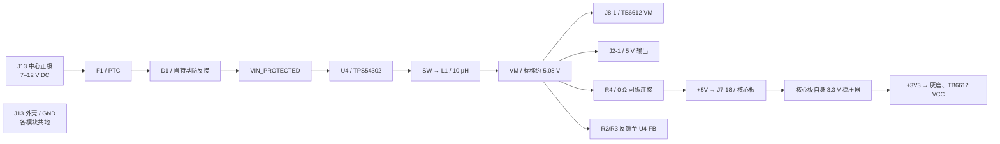

# A10 已下单后的电气功能终审

日期：2026-10-17。用户确认本次订单为 **A10 + SMT**，1×20 排母存在已接受的选料替换。本报告不将该排母换料作为问题。没有访问订单后台，结论针对本地 A10 工程、制造包和配套 BOM/坐标；工厂最终用料与实际贴装尚无读回证据。

## 结论与处理优先级

**未发现电源输入接反、TPS54302 引脚错接、反馈分压接错、电机驱动信号串接错误、供电网络短路或断路等确定性电气硬伤。** A10 降压拓扑和主要阻容值有原厂参考设计依据，标称输出约 5.08 V，接口网络与当前固件一致。

**目前能够确认的是设计连接正确，不能确认实物降压已经正常，也不能确认这块板能持续带两个电机输出 3 A。** 仍需落实核心板 3.3 V 负载余量、两个电机的启动/堵转电流，以及上电、负载阶跃和温升结果。没有发现仅凭此次文件检查就必须撤单的确定性电气错误；这不构成满载或实车放行。

| 优先级 | 事项 | 已确认事实及处理 |
| --- | --- | --- |
| 接电脑前必须处理 | R4 会连接两路 5 V | R4 是 VM—+5V 的 0 Ω 连接，无自动切换。正常 DC 供电时装上；核心板 USB 供电前拆下。不能用“DC 已拔掉”代替拆 R4，因为 USB 仍会通过 R4 给 VM 母线送电。 |
| 接入模块前确认 | 3.3 V 来自核心板 | 载板没有独立 3.3 V 稳压器。核心板稳压器需承担 MCU、灰度模块及 TB6612 逻辑负载。现有资料不足以核算该稳压器的电流和温升余量。 |
| 带电机前确认 | 电机启动/堵转电流 | 降压芯片 3 A 和驱动器峰值电流均不能替代实际负载核算。两个电机、核心板和外围共享降压输出能力；TB6612 的单通道能力还要分别满足。 |
| SMT 审核关注 | U4 型号、方向及既有警告 | 本地料号为 TPS54302DDCR / C311983，A10 焊盘为约 0.60×1.10 mm、节距 0.95 mm、排距 2.70 mm；坐标为顶面 0°，1 脚在芯片左下方。原理图仍有 1 条 U4 `ATTRMATCHCODE` 属性警告，未证明其原因已消除。实际工厂选料和器件 1 脚方向仍需按这份资料核对。 |
| 稳定性验证项 | 降压布局不等于动态性能验证 | 输入小电容较近，输出电容及反馈回路仍有优化空间，详见下文。现有地铜连通，但没有环路增益、纹波、启动过冲或负载阶跃实测。 |

## 本次实际执行的核查

重新运行 A10 的 `verify_design.py`、`verify_copper.py`、`verify_local_clearance.py`，均通过。并新增只读的 [audit_electrical.py](../hardware/stm32PCB-A10/audit_electrical.py)，直接解析原生 PCB 的最终对象、封装和逐脚网络，避免仅依赖先前报告。

- **32 个器件、143 个引脚**：由原生封装变换得到的位置/旋转/焊盘尺寸与 PCB 快照对应；原生 `PAD_NET`、PCB 快照、原理图网表逐脚一致。
- **48 个网络**：对原生铜几何检查连通与异网交叠，未发现断开的铜组或异网短路。包括 363 段原生铜线、65 个过孔、4 个地铜区域；快照记录 359 段线，原生工程另有 4 段长度不足约 0.002 mm 的极短同网段，本次也纳入检查。
- 几何连通允许 0.005 mm 坐标容差；异网短路检测采用大于 0.0001 mm² 的交叠面积阈值。检查结果受几何模型和阈值限制，不能替代成品板电测。
- A10 原生 BOM、标准 SMT BOM 均为 19 组/32 个器件；32 行坐标与对应 PCB 一致。用户已接受的排母替换不影响本报告的板上网络判断，但本次未检查工厂实际替换后的订单 BOM。
- Gerber 的关键焊盘、模块孔距、并联电源过孔和配套坐标检查通过。C1/C2 四个焊盘到异网铜最小值约 **0.2996 mm**，C2 地端到 AIN1 约 **0.3545 mm**。
- 保存的严格 PCB DRC 为 0 项；保存的原理图 DRC 为上述 1 条 U4 属性警告。本次没有启动实时 EDA 会话重新运行原生 DRC，不能将读取旧 DRC 记录描述为实时 DRC。

本次原生复核结果及 SHA-256 见 [A10-final-electrical-evidence.json](A10-final-electrical-evidence.json)。所有检查只涉及设计文件，没有烧录、上电或驱动电机。

## 电源输入与降压回路



电源正极路径为 `J13.1 → F1.1/F1.2 → D1.2（阳极）/D1.1（阴极）→ U4.3`。D1 的阴极朝降压输入侧，方向正确。J13.2 为 GND，J13.3 切换触点未使用。J1 是 +5V 输出、J2 是 VM 输出，均不能接入 7–12 V 电池。

对照 [TI TPS54302 原厂手册 Rev. C](https://www.ti.com/lit/ds/symlink/tps54302.pdf) 的引脚功能、5 V 参考设计和布局章节，逐项核对：

| 项目 | A10 的实际连接/数值 | 结论 |
| --- | --- | --- |
| U4.1 | GND | 正确 |
| U4.2 | BUCK_SW → L1.1 | 正确，电感接开关节点 |
| U4.3 | VIN_PROTECTED | 正确，接防反接后的输入 |
| U4.4 | BUCK_FB | 正确，接反馈分压中点 |
| U4.5 | EN 悬空 | 手册允许的启用方式，不是漏接导致无法启动 |
| U4.6 | BUCK_BOOT | 经 C8 跨接到 SW |
| C8 | 100 nF，BOOT—SW | 正确；没有误接到地 |
| L1 | 10 µH / SRP1038A-100M | 与 5 V 参考值一致；该型号的额定/饱和电流不能解释为全板输出额定值 |
| C5/C6/C7 | 输入 22 µF×2 + 100 nF | 前两颗 25 V，小电容 50 V；适用于本项目 7–12 V 输入意图 |
| C9/C10 | 输出 22 µF×2 / 25 V | 与参考标称总容值一致；有效容值仍受直流偏压、温度和容差影响 |
| R2/R3 | 上臂 100 kΩ / 下臂 13.3 kΩ | 分压方向正确 |
| C11 | 75 pF，并联 R2 | 与参考补偿值一致 |

按典型反馈基准计算：`Vout = 0.596 × (1 + 100 / 13.3) = 5.0772 V`。这只是标称计算值，不是测量值或输出精度保证。

7–12 V 是本项目外部输入范围。芯片能在更宽范围内工作，并不意味着全板可按芯片最大输入电压使用；输入电容、PTC、连接器及浪涌余量也约束整板范围。输入经二极管和 PTC 后有压降，电池低电量及电机启动时必须保证 U4 输入仍有降压余量。本板也没有用 EN 实现电池欠压截止。

## 降压布局与供电能力的保留项

读取原生焊盘坐标得到：U4 VIN 至 C7 输入焊盘中心约 **1.81 mm**，至 C5 输入焊盘约 **3.89 mm**；U4 GND 至 C9 GND 约 **18.84 mm**，U4 FB 至 R2 反馈端约 **4.68 mm**。这些是焊盘中心直线距离，不是走线长度或电流路径长度。

输入去耦有近端 100 nF，并配有大容量陶瓷电容。输出电容布置在大电感输出附近，但离 U4 较远；反馈下臂的地通过公共地铜接入，未实现独立返回 U4 地脚的专用 Kelvin 线。地铜与接地过孔连通，因此不能据此判定降压一定无法工作；同样，静态连通也不能证明开关噪声、负载动态或温升合格。

TI 建议缩短开关节点、输入输出电容靠近器件、反馈远离开关节点并采用合适的地参考。A10 尚需通过空载和分级负载、启动/停机、两个电机负载变化时的输出纹波/压降及温升来验证。若后续再改版，可优先缩紧功率回路并优化反馈取样与地回路；本次未修改已下单的 A10。

F1 为输入端 PTC，不是精密输出限流器；不能由其 3 A 保持电流推导输出恒定 3 A。TB6612 的单通道电流和热耗散限制独立于降压能力。[东芝手册](https://toshiba.semicon-storage.com/info/datasheet_en_20141001.pdf?did=10660) 的工作范围给出相应条件下约 1 A/通道，1.2 A 为绝对最大平均额定、3.2 A 为限定时间的单次脉冲值，均不能当作双通道连续带载承诺。

## 接线与固件对应

以载板顶面朝向观察者、FRONT 在上为准：

| 功能 | 核心板 GPIO / 供电 | 载板去向 |
| --- | --- | --- |
| 灰度 S0…S5 | PA0…PA5 | J10.3…J10.8 |
| 灰度 S6 / S7 | PB0 / PB1 | J10.9 / J10.10 |
| 左 PWM / 右 PWM | PA6 / PA7，TIM3 CH1/CH2 | J9.1 PWMA / J9.7 PWMB |
| 左方向 | PB12 / PB13 | J9.3 AIN1 / J9.2 AIN2 |
| 右方向 | PB14 / PB15 | J9.5 BIN1 / J9.6 BIN2 |
| 驱动使能 | PB5 | J9.4 STBY，并由 R1 10 kΩ 下拉 |
| 启停按键 | PB10，内部上拉 | SW1 按下接地 |
| 左电机 | TB6612 AO1 / AO2 | J3.1 / J3.2 |
| 右电机 | TB6612 BO1 / BO2 | J4.1 / J4.2 |
| 驱动电机供电 | VM，约 5.08 V | J8.1 |
| 驱动逻辑供电 | +3V3 | J8.2 |
| 灰度供电 | +3V3 / GND | J10.1 / J10.2 |

J9 上排从左到右：`PWMA, AIN2, AIN1, STBY, BIN1, BIN2, PWMB, GND`。

J8 下排从左到右：`VM, VCC, GND, AO1, AO2, BO2, BO1, GND`。注意 **BO2 在 BO1 左边**；电机端子 J4 已按 BO1/BO2 接出，并没有因此把右电机两端串接到别的信号。

J10 顶视从左到右是 `S7…S0, GND, +3V3`，对应丝印 `8…1, GND, VCC`。应按模块实际端子标注连接；不能把插座从左到右的排列直接当成传感器阵列从车体左到右的顺序。固件仍要求传感器物理左到右为 S0…S7，且模块输出为兼容 3.3 V 的数字信号。

两组模块双排间距均为 15.24 mm，单排节距 2.54 mm。STM32 顶视方向为 USB 朝左、SWD 朝右。TB6612 是模块而非直接焊裸芯片，裸芯片手册不能证明任意模块的排针排列相同；A10 保留 A9 按用户反馈修正的模块方向，实物试插和逐脚对标仍未完成。

SW1 已目视核对 [XKB 原厂触点/焊盘图](../hardware/stm32PCB-A7/references/SW1-C318884.pdf)：顶视上排 A/B 常通、下排 C/D 常通，按下连通两组；A10 上排接 BTN、下排接 GND，没有把同一组常通触点误当成开关两端。R1 的 STBY 下拉与固件上电停止意图一致，不能由设计记录代替实际上电停车验证。

## SMT 与到板后的验证入口

本地 A10 Gerber 的 SHA-256 为 `83d50edf1b0bb55356c1f119f26922bca2160ca50aebe4ea6b68a1b5fa27316c`，与根目录旧 `Gerber_PCB1_V5.zip` 不同。用户已确认订单为 A10，本次不再用旧包作为基准；但没有从订单后台下载制造数据进行逐字节比对。

尚存的 J13 槽孔与厂家图小差异见 [原 BOM 核查](BOM_5406283A_Y1-review.md)：焊盘 2/3 槽长约 3.3 mm，厂家图约 3.5 mm，中心距也有约 0.1 mm 差异。它属于连接器插装/工艺确认项，不改变本次确认的正负极网络；仍不能宣称该 DC 插座的实际插装已验证。

到板后建议顺序如下，均为后续验证建议，本次未执行：

1. 不插核心板、TB6612、灰度和电机，先检查焊接、D1 极性、U4 方向及电源对地短路，再从 J13 使用有电流限制的电源供电；确认 VM 和 R4 后的 +5V 约为 5.08 V。**空载载板没有 3.3 V 是预期现象**。
2. 断电插核心板，确认 +3V3 建立且无异常发热；逐步接灰度与 TB6612，核实 VCC 为 3.3 V、VM 为约 5 V、STBY 默认低。使用 USB 供电前拆 R4。
3. 先核对灰度的实际端子、白/黑输出和八路左右顺序，再按既定授权阶段架空检查轮向。带电机前取得电机额定/堵转电流；负载试验逐级进行，观察供电压降、纹波和稳压器/驱动器温升。

复核命令：

```sh
python3 hardware/stm32PCB-A10/verify_design.py
# 以下脚本需要 Python 可导入 Shapely 2.x
python3 hardware/stm32PCB-A10/verify_copper.py
python3 hardware/stm32PCB-A10/verify_local_clearance.py
python3 hardware/stm32PCB-A10/audit_electrical.py
```

本报告不修改 Gerber、BOM、贴片坐标、原理图、PCB 或固件；不重下单、不联系工厂、不操作硬件。`hardware_tested=false`，`power_load_and_thermal_test_completed=false`。
