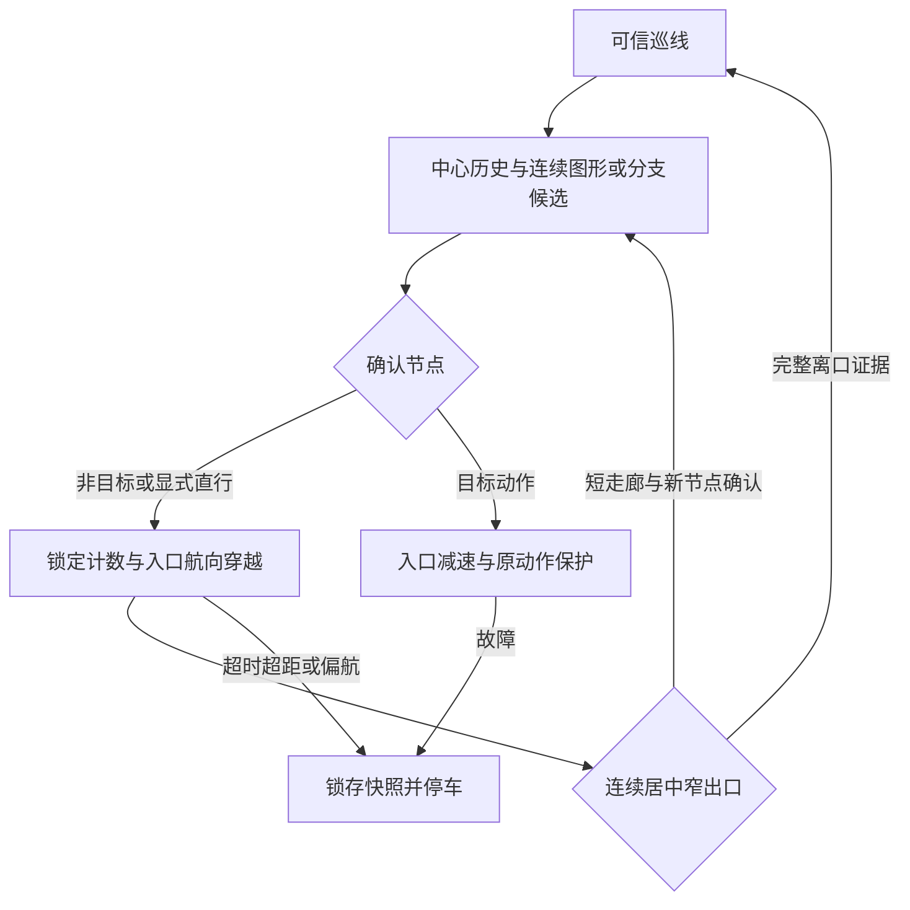

# 元器件与路口统一计数

基线：main `4857be61d38434087a13cdd96ffa95b37f439098`。依据：[校赛计划新增方案](https://app.notion.com/p/3f8c2c8fcde6800783fee3745c60f292)、[规则与原始图示](https://app.notion.com/p/3f7c2c8fcde681c8ba24dcd51c149a25)。本轮仅代码与软件验证，不烧录或操作电机。

## 图示如何映射到算法

| 图示 | 可出现的八路形状 | 处理与限制 |
| --- | --- | --- |
| 电阻 | 横向边框、两侧分离线、部分边缘线 | 新增多个宽度至少2路的连续组候选，如0x66；已确认后锁定直行，拒绝追随侧边。 |
| 电源 | 长短横条、条间无线、另一根横条 | 宽条可确认节点；条间失线不追加计数、不重新给予预算，整组图形连续锁定。 |
| 三极管 | 单侧、中心加分支、分离区域 | 图示本身是T形分支，沿上下通道正反向可能经过，基极进入时需按路线选择出口；真实分支沿用原检测与转向。 |

检测对左右镜像对称，也不依赖先遇到电源长条还是短条。当前8位数字阵列无法证明观测来自哪种电气元件；单区域窄图形可能与白线完全相同，宽条也可能与十字路口完全相同。这些都不是元件分类保证。

## 候选、计数与目标动作

保留最近连续居中窄线历史、相邻采样不超过15 ms、真实前进、侧别连续与曲线横移抑制。新增图形候选为单一区域宽度大于3路，或每个区域都至少2路的多个连续区域；已有路口拓扑候选优先。三块纯孤立噪点、无线与单根窄线不取得新增图形资格。新增图形采用4帧/0.15 cm，在100 ms内确认；不是扩大普通失线预算。

所有确认事件共用 `junctions_seen`。非目标事件固定 STRAIGHT；元器件需单独占一个表项时用 STRAIGHT。到目标序号才执行表中动作。明确图形候选不允许执行转弯或最终STOP，配置矛盾以 `ROUTE_FAILURE_NODE_TYPE=15` 停车；未知全宽形状仍只能依赖路线计数约束，不能声称已辨认元件。

```c
// 仅演示：两个元器件各计一次，第三个节点左转；不是现场地图。
{3, 50.0f, LEFT, 50, 0.0f, false, 0.0f},
// 若单独配置一个已知元件为动作目标：
{1, 50.0f, STRAIGHT, 50, 0.0f, false, 0.0f},
```

当前 `route_table.c` 保留原六项与计数，尚无现场元件位置，必须按新节点序列重标；不能把旧数值当作正式比赛路线。距离始终只影响速度规划，不补计或触发转向。

## 独立的直行穿越

`ROUTE_CLEARING + component_pass_active` 是正常直行节点的穿越子过程。它保存候选之前最近可信入口航向，冻结并清理位置PID，保留编码器速度内环，用当前IMU航向或当帧连续降级的编码器航向产生左右轮目标差。目标不固定为同一PWM。

| 参数 | 初值 / 用途 |
| --- | --- |
| COMPONENT_PASS_SPEED_CM_S | 60 cm/s，还受巡航、JUNCTION_PASS_SPEED_CM_S、启动包络及下一目标减速限制 |
| COMPONENT_PASS_TIMEOUT_MS | 1500 ms，单次固定预算，孤立中心帧与形状变化不能续期 |
| COMPONENT_PASS_MAX_CM | 20 cm，15 cm元件包络外留检测及出口确认余量，需实测 |
| COMPONENT_PASS_HEADING_MAX_RAD | 0.35 rad，航向偏差先到同样停车 |
| ROUTE_FAILURE_COMPONENT_PASS | 14，超限先于当帧出口接受 |

原 `component_recovery` 仍只服务转弯出口/其他未进入新穿越的离口恢复，上限16 cm/s、1200 ms/12 cm，不被替换成高速值。未知长度的下一转弯末段仍从倒数第二节点穿越期提前减速；已测末段仍在离口后按原距离包络规划。速度上限不等于实测轮速，真实制动距离需标定。

出口必须是居中、单区域、至多3路，连续至少3帧，持续50 ms且前进2 cm，才恢复位置PID和重新允许普通计数。在此之前即使出现一根侧边窄线也保持入口航向。若稳定中心走廊至少20 ms/0.30 cm后出现新的分支或图形，先积累其连续确认，再交接下一节点，避免固定2 cm吞掉紧邻的转弯。形状相同的图形内部走廊仍有误分段风险，不能以本规则保证所有图形只计一次。



## 验证与实车边界

`test_component_nodes.c` 覆盖电阻/电源特征顺序及其反向和左右镜像、全排/部分多区域、连续元件到目标转弯、一次计数、居中出口、防噪声/静止/采样中断、目标类型冲突、短相邻节点、穿越速度和航向控制、故障锁定。特征序列是依据图示构造的合成输入，并非实车GPIO记录或按尺寸完成的光学仿真。

停车快照增加穿越活动、年龄、距离与节点证据类型；导航环形轨迹增加穿越状态、节点类型和左右轮目标。结构变化后必须使用对应ELF解释RAM。

实车仍须采集正反向GPIO序列，逐一验证电阻侧框、电源条间空隙、三极管各进出端、连续短节点与STOP前元件，先低速再提高速度。编码器反馈、控制时序、可用时俯仰和既有转弯保护保留；不启用新的反向制动力矩，不允许STOPPED自动恢复。路径关闭时继续原仅巡线模式。
