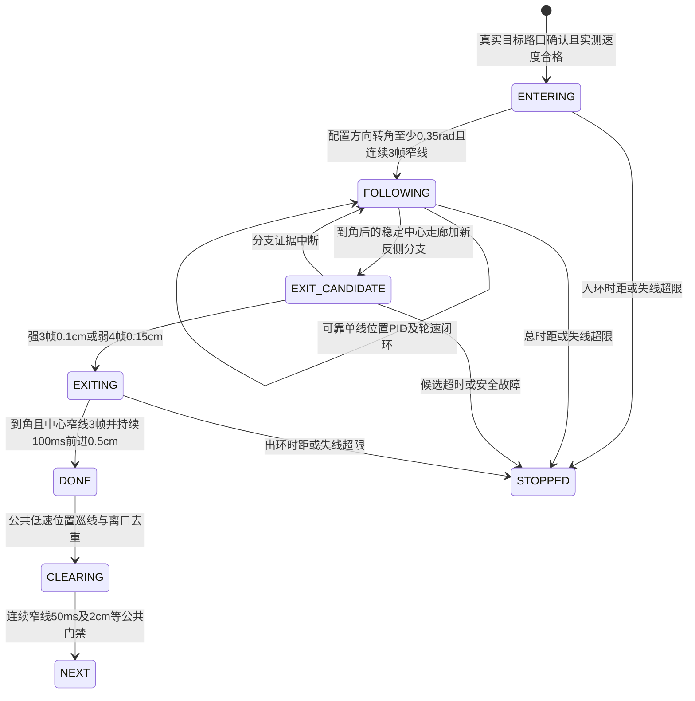

# HEXAGON 六边形环岛

2026-11-03：源码与主机逻辑实现完成，未烧录、未读取或操作硬件。当前实际路径表保留。进度与验证入口见 [hexagon-progress.md](hexagon-progress.md)。

## 路径调用

字段仍为 `{路口数, 转弯速度, 动作, 巡航速度, 角度, 圆弧开关, 末段实测长度}`。仅在 `ENCODER_CONTROL_ENABLED=1` 和 `PRESET_ROUTE_ENABLED=1` 下执行。

| 顺序 | RouteStep 字段 | 示例值与含义 |
| --- | --- | --- |
| 1 | `junction_count` | `1`：离口后第一个确认路口入环 |
| 2 | `turn_speed` | `12.0f`：入口及动作轮速表内上限，cm/s |
| 3 | `action` | `HEXAGON` |
| 4 | `cruise_speed` | `40`：路段巡航目标，cm/s |
| 5 | `angle_deg` | `-300.0f`：左绕最小净航向变化，度 |
| 6 | `corner_arc_enabled` | `false`：HEXAGON 不使用普通90°圆弧 |
| 7 | `final_segment_length_cm` | `0.0f`：不启用末段距离规划 |

```c
#include "route.h"
/* 示例，按实际赛道选择；没有替换 src/route_table.c 中的用户表。 */
const RouteStep example[] = {
    {1, 12.0f, HEXAGON, 40, -300.0f, false, 0.0f},
    {1, 12.0f, STOP,    40,    0.0f, false, 0.0f},
};
/* 顺时针绕行：把 -300.0f 改成 +300.0f。 */
```

`junction_count=1` 表示上次动作离口后确认的第一个真实路口为入环口；入环前经过的非目标路口仍只计一次并直行。环内分支不增加路径路口计数。正常出环并完成公共离口去重后，才推进到下一项。

`angle_deg` 为动作真正开始（必要的入口降速之后）起，沿配置方向的**最小净累计航向变化**，右正左负，合法绝对值 60～720°。它包含入环引导的转角，不是六边形顶点数，不是必须精确转到的目标终点，不做 ±180°/360°取模，也不累计左右抖动的绝对值。例子 -300° 只解锁左绕净转角达到300°之后的新出口检测；不保证该角度就是实际赛道正确出口。HEXAGON 必须 `corner_arc_enabled=false`。末段长度0禁用距离规划；非零仍需要现有实测制动标定门禁。最后一项仍必须STOP；当前 `ROUTE_REPEAT_COUNT=0` 的循环语义保持。

## 状态与控制

外层处于 `ROUTE_EXECUTING`，独立子状态见 `RoutePlanner.hexagon`。



入环/分支选择采用配置方向的低速引导；环上可靠单一区域至多3路目标线使用位置PID，并带当前航向源的角速度阻尼。具体地，`hexagon_update()` 连续3帧窄线设置 `use_line=true`，控制器使用 `pid_update(obs.position,dt,...)`；正常 FOLLOWING 不叠加持续的同向固定转弯量。仅入环，或 FOLLOWING 的非零异常观测且窄线连续证据清零时使用方向引导；完全无线及出口候选采用保持航向，均受时距边界限制。分支歧义时冻结位置PID，不把多区域的平均位置当成有效线；已确认出口分支采用切线航向保持，待连续窄线恢复后由位置PID接管。双轮速度目标非负，动作外轮目标不超过 `min(turn_speed, HEXAGON_SPEED_CM_S, JUNCTION_SETTLE_SPEED_CM_S)`，当前不超过16 cm/s。目标限速不等于实测轮速已达到。

出口检测要求到角后先观察到稳定居中窄线，再出现绕行反侧的唯一分支（右绕看左分支，左绕看右分支）。中心历史仍受250 ms/1.5 cm约束。到角前已在视野内的分支不能延续至到角后直接获准。强中心分支3帧/0.1 cm，边缘或分离弱证据4帧/0.15 cm，候选最长100 ms；双侧/三区域、单帧、无前进均不能直接确认出口。到角但持续单线不判成功；出口中心证据中断清零，退出确认期间仍须满足完整配置角度，不使用普通转弯95%豁免。

拓扑假设：入口选择角度符号对应的环支路；环上存在可循迹单线；出口是当前切线的直行延续，并出现绕行反侧分支。用户图中“右侧顶点接上下直线”仅描述全局接线位置，不能据此确认入环方向或出口在探头下的相对分支侧；只有到达右侧出口时外接线满足上述切线延续和反侧分支、且到角后还有中心走廊供建立新出口资格，当前策略才适用。未重新取得或验证赛道图尺寸、连接角与逐帧数据，300°只是调用示例。软件不识别六条边或六边形几何形状。实际出口若不是该拓扑，应调整分支/引导策略。矩形图形可能产生相同证据，主机合成测试不能证明其可区分性。

## 有界保护

| 范围 | 当前初值 |
| --- | --- |
| 入环阶段 | 3000 ms / 30 cm，任一先到停车 |
| 入环尚未捕线 | 1200 ms / 12 cm，任一先到停车 |
| 环岛总动作 | 30000 ms / 400 cm，任一先到停车 |
| 确认出口分支后的出环 | 3000 ms / 30 cm，任一先到停车 |
| 已捕线后的失线/歧义 | 400 ms / 8 cm，任一先到停车 |
| 过转 | 超过配置最小角度再120°停车 |
| 错向 | 相对动作入口的方向归一化净转角低于 -0.35 rad；不是逐帧反向增量门禁 |

已捕线后图形允许继承单次12 cm/1200 ms低速航向恢复；仅无线不能获得额外预算。恢复期限先于恢复成功，期间分支噪声不能绕过期限或取得出口资格。孤立有效帧不刷新失线时距；连续线恢复才刷新。公共离口1500 ms/20 cm、编码器反馈/反向、俯仰锁存、调度故障与人工停止继续生效。IMU有效时用IMU，首帧失效锁定编码器且连续累计航向，START不解除降级。停车不自动续跑。

## 参考与验证

已通过 GitHub API / raw URL 读取指定仓库的 [CircleHandler.c](https://github.com/Rema1nder/Maybach-S680/blob/main/User/CircleHandler.c)。留存目录清单 `hexagon-reference-tree.json` 和只读源文本 `hexagon-reference-CircleHandler.c.txt`。借鉴分阶段入环/沿环/出环、方向分支与出环连续确认的结构。参考实现使用16路ADC、LSM6DSR，当前部分出口按里程/光电触发，且超时调用完成；本工程保持8路GPIO、现有MPU6050/编码器航向，并要求角度加真实出口证据，超限停车。未直接移植其硬件接口或超时成功逻辑。

`test/test_hexagon.c` 已纳入 `sh test/run_host_tests.sh`，两极性×IMU关/开均使用ASan/UBSan，检查左右镜像、到角持续单线不出环、旧分支不挪用、出口证据中断、非目标计数、入口过速、时距/错向/过转/NaN、图形单次恢复及期限、控制器轮目标、IMU当帧连续降级和任务故障锁定；同时调用已有导航回归。完整主机套件退出0，日志73行包含PASS（其中HEXAGON执行会额外打印其调用的通用导航结果）；四种HEXAGON组合打印9141/9145/9141/9145项检查，包含通用导航检查数，不称为独立六边形用例数。

`pio run` 首次因全局平台锁写权限失败；使用项目内缓存入口 `PLATFORMIO_CORE_DIR="$PWD/.pio/hexagon-core" pio run`，复用本机已安装工具链后成功。Flash41248 B、RAM10340 B。日志见 `hexagon-host-tests.log`、`hexagon-build.log`。RAM布局因子状态字段而变化，后续诊断必须保留读取时ELF。

余项仅为实际赛道拓扑、角度/距离尺度、轮速跟随、图形区分与控制周期耗时的硬件验证；本轮没有执行硬件操作，不能宣称实车成功。
