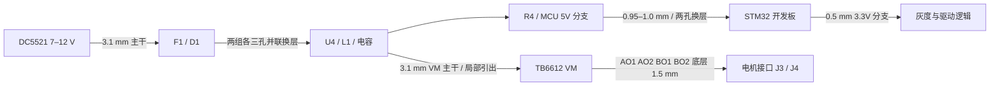

# STM32 巡线载板 A5：电源与电机输出布线修正

2026-10-16，根据用户提供的 `IMG_0964.PNG`、`IMG_0965.PNG`、`IMG_0966.PNG`、`IMG_0967.jpg` 中的评审意见修改。A5 是完整、可继续编辑的独立工程；A4 实时工程及历史归档保留。固件、模块针序、100 × 90 mm 板框、2.54 mm 单排针距和两组模块 16.00 mm 排距保持原设计。

打开 [stm32PCB/stm32PCB.eprj3](stm32PCB/stm32PCB.eprj3)，或解压 [stm32PCB-A5-project.zip](stm32PCB-A5-project.zip) 后打开同名入口。目录内直接打开的工程与 ZIP 在交付时一致。

## 对评审意见的落实

| 评审意见 | A4 回读 | A5 修改 |
| --- | --- | --- |
| 电源主路太细 | 输入与 VM 主干约 1.5 mm；U4 SW 到 L1 约 0.5 mm | DC_RAW、DC_FUSED 及 VIN / VM 主要承流段加至 3.1 mm（约 122 mil）；局部按焊盘/相邻脚间距收窄 |
| U4 周边电源瓶颈 | VIN 接 U4 约 0.45 mm；SW 主路 0.5 mm | VIN 接 U4 约 1.0 mm；SW 主路采用 0.55 → 1.4 → 3.1 mm，短距离引出后扩宽到电感。自举支路仍为小电流支路，不把所有 SW 分支都误作主路 |
| 入口有悬空过孔 | VIN 三孔入口最左孔没有底层主干接线，不能有效分担电流 | 入口和靠近输入电容处各 3 个约 0.4 mm 孔径 / 0.9 mm 外径过孔，两组均有顶/底连接铜路；逐孔检查双面接入 |
| 电源换层要用并联孔 | MCU 5V 分支有单个过孔，且布线回读存在细线与冗余过孔 | 改为 2 个约 0.4 mm 孔径 / 0.9 mm 外径过孔，并以 0.95–1.0 mm 铜路连接到 MCU 5V；输入/输出电容及芯片地也补充就近回流孔 |
| AO/BO 四线同层 | AO1/BO1 底层，AO2/BO2 顶层，均约 1.0 mm | 四路均在底层，线宽 1.5 mm（约 59 mil），直接到 J3/J4，无换层过孔；AO2/BO2 从接插件外侧绕行 |
| 其他细线让开功率线路 | 部分控制线占用输出走线区域 | 按固定功率布线重新布信号，保留原网络定义；3.3V 分支全部加至 0.5 mm，重新生成双面地铜 |

截图提出的“每安培 40 mil”和“两个 12 mil 内孔”作为本次布线评审目标。3 A 主干的目标宽度为 120 mil = 3.048 mm，因此采用 3.1 mm；电源换层孔采用约 0.4 mm（15.8 mil）孔径。芯片脚、输出排针、去耦和逻辑支路存在不同的局部尺寸约束，不据此推断它们都能独立输出 3 A。J1/J2 仍为 5V 测试/辅助输出，不能当作各自额外具有 3A 配额的电源口。

上述经验尺寸不是温升测试结果。TI 对 TPS54302 的布局要求是 VIN/GND 尽可能宽、SW 短且宽、输入输出电容就近并提供足够过孔，反馈远离开关节点；参见 [TI TPS54302 数据手册，7.4 Layout](https://www.ti.com/lit/ds/symlink/tps54302.pdf)。芯片焊盘处保留短引出再放宽，同时不扩大无关的自举和反馈支路。

## 验证与文件

- `pcb-drc.json`、`schematic-drc.json`：严格 DRC 记录，均为空数组；PCB 已保存、关闭再打开复查。
- `pcb-state.json`：最终焊盘、走线、过孔、填充、丝印和规则的实际回读。
- `verification.json`、`verify_design.py`：32 个器件、143 个引脚分配、48 个网络的原理图/PCB 对照，针序、16.00 mm 排距、2.54 mm 针距及 Gerber 板框/钻孔复核；另查四路电机输出均在底层且宽 1.5 mm、功率线宽和并联孔数量。
- `copper-verification.json`、`verify_copper.py`：从实际走线/焊盘/过孔及原生 FILL 的全部孔洞重建双面铜几何，独立检查 48 个网络的连通和异网短路。原生 FILL 的孔洞不能从 API JSON 的外轮廓省略推断；本脚本直接读取保存后的原生工程。
- `rule-diff.json`、`rules-before.json`：仅将默认 1oz 走线规则的最大宽度从 2.54 mm 调为 3.81 mm，以允许 3.1 mm 主干；最小宽度、安全间距和连通检查均未降低/关闭。比较已排除浮点格式化误差。
- `PCB-顶层丝印-A5.png`、`PCB-双层布线-A5.png`、`PCB-底层电机输出-A5.png`：原生 EDA 导出预览。底层图采用从顶面透视底铜的观察方式，不能当作翻面焊接的镜像图。
- `stm32PCB-A5.netlist.json`、`stm32PCB-A5.net`：原生与 Protel 网表；`schematics-preview.zip` 和 `SCH_*.png`：三页原理图预览。
- `stm32PCB-A5-REVIEW-ONLY-Gerber.zip`：本版审阅制造数据。ZIP、铜层线宽孔径定义、100 × 90 mm 板框、四个 3.2 mm 安装孔、模块排母孔位置及孔径均有程序复核。

主验证不需要连接开发板：

```sh
python3 hardware/stm32PCB-A5/verify_design.py
```

独立几何复核需要 Python 环境有 `Shapely 2.x`：

```sh
python3 hardware/stm32PCB-A5/verify_copper.py
```

本次使用本机已有 Shapely 环境执行了几何复核，未改动固件，未重复运行固件主机逻辑测试或 PlatformIO 构建。最终统计见 `verification.json`；检查结果只对应本次保存和归档的设计。

## 供电与实物验证边界

电路沿用 A4：DC5521 中心正 7–12 V → F1 / D1 → TPS54302 降压 → 5V VM 母线 → R4 → MCU 5V；开发板自带 3.3V 稳压器供 MCU、灰度与驱动逻辑。器件选型、逐针接线及机械说明见 [A4 历史说明](../stm32PCB-A4/README.md)。上车前仍须确认实物模块的针序、针距、两排中心距及排母高度。



使用开发板 USB 供电前仍须拆下 R4；J1/J2 不得接入 7–12 V。3A 是全板电源的设计目标，未测负载、纹波、启动瞬态、回灌/再生过压和温升。电机额定/堵转电流、TB6612 模块实际散热能力、插座/线缆载流、开发板 3.3V 容量及实物配合仍需确认。

地平面沿用**实心填充区域**，不是可自动重建的覆铜对象。后续移动焊盘或改变走线/过孔后，必须同步重建地铜避让并重新检查，不能直接沿用本次 DRC 记录。

本次未烧录、通电或操作电机。`hardware_tested=false`、`power_load_and_thermal_test_completed=false`、`module_mechanical_fit_verified=false`、`fabrication_release_approved=false`。
